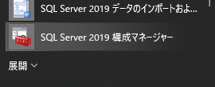
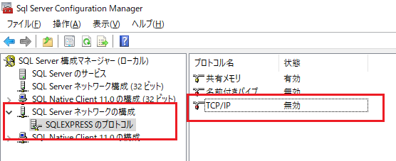
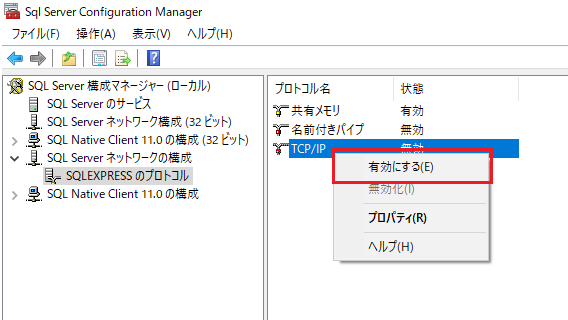
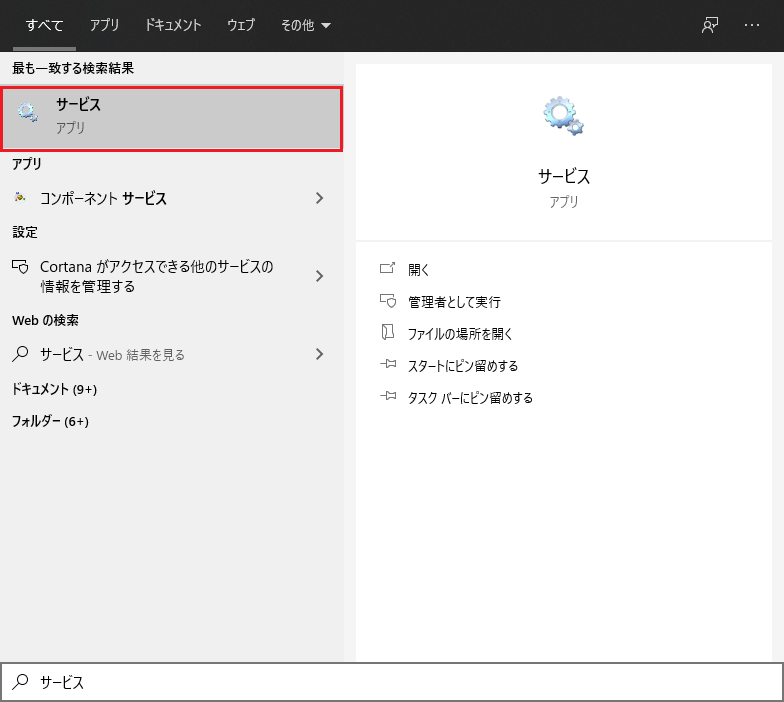
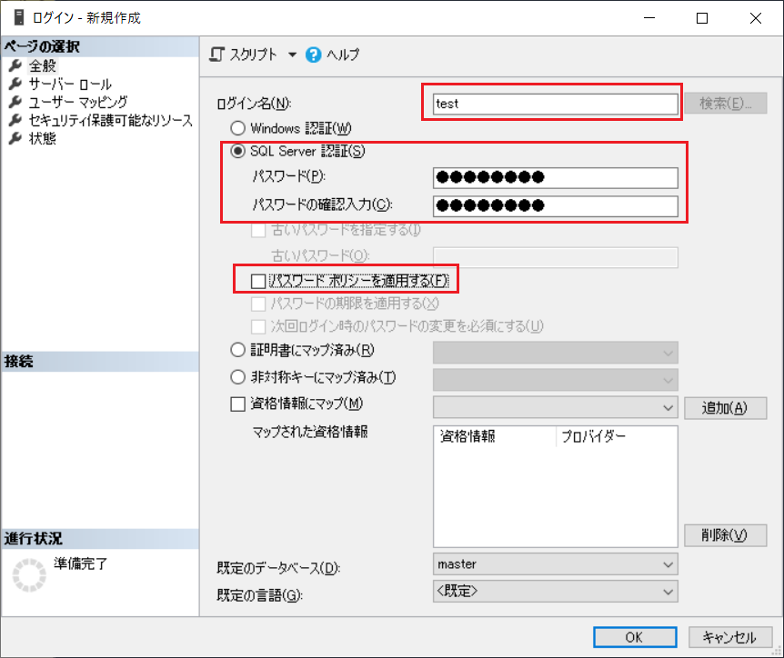
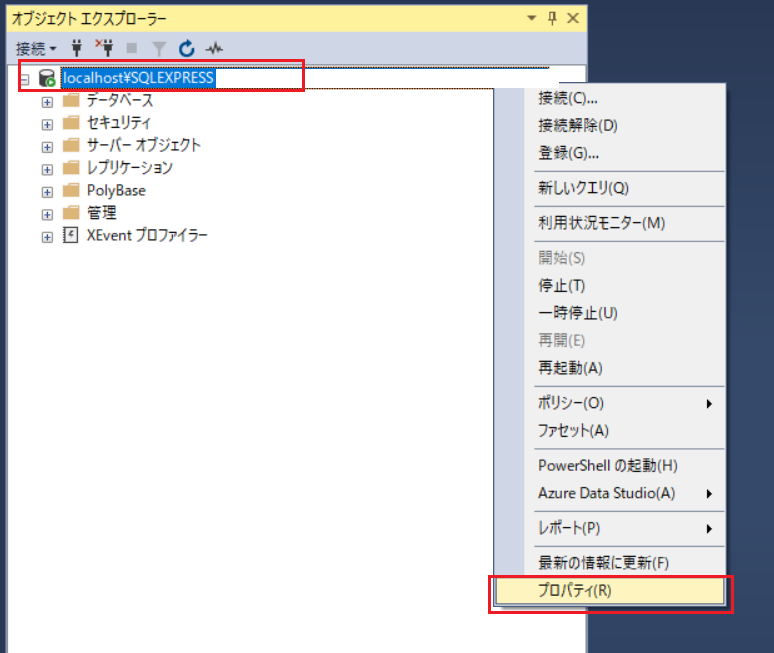
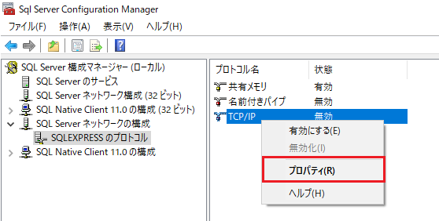
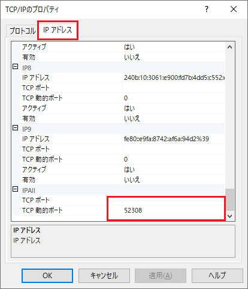
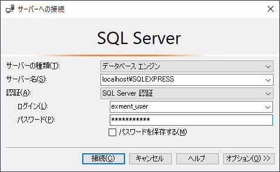
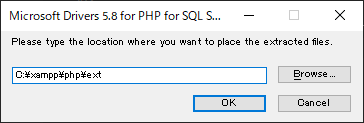

# SQL Serverインストール手順
Exment のデータベースに、SQL Server を使うための手順です。

- <span class="red bold">※現在、バックアップ・リストア機能に非対応です。</span>
- 手順は、OS やバージョン、インストールした時期などによって、違う場合があります。

## 手順の流れ
1. **SQL Server を用意する**（インストール、データベースとユーザーの作成）… 「SQL Server設定」
2. **つながるかを確かめる** … 「接続確認」
3. **Exment からつなぐ**（PHP のドライバーを入れて、Exment をインストールする）… 「Exment設定」

## SQL Server設定

### SQL Serverインストール
1. 次のサイトから、SQL Server をダウンロードします。  
※エディションは、用途や事業の規模などに合わせて選んでください。  
[SQL Serverダウンロード](https://www.microsoft.com/ja-jp/sql-server/sql-server-downloads)  

2. ダウンロードしたファイルを実行し、インストールを進めます。  
  

3. インストールが終わります。

### SQL Server Management Studio(GUIツール)インストール
SQL Server Management Studio は、SQL Server を画面で操作するためのツールです。

- 次のサイトを開きます。  
「使用できる言語」から「日本語」をクリックして、ツールをダウンロードし、インストールしてください。  
https://docs.microsoft.com/ja-jp/sql/ssms/download-sql-server-management-studio-ssms?view=sql-server-ver15#available-languages


### 追加設定(Windows)
※現在、WindowsにSQL Serverをインストールした場合に、下記の設定が必要なことを確認しています。

1. Windows のスタートメニューから、「SQL Server 構成マネージャー」を開きます。  
  

2. 左のメニューで、「SQL Serverネットワークの構成」→「(エディション名)のプロトコル」をクリックします。そのあと、「TCP/IP」を右クリックし、「有効にする」をクリックします。  
  
  
  

3. スタートメニューのボタンをクリックし、「サービス」と入力して、表示された「サービス」アプリを実行します。  
  

4. サービスの一覧から「SQL Server (エディション名)」を選び、「サービスの再起動」をクリックします。  
  


### データベース作成、ユーザー追加
1. 「SQL Server Management Studio」を実行します。  
  

2. ログインします。  
  

#### データベース作成
1. 左のメニューで、「データベース」フォルダーを右クリックし、「新しいデータベース」をクリックします。  
  

2. 任意のデータベース名を入力し、OK をクリックします。  
  

#### ユーザー追加
1. 左のメニューで、「セキュリティ」→「ログイン」を右クリックし、「新しいログイン」を選びます。  
  

2. ログイン名とパスワードを入力し、「SQL Server 認証」を選びます。「パスワード ポリシー」は、チェックを外すことをおすすめします。（所属する会社・組織などのポリシーに従ってください。）  
    

3. 左上の「ユーザー マッピング」を選びます。  
「このログインにマップされたユーザー」のデータベースの一覧で、先ほど作ったデータベースを選びます。  
「データベース ロール メンバーシップ」で、次のものを選びます。
   - db_backupoperator
   - db_ddladmin
   - db_datawriter
   - db_datareader
   - public
   - dbcreator(※手動でのデータのバックアップ・リストアに使用します。手動でのデータのバックアップ・リストアを実施する場合、チェックしてください。)

       

4. すべて終わったら、OK をクリックします。

#### サーバーログイン設定
1. 左のメニューで、左上のサーバーを右クリックし、「プロパティ」を選びます。  
 

2. 「セキュリティ」メニューで、「サーバー認証」に「SQL Server 認証モードと Windows 認証モード」を選び、OK をクリックします。

3. スタートメニューのボタンをクリックし、「サービス」と入力して、表示された「サービス」アプリを実行します。  
  

4. 「サービス」アプリで、もう一度「SQL Server (エディション名)」を選び、「サービスの再起動」をクリックします。  
  

#### ポート確認
- 「SQL Server 構成マネージャー」で、「TCP/IP」を右クリックし、「プロパティ」をクリックします。  
そのあと、「IPアドレス」タブを開き、いちばん下の「TCP 動的ポート」の値を確かめます。（あとで、Exment のデータベース設定で使います。）  
  
  


## 接続確認
SQL Server につながるかを確かめます。

1. 「SQL Server Management Studio」を実行します。  
  

2. 次の内容でログインします。
    - サーバー名：既定のサーバー名
    - 認証：SQL Server認証
    - ユーザー名：作成したユーザーのユーザー名
    - パスワード：作成したユーザーのパスワード

      

3. 正常にログインできることを確かめます。  
設定が正しく終わっていないと、エラーが出ます。


## Exment設定
Exment から SQL Server につなぐための、環境づくりと設定を行います。

### ドライバのインストール
ドライバー（PHP から SQL Server につなぐための部品）を入れます。Exment を入れているサーバーの OS によって、手順が違います。

#### Windows
1. 次のコマンドを実行します。  
結果にファイルパスが出るので、メモします。

```
php -i | find "extension_dir"
# 結果例
extension_dir => C:\xampp\php\ext => C:\xampp\php\ext
```


2. 次のサイトから、PHP から Microsoft SQL Server につなぐためのドライバーをダウンロードします。  
https://docs.microsoft.com/ja-jp/sql/connect/php/download-drivers-php-sql-server?view=sql-server-ver15

3. ダウンロードした EXE ファイルを実行します。次のようなダイアログが出ます。  


4. 手順 1 でメモしたファイルパスを貼り付け、「OK」をクリックします。  


5. SQL Server につなぐための dll ファイルが、PHP の拡張ライブラリのフォルダーに置かれます。  


6. php.ini ファイルを開き、ファイルの最後に、次の内容を書きます。  
※ファイル名は、コメントの内容に合わせて変えてください。

```
extension=php_pdo_sqlsrv_82_ts_x64.dll
# "82"部分：利用しているPHPのバージョン。PHP8.3を使用していれば83
# "ts"部分：コマンド「php -i | find "Thread Safety"」を実施時に、「enabled」と出れば「ts」を、「disabled」と出れば「nts」を記入
# "x64"部分：コマンド「php -v」を実施時に、1行目に「x64」が含まれていれば「x64」を、そうでなければ「x86」を記入
```

7. PHP を再起動します。これで、Windows での設定は終わりです。


#### Linux

[こちら](https://docs.microsoft.com/ja-jp/sql/connect/php/installation-tutorial-linux-mac?view=sql-server-ver15)の手順のとおりに、それぞれの OS に、ODBC ドライバーと PHP ドライバーをインストールしてください。


### Exment設定
- このあとは、[インストール手順](/ja/quickstart)のとおりに、インストールを進めてください。

- データベース設定の画面では、次の値を入力してください。
    - データベースの種類 : SQL Server
    - データベースのホスト名 : サーバー名
    - データベースのポート番号 : TCP/IP画面で確認したポート番号
    - Exment用データベース名 : 作成したデータベース名
    - Exment用データベースのユーザー名 : 作成したユーザー名
    - Exment用データベースのパスワード : 作成したユーザーのパスワード
