# XAMPPによる環境構築
XAMPP を使って、Windows のパソコンに Exment を動かす環境を作る手順です。  
XAMPP は、PHP・Apache・MySQL をまとめて入れられるソフトです。開発用の環境をはじめから作るときに、おすすめしています。

## 注意点
- **XAMPPでのインストールは、開発・検証としてのみご利用ください。本番環境としては利用しないことをおすすめします。** 

## インストール手順
次の順に進めます。

1. XAMPP を入れて、Apache と MySQL を動かす
2. mysql のコマンドを使えるようにする（環境変数）
3. データベースを作る
4. Exment 用の URL を作る（サブドメイン設定）
5. Exment をインストールする

### XAMPPインストール手順
1. 次のサイトから、XAMPP をダウンロードします。  
[XAMPPダウンロード](https://www.apachefriends.org/jp/download.html)

2. 「PHP8.2」以上のものを選んで、ダウンロードしてください。  
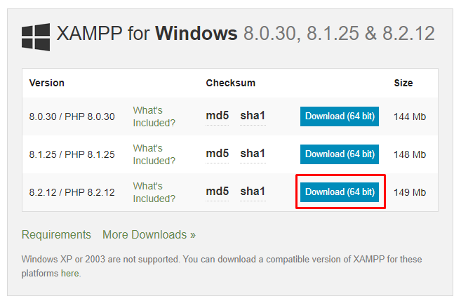

3. XAMPP のインストールを進めます。  
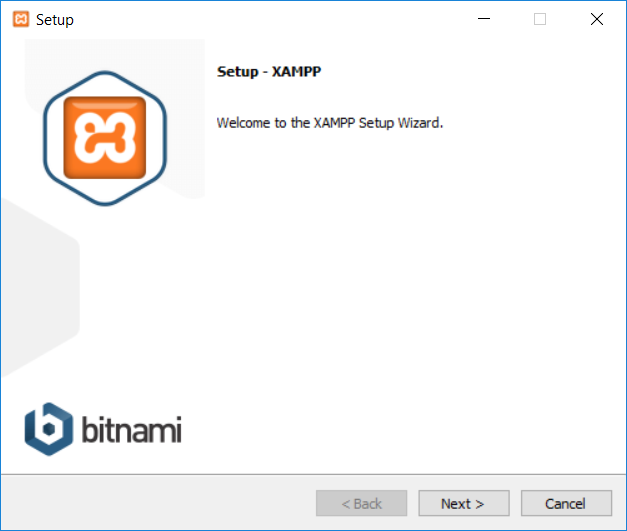

4. 途中で、XAMPP のコンポーネントを選ぶ画面が出ます。Apache、MySQL を選びます。  
「phpMyAdmin」にもチェックを付けます。  
※それ以外は、任意にチェックを行ってください  
そのあと、「Next」をクリックします。  

5. あとは画面のとおりに進めて、インストールを終わらせます。

6. インストールが終わったら、XAMPP コントロールパネルを起動します。  
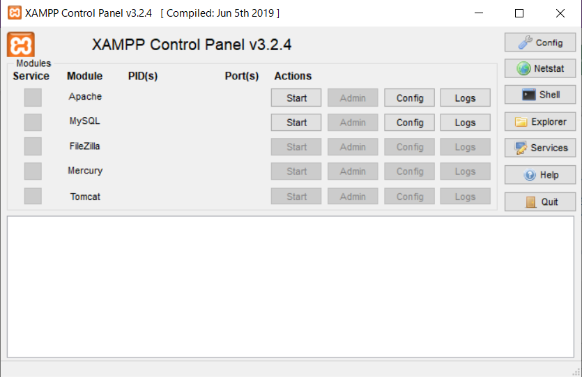

7. いちばん上の「Apache」と「MySQL」の行の、「Start」をクリックします。  
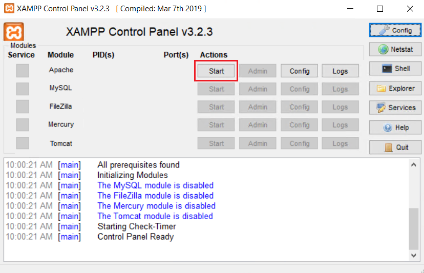

8. ファイアウォールの設定が出た場合は、「許可」をクリックします。  
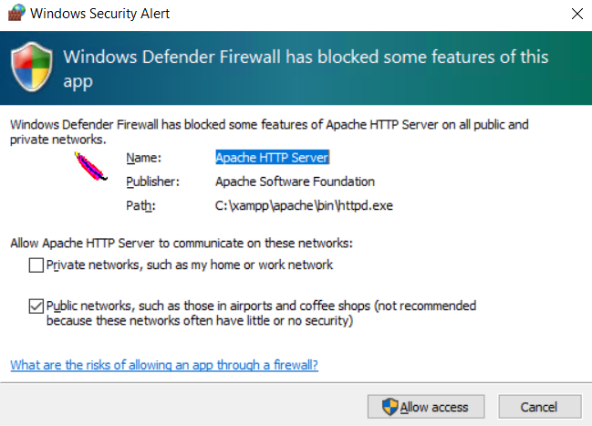

9. これで Apache が動きます。  

#### 【注意点】
- OS を再起動したときは、もう一度 XAMPP コントロールパネルを起動して、Apache を起動し直す必要があります。

### 環境変数追加
コマンドプロンプトから mysql を実行するには、「環境変数」にパスを通す必要があります。

1. エクスプローラーで「PC」を右クリックし、「プロパティ」をクリックします。  

2. 「システムの詳細設定」をクリックします。  
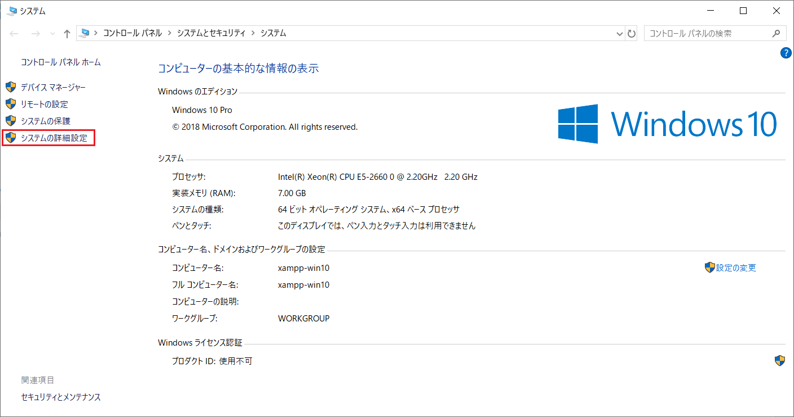

3. 「環境変数」をクリックします。  
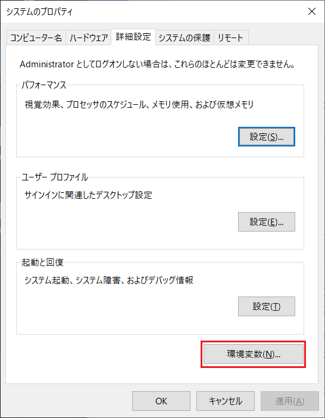

4. 「ユーザー環境変数」の「Path」をクリックし、「編集」をクリックします。  

5. 「新規」をクリックし、次の行を追加します。

~~~
C:\xampp\mysql\bin  
~~~

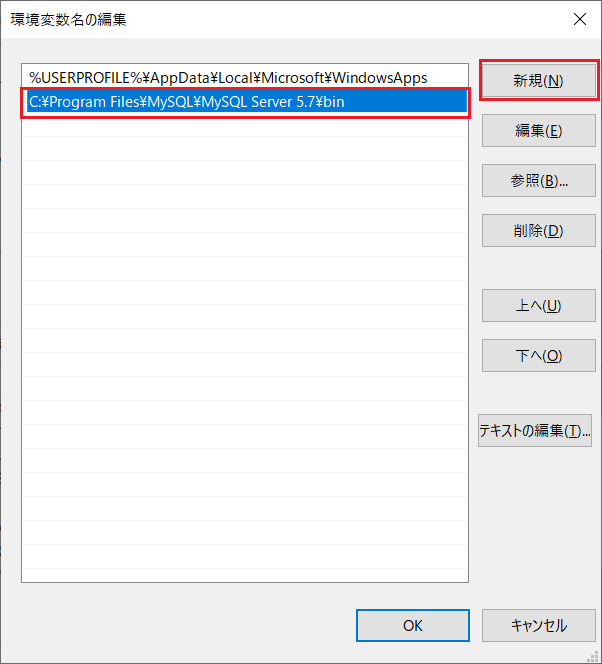

6. 入力したら、開いているダイアログをすべて「OK」で閉じます。

##### XAMPP配下のMysqlを実行する場合
- XAMPP の中の Mysql を実行する場合は、[Exmentインストール](#exmentインストール)の手順のときに、実行ファイルがあるフォルダーまでのパスを、Exment のルートディレクトリにある .env に追加してください。

~~~
#例  
EXMENT_MYSQL_BIN_DIR="C:/xampp/mysql/bin"
~~~

#### データベースを作成
1. XAMPP コントロールパネルを起動し、「MySQL」行の「Admin」をクリックします。  
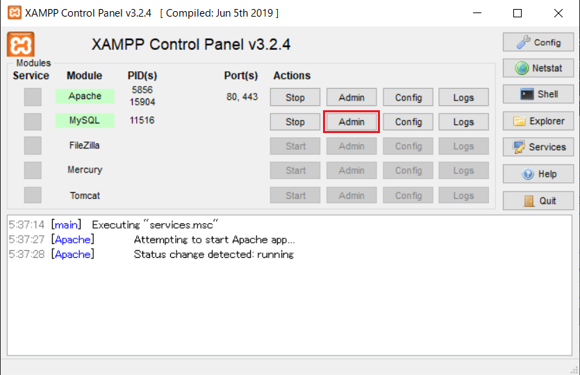

2. 左のメニューの「新規作成」をクリックします。  
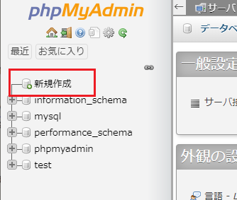

3. 「データベースを作成する」行で、任意のデータベース名を英数字で入力し、「作成」をクリックします。  

これで、データベースができました。

### サブドメイン設定
ふつうの設定では、"C:\xampp\htdocs"フォルダーの中に Exment のプロジェクトファイルを置くと、Exment を使えます。  
しかし、そのままだと、たとえば[http://localhost/exment/.env](http://localhost/exment/.env)の URL を開くと、データベースの情報を含む設定ファイルが画面に表示されてしまうなど、大きな問題があります。  
そのため、この問題が起きないようにする設定を、強くおすすめします。次の手順で設定してください。

1. フォルダー「C:\xampp」に、フォルダー「local」を作ります。  

2. "C:\xampp\apache\conf\extra\httpd-vhosts.conf"を開きます。

3. ファイルの最後に、次の記述を追加します。**※DocumentRootの末尾に「/public」が必要になります**  

~~~
<VirtualHost *:80>
    DocumentRoot "C:/xampp/htdocs"
    ServerName localhost
</VirtualHost>

<VirtualHost *:80>
  DocumentRoot "C:/xampp/local/exment/public"
  ServerName exment.localapp
</VirtualHost>

<Directory "C:\xampp\local\exment\public">
  Allow from all
  AllowOverride All
  Require all granted
</Directory>
~~~

4. "C:\WINDOWS\system32\drivers\etc\hosts"を開き、次のように編集します。  
※このファイルは直接編集できません。デスクトップなどにコピーして編集したあと、元の場所に上書きしてください。  

~~~
127.0.0.1       localhost
127.0.0.1       exment.localapp
~~~

5. XAMPP コントロールパネルで、Apache を再起動します。「Apache」行の「Stop」ボタンをクリックしたあと、もう一度「Start」をクリックしてください。  
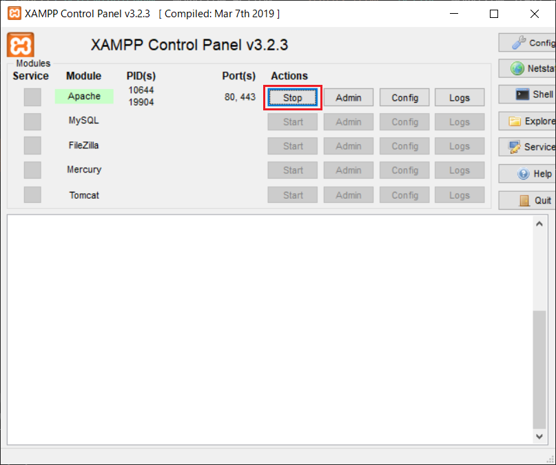

6. これで、次の URL で Exment を開けるようになります。  
http://exment.localapp

### Exmentインストール
Exment の[インストール手順](/ja/quickstart)のとおりに、Exment をインストールします。  
Exment のインストールは、通常"C:\xampp\local"フォルダーの中で行います。  
ここでは、"C:\xampp\local\exment"フォルダーの中にインストールしたものとします。  

- インストールの途中に、データベースの設定を入力する画面があります。次のように入力してください。
    - データベース種類：MariaDB
    - ホスト名：127.0.0.1
    - ポート：3306
    - データベース：（上記で作成したデータベース名）
    - ユーザー名：root
    - パスワード：(空欄)

## PHPバージョンアップ時の対応
PHP のバージョンを変えるときは、次の手順で行ってください。

- バージョンアップの作業中は、Exment にアクセスできなくなります。
- 下の例は、PHP7.4 から PHP8.2 へアップデートする手順です。XAMPP 全体はアップデートせずに、PHP だけを置きかえる方法です。
- 環境や導入した時期、バージョンやインストールの方法によって、手順が違う場合があります。

1. 作業の準備として、Apache と MySQL を止め、XAMPP コントロールパネルを終了します。

2. いま使っている XAMPP の中の PHP フォルダー（デフォルトはC:\xampp\php）と Apache フォルダー（デフォルトはC:\xampp\apache）をバックアップします。フォルダーの名前を変える、別の場所にコピーするなど、お好きな方法でかまいません。

3. 新しい XAMPP を、ZIP 形式でダウンロードします。  

   1. [XAMPPダウンロード](https://www.apachefriends.org/jp/download.html) にアクセスします
   2. OSや使用したいPHPのバージョンに合わせてファイルをダウンロードします。  
      > その際、installer.exeではなくzipファイルを選択してください。（解凍できる環境があれば7zファイルでも構いません）
      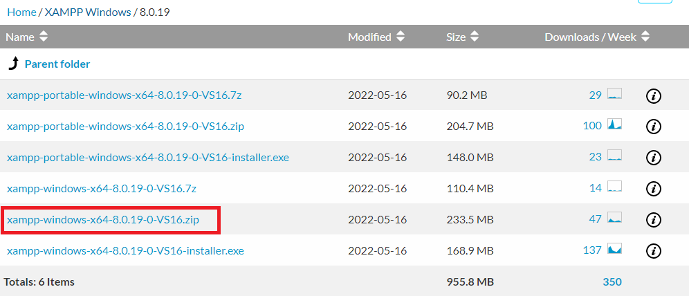

   3. ZIP ファイルを解凍して、展開されたフォルダ直下にあるPHPフォルダとApacheフォルダをXAMPP配下にコピーします。  

4. 必要なら、php.ini ファイルを直します。  
※元の ini ファイルを変えていた場合は、新しい ini ファイルにも同じ変更が必要です。バックアップした php.ini と新しい php.ini を比べて、設定値などを追加してください。  

5. XAMPP コントロールパネルを起動します。

6. Apache の config ボタンを押して、プルダウンから「Apache(httpd-xampp.conf)」を選びます。 
   

7. httpd-xampp.conf を編集します。 
   1. 最初に"php7_module"をすべて"php_module"に置き換えてください。
   2. 残りの"php7"をすべて"php8"に置き換えてください。
   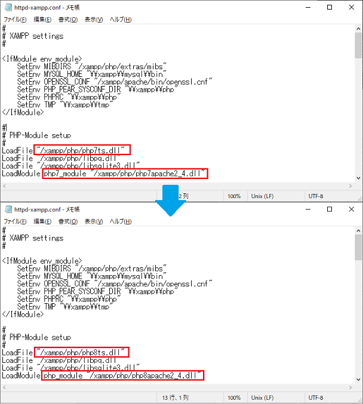

8. Shell ボタンを押してコマンドの画面を開き、PHP のバージョンが新しくなったことを確かめます。

~~~
php -v
~~~

9. 「Apache」と「MySQL」行の、「Start」をクリックします。  

   > 「Apache」の「Start」時にエラーが発生することがあります。  
   その際は、同じ行の右側にある「Logs」→「Apache(error.log)」を開いてください。  
   ログの最新行に「PHP Warning: 'vcruntime140.dll'...」と出力されていたら、「Visual C++ 再頒布可能パッケージ」をインストールする必要があります。  
   [Microsoftのダウンロードサイト](https://visualstudio.microsoft.com/ja/downloads/) にアクセスして、一番下までスクロール→「その他の Tools、Frameworks、そして Redistributables」を開きます。	  
   「Microsoft Visual C++ Redistributable for Visual Studio 2022」のダウンロードボタンをクリックしてインストーラーを入手→ 実行してください。  
