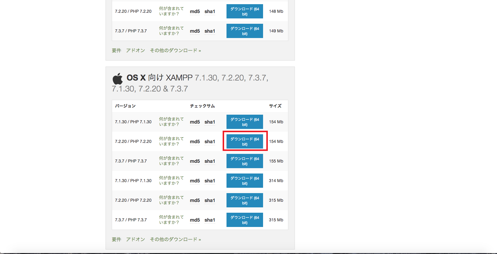
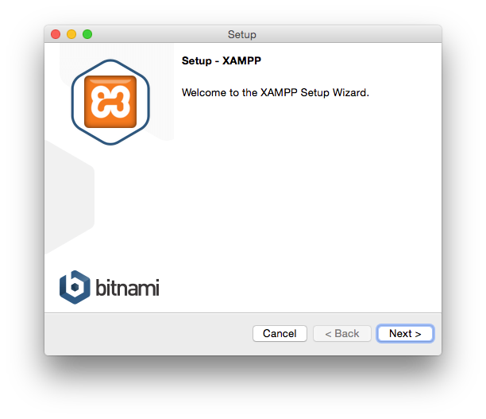
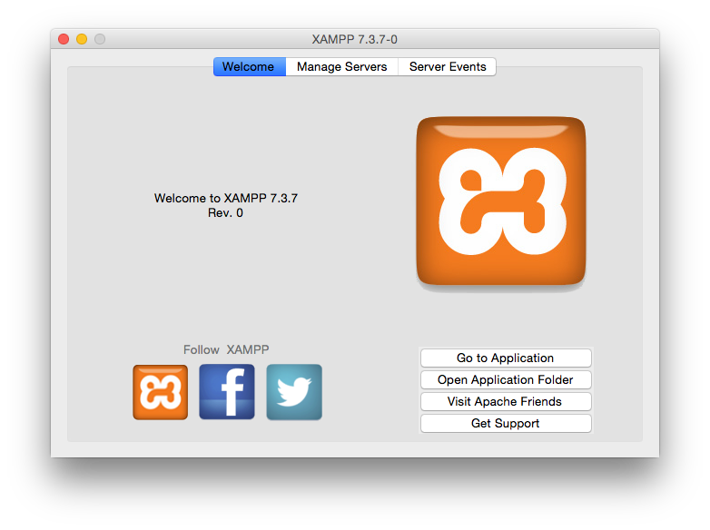
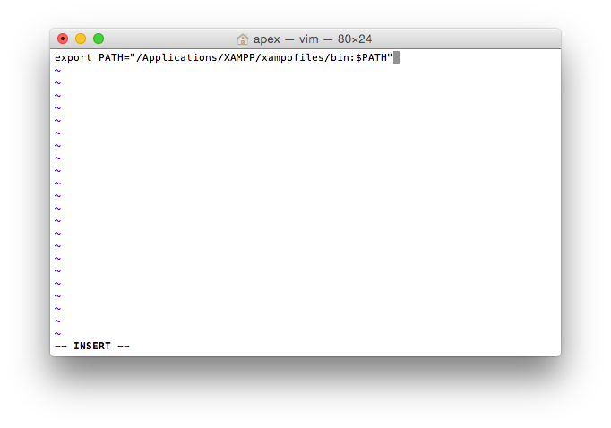
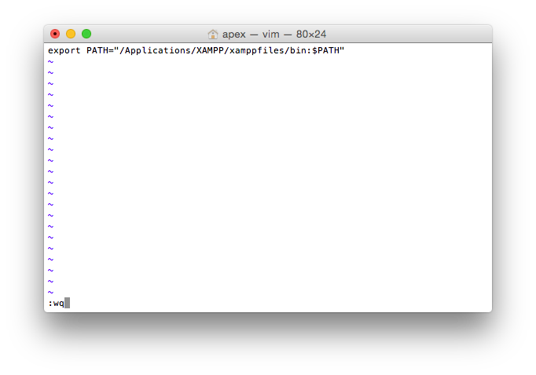
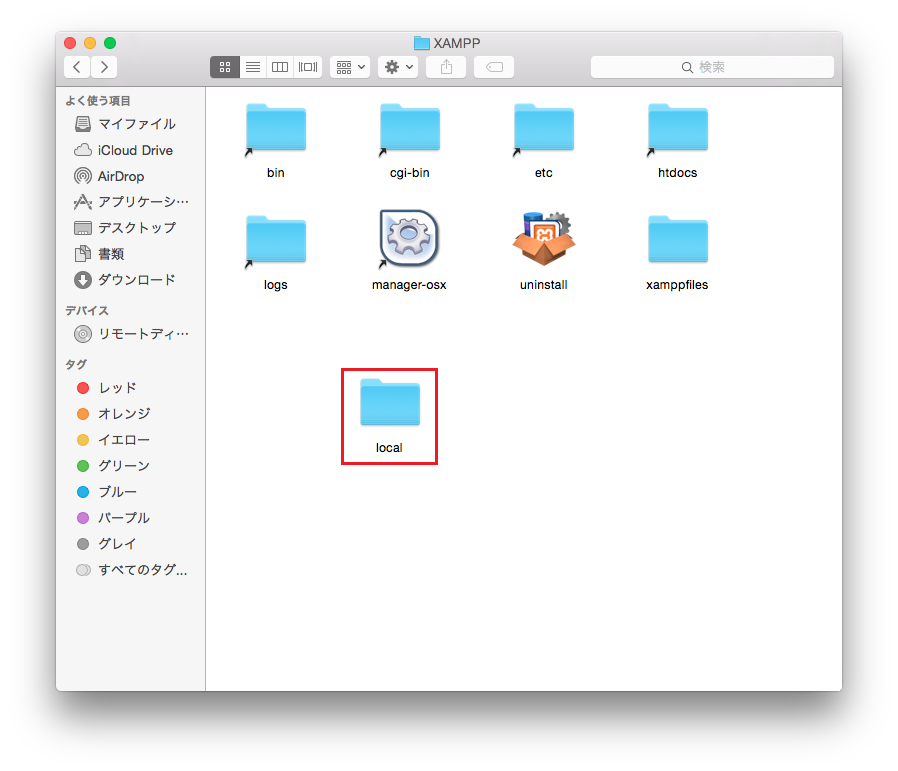

# XAMPPによる環境構築
XAMPP を使って、Mac に Exment を動かす環境を作る手順です。  
XAMPP は、PHP・Apache・MySQL をまとめて入れられるソフトです。開発用の環境をはじめから作るときに、おすすめしています。

## 注意点
- **XAMPPでのインストールは、開発・検証としてのみご利用ください。本番環境としては利用しないことをおすすめします。** 

## インストール手順
次の順に進めます。

1. XAMPP を入れて、Apache と MySQL を動かす
2. mysql のコマンドを使えるようにする（環境変数）
3. データベースを作る
4. Exment 用の URL を作る（サブドメイン設定）
5. Exment をインストールする

### XAMPPインストール手順
1. 次のサイトから、XAMPP をダウンロードします。  
[XAMPPダウンロード](https://www.apachefriends.org/jp/download.html)  

2. 「OS X向けXAMPP」の中から、「PHP8.2」のものを選んで、ダウンロードしてください。  

3. XAMPP のインストールを進めます。  

4. XAMPP のコンポーネントを選ぶ画面では、両方ともチェックを付けて Next を押します。  

5. あとは画面のとおりに Next を押して、インストールを終わらせます。

6. インストールが終わると、LaunchPad の XAMPP（その他）に manager-osx というアプリがあります。そこから XAMPP を起動できます。  

7. XAMPP を起動したら、Manage Servers をクリックします。  

8. MySQL と Apache の Start ボタンをクリックし、Status を Running にします。  

#### 【注意点】
- OS を再起動したときは、もう一度 XAMPP コントロールパネルを起動して、Apache を起動し直す必要があります。  

### 環境変数追加
ターミナルから mysql を実行するには、ターミナルの設定ファイル .bash_profile に Path を書き足します。

1. 次のコマンドで、.bash_profile を開きます。

~~~
vi .bash_profile
~~~

2. 開いた画面でキーボードの i を押して、入力モード（左下に INSERT と表示されます）にします。そのうえで、次のように Path を入力します。

~~~
export PATH="/Applications/XAMPP/xamppfiles/bin:$PATH"
~~~

3. 保存して閉じるために、キーボードの Esc を押してから、:wq と入力します。  

4. 最後に、次のコマンドで .bash_profile を読み込み、Path を通します。

~~~
source ~/.bash_profile
~~~

#### データベースを作成
1. XAMPP コントロールパネルを起動したあと、Web ブラウザーで次の URL を開き、phpMyadmin にアクセスします。

http://localhost/phpmyadmin/index.php  

2. 左のメニューの「新規作成」をクリックします。  

3. 「データベースを作成する」行で、任意のデータベース名を英数字で入力し、「作成」をクリックします。  

これで、データベースができました。

### サブドメイン設定
ふつうの設定では、"/Applications/XAMPP/htdocs"フォルダーの中に Exment のプロジェクトファイルを置くと、Exment を使えます。  
しかし、そのままだと、たとえば[http://localhost/exment/.env](http://localhost/exment/.env)の URL を開くと、データベースの情報を含む設定ファイルが画面に表示されてしまうなど、大きな問題があります。  
そのため、この問題が起きないようにする設定を、強くおすすめします。次の手順で設定してください。

1. フォルダー「/Applications/XAMPP」に、フォルダー「local」を作ります。  

2. "/Applications/XAMPP/xamppfiles/etc/extra/httpd-xampp.conf"を開きます。

3. ファイルの最後に、次の記述を追加します。**※DocumentRootの末尾に「/public」が必要になります**  

~~~
<VirtualHost *:80>
    DocumentRoot "/Applications/XAMPP/xamppfiles/htdocs"
    ServerName localhost
</VirtualHost>

<VirtualHost *:80>
  DocumentRoot "/Applications/XAMPP/local/exment/public"
  ServerName exment.localapp
</VirtualHost>

<Directory "/Applications/XAMPP/local/exment/public">
  Allow from all
  AllowOverride All
  Require all granted
</Directory>  
~~~

4. "/Applications/XAMPP/xamppfiles/etc/httpd.conf"を開き、文字列の検索で、次の記述を探します。

~~~
User daemon
Group daemon
</IfModule>
~~~

この記述を、次のように直します。

~~~
User (Macのログインユーザー名)
Group daemon
</IfModule>
~~~

5. "/etc/hosts"を編集します。  
ターミナルで、次のコマンドを入力します。  
※パスワードを聞かれるので、ログインユーザーのパスワードを入力してください

~~~
sudo vi /etc/hosts
~~~

hosts ファイルに、次の項目を追加してください。

~~~
127.0.0.1       localhost
127.0.0.1       exment.localapp
~~~

6. XAMPP コントロールパネルで、Apache を再起動します。  

### Exmentインストール
Exment の[インストール手順](/ja/quickstart)のとおりに、Exment をインストールします。  
Exment のインストールは、通常"/Applications/XAMPP/local"フォルダーの中で行います。  
ここでは、"/Applications/XAMPP/local/exment"フォルダーの中にインストールしたものとします。  

- インストールの途中に、データベースの設定を入力する画面があります。次のように入力してください。
    - データベース種類：MariaDB
    - ホスト名：127.0.0.1
    - ポート：3306
    - データベース：（上記で作成したデータベース名）
    - ユーザー名：root
    - パスワード：(空欄)

