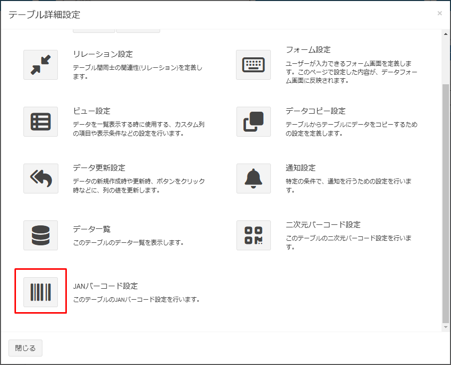
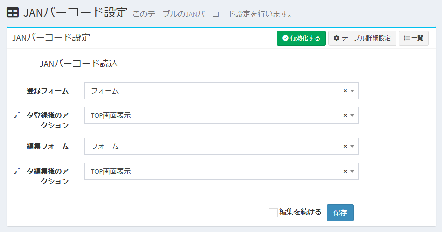
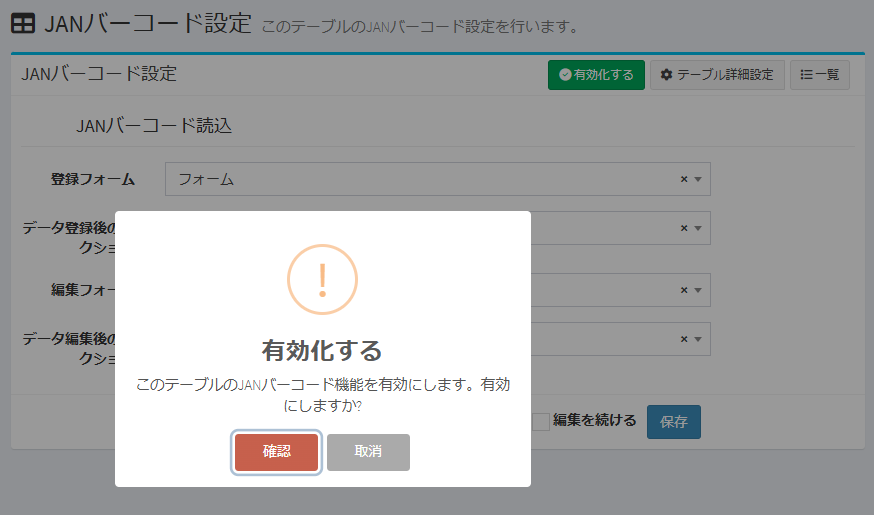

# JANバーコード設定
テーブルごとに、JANバーコードを読み込んだときの動き（どのフォームを開くか、保存のあとにどの画面を出すか）を決める画面の説明です。

設定の流れは、次のとおりです。

1. JANバーコード設定の画面を開く
2. 設定して保存する
3. 「有効化する」ボタンを押す

## JANバーコード機能の概要
JANバーコード機能の概要は、[公式サイトの投稿](https://exment.net/release_v6-2-0/)をご覧ください。

## ページ表示
- カスタムテーブル一覧で、設定するテーブルにチェックを入れて、右上の「テーブル詳細設定」をクリックします。  

> ※ そのカスタムテーブルのデータ一覧画面やデータ登録画面から、直接移ることもできます。その場合も、右上の「テーブル詳細設定」をクリックしてください。  

- テーブル詳細設定の画面で、JANバーコード設定のアイコンをクリックすると、JANバーコード設定画面が出ます。  

## JANバーコードの設定項目

### JANバーコード読込
JANバーコードを読み込んだときの動きを設定します。 

- #### 登録フォーム  
JANバーコードを読み込んだあとに開く、登録フォームを選びます。  
そのテーブルに登録済みのカスタムフォームから選べます。 

- #### データ登録後のアクション  
データを登録したあとに出す画面を選びます。  
TOP画面、一覧画面、詳細画面、編集画面、カメラ起動画面から選べます。

- #### 編集フォーム
JANバーコードを読み込んだあとに開く、編集フォームを選びます。  
そのテーブルに登録済みのカスタムフォームから選べます。

- #### データ編集後のアクション
データを編集したあとに出す画面を選びます。  
TOP画面、一覧画面、詳細画面、編集画面、カメラ起動画面から選べます。

設定したら、「保存」ボタンをクリックします。  

### JANバーコード設定を有効化する  
- そのテーブルでJANバーコード機能を使えるようにするには、「有効化する」必要があります。一度保存してから、ページ右上の「有効化する」ボタンをクリックしてください。  
- 二次元バーコードとJANバーコードは、どちらか1つだけを有効化できます。  
二次元バーコードを有効化しているときは、JANバーコード機能の「有効化する」ボタンは出ず、有効化できません。同じように、JANバーコードを有効化しているときは、二次元バーコードを有効化できません。  

### JANバーコード設定を無効化する  
- JANバーコードでの管理をやめるとき、または別のテーブルでJANバーコードの管理をしたいときは、ページ右上の「無効化する」ボタンをクリックしてください。  
- 有効だったときにひも付けたJANバーコードの情報は残ります。そのため、JANバーコードを読み込むと、このテーブルのデータが出ます。  

## Exmentからカメラ画面の起動
- Exmentのダッシュボードから、二次元／JANバーコードを読み込むためのカメラ画面を起動できます。  

- ダッシュボードに、アイテム「二次元／JANバーコード」を追加する手順は、[ダッシュボード](/ja/dashboard#二次元／janバーコード)をご覧ください。
