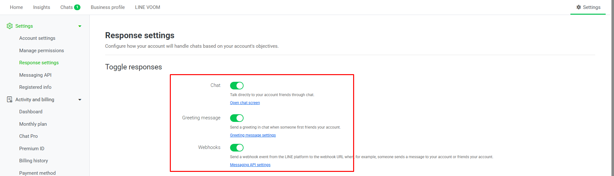
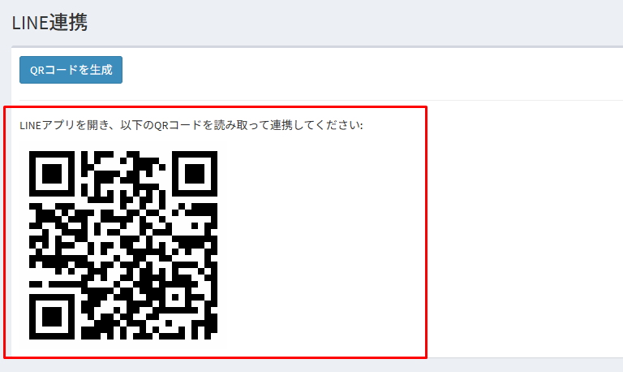
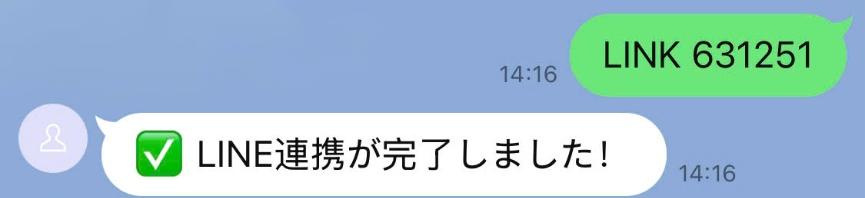
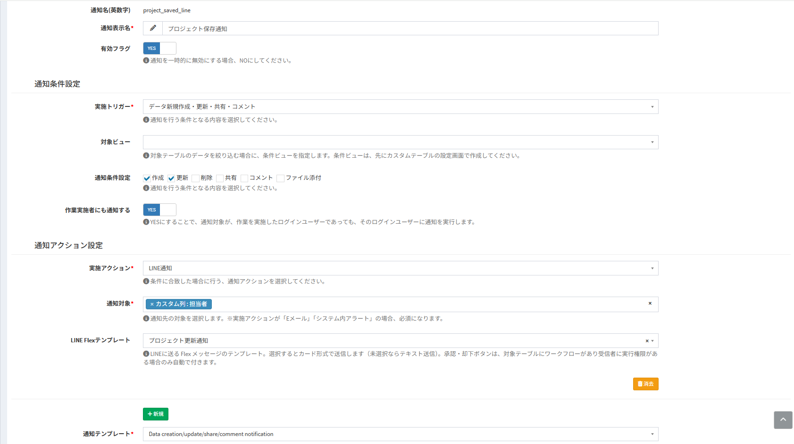
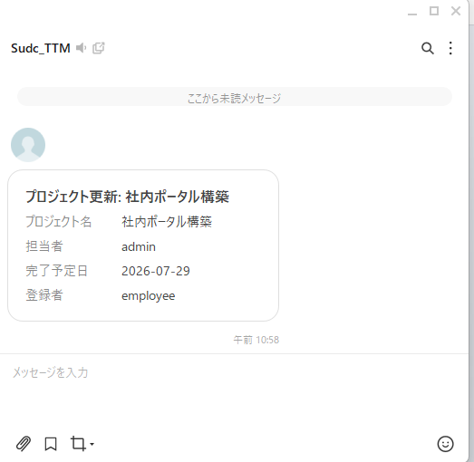
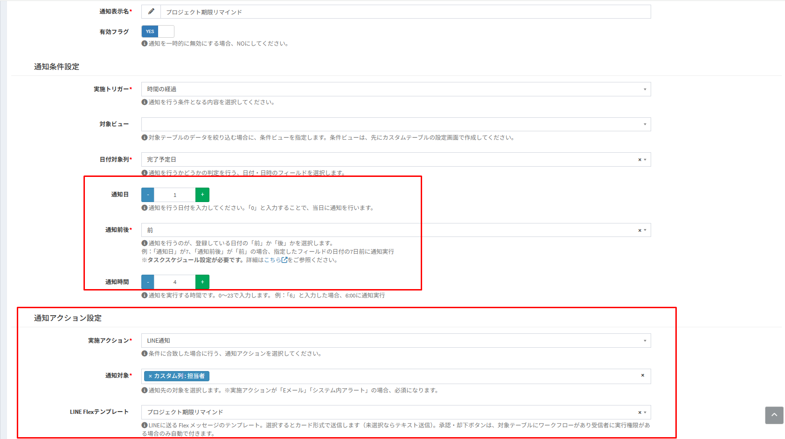
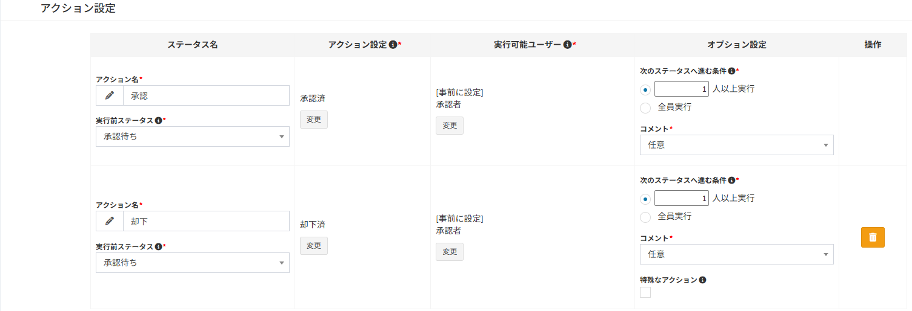
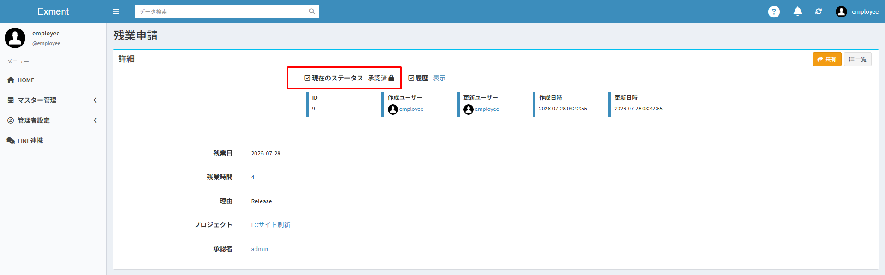
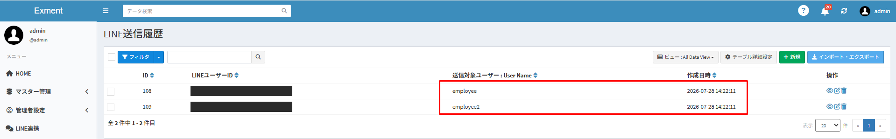

# LINE連携
Exmentと、企業のLINE公式アカウントを連携します。  
Exmentの通知をLINEで受け取ったり、LINEに届いた通知カードのボタンから、ワークフローのアクションを実行したりできます。  
LINEとメールで従業員の安否を確認する機能については、[安否確認](/ja/safety_check)をご確認ください。  
※LINE連携は、v7.0.0より利用できます。

## LINE連携でできること
- **LINEアカウント連携**：各ユーザーが、自分のLINEアカウントとExmentのユーザーを連携します。LINEで通知を受け取るには、この連携が必要です。
- **LINE通知**：[通知](/ja/notify)の実施アクションに「LINE通知」を選択すると、LINEにメッセージを送信します。テキストのほか、カード形式（Flex Message）で送信することもできます。
- **LINEからのワークフロー実行**：通知カードに、「承認」「却下」などのアクションのボタンを表示します。ボタンを押すと、LINEからそのままアクションを実行できます。
- **LINE送信履歴**：LINE通知や安否確認で送信したメッセージを、成功・失敗にかかわらず記録します。

## 設定の流れ
| 手順 | 内容 | 作業者 |
| --- | --- | --- |
| 1 | [LINE公式アカウントを準備する](/ja/line?id=line公式アカウントの準備) | 管理者 |
| 2 | [チャネルの情報を、Exmentのシステム設定に入力する](/ja/line?id=システム設定) | 管理者 |
| 3 | [Webhook URLを、LINEに登録する](/ja/line?id=webhookの設定) | 管理者 |
| 4 | [タスクスケジュールを設定する](/ja/additional_task_schedule)（「時間の経過」の通知を使用する場合） | サーバー管理者 |
| 5 | [LINEアカウントを連携する](/ja/line?id=lineアカウント連携) | 各ユーザー |
| 6 | [LINE Flexテンプレートを作成する](/ja/line?id=line-flexテンプレート)（カード形式で送信する場合） | 管理者 |
| 7 | [通知を設定する](/ja/line?id=line通知の設定) | 管理者 |

## 動作要件
- Messaging APIを有効にした、LINE公式アカウントが必要です。Exmentからのメッセージは、このアカウントから送信されます。
- LINEのサーバーから、ExmentのWebhook URLにアクセスできる必要があります。インターネットからアクセスでき、有効なSSL証明書を設定した「https://」のURLで、Exmentを公開してください。
- 実施トリガー「時間の経過」の通知を使用する場合は、[タスクスケジュール](/ja/additional_task_schedule)の設定が必要です。

> LINE公式アカウントには、料金プランごとに、1か月に送信できるメッセージ数の上限があります。Exmentから送信する通知は、受信者1人につき1通として数えられます。ユーザーの操作に対する返信（「LINE連携が完了しました！」など）は数えられません。  
詳しくは、LINE公式アカウントの料金プランをご確認ください。

## LINE公式アカウントの準備

### Messaging APIを有効にする
- [LINE Official Account Manager](https://manager.line.biz)で、LINE公式アカウントを作成します。既存のアカウントを使用することもできます。
- 「設定」→「Messaging API」で、Messaging APIを有効にします。プロバイダーを選択（または作成）すると、LINE公式アカウントに、Messaging APIのチャネルが作成されます。

### チャネルの情報を確認する
Exmentに設定する、以下の3つの値を確認します。

| 値 | 確認する場所 | 用途 |
| --- | --- | --- |
| チャネルシークレット | LINE Official Account Managerの「設定」→「Messaging API」、または[LINE Developersコンソール](https://developers.line.biz/console/)の「チャネル基本設定」タブ | LINEから届くデータ（Webhook）の署名の検証 |
| チャネルアクセストークン（長期） | LINE Developersコンソールでチャネルを選択し、「Messaging API設定」タブの「チャネルアクセストークン」で［発行］をクリック | メッセージの送信 |
| ベーシックID | LINE Official Account Managerのアカウント名の横、またはLINE Developersコンソールの「Messaging API設定」タブの「ボットのベーシックID」。「@」から始まるIDです | アカウント連携用のQRコードの作成 |

※チャネルシークレットとチャネルアクセストークンは、第三者に知られないように管理してください。

### 応答設定
- LINE Official Account Managerの「設定」→「応答設定」で、「Webhook」をオンにします。
- 自動応答メッセージを設定している場合は、停止することを推奨します。Exmentは、ユーザーから届いたテキストメッセージに返信します。自動応答メッセージが有効だと、Exmentの返信とは別に、自動応答メッセージも送信されます。

## システム設定
- 左メニューの「管理者設定」→「システム設定」をクリックし、右上のボタンから［詳細設定］に切り替えます。  
以下のURLからも表示できます。

~~~
http(s)://(ExmentのURL)/admin/system?advanced=1
~~~

- 「LINE設定」に、以下の項目を入力し、［保存］をクリックします。

| 項目 | 内容 |
| --- | --- |
| チャネルアクセストークン | LINE Developersコンソールで発行した、チャネルアクセストークン（長期）を入力します。 |
| チャネルシークレット | チャネルシークレットを入力します。 |
| LINE公式アカウント Basic ID | ベーシックIDを、「@」から入力します。 |
| Webhook URL | LINEに登録するWebhook URLが表示されます。入力はできません。 |

※チャネルアクセストークンとチャネルシークレットは、保存後は伏せ字で表示されます。  
※これらの値は、「.env」ファイルでも設定できます。詳細は[設定値](/ja/line?id=設定値)をご確認ください。システム設定画面で保存した値が優先されます。

## Webhookの設定
LINEのWebhookは、ユーザーが連携コードを送信したり、通知カードのボタンを押したりしたときに、その内容をExmentに送るための仕組みです。

- LINE Developersコンソールでチャネルを選択し、「Messaging API設定」タブを開きます。
- 「Webhook URL」の［編集］をクリックし、システム設定の「LINE設定」に表示されたWebhook URLを貼り付けて、［更新］をクリックします。  
Webhook URLは、以下の形式です。

~~~
https://(ExmentのURL)/admin/line/webhook
~~~

- 「Webhookの利用」をオンにします。
- ［検証］をクリックし、「成功」と表示されることを確認します。

※Webhook URLは、LINE Official Account Managerの「設定」→「Messaging API」でも設定できます。  
※Webhook URLには、「https://」で始まり、有効なSSL証明書を設定したURLのみ登録できます。  
※Exmentの[IPフィルタ設定](/ja/additional_ip_filter)は、Webhook URLには適用されません。ファイアウォールなどでアクセスを制限している場合は、LINEのサーバーからアクセスできるように設定してください。

## LINEアカウント連携
LINEで通知を受け取るユーザーは、各自でLINEアカウントを連携します。  
**LINEアカウントを連携していないユーザーには、LINE通知は送信されません。** LINE通知を使用する前に、ユーザーに連携を依頼してください。

### 連携する
- Exmentにログインし、左メニューの「LINE連携」をクリックします。  
以下のURLからも表示できます。

~~~
http(s)://(ExmentのURL)/admin/line/link
~~~

- ［QRコードを生成］をクリックします。連携用のQRコードが表示されます。

- スマートフォンのLINEアプリで、QRコードを読み取ります。  
LINE公式アカウントとのトーク画面が開き、「LINK (連携コード)」が入力された状態になります。  
※LINE公式アカウントを友だち追加していない場合は、画面の案内に従い、友だち追加してください。

- そのままメッセージを送信します。「LINE連携が完了しました！」と返信が届けば、連携は完了です。

- 「LINE連携」画面を開き直すと、「LINE連携済み」と表示されます。

※連携コードの有効期限は、初期設定では10分です。期限が切れた場合は、もう一度［QRコードを生成］をクリックしてください。  
※1つのLINEアカウントは、1人のユーザーとだけ連携できます。すでに連携しているLINEアカウントから連携コードを送信すると、「このLINEアカウントは既に別のアカウントと連携済みです。変更する場合は、先にWeb上で連携を解除してください。」と返信されます。ただし、連携先のユーザーが削除済みの場合は、以前の連携が自動で解除され、別のユーザーと連携できます。  
※誤った連携コードを送信できるのは、初期設定では5回までです。最初に誤ったコードを送信してから10分（初期設定）以内に5回誤ると、その10分が過ぎるまで連携できません。この間は、正しい連携コードを送信しても「連携コードが正しくないか、有効期限が切れています。再度ご確認ください。」と返信されます。

### 連携を解除する
「LINE連携」画面で、［連携解除］をクリックします。  
スマートフォンやLINEアカウントを変更した場合は、連携を解除してから、もう一度連携してください。

## LINE Flexテンプレート
LINE通知をカード形式（Flex Message）で送信する場合の、カードの内容を設定します。  
通知設定でテンプレートを選択しない場合は、テキストのメッセージが送信されます。

### テンプレートの作成
- 以下のURLにアクセスし、「LINE Flexテンプレート」のデータ一覧画面を開きます。  
左のメニューに追加する場合は、[メニュー](/ja/menu)で、メニュー種類「テーブル」を選択して追加してください。

~~~
http(s)://(ExmentのURL)/admin/data/line_flex_template
~~~

- ［新規］をクリックし、以下の項目を入力して保存します。

| 項目 | 内容 |
| --- | --- |
| Flexキー | テンプレートを識別するためのキーです（例：ot_request）。「safety_check」は[安否確認](/ja/safety_check)で使用するため、使用しないでください。 |
| テンプレート名 | テンプレートの名前です。通知設定の「LINE Flexテンプレート」の選択肢に表示されます。 |
| タイトル | カードの見出しです。変数を使用できます。空欄の場合は、データの見出しを表示します。 |
| 本文項目 | カードの本文に表示する項目です。1行に1項目を、「表示名 = 値」の形式で入力します。 |
| 説明 | テンプレートの説明です。LINEには表示されません。 |

※新規作成時の「タイトル」「本文項目」には、ワークフロー実行の通知向けの初期値（ステータス、アクション名など）が入力されています。データの作成・更新の通知などで使用する場合は、内容を変更してください。  
※「安否確認」テンプレート（Flexキー「safety_check」）は、[安否確認](/ja/safety_check)のインストール時に自動で作成されます。通知設定の「LINE Flexテンプレート」では選択しないでください。また、編集・削除しないでください。

### 本文項目の書き方
「=」の左側に表示名、右側に値を入力します。値には、変数を使用できます。  
以下は、残業申請のカードの例です。

~~~
申請者 = ${created_user}
承認者 = ${value:approver}
プロジェクト = ${value:project}
残業日 = ${value:ot_date}
残業時間 = ${value:ot_hours}
理由 = ${value:reason}
~~~

- 値が空になる行は、カードに表示されません。
- 「本文項目」が空欄の場合、ワークフロー実行の通知では、ステータス・アクション名などの標準の項目を表示します。

### 使用できる変数
[パラメータ変数](/ja/params)を使用できます。主な変数は、以下のとおりです。

| 変数 | 内容 |
| --- | --- |
| ${value} | データの見出し |
| ${value:(列名)} | データの列の値（例：${value:approver}） |
| ${created_user} | データを作成したユーザー名 |
| ${table_view_name} | テーブル表示名 |
| ${workflow:status_name} | アクション実行後のステータス名 ※1 |
| ${workflow:status_from_name} | アクション実行前のステータス名 ※1 |
| ${workflow:action_name} | 実行されたアクション名 ※1 |
| ${workflow:action_user} | アクションを実行したユーザー ※1 |
| ${workflow:comment} | アクションの実行時に入力されたコメント ※1 |
| ${notify_target_column_key} | 「日付対象列」の列名 ※2 |
| ${notify_target_column_value} | 「日付対象列」の値 ※2 |

※1 実施トリガー「ワークフロー実行」の通知でのみ使用できます。  
※2 実施トリガー「時間の経過」の通知でのみ使用できます。

### カードのボタン
カードのボタンは、テンプレートに設定しなくても、自動で追加されます。

| ボタン | 表示される条件 |
| --- | --- |
| ワークフローのアクション（「承認」「却下」など） | 以下の条件をすべて満たす場合に表示されます。 ・データにワークフローが設定されていて、受信者が実行できるアクションがある ・受信者が、そのアクションをまだ実行していない ・アクションの「コメント」が「必須」ではない ・アクションの実行後に、次の作業ユーザーを選択する必要がない（次のステータスに、実行可能ユーザーが「前アクションの実行ユーザーが選択」のアクションがない）※「次のステータスへ進む条件」が「1人以上実行」のアクションのみ判定します。それ以外のアクションは、[ワークフローの設定](/ja/line?id=ワークフローの設定)をご確認ください。 |
| 詳細を見る | ExmentのURLが「https://」の場合に表示されます。押すと、データの詳細画面を開きます。 |

詳細は、[LINEからワークフローのアクションを実行する](/ja/line?id=lineからワークフローのアクションを実行する)をご確認ください。

## LINE通知の設定
[通知](/ja/notify)の設定画面の「通知アクション設定」で、以下の項目を設定します。  
通知設定画面の開き方は、[通知](/ja/notify?id=一覧画面表示)をご確認ください。

| 項目 | 内容 |
| --- | --- |
| 実施アクション | 「LINE通知」を選択します。 |
| 通知対象 | 通知を送信するユーザーを選択します（必須）。「ユーザー」列（「カスタム列：(列名)」と表示されます）、「指定のユーザー」「指定の組織」「作成者」などを選択できます。 |
| LINE Flexテンプレート | カード形式で送信する場合に、[LINE Flexテンプレート](/ja/line?id=line-flexテンプレート)を選択します。空欄の場合は、テキストで送信します。 |

- テキストで送信する場合、メッセージは「通知テンプレート」の件名と本文から作成されます。
- 「指定の組織」を選択した場合は、組織に所属するすべてのユーザーに送信されます。
- 通知対象のうち、LINEアカウントを連携していないユーザーには送信されません。この場合、エラーにはならず、[LINE送信履歴](/ja/line?id=line送信履歴)にも記録されません。
- LINE通知は、データの保存などの処理が終わった直後に送信されます。[通知処理の遅延実行](/ja/additional_queue)（キュー）は使用せず、送信に失敗しても自動では再送信しません。送信結果は、[LINE送信履歴](/ja/line?id=line送信履歴)で確認できます。

### 例1：データの作成・更新時に通知する
- 実施トリガー：「データ新規作成・更新・共有・コメント」
- 通知条件設定：「作成」「更新」にチェック
- 実施アクション：「LINE通知」
- 通知対象：「カスタム列：担当者」
- LINE Flexテンプレート：作成したテンプレート

データが保存されると、LINEに以下のようなカードが届きます。

※初期設定では、データを保存したユーザー自身には通知されません。自分にも通知する場合は、「作業実施者にも通知する」をYESにしてください。

### 例2：組織のメンバーに通知する
「通知対象」で「指定の組織」を選択し、「送信先の組織」で組織を選択します。  
組織に所属するユーザーのうち、LINEアカウントを連携しているユーザーに送信されます。

※選択肢には、そのテーブルへのアクセス権限がある組織のみ表示されます。

### 例3：期限の前日にリマインドする
- 実施トリガー：「時間の経過」
- 日付対象列：基準とする日付の列（例：完了予定日）
- 通知日：「1」
- 通知前後：「前」
- 通知時間：通知を送信する時刻（0～23）
- 実施アクション：「LINE通知」

指定した時刻に、以下のようなカードが届きます。

※「時間の経過」の通知を実行するには、[タスクスケジュール](/ja/additional_task_schedule)の設定が必要です。通知は、「通知時間」に指定した時刻の00分に実行されます。  
※設定を確認するため、すぐに実行する場合は、以下のコマンドを実行してください。「通知時間」の設定によらず、通知が実行されます。

~~~
php artisan exment:notify --name=(通知名(英数字))
~~~

※コマンドを繰り返し実行した場合などに、同じリマインドが重複して送信されないようにするには、設定値「LINE_DEDUPE_MINUTES」を設定してください。詳細は[設定値](/ja/line?id=設定値)をご確認ください。

## LINEからワークフローのアクションを実行する
LINEに届いた通知カードのボタンから、ワークフローのアクションを実行できます。  
ここでは、承認者が残業申請をLINEで承認する例で説明します。ワークフローの設定方法は、[ワークフロー設定](/ja/workflow_setting)をご確認ください。

### ワークフローの設定
ワークフロー設定の「アクション設定」で、LINEから実行するアクションを、以下のように設定します。

- 実行可能ユーザー：アクションを実行するユーザー（例：「事前に設定」で、テーブルの「承認者」列）
- コメント：「任意」または「使用しない」

※「コメント」が「必須」のアクションは、LINEのカードにボタンが表示されません。コメントを入力する必要があるため、Exmentの画面から実行してください。  
※次のステータスに、実行可能ユーザーが「前アクションの実行ユーザーが選択」のアクションがある場合は、次の作業ユーザーを選択する必要があるため、Exmentの画面から実行してください。  
「次のステータスへ進む条件」が「1人以上実行」のアクションは、LINEのカードにボタンが表示されません。  
2人以上の実行が必要なアクション（「次のステータスへ進む条件」が2人以上、または「全員実行」）は、ボタンが表示されます。ステータスが進まない実行（例：3人が承認する場合の1人目・2人目）は、LINEから実行できます。ステータスが進む実行（例：3人目）でボタンを押した場合は、アクションは実行されず、「この操作は次の作業ユーザーの選択が必要です。Web上で処理してください。」と返信されます。

### 通知の設定
承認者にLINE通知を送信する、通知設定を行います。「LINE Flexテンプレート」は必ず選択してください。テキストで送信した場合、ボタンは表示されません。

- **データの作成時に通知する場合**：テーブルの通知設定で、実施トリガー「データ新規作成・更新・共有・コメント」、通知条件設定「作成」、通知対象「カスタム列：承認者」、実施アクション「LINE通知」を設定します。
- **アクションの実行時に、次の作業ユーザーに通知する場合**：ワークフローの通知設定で、実施アクション「LINE通知」、通知対象「次の作業ユーザー」を設定します。

### LINEから承認する
- 申請者が、承認者を選択して残業申請のデータを作成します。

- 承認者のLINEに、「承認」「却下」ボタン付きのカードが届きます。  
ボタンを押すと、アクションが実行され、「処理しました: 承認」と返信が届きます。

- Exmentのデータのステータスが更新されます。

※アクションは、LINEアカウントを連携したユーザーとして実行されます。ボタンを押した時点で、そのユーザーがアクションを実行できるかを、改めて確認します。  
※他のユーザーがすでに処理した場合や、同じアクションを実行済みの場合など、アクションを実行できない場合は、「この操作は利用できないか、既に処理済みです。」と返信されます。  
※次の作業ユーザーの選択が必要な場合は、「この操作は次の作業ユーザーの選択が必要です。Web上で処理してください。」と返信されます。Exmentの画面から実行してください。  
※カードの送信後に、アクションの「コメント」を「必須」に変更した場合は、「この操作はコメントの入力が必要です。Web上で処理してください。」と返信されます。  
※ログインユーザーとして設定されていないユーザーは、LINEからアクションを実行できません。「ログインが有効化されていないアカウントです。」と返信されます。

## LINE送信履歴
LINE通知や[安否確認](/ja/safety_check)で送信したメッセージは、成功・失敗にかかわらず、「LINE送信履歴」テーブルに記録されます。  
ユーザーの操作に対する返信（「LINE連携が完了しました！」「処理しました: 承認」など）は、記録されません。  
以下のURLにアクセスすると、一覧を表示できます。

~~~
http(s)://(ExmentのURL)/admin/data/line_send_log
~~~

| 列 | 内容 |
| --- | --- |
| LINEユーザーID | 送信先の、LINEのユーザーIDです。 |
| メッセージ種別 | 「text」（テキスト）または「flex」（カード）です。 |
| 送信Flexテンプレート | カードの送信に使用した、LINE Flexテンプレートです。 |
| 件名 | メッセージの件名です。カードの場合は、タイトルです。 |
| 本文 | LINEに送信したメッセージのデータ（JSON形式）です。カードの場合は、Flex Messageの内容がすべて記録されます。 |
| 送信対象ユーザー | 送信先の、Exmentのユーザーです。 |
| 送信日時 | メッセージを送信した日時です。 |
| 送信結果 | 「success」（成功）または「failed」（失敗）です。 |
| エラー内容 | 送信に失敗した場合の理由です（例：「HTTP 400 …」）。 |

※LINEアカウントを連携していないユーザーには送信しないため、履歴も記録されません。通知が届かない場合は、まずLINEアカウントの連携をご確認ください。  
※一覧に表示する列は、[カスタムビュー](/ja/view)で変更できます。

## 設定値
「.env」ファイルで、以下の設定を変更できます。詳細は[設定値一覧](/ja/config?id=line連携)をご確認ください。

| 設定キー | 既定値 | 内容 |
| --- | --- | --- |
| LINE_CHANNEL_ACCESS_TOKEN | (なし) | チャネルアクセストークンです。システム設定画面で保存した値が優先されます。 |
| LINE_CHANNEL_SECRET | (なし) | チャネルシークレットです。システム設定画面で保存した値が優先されます。 |
| LINE_OA_BASIC_ID | (なし) | ベーシックIDです。システム設定画面で保存した値が優先されます。 |
| LINE_DEDUPE_MINUTES | 0 | 「時間の経過」のLINE通知で、同じユーザーに同じデータについてのLINEメッセージを送信してから、この時間（分）は再度送信しません。他の通知設定で送信したメッセージや、送信に失敗したメッセージも対象です。0の場合、この機能は無効です。 |
| LINE_LINK_CODE_TTL_MINUTES | 10 | 連携コードの有効期限（分）です。 |
| LINE_LINK_MAX_ATTEMPTS | 5 | 誤った連携コードを送信できる回数です。この回数を超えると、一定時間連携できなくなります。 |
| LINE_LINK_ATTEMPT_DECAY_MINUTES | 10 | 誤った連携コードの送信回数を数える時間（分）です。最初に誤ったコードを送信してからこの時間内に「LINE_LINK_MAX_ATTEMPTS」の回数を誤ると、この時間が過ぎるまで連携できません。 |
| LINE_HTTP_TIMEOUT | 10 | LINEのサーバーと通信する際の、タイムアウト時間（秒）です。 |
| LINE_API_BASE | https://api.line.me | LINE Messaging APIのURLです。通常は変更しないでください。 |

※「LINE_DEDUPE_MINUTES」により送信しなかった通知は、LINE送信履歴には記録されません。「storage/logs/laravel.log」に「LINE reminder skipped by dedupe」と記録されます。

## うまく動作しない場合
| 現象 | 主な原因 | 対処 |
| --- | --- | --- |
| Webhookの［検証］が成功しない | ・Webhook URLが「https://」ではない、またはSSL証明書が無効 ・インターネットからExmentにアクセスできない ・チャネルシークレットが正しくない | Webhook URLとサーバーの公開設定、システム設定の「チャネルシークレット」を確認してください。 |
| 連携コードを送信しても、返信が届かない | ・「Webhookの利用」がオフになっている ・Webhook URLが正しくない | [Webhookの設定](/ja/line?id=webhookの設定)を確認してください。 |
| ［QRコードを生成］をクリックすると、「LINE公式アカウントのベーシックIDが未設定です。管理者設定 > システム設定で設定してください。」と表示される | ベーシックIDが設定されていない | システム設定の「LINE公式アカウント Basic ID」を入力してください。 |
| 「連携コードが正しくないか、有効期限が切れています。再度ご確認ください。」と返信される | ・連携コードの有効期限が切れている、またはコードが誤っている ・誤った連携コードを続けて送信したため、一時的に連携できなくなっている | ［QRコードを生成］をクリックし、新しいQRコードを読み取ってください。一時的に連携できなくなっている場合は、時間（初期設定では10分）をおいてから送信してください。 |
| 「このLINEアカウントは既に別のアカウントと連携済みです。変更する場合は、先にWeb上で連携を解除してください。」と返信される | そのLINEアカウントは、すでにExmentのユーザーと連携している | 連携しているユーザーでExmentにログインし、「LINE連携」画面で［連携解除］をクリックしてから、もう一度連携してください。 |
| 「アカウントを連携するには「LINK &lt;コード&gt;」の形式で送信してください。」と返信される | LINEアカウントを連携していないユーザーが、連携コード以外のメッセージを送信した | [LINEアカウント連携](/ja/line?id=lineアカウント連携)の手順で、QRコードを読み取って連携してください。 |
| 「無効なコマンドです。」と返信される | LINEアカウントを連携したユーザーが、連携コード以外のメッセージを送信した | 異常ではありません。Exmentは、連携コード以外のメッセージには応答しません。安否確認の追加回答については、[安否確認](/ja/safety_check?id=lineで回答する)をご確認ください。 |
| LINE通知が届かず、LINE送信履歴にも記録がない | 通知対象のユーザーが、LINEアカウントを連携していない | ユーザーに[LINEアカウント連携](/ja/line?id=lineアカウント連携)を依頼してください。 |
| LINE送信履歴の送信結果が「failed」になる | ・チャネルアクセストークンが正しくない、または無効 ・ユーザーがLINE公式アカウントをブロックしている ・1か月の送信数の上限に達している | 「エラー内容」を確認してください。チャネルアクセストークンを再発行した場合は、システム設定に入力し直してください。 |
| カードに「承認」「却下」ボタンが表示されない | ・アクションの「コメント」が「必須」 ・「次のステータスへ進む条件」が「1人以上実行」のアクションで、実行後に次の作業ユーザーの選択が必要（次のステータスに「前アクションの実行ユーザーが選択」のアクションがある） ・受信者が、そのアクションを実行できない、またはすでに実行済み ・データがすでに処理済み ・LINE Flexテンプレートを選択していない | [LINEからワークフローのアクションを実行する](/ja/line?id=lineからワークフローのアクションを実行する)を確認してください。 |
| 「時間の経過」のLINE通知が送信されない | ・タスクスケジュールが動作していない ・「通知時間」がサーバーの時刻と合っていない ・「LINE_DEDUPE_MINUTES」により送信されなかった | [タスクスケジュール](/ja/additional_task_schedule)を確認してください。「php artisan exment:notify」で通知を実行して確認することもできます。 |
| 「詳細を見る」ボタンが表示されない | ExmentのURLが「https://」ではない | Exmentを「https://」のURLで運用してください。 |
