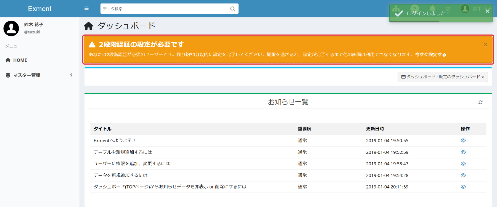
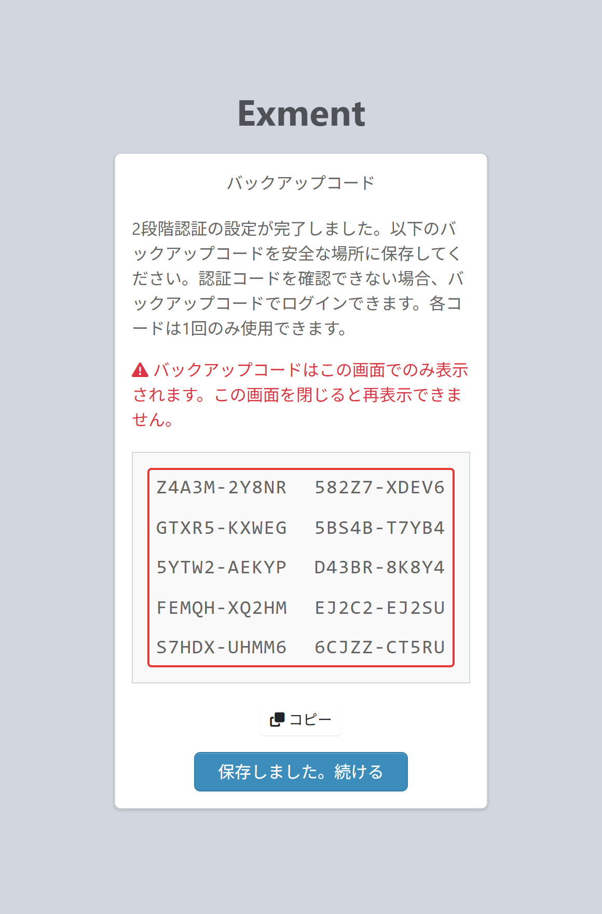
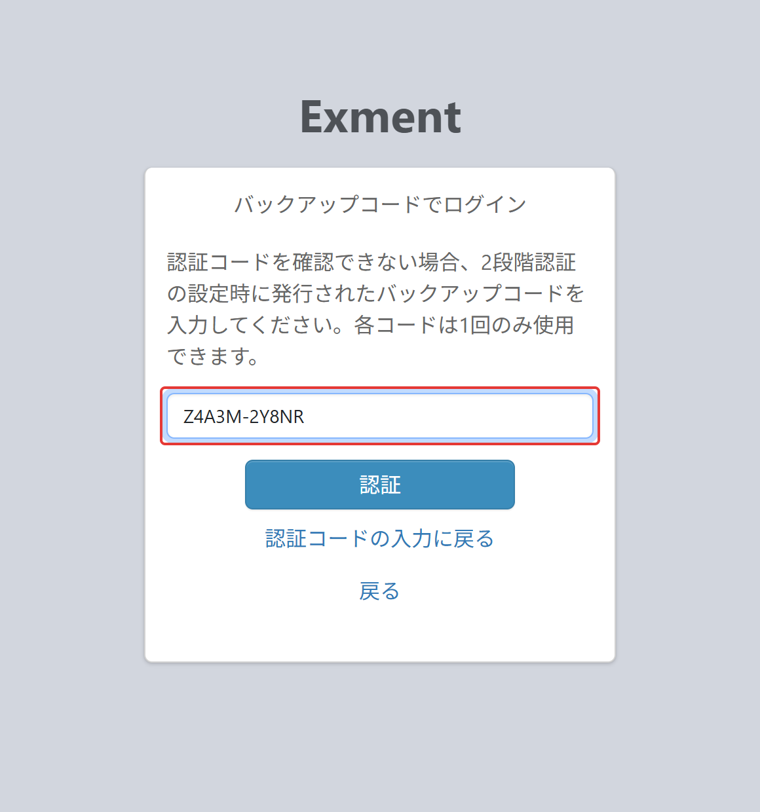
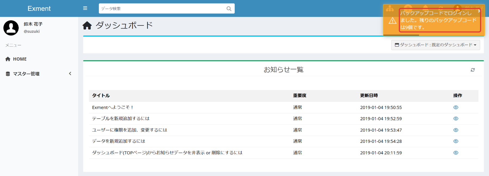

# ログイン(2段階認証)
2段階認証を使用して、Exmentにログインする方法を記載します。  
2段階認証のシステム初期設定は、管理者が行います。[こちら](/ja/login_2factor_setting)をご参照ください。

## 2段階認証の方式
現在サポートしている2段階認証の方式は、以下の2つです。  
どちらの方式を使用しているかどうかは、管理者にお問い合わせください。

##### Eメール
ID/パスワードによるログイン後、登録しているメールアドレスに、認証コードのメールが送付されます。  
その認証コードをフォームに入力することで、ログインが完了されます。

##### Google認証システム
ID/パスワードによるログイン後、Google認証システムを使用して、2段階認証を行います。

### 2段階認証手順(Eメール)

- ログイン画面で、ID/パスワードを入力し、［ログイン］ボタンをクリックします。
  

- 2段階認証画面が表示され、認証コード入力欄が表示されます。
  

- また、ログインを行ったユーザーのメールアドレスに、認証コードが送付されますので、確認します。
  

### 2段階認証手順(Google認証システム)

- ログイン画面で、ID/パスワードを入力し、［ログイン］ボタンをクリックします。
  

- 2段階認証画面が表示され、認証コード入力欄が表示されます。
  

- はじめてログインを行う場合、まずはGoogle認証システムの設定が必要です。  
［送信］ボタンをクリックすることで、登録しているメールアドレスに、Google認証システムの登録を行うためのメールを送信します。
  

- ログインを行ったユーザーのメールアドレスに、Google認証システム登録用のURLが送付されますので、クリックします。  
  

- 送付されたURLをクリックすると、２段階認証システムをインストールする画面に移行します。step1～3を行ってください。  
認証コード入力を正しく行い送信すると、２段階認証でのログインが完了します。

  

> ２段階認証にて、認証コードの入力を一定回数以上間違えると、認証を行った通信からのログインがブロックされます。ご注意ください。  
> 認証コードまたはバックアップコードを続けて5回間違えると、ログアウトされ、15分間は2段階認証を行うことができなくなります(回数・時間は管理者が変更できます)。  
> Eメールの場合、有効な認証コードは最後に送信されたものだけです。Google認証システムの場合、一度使用した認証コードは再度使用できません。

### 設定猶予時間について
管理者がログイン設定の「役割グループごとに対象を指定する」を「YES」に設定している場合、2段階認証が必須のユーザーがGoogle認証システムの登録を行わないままログインすると、各画面の上部に、2段階認証の設定を促す警告と残り時間が表示されます。  
警告の「今すぐ設定する」をクリックするか、画面右上のユーザー名 > 「ユーザー設定」から2段階認証の設定を行ってください。  
残り時間（既定は30分。管理者が変更できます）を過ぎると、2段階認証の設定が完了するまで、設定画面以外の画面を開くことができなくなります。  
※残り時間は、ログアウトして再度ログインしてもリセットされません。
  

## バックアップコード
2段階認証で初めてログインが完了した時（Google認証システムの場合は登録完了時、Eメール認証の場合は初回の認証コード入力時）に、10個のバックアップコードが発行され、画面に1度だけ表示されます。  
認証コードを確認できない場合（スマートフォンの紛失、メールを受信できない場合など）に、認証コードの代わりに入力してログインできます。

- 表示されたバックアップコードは、［コピー］ボタンなどで安全な場所に保存してください。この画面を閉じると、同じコードは再表示できません。  
保存したら、［保存しました。続ける］をクリックします。
  

- 各コードは1回のみ使用できます。

### バックアップコードでログインする

- ログイン画面で、ID/パスワードを入力し、［ログイン］ボタンをクリックします。

- 2段階認証画面で、「バックアップコードでログイン」をクリックします。  
※バックアップコードが発行されていない、またはすべて使用済みの場合、このリンクは表示されません。

- バックアップコードを入力し、［認証］ボタンをクリックします。大文字・小文字、ハイフンの有無は区別されません。  
ログインが完了し、残りのバックアップコードの個数が表示されます。
  
  

> バックアップコードの入力を一定回数以上間違えると、認証を行った通信からのログインがブロックされます。ご注意ください。  
> 認証コードとバックアップコードの間違いは合わせて数え、続けて5回間違えると、ログアウトされ、15分間は2段階認証を行うことができなくなります。

### バックアップコードを再発行する
残りのバックアップコードが少なくなった場合や、コードを紛失した場合は、再発行してください。

- 画面右上のユーザー名 > 「ユーザー設定」を開きます。  
「バックアップコード」項目に、残りの個数が表示されます。

- ［バックアップコードを再発行］をクリックし、確認画面で再度［バックアップコードを再発行］をクリックします。  
新しいバックアップコードが10個表示されます。それまでのバックアップコードは、すべて無効になります。
