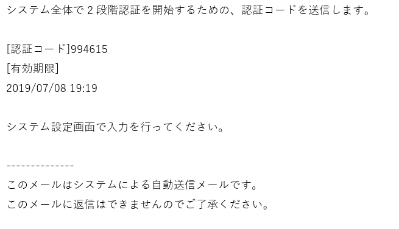

# 2段階認証 システム設定
Exment は、2段階認証（パスワードのあとに、もう 1 つコードを入力してログインするしくみ）に対応しています。  
このページは、システムの管理者が 2段階認証を使えるようにするための設定の手順です。

手順は、次のとおりです。

1. （Google認証システムを使うときだけ）ライブラリを入れる
2. 「.env」ファイルに設定を足す
3. ログイン設定画面で、メールの設定をして保存する
4. 「2段階認証を使用する」を YES にし、方式を選ぶ
5. 認証コードを受け取って入力し、保存する

## 2段階認証の方式
今使える 2段階認証の方式は、次の 2 つです。  

##### Eメール
ID/パスワードでログインしたあと、登録しているメールアドレスに、認証コードのメールが届きます。  
その認証コードを画面に入力すると、ログインが終わります。

##### Google認証システム
ID/パスワードでログインしたあと、Google認証システムを使って、2段階認証を行います。

## 前提事項
- Exment の 2段階認証は、ユーザーごとではなく、システム全体で設定します。  

- 2段階認証を使うには、システムからメールを送れることが必要です。方式に「Google認証システム」を選んだときも同じです。

- 方式が「Google認証システム」のときは、ユーザーがはじめてログインしたときに、登録しているメールアドレスに、Google認証システムの登録のためのメールを送ります。  
  
届いたメールのリンクを押すと、ユーザーが自分で 2段階認証の設定を行えます。  
1 度設定すれば、2 度目からは、Google認証システムに出る認証コードを入力するだけです。  

## 設定方法
2段階認証の設定の手順です。

- 使う方式が「Google認証システム」のときは、プロジェクトのルートフォルダで、次のコマンドを実行します。

~~~
composer require pragmarx/google2fa
~~~

> v7.0.0 以降、simplesoftwareio/simple-qrcode は Exment の依存ライブラリとして自動でインストールされるため、追加は不要です。

- プロジェクトのルートフォルダの「.env」ファイルを開き、次のように追記してください。  
※設定ファイルの直し方は、[設定値一覧](/ja/config)をご覧ください。

~~~
EXMENT_LOGIN_USE_2FACTOR=true
~~~

- 管理者アカウントで、ログイン設定画面を開きます。

- はじめに、メールの設定をします。メール送信の設定値を入力してください。くわしくは[システムメール設定](/ja/system_setting#システムメール設定)をご覧ください。  
入力したら、1 度［送信］を押して、保存します。  

- そのあと、ログイン設定画面の下のほうにある「2段階認証」を表示します。  
  

- 「2段階認証を使用する」を「YES」にします。  
YES にすると、残りの設定項目が出ます。  
  

- 「既定の認証方式」で、2段階認証に使う方式（「Eメール」か「Google認証システム」）を選びます。  

- ［認証コード送信］ボタンを押すと、今ログインしているアカウントに、認証コードを送ります。  
届いたメールに書いてある認証コードを、「認証コード」の項目に入力してください。
  
  

※［認証コード送信］ボタンを押したときに、下の画像のようなエラーが出ることがあります。  
このエラーは、v1.4.0未満のバージョンからアップデートした場合に出ます。  
そのときは、[こちらの手順](/ja/update/v1_4)にそって、通知テンプレートを取り込んでください。  
  

※メール送信のエラーが出ることもあります。  
メール送信の設定が正しくないときに出ます。
そのときは、[システムメール設定](/ja/system_setting#システムメール設定)を見て、設定を直してください。
  

- 最後に、［送信］を押して、設定を保存してください。

## 設定無効化
何かの理由で、2段階認証を強制的に無効にしたいときは、次の設定を行ってください。

- プロジェクトのフォルダの「.env」ファイルを開き、次のように追記してください。  
※設定ファイルの直し方は、[設定値一覧](/ja/config)をご覧ください。

~~~
EXMENT_LOGIN_USE_2FACTOR=false
~~~

この設定をすると、画面で「2段階認証を使用する」にしていても、2段階認証は無効になります。
  
  
[←ログイン設定へ戻る](/ja/login_setting)
