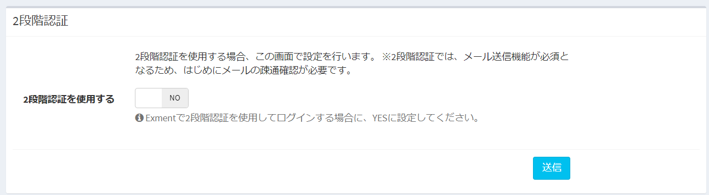
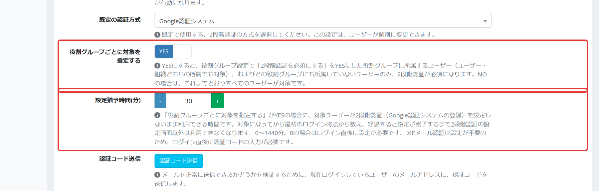
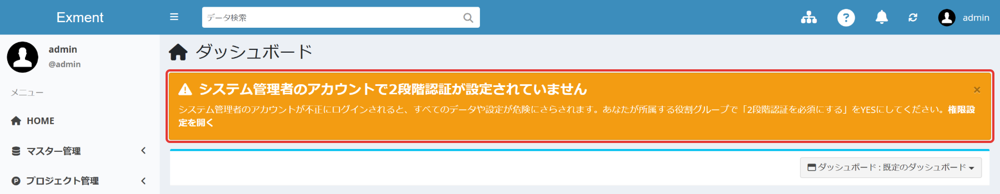
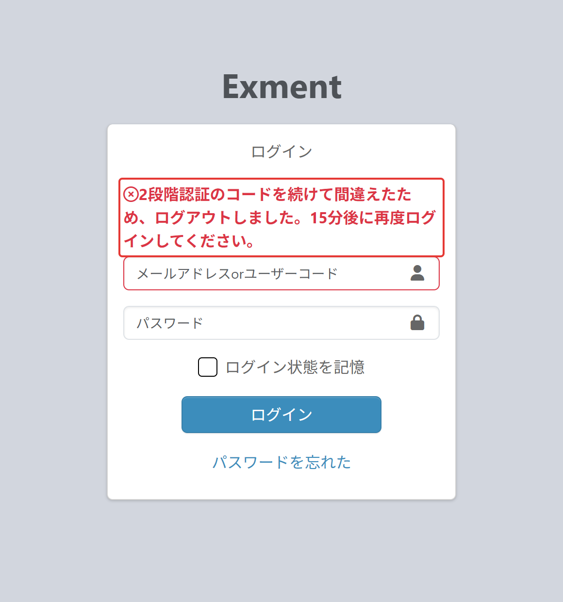

# 2段階認証 システム設定
Exmentでは、2段階認証に対応しております。  
ここでは、Exmentのシステム管理側の設定方法を記載します。

## 2段階認証の方式
現在サポートしている2段階認証の方式は、以下の2つです。  

##### Eメール
ID/パスワードによるログイン後、登録しているメールアドレスに、認証コードのメールが送付されます。  
その認証コードをフォームに入力することで、ログインが完了されます。

##### Google認証システム
ID/パスワードによるログイン後、Google認証システムを使用して、2段階認証を行います。

## 前提事項
- Exmentでの2段階認証は、ログインユーザー個々による設定ではなく、システム全体で設定を行います。  
2段階認証を必須にするユーザーは、既定ではすべてのユーザーです。「役割グループごとに対象を指定する」を「YES」にすると、役割グループごとに指定できます。詳細は[2段階認証の対象](#_2段階認証の対象)をご参照ください。

- Exmentで2段階認証を行う場合、システムからメール送信が実行できることが必須になります。これは2段階認証の種類を「Google認証システム」に選択していた場合でも同様です。

- 2段階認証を設定し、認証方式を「Google認証システム」で設定していた場合は、ユーザーが初めてログインを行った時、登録しているメールアドレスに、Google認証システムの登録を行うためのメールを送信します。  
  
送付されたメールアドレスのリンクをクリックすることで、各ユーザーが2段階認証の設定を行うことができます。  
1度設定を行うことで、2度目以降は初期設定は行わず、Google認証システムから認証コードを入力するのみの方式となります。  

- 2段階認証で初めてログインが完了した時、そのユーザーに[バックアップコード](#バックアップコード)が10個発行されます。

## 設定方法
2段階認証の設定方法です。

- 使用する認証が「Google認証システム」の場合、プロジェクトのルートフォルダより、以下のコマンドを実行します。

~~~
composer require pragmarx/google2fa
composer require simplesoftwareio/simple-qrcode=^2.0.0
~~~

- プロジェクトのルートフォルダより、「.env」ファイルを開き、以下のように追記を行ってください。  
※設定ファイルの編集方法について、詳細は[こちら](/ja/config)をご参照ください。

~~~
EXMENT_LOGIN_USE_2FACTOR=true
~~~

- 管理者アカウントで、ログイン設定画面に遷移します。

- まずはメール設定を行います。メール送信の設定値を記入してください。詳細は[システムメール設定](/ja/system_setting#システムメール設定)をご参照ください。  
設定が完了したら、1度［送信］をクリックし、保存します。  

- その後、ログイン設定画面下部の「2段階認証」を表示します。  
  

- 「2段階認証を使用する」項目を、「YES」に設定します。  
YESに設定することで、残りの設定項目が表示されます。  
  

- 「既定の認証方式」項目で、2段階認証に使用する方式の、「Eメール」もしくは「Google認証システム」を選択します。  

- 役割グループごとに2段階認証を必須にするユーザーを指定する場合は、「役割グループごとに対象を指定する」項目を「YES」に設定します。詳細は[2段階認証の対象](#_2段階認証の対象)をご参照ください。  

- ［認証コード送信］ボタンをクリックすることで、現在ログインしているアカウントに、2段階認証を使用するための認証コードを送付します。  
その送付されたメール内に記載された認証コードを、「認証コード」項目に記入してください。
  
  

※［認証コード送信］ボタンをクリック時に、下記の画像のようなエラーが発生する場合があります。  
このエラーは、v1.4.0未満のバージョンからアップデートした場合に発生します。  
その場合、[こちらの手順](/ja/update/v1_4)に従い、通知テンプレートを取り込んでください。  
  

※また、メール送信エラーが発生する場合があります。  
メール送信設定が正常に行われていない場合に発生します。
その場合、[システムメール設定](/ja/system_setting#システムメール設定)に従い、正しい設定を行ってください。
  

- その後、［送信］をクリックし、設定値を保存してください。

## 2段階認証の対象
「役割グループごとに対象を指定する」項目で、2段階認証を必須にするユーザーの範囲を設定します。
  

##### NO（既定）
すべてのログインユーザーが、ログインのたびに2段階認証を行います。これまでと同じ動作です。  

##### YES
以下のユーザーのみ、ログインのたびに2段階認証を行います。それ以外のユーザーは、ID/パスワードのみでログインします。  

- 役割グループ設定で「2段階認証を必須にする」を「YES」にした役割グループに所属するユーザー。ユーザーとして所属している場合も、所属する組織を通じて所属している場合も対象です。
- どの役割グループにも所属していないユーザー。

役割グループの「2段階認証を必須にする」項目は、「2段階認証を使用する」を「YES」にして保存した後、役割グループの権限設定画面に表示されます。詳細は[役割グループ・権限設定](/ja/role_group#役割グループ新規作成)をご参照ください。  

##### 設定猶予時間(分)
「役割グループごとに対象を指定する」が「YES」の場合に表示されます。  
2段階認証が必須のユーザーが、Google認証システムの登録を行わないままExmentを利用できる時間です（既定は30分）。  
対象ユーザーが対象になってから最初にログインした時点から数え、その間は各画面の上部に、2段階認証の設定を促す警告が表示されます。  
猶予時間を過ぎると、2段階認証の設定が完了するまで、2段階認証の設定画面以外の画面を開くことができなくなります（どの画面を開いても、設定画面にリダイレクトされます）。  
0を設定した場合は、ログイン直後に設定が必要になります。  
※Eメール認証は設定が不要のため、猶予時間に関係なく、ログイン直後に認証コードの入力が必要です。  
※猶予時間は、ログアウトして再度ログインしてもリセットされません。

## システム管理者への警告
システム管理者が2段階認証を行わずにログインした場合、ログイン後に最初に開いた画面の上部に「システム管理者のアカウントで2段階認証が設定されていません」という警告が表示されます。  
システム管理者のアカウントが不正にログインされると、すべてのデータや設定が危険にさらされるため、2段階認証の設定を促すものです。  
  

- 以下の場合に表示されます。
    - 「2段階認証を使用する」が「NO」の場合。警告のリンクから[ログイン設定](/ja/login_setting)画面を開けます。
    - 「役割グループごとに対象を指定する」が「YES」で、システム管理者が所属する役割グループの「2段階認証を必須にする」が「NO」の場合。警告のリンクから[役割グループ](/ja/role_group)画面を開けます。
- 警告は、ログインするたびに1回表示されます。別の画面に移動すると表示されなくなります。
- 以下の場合は表示されません。
    - 2段階認証を行ってログインした場合
    - 設定猶予時間中の場合(2段階認証の設定を促す警告が表示されます)
    - SSO(OAuth・SAML)でログインした場合
    - 「.env」ファイルで2段階認証を有効にしていない場合(EXMENT_LOGIN_USE_2FACTORを設定していない場合)

## バックアップコード
バックアップコードは、認証コードを確認できない場合（スマートフォンの紛失、メールを受信できない場合など）に、認証コードの代わりに入力してログインするためのコードです。  

- 2段階認証で初めてログインが完了した時（Google認証システムの場合は登録完了時、Eメール認証の場合は初回の認証コード入力時）に、10個のバックアップコードが発行され、画面に1度だけ表示されます。  
ユーザーは、表示されたコードを安全な場所に保存する必要があります。

- 各コードは1回のみ使用できます。使用済みのコードは再利用できません。

- 2段階認証の画面で「バックアップコードでログイン」をクリックすると、バックアップコードの入力画面が表示されます。

- ユーザーは、ユーザー設定画面（画面右上のユーザー名 > 「ユーザー設定」）の「バックアップコード」項目で、残りの個数の確認と、再発行を行うことができます。  
再発行すると、それまでのバックアップコードはすべて無効になります。

- バックアップコードは、暗号化されたハッシュ値のみをデータベースに保存します。管理者を含め、発行後にコードを確認することはできません。  
ユーザーがすべてのコードを使用した、または紛失した場合は、認証コードでログインした後に再発行してください。

- バックアップコードは、2段階認証の設定が完了しているユーザーのみ発行・使用できます。Google認証システムの登録が完了していないユーザー（設定猶予時間中のユーザーを含む）は、バックアップコードを発行できず、バックアップコードでログインすることもできません。

- バックアップコードのハッシュ値は、「.env」の`APP_KEY`を使用して計算します。`APP_KEY`を変更すると、発行済みのバックアップコードはすべて使用できなくなります（Google認証システムの登録情報と同様です）。その場合、各ユーザーは認証コードでログインした後に再発行してください。

## 2段階認証コードの入力制限
認証コードの総当たり（ブルートフォース攻撃）を防ぐため、2段階認証のコードの入力を制限します。

- 認証コード（Eメール・Google認証システム）またはバックアップコードを、15分間に5回間違えると（初期値）、そのユーザーはログアウトされ、15分間は2段階認証を行うことができなくなります。  
ログイン画面に「2段階認証のコードを続けて間違えたため、ログアウトしました。N分後に再度ログインしてください。」と表示されます。
  

- 制限はユーザーごとです。同じネットワークの他のユーザーには影響しません。2段階認証に成功すると、間違えた回数はリセットされます。
- 制限中にパスワードで再度ログインしても、2段階認証の画面を開いた時点でログアウトされます。
- Eメールの場合、制限された時点で、送信済みの認証コードは無効になります。
- Eメールの場合、有効な認証コードは最後に送信したものだけです。再度ログインして新しい認証コードが送信されると、以前の認証コードは使用できません。
- Google認証システムの場合、端末の時計のずれを考慮して、前後30秒の認証コードを受け付けます。一度使用した認証コード（およびそれより前の認証コード）は、再度使用できません。
- 2段階認証のコードの誤りは、[IPブロック](/ja/login_setting#ブルートフォース攻撃対策)の失敗回数には数えません。

制限の使用有無・回数・時間は、[ログイン設定](/ja/login_setting#_2段階認証コードの入力を制限する)の「ブルートフォース攻撃対策」で変更できます。

Google認証システムで受け付ける認証コードの範囲は、「.env」ファイルで変更できます。通常は変更する必要はありません。
※設定ファイルの編集方法について、詳細は[こちら](/ja/config)をご参照ください。

~~~
# Google認証システムで受け付ける、前後の認証コードの数 (1つ = 30秒)
EXMENT_LOGIN_2FACTOR_GOOGLE_WINDOW=1
~~~

## 設定無効化
何らかの理由で、2段階認証を強制的に無効にしたい場合、以下の設定を行ってください。

- プロジェクトのフォルダより、「.env」ファイルを開き、以下のように追記を行ってください。  
※設定ファイルの編集方法について、詳細は[こちら](/ja/config)をご参照ください。

~~~
EXMENT_LOGIN_USE_2FACTOR=false
~~~

この設定を行うことで、画面で「2段階認証を使用する」設定にした場合でも、2段階認証が無効になります。
  
  
[←ログイン設定へ戻る](/ja/login_setting)
