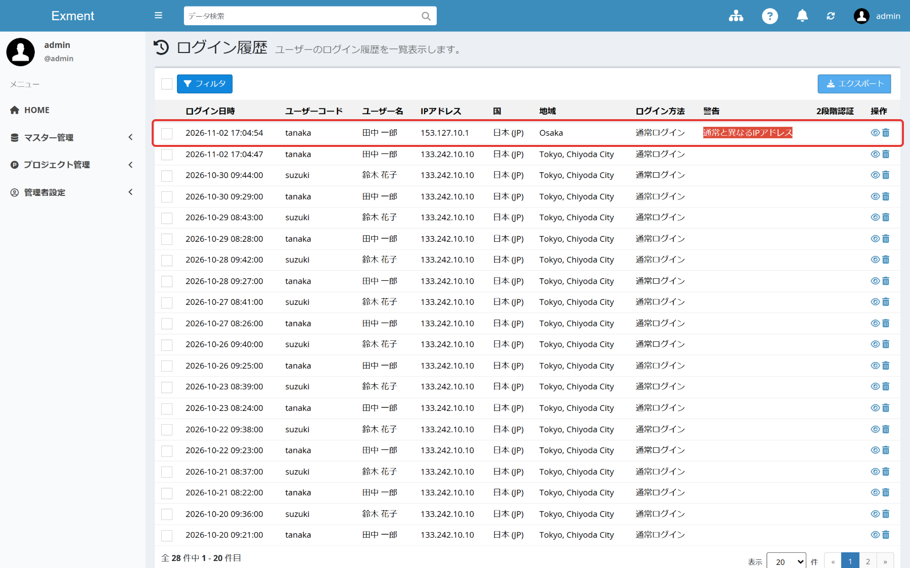
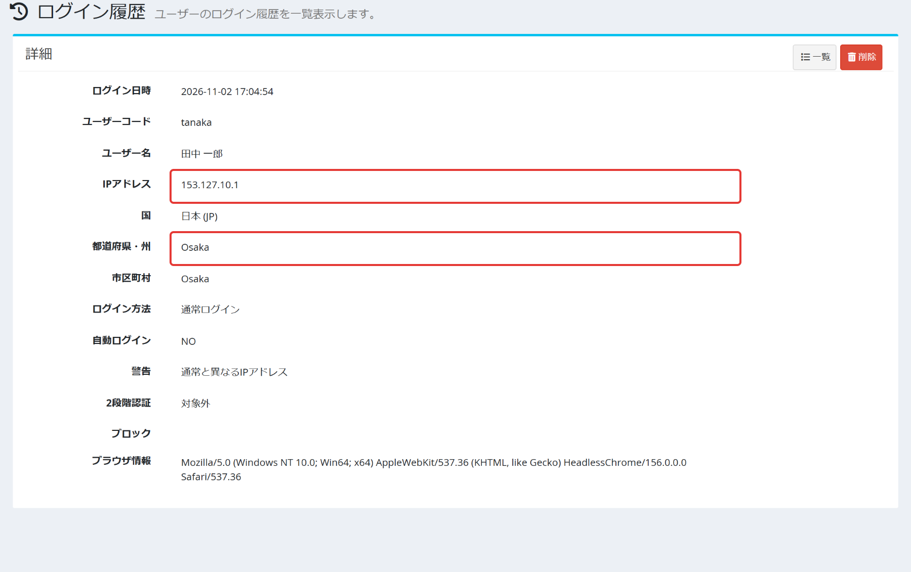
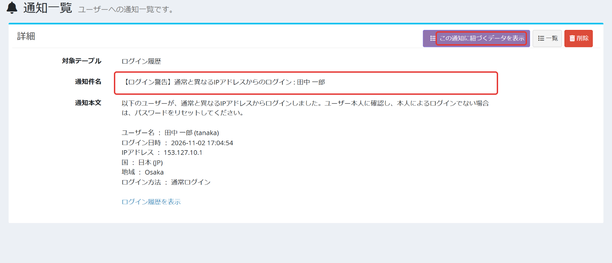
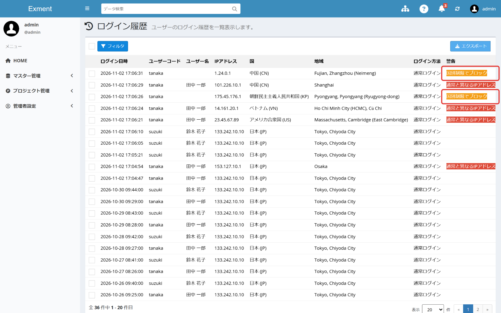
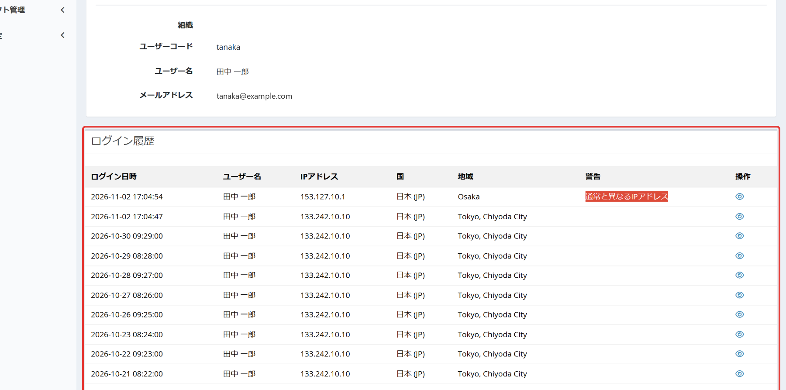
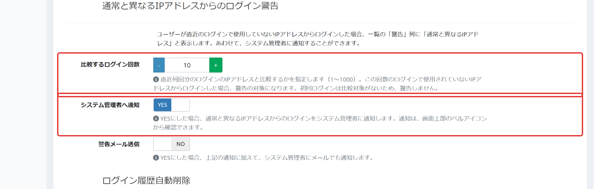

# ログイン履歴
ユーザーがExmentにログインした履歴を、Web画面で一覧表示します。  
いつ・誰が・どこからログインしたかを確認でき、通常と異なるIPアドレスからのログインには警告が表示されます。

  


## 記録される内容
ユーザーがログインに成功するたびに、1件の履歴を記録します。  
通常のログインのほか、LDAP・OAuth・SAMLによるログイン、「ログイン状態を記憶」による自動ログインも対象です。  
また、[国別ログイン制限](/ja/login_setting#国別ログイン制限)によってブロックしたログインも記録します。詳細は[ブロックしたログイン](#ブロックしたログイン)をご確認ください。  
※APIの認証は対象外です。APIの実行内容は[操作ログ](/ja/logs)で確認できます。


## 確認方法
- 以下のURLを入力します。  
http(s)://(ExmentのURL)/admin/login_history  

- もしくは、メニューに「ログイン履歴」を追加します。  
「管理者設定」 > 「メニュー」ページを開き、メニュー種類「システムメニュー」を選択すると、対象の「ログイン履歴」が表示されますので、選択し、保存を行ってください。  
※「ログイン履歴」は、デフォルトの設定ではメニューに表示されていません。

- 画面を表示できるのは、システム管理者権限を持つユーザーです（操作ログと同じです）。役割グループの「ユーザーログイン設定」権限だけでは表示できません。

- データの詳細を表示したい場合は、該当行をクリックするか、行の「表示」アイコンをクリックしてください。  

- 一覧上部の「フィルタ」から、ユーザーコード・ユーザー名・IPアドレス・国・警告・ブロック・ログイン日時で絞り込むことができます。

- ユーザーごとのログイン履歴は、ユーザーの詳細画面でも確認できます。詳細は[ユーザー詳細画面での確認](#ユーザー詳細画面での確認)をご確認ください。

- 一覧右上の「エクスポート」から、CSV・Excel形式で出力できます。

- 履歴を削除する場合は、行の「削除」アイコンをクリックするか、左のチェックボックスで複数の行を選択して「削除」を実行してください。  
※削除した履歴は元に戻せません。保存期間を決めて自動的に削除する場合は、[ログイン履歴自動削除](#ログイン履歴自動削除)をご利用ください。

- ログイン履歴は、画面から編集することはできません。


### 各項目について

- ##### ログイン日時
ログインした日時です。

- ##### ユーザーコード・ユーザー名
ログインしたユーザーです。ログイン時点の値を保存しているため、その後ユーザー名を変更したり、ユーザーを削除した場合も、履歴には当時の値が表示されます。

- ##### IPアドレス
ログインした端末のIPアドレスです。  
※Exmentをリバースプロキシやロードバランサーの背後で運用している場合は、[リバースプロキシの設定](/ja/additional_reverse_proxy)を行ってください。設定していない場合、すべての履歴がプロキシのIPアドレスで記録されます。

- ##### 国・地域
IPアドレスから判定した、国と地域(都道府県・州、市区町村)です。  
判定には[GeoIPデータベース](#geoipデータベース)が必要です。

- ##### ログイン方法
通常ログイン、LDAP認証、OAuth認証、SAML認証のいずれかです。

- ##### 警告
以下のいずれかを表示します。  
    - 通常と異なるIPアドレス : ユーザーが、通常と異なるIPアドレスからログインしました。詳細は[通常と異なるIPアドレスの判定](#通常と異なるipアドレスの判定)をご確認ください。
    - 国別制限でブロック : [国別ログイン制限](/ja/login_setting#国別ログイン制限)によって、ログインをブロックしました。詳細は[ブロックしたログイン](#ブロックしたログイン)をご確認ください。

- ##### 2段階認証
[2段階認証](/ja/login_2factor_setting)の状態です。  
    - 完了 : パスワードの認証後、2段階認証も完了しました。
    - 未完了 : パスワードの認証には成功しましたが、2段階認証は完了していません。
    - 空欄(詳細画面では「対象外」) : 2段階認証の対象外のログインです。ワンタイムパスワードの入力はありません。以下の場合が該当します。
        - 2段階認証を使用していない場合
        - OAuth認証・SAML認証によるログイン
        - 2段階認証の「役割グループごとに対象を指定する」が「YES」で、ユーザーが2段階認証の対象外の場合。詳細は[2段階認証の対象](/ja/login_2factor_setting#_2段階認証の対象)をご確認ください。
        - ブロックしたログイン

- ##### ブロック(詳細画面のみ)
ブロックしたログインの場合、ブロックした理由(「国別制限でブロック」)を表示します。ログインに成功した場合は空欄です。

- ##### 自動ログイン(詳細画面のみ)
「ログイン状態を記憶」による自動ログインの場合、YESになります。

- ##### ブラウザ情報(詳細画面のみ)
ログインした端末のブラウザ情報(ユーザーエージェント)です。
  


## 通常と異なるIPアドレスの判定
ログインしたユーザーの、直近のログイン履歴(デフォルトでは10回分)で使用されたIPアドレスと比較し、いずれとも異なるIPアドレスからのログインだった場合に、警告を表示します。

- ログイン履歴がないユーザー(初回ログイン)は、比較対象がないため、警告は表示されません。
- 比較するのは、同じユーザーの履歴のみです。他のユーザーが使用したIPアドレスは比較対象になりません。
- 2段階認証が「未完了」の履歴と、[ブロックしたログイン](#ブロックしたログイン)の履歴は、「使用したIPアドレス」として扱いません。
- IPv6アドレスは、先頭64ビット(ネットワーク部)が同じであれば、同じIPアドレスとして扱います。
- 比較するログイン回数は、[警告通知の設定](#警告通知の設定)で変更できます。

※自宅や外出先など、普段と異なる場所からログインした場合も警告が表示されます。警告は、不正ログインを断定するものではありません。  
※一度警告の対象になったIPアドレスも、以降は「使用したIPアドレス」として比較対象に含まれます。同じIPアドレスからの2回目以降のログインには、警告は表示されません。

### システム管理者への通知
警告の対象となるログインがあった場合、システム管理者に通知します。

- 画面上部のベルアイコンに通知が表示されます。通知を開くと、ユーザー・ログイン日時・IPアドレス・国・地域を確認でき、「ログイン履歴を表示」から該当の履歴を表示できます。
  

- [警告通知の設定](#警告通知の設定)で「警告メール送信」をYESにすると、あわせてシステム管理者にメールでも通知します。
- 通知が不要な場合は、「システム管理者へ通知」をNOにしてください。一覧の「警告」列の表示は、通知の設定に関係なく行われます。


## ブロックしたログイン
[国別ログイン制限](/ja/login_setting#国別ログイン制限)を使用している場合、許可していない国からのログインをブロックし、ログイン履歴に記録します。  
一覧の「警告」列に「国別制限でブロック」と表示されます。
  

- ログインフォーム(通常ログイン・LDAP認証)でブロックした場合、ユーザーコードには、ログイン画面で入力されたIDを記録します。パスワードの認証前にブロックするため、ユーザー名は空欄になります。
- OAuth認証・SAML認証でブロックした場合、ユーザーコード・ユーザー名は空欄になり、ログインプロバイダのみ記録します。
- 「ログイン状態を記憶」による自動ログインをブロックした場合、ユーザーコード・ユーザー名を記録し、「自動ログイン」はYESになります。
- ブロックしたログインは、システム管理者への通知([システム管理者への通知](#システム管理者への通知))の対象外です。
- 「フィルタ」の「ブロック」で「ブロックされたログイン」を選択すると、ブロックしたログインのみを表示できます。「ログイン成功」を選択すると、ブロックしたログインを除いて表示します。
- エクスポートしたファイルでは、最後の列「ブロック」に、ブロックした理由(国別ログイン制限の場合は「country」)を出力します。ログインに成功した場合は空欄です。


## ユーザー詳細画面での確認
ユーザーの詳細画面の下部に、そのユーザーのログイン履歴を表示します。  
  

- 表示する項目は、ログイン日時・ユーザー名・IPアドレス・国・地域・警告です。
- 新しい順に、1ページに10件ずつ表示します。
- 行の「表示」アイコンをクリックすると、ログイン履歴の詳細画面を表示します。
- 表示できるのは、ログイン履歴画面を表示できるユーザー(システム管理者)のみです。
- ログインユーザーとして設定されていないユーザー(過去のログイン履歴もないユーザー)には表示されません。
- この画面から、ログイン履歴を編集・削除することはできません。


## 警告通知の設定
ログイン履歴画面の下部で、警告の判定と通知に関する設定を行うことができます。
  

#### 比較するログイン回数
- 直近何回分のログイン履歴のIPアドレスと比較するかを指定します。1～1000の整数を入力してください。
- デフォルト値は「10」です。

#### システム管理者へ通知
- YESにすると、通常と異なるIPアドレスからのログインがあった場合に、システム管理者のベルアイコンに通知します。
- デフォルト値は「YES」です。

#### 警告メール送信
- YESにすると、ベルアイコンの通知に加えて、システム管理者にメールでも通知します。
- 「システム管理者へ通知」がYESの場合のみ設定できます。
- デフォルト値は「NO」です。


## GeoIPデータベース
国・地域の判定は、サーバーに配置したGeoIPデータベースファイルを使用して行います。  
判定のために、IPアドレスを外部のサービスへ送信することはありません。

- GeoIPデータベースを配置していない場合も、ログイン履歴は記録されます。国・地域のみ空欄になります。
- 社内ネットワークなどのプライベートIPアドレスは、国・地域を判定できません。
- 判定結果は、おおよその位置です。VPNやモバイル回線では、実際と異なる場所になることがあります。

### 配置方法
サーバーで、以下のコマンドを実行してください。  
[DB-IP](https://db-ip.com)が無償で公開している「IP to City Lite」データベース(約130MB)をダウンロードし、`storage/app/geoip`に配置します。  

```
php artisan exment:geoip-update
```

※サーバーからインターネットに接続できない場合は、別の端末でダウンロードしたファイル(拡張子mmdb)を、`storage/app/geoip`に配置してください。

### 自動更新
GeoIPデータベースは毎月更新されます。古いデータベースを使い続けると、判定の精度が下がります。  
ログイン履歴画面の下部で「GeoIPデータベース自動更新」をYESにすると、毎月自動的にダウンロードして更新します。  
※自動更新には、[タスクスケジュール](/ja/additional_task_schedule)の設定が必要です。


## ログイン履歴自動削除
ログイン履歴画面の下部で、ログイン履歴を自動削除する設定を行うことができます。

#### ログイン履歴自動削除
- YESにすると、保存期間より古いログイン履歴を、1日1回、自動的に削除します。
- デフォルト値は「NO」です。

#### 履歴保存期間（日数）
- ログイン履歴を保持する日数を指定します。1以上の値を入力してください。
- デフォルト値は「365」です。

※自動削除には、[タスクスケジュール](/ja/additional_task_schedule)の設定が必要です。


## 設定値
以下の値は、.envファイルで変更できます。

#### GeoIPデータベースのパス
- 設定キー : EXMENT_GEOIP_DB_PATH
- 既定値 : なし
- 役割 : GeoIPデータベースファイル(拡張子mmdb)のフルパスです。未設定の場合、`storage/app/geoip`内のmmdbファイルを使用します。

#### GeoIPデータベースのダウンロードURL
- 設定キー : EXMENT_GEOIP_DOWNLOAD_URL
- 既定値 : `https://download.db-ip.com/free/dbip-city-lite-{year}-{month}.mmdb.gz`
- 役割 : `php artisan exment:geoip-update`でダウンロードするURLです。{year}、{month}は、実行時の年(4桁)、月(2桁)に置き換えられます。  
例えば2026年11月に実行した場合は、`https://download.db-ip.com/free/dbip-city-lite-2026-11.mmdb.gz`からダウンロードします。  
通常は変更する必要はありません。社内のミラーサーバーなど、別の場所からダウンロードする場合のみ設定してください。
