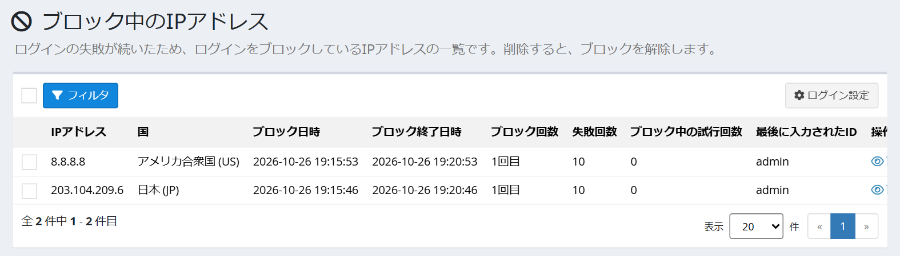
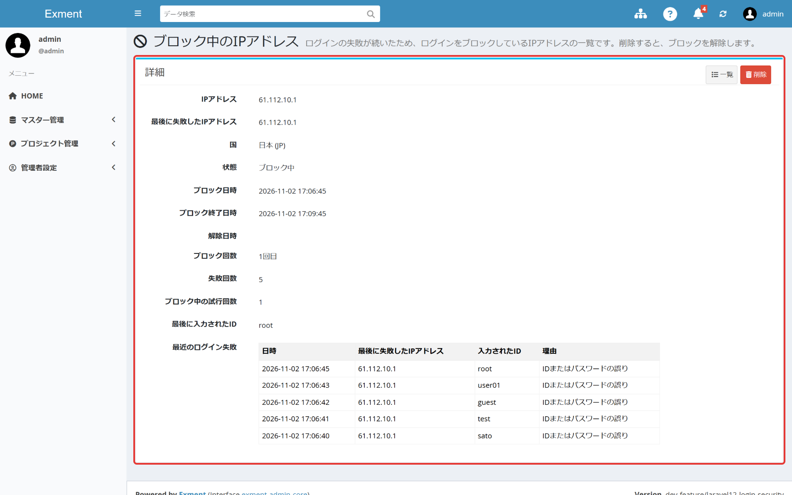

# ブロック中のIPアドレス
ログインの失敗が続いたため、ログインをブロックしているIPアドレスを一覧表示します。  
ブロックの解除も、この画面から行います。  
IPブロックの設定方法は、[ログイン設定 - ブルートフォース攻撃対策](/ja/login_setting#ブルートフォース攻撃対策)をご確認ください。

## 確認方法
- 以下のURLを入力します。  
http(s)://(ExmentのURL)/admin/login_ip_block  

- 「ログイン設定」画面の「ブルートフォース攻撃対策」欄にあるリンク「ブロック中のIPアドレス一覧」からも表示できます。

- メニューに追加する場合は、「管理者設定」 > 「メニュー」ページを開き、メニュー種類「システムメニュー」を選択して、対象の「ブロック中のIPアドレス」を選択し、保存を行ってください。  
※デフォルトの設定ではメニューに表示されていません。

- 画面を表示できるのは、システム管理者権限を持つユーザーです（ログイン履歴と同じです）。

- IPアドレスがブロックされた場合、システム管理者に通知されます(設定でOFFにできます)。通知から、ブロックしたIPアドレスの詳細を表示できます。

## 一覧の項目

| 項目 | 説明 |
|---|---|
| IPアドレス | ブロックしているIPアドレスです。IPv6の場合は、上位64ビットのネットワーク(例: 2001:db8:1:2::/64)で表示します。 |
| 国 | IPアドレスから判定した国です。判定には[GeoIPデータベース](/ja/login_history#geoipデータベース)が必要です。 |
| ブロック日時 | ブロックを開始した日時です。 |
| ブロック終了日時 | この日時を過ぎると、自動的にブロックが終わります。 |
| ブロック回数 | 24時間以内に繰り返しブロックされた回数です（1回目、2回目、3回目以降）。「再発時にブロック時間を延長する」がYESの場合、回数に応じてブロック時間が長くなります。 |
| 失敗回数 | ブロックの原因となったログインの失敗回数です。 |
| ブロック中の試行回数 | ブロック中に、このIPアドレスからログインしようとした回数です。 |
| 最後に入力されたID | ブロックの直前に入力されたIDです。 |

- 表示されるのは、現在ブロック中のIPアドレスです。ブロックが終わったIPアドレスは表示されません。
- 一覧上部の「フィルタ」から、IPアドレス・最後に入力されたIDで絞り込むことができます。

## 詳細画面
該当行をクリックするか、行の「表示」アイコンをクリックすると、詳細を表示します。  
上記の項目に加えて、以下の内容を確認できます。

- 状態：ブロック中、ブロック終了、解除済み
- 最後に失敗したIPアドレス(IPv6の場合、ネットワーク内の実際のアドレス)
- 解除日時
- 最近のログイン失敗：このIPアドレスからの最近のログインの失敗(最大20件)。日時、IPアドレス、入力されたID、理由(IDまたはパスワードの誤り、CAPTCHAの誤り)を表示します。
  

## ブロックの解除
社内のIPアドレスなど、正規の利用者がブロックされた場合は、ブロックを解除してください。

- 一覧の行の「削除」アイコン、または詳細画面の「削除」ボタンをクリックすると、ブロックを解除します。
- 複数のIPアドレスを解除する場合は、行のチェックボックスを選択し、一覧上部の操作から削除を行ってください。
- 解除したIPアドレスは、すぐにログインできるようになります。解除前の失敗回数は数え直され、次にブロックされた場合も、1回目のブロック時間からになります。
- 同じIPアドレスが今後ブロックされないようにする場合は、ログイン設定の「ブロックしないIPアドレス」に追加してください。

