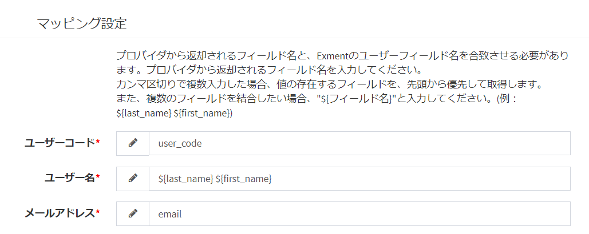
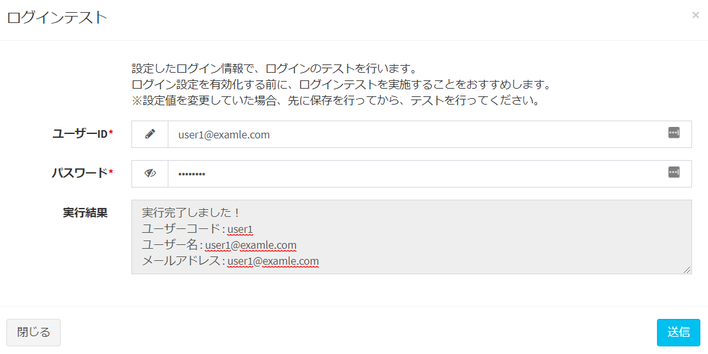

# シングルサインオン(LDAP)
LDAP を使ったシングルサインオン（SSO）の設定のしかたです。  
Exment では、[ログイン設定](/ja/login_setting)でシングルサインオンを追加できます。追加すると、Exment 専用のログインパスワードを管理しなくても、プロバイダ（ここでは LDAP のサーバー）の ID とパスワードでログインできます。

設定は、次の 2 つの順に行います。

1. **サーバーの準備**（PHP の拡張機能と、ライブラリを入れる）… 「サーバー・プロバイダ設定」
2. **画面での設定**（ログイン設定画面で、プロバイダを追加する）… 「画面での設定」

#### 注意点
- **このマニュアルでは、LDAPに詳しい方向けの手順になります。各プロバイダの設定方法などは、各資料をご参照ください。**


## サーバー・プロバイダ設定
ログイン設定画面でプロバイダを追加する前に、サーバーでコマンドを実行して、拡張機能をインストールする必要があります。

### Windowsの場合

1. php.ini ファイルを開きます。  
※php.ini ファイルの場所は、サーバーのインストールによって違います。

2. 次の記述を追加します。

```
extension=ldap
```

3. PHP を再起動します。

4. 次のコマンドを実行します。

```
composer require directorytree/ldaprecord
```
※Exment v7.0.0以降で使用するライブラリです。Exment v6.x以前をご利用の場合は、代わりに「composer require adldap2/adldap2-laravel」を実行してください。  


### Linux(CentOS)の場合

> パッケージの追加が必要なため、レンタルサーバーなどでは導入できない場合があります。

1. 次のコマンドを実行して、パッケージをインストールします。  
※先に、[Linuxによる環境構築](/ja/install_linux)などで行っている、epel の更新と rpm のインストールを済ませてください。

```
sudo dnf install php-ldap
```

2. php.ini ファイルを開きます。  
※php.ini ファイルの場所は、サーバーのインストールによって違います。

3. 次の記述を追加します。

```
extension=ldap.so
```


4. 次のコマンドを実行します。

```
composer require directorytree/ldaprecord
sudo service httpd restart
```
※Exment v7.0.0以降で使用するライブラリです。Exment v6.x以前をご利用の場合は、代わりに「composer require adldap2/adldap2-laravel」を実行してください。  


## 画面での設定
サーバーの設定が終わったら、[ログイン設定画面](/ja/login_setting)で、プロバイダを追加します。

1. 管理者アカウントで、システム設定画面を開きます。  
ページの右上の「ログイン設定」ボタンから、ログイン設定画面を開きます。  
  

2. 新規ボタンを押して、ログイン設定を作ります。入力する項目は、下のとおりです。

- **LDAP名(英数字)** : ほかと重ならないように、英数字で入力してください。

### LDAP設定
LDAP の設定を入力してください。  
(Active Directory の場合)
  

(openLDAP の場合)
  

### マッピング設定
プロバイダから返ってくるフィールド名と、Exment の「ユーザー」テーブルのフィールド名を、対応させる必要があります。  

  

プロバイダから返ってくるフィールド名を入力してください。

  

書き方は 3 つあります。

| 書き方 | 使うとき | 例 |
|---|---|---|
| フィールド名をそのまま書く | 1 つのフィールドをそのまま使う | |
| カンマ区切りで複数書く | 候補がいくつかあり、値があるものを先頭から順に使う | seimei,username |
| ${フィールド名} の形で複数書く | 複数のフィールドを組み合わせて使う | ${last_name} ${first_name} |

#### フィールド名をそのまま記入する
プロバイダから返ってくるフィールド名を、そのまま書きます。
  

#### フィールド名をカンマ区切りで複数記入する
使いたいフィールドの候補がいくつかあるときは、プロバイダから返ってくるフィールド名を、カンマ区切りで書きます。  
カンマ区切りの先頭から順に値を探し、値があれば、その値を使います。  
(例：できれば姓名フィールド「seimei」を使用したいが、プロバイダ側で必須項目でないので、「seimei」に値があればその値を、なければ「username」を、ユーザー名として使用する → seimei,username と記入)
  

#### フィールド名を、${フィールド名}形式で複数記入する
プロバイダから返ってくるユーザー情報を複数組み合わせて、Exment のユーザー情報として使いたいときの書き方です。${フィールド名} の形で、フィールドを複数書いてください。  
(例：「氏名」フィールドはプロバイダにないが、「姓(last_name)」「名(first_name)」フィールドがそれぞれあるので、「姓 名」と組み合わせて使用する → ${last_name} ${first_name} と記入)
  


### ユーザー設定
ログインしたユーザーの扱いを設定します。

  

#### アカウント検索列
SSO で取得したアカウントの、どの列を使って Exment のアカウントを探すかを設定します。

#### ユーザー新規作成
- YES の場合：ログインしたユーザーが Exment にいなかったとき、ログイン情報を使って、Exment のユーザーを新しく作ります。
- NO の場合：先に、Exment にユーザーを作っておく必要があります。ログインしたユーザーが Exment にいなかったときは、エラーが表示されます。

#### 役割グループ設定
YES の場合、Exment のユーザーを新しく作るときに、役割グループに紐付けることができます。  

#### ユーザー情報を更新する
YES の場合、もう一度ログインしたときに、ユーザー名などのユーザー情報を更新します。


- データを 1 回以上保存すると、「有効化」ボタンと「ログインテスト」ボタンが表示されます。

- 有効フラグを YES にすると、ログイン画面に SSO 認証用のボタンが表示されます。  

(Active Directory の場合)

  

(openLDAP の場合)

  


### ログインボタン設定
ログイン画面に表示する、ログインボタンの設定を行います。  

  


### 有効化とログインテスト
- データを 1 回以上保存すると、「有効化」ボタンと「ログインテスト」ボタンが表示されます。

  

#### 有効化
- 有効化を実行すると、ログイン画面に SSO 認証用のボタンが表示されます。  
※通常の「ログイン」ボタンを表示したくない場合は、[ログイン設定](/ja/login_setting)で、「既定のログインを表示する」を「NO」にしてください。  
  


#### ログインテスト
- 「ログインテスト」ボタンをクリックすると、設定したログイン情報で、ログインのテストができます。ログイン設定を有効化していなくても、テストできます。  

  


- 「ログイン」ボタンをクリックすると、設定が正しいかをテストできます。  
結果は、「実施結果」の項目に表示されます。

  

  
  
[←ログイン設定へ戻る](/ja/login_setting)
