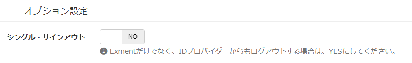

# シングルサインオン(OAuth)
OAuth を使ったシングルサインオン（SSO）の設定のしかたです。Google や Microsoft などのアカウントで、Exment にログインできるようになります。  
Exment では、[ログイン設定](/ja/login_setting)でシングルサインオンを追加できます。追加すると、Exment 専用のログインパスワードを管理しなくても、プロバイダ（Google など、ログインを受け持つサービス）の ID とパスワードでログインできます。

設定は、次の 2 つの順に行います。

1. **サーバーとプロバイダの準備**（プロバイダ側にアプリケーションを作り、必要ならライブラリを入れる）… 「サーバー・各プロバイダ設定」
2. **画面での設定**（ログイン設定画面で、プロバイダを追加する）… 「画面での設定」

1 の手順は、使うプロバイダによって変わります。

| 使うプロバイダ | 見るところ |
|---|---|
| Google、Facebook、Twitter、GitHub、LinkedIn、Bitbucket | (1) Socialite標準で用意されているプロバイダの場合 |
| Office365、Microsoft Graph | (2) Exment拡張で用意しているプロバイダの場合 |
| それ以外 | (3) 各自でプロバイダを用意する場合 |

#### 注意点
- Exmentでは、[Socialite](https://github.com/laravel/socialite)でシングルサインオン処理を実装しています。
- **このマニュアルでは、OAuthに詳しい方向けの手順になります。各プロバイダのClient IDやClient Secretの作成方法などは、各資料をご参照ください。**
- <span class="red">v3.0.16以下で、Googleログインができない方は、[こちらの手順](/ja/patch/sso_google)で、対応を行ってください。</span>

#### 参考リンク
- [オープンソースWebデータベース『Exment』で、GoogleアカウントによるSSOに対応する](https://qiita.com/hirossyi73/items/70dcc35305a96abace08)


## サーバー・各プロバイダ設定
ログイン設定画面でプロバイダを追加する前に、サーバーでコマンドを実行して、拡張機能をインストールする必要があります。

### (1) Socialite標準で用意されているプロバイダの場合
- Socialite が標準で用意しているプロバイダは、次のとおりです。（カッコの中の文字列は、あとで service を指定するときに使います）
    - Google (google)
    - Facebook (facebook)
    - Twitter (twitter)
    - GitHub (github)
    - LinkedIn (linkedin)
    - Bitbucket (bitbucket)

- それぞれのプロバイダで、Exment 用のアプリケーションを作ります。  
※callback URL は、次のとおりです。  
http(s)://(ExmentのURL)/auth/login/(socialiteのprovider名)/callback  

    - 例1 GitHubの場合：http(s)://(ExmentのURL)/auth/login/github/callback  
    - 例2 Facebookの場合：http(s)://(ExmentのURL)/auth/login/facebook/callback  
    - 例3 Googleの場合：http(s)://(ExmentのURL)/auth/login/google/callback  

> ※URL は、「/admin」が付かない標準の設定（v7.2.1 以降に新しくインストールしたサイト）の場合です。`.env` の `ADMIN_ROUTE_PREFIX` に値がある場合（前の版で入れたサイトは「admin」）は、サイトの URL のあとにその値を足してください（例：`http(s)://(ExmentのURL)/admin/auth/login/google/callback`）。詳しくは[URLに含む「admin」の変更・削除](/ja/additional_prefix)をご覧ください。

- 次のコマンドを、Exment のルートディレクトリで実行します。

~~~
composer require laravel/socialite=~5.1
~~~
※Exment v7.0.0以降では、「laravel/socialite」はExmentの依存ライブラリとして自動的にインストールされるため、このコマンドの実行は不要です。

- [画面での設定](#画面での設定)を行います。


### (2) Exment拡張で用意しているプロバイダの場合
- 一部のプロバイダは、Exment の拡張として用意しています。（カッコの中の文字列は、あとで service を指定するときに使います）
    - Office365、Microsoft Graph (graph)

- それぞれのプロバイダで、Exment 用のアプリケーションを作ります。  
※callback URL は、次のとおりです。  
http(s)://(ExmentのURL)/auth/login/(socialiteのprovider名)/callback  

    - 例 Office365の場合：http(s)://(ExmentのURL)/auth/login/graph/callback

- 次のコマンドを、Exment のルートディレクトリで実行します。

~~~
composer require exceedone/microsoft-graph
~~~

- [画面での設定](#画面での設定)を行います。


### (3) 各自でプロバイダを用意する場合
(1)(2) にないプロバイダの場合は、[Socialite Providers](https://socialiteproviders.github.io/)で、非公式のプロバイダーを追加します。  
非公式のプロバイダーにも、アバター（ユーザーの画像）を取得する処理は入っていません。アバターを取得したい場合は、処理を追加します。(任意)  
  
※手順がいくつかあります。くわしくは[独自プロバイダ作成方法](#独自プロバイダ作成方法)をご確認ください。

- 手順が終わったら、[画面での設定](#画面での設定)を行います。


## 画面での設定
サーバーの設定が終わったら、[ログイン設定画面](/ja/login_setting)で、プロバイダを追加します。

1. 管理者アカウントで、システム設定画面を開きます。  
ページの右上の「ログイン設定」ボタンから、ログイン設定画面を開きます。  
  

2. 新規ボタンを押して、ログイン設定を作ります。入力する項目は、下のとおりです。

### プロバイダ種類
  

- 「サーバー・各プロバイダ設定」で (1) のプロバイダを選んだ場合は、そのプロバイダ名を選んでください。  

- 「サーバー・各プロバイダ設定」で (2)(3) のプロバイダを選んだ場合は、「その他」を選んでください。  
「その他」を選ぶと表示される「プロバイダ種類(英数字)」には、Socialite で指定されているプロバイダ種類の英数字を入力してください。  
例 Microsoft Graphの場合："graph"

  


### クライアントID、クライアントシークレット
プロバイダから提供された文字列を入力してください。

### スコープ
ログインだけなら、基本的には、はっきりした用途はありません。[アクセストークン取得](#アクセストークン取得)でアクセストークンを取得する場合は、設定することをおすすめします。

### オプション設定
選んだプロバイダ種類に合わせた、オプションの設定を行います。
(オプション設定のないプロバイダ種類を選択した場合は、表示されません。)

#### プロバイダ種類が「その他」の場合
 

##### シングル・サインアウト
Exment からログアウトするときに、SSO でログインしたプロバイダーからもログアウトします。<span class="red">※現在、Oktaには対応しておりません。</span>

<!---
  OAuth、Samlで同じものを記載
-->
### ユーザー設定
ログインしたユーザーの扱いを設定します。

  

#### アカウント検索列
SSO で取得したアカウントの、どの列を使って Exment のアカウントを探すかを設定します。

#### ユーザー新規作成
- YES の場合：ログインしたユーザーが Exment にいなかったとき、ログイン情報を使って、Exment のユーザーを新しく作ります。
- NO の場合：先に、Exment にユーザーを作っておく必要があります。ログインしたユーザーが Exment にいなかったときは、エラーが表示されます。

#### 役割グループ設定
YES の場合、Exment のユーザーを新しく作るときに、役割グループに紐付けることができます。  

#### ユーザー情報を更新する
YES の場合、もう一度ログインしたときに、ユーザー名などのユーザー情報を更新します。


- データを 1 回以上保存すると、「有効化」ボタンと「ログインテスト」ボタンが表示されます。

- 有効フラグを YES にすると、ログイン画面に SSO 認証用のボタンが表示されます。  
※通常は、ユーザー ID とパスワードを入力する既定のログインフォームも、いっしょに表示されます。[SSO設定](/ja/system_setting?id=sso設定)で、画像のように表示しないこともできます。  


### ログインボタン設定
ログイン画面に表示する、ログインボタンの設定を行います。  
※この設定をしなくても、上の「(1) Socialite標準で用意されているプロバイダの場合」にあるプロバイダは、それぞれのフォーマットで表示されます。

  


### 有効化とログインテスト
- データを 1 回以上保存すると、「有効化」ボタンと「ログインテスト」ボタンが表示されます。

  

#### 有効化
- 有効化を実行すると、ログイン画面に SSO 認証用のボタンが表示されます。  
  

#### ログインテスト
- 「ログインテスト」ボタンをクリックすると、設定したログイン情報で、ログインのテストができます。ログイン設定を有効化していなくても、テストできます。  
**そのときは、「テスト用リダイレクトURL」に表示されている URL を、プロバイダの OAuth 認証設定のコールバック URL に、一時的に追加するか、変更してください。**

  


- 「ログイン」ボタンをクリックすると、設定が正しいかをテストできます。  
結果は、「実施結果」の項目に表示されます。


### アクセストークン取得

- ログインのあとで、アクセストークンとリフレッシュトークンを取得する場合は、次の方法で取得してください。

~~~ php
use Exceedone\Exment\Services\Login\LoginService;

$access_token = LoginService::getAccessToken();
$refresh_token = LoginService::getRefreshToken();
~~~


## 独自プロバイダ作成方法
(3) の手順を行う場合の、くわしい手順です。[Socialite Providers](https://socialiteproviders.github.io/)で指定されているパッケージを追加します。  
また、アバターを取得するための独自プロバイダを作ります。（任意）

| 手順 | 必要かどうか |
|---|---|
| プロバイダ設定・追加 | 必須 |
| アバター取得のための開発 | 任意 |
| サービスプロバイダ追加 | 必須 |
| オプション設定の追加 | プロバイダにより必須 |
| 画面設定の実施 | 必須 |

### (必須)プロバイダ設定・追加
- それぞれのプロバイダで、Exment 用のアプリケーションを作ります。  
※callback URL は、次のとおりです。  
http(s)://(ExmentのURL)/auth/login/(socialiteのprovider名)/callback  

    - 例 Microsoft Graphの場合：http(s)://(ExmentのURL)/auth/login/graph/callback

- 次のコマンドを、Exment のルートディレクトリで実行します。

~~~
composer require laravel/socialite=~5.1
~~~
※Exment v7.0.0以降では、「laravel/socialite」はExmentの依存ライブラリとして自動的にインストールされるため、このコマンドの実行は不要です。

- [Socialite Providers](https://socialiteproviders.github.io/)で指定されているパッケージを追加します。  

    - 例：Microsoft Graphの場合

~~~
composer require socialiteproviders/microsoft-graph
~~~

### (任意)アバター取得のための開発
※この独自プロバイダの作成は、アバターを取得するための、任意の手順です。アバターの取得がいらない場合は、作る必要はありません。

- アバターを取得するために、既存のプロバイダーを継承したクラスを 2 つ、フォルダー「app/Socialite」に作ります。※フォルダー「app/Socialite」がない場合は、作ってください。  
1 つ目は、MicrosoftGraphProvider.php です。インタフェース ProviderAvatar を implements し、getAvatar を実装します。  
getAvatar メソッドには、アバターを取得するための API の処理を書いてください。取得のための URL やエンドポイントは、それぞれの OAuth プロバイダでご確認ください。  
下の例は、Microsoft Graph での手順です。

~~~ php
<?php

namespace App\Socialite;

use Exceedone\Exment\Auth\ProviderAvatar;
use SocialiteProviders\Graph\Provider;

class MicrosoftGraphProvider extends Provider implements ProviderAvatar
{
    /**
     * Get avatar stream
     * @param mixed $token
     * @return string
     */
    public function getAvatar($token = null){
        try
        {
            $client = $this->getHttpClient();
            $response = $client->get('https://graph.microsoft.com/v1.0/me/photo/$value', [
                'headers' => [
                    'Authorization' => 'Bearer '.$token,
                    'Content-Type' => 'application/json;odata.metadata=minimal;odata.streaming=true'
                ],
                'http_errors' => false,
            ]);

            if($response->getStatusCode() == 404){
                return null;
            }

            return $response->getBody()->getContents();

        }
        catch (Exception $exception)
        {
            return null;
        }
        return null;
    }
}

~~~ 

- 2 つ目は、GraphExtendSocialite.php です。作った MicrosoftGraphProvider を指定します。

~~~ php
<?php

namespace App\Socialite;

use SocialiteProviders\Manager\SocialiteWasCalled;

class GraphExtendSocialite
{
    /**
     * Execute the provider.
     */
    public function handle(SocialiteWasCalled $socialiteWasCalled)
    {
        $socialiteWasCalled->extendSocialite(
            'graph', __NAMESPACE__.'\MicrosoftGraphProvider'
        );
    }
}

~~~ 

### (必須)サービスプロバイダ追加
- ファイル app/Providers/EventServiceProvider.php に、追加したプロバイダを書いて、サービスプロバイダを追加します。  
※アバターを取得するための独自開発をしたかどうかで、書く内容が変わります。  
また、「@handle」に書くクラス名は、多くの場合、[Socialite Providers](https://socialiteproviders.github.io/)で追加したプロバイダのマニュアルに書いてあります。ご確認ください。

~~~ php

// 例：Microsoft Graphの場合

protected $listen = [
    ///// アバターの取得のために独自開発を行った場合
    'App\Events\Event' => [
        'App\Listeners\EventListener',
    ],
    
    /// 追加
    \SocialiteProviders\Manager\SocialiteWasCalled::class => [
        '\App\Socialite\GraphExtendSocialite@handle', ///// アバターの取得のために独自開発を行った場合
        // 'SocialiteProviders\\Graph\\GraphExtendSocialite@handle', ///// 通常の取得の場合は、こちらをコメントアウトして記載
    ],
];

~~~
~~~php

// 例：EntraIDの場合

protected $listen = [
    // ... other listeners
    \SocialiteProviders\Manager\SocialiteWasCalled::class => [
        // ... other providers
        \SocialiteProviders\Microsoft\MicrosoftExtendSocialite::class.'@handle',
    ],
];

~~~

※Exment v7.0.0以降で新規インストールした場合(Laravel12で作成したプロジェクト)、「app/Providers/EventServiceProvider.php」は存在しません。その場合は、「app/Providers/AppServiceProvider.php」のbootメソッドに、以下のように記載してください。

~~~php

// 例：EntraIDの場合

public function boot(): void
{
    \Illuminate\Support\Facades\Event::listen(
        \SocialiteProviders\Manager\SocialiteWasCalled::class,
        [\SocialiteProviders\Microsoft\MicrosoftExtendSocialite::class, 'handle']
    );
}

~~~


### (プロバイダにより必須)オプション設定の追加
OAuth サインインのプロバイダによっては、追加の設定が必要です。  

  
例：[OKTA](https://github.com/SocialiteProviders/Okta)の場合
- config/services.php を開き、次の記述を追加します。

``` php
'okta' => [    
  'base_url' => env('OKTA_BASE_URL'), 
],
```

- .env ファイルを開き、次の記述を追加します。

```
OKTA_BASE_URL='https://<OKTAのドメイン>'
```

> 本来、Socialiteでは、config/services.phpの"client_id", "client_secret", "redirect"の設定値を必須としており、ExmentのOAuth認証では、画面で設定した値を、自動的に付与するようになっています。  
プロバイダ独自の設定値を入力したい場合は、config/services.phpに、上記のように値を追加するようにしてください。


### (必須)画面設定の実施

- サーバー側の設定がすべて終わったら、[画面での設定](#画面での設定)を行います。

  
  
[←ログイン設定へ戻る](/ja/login_setting)
