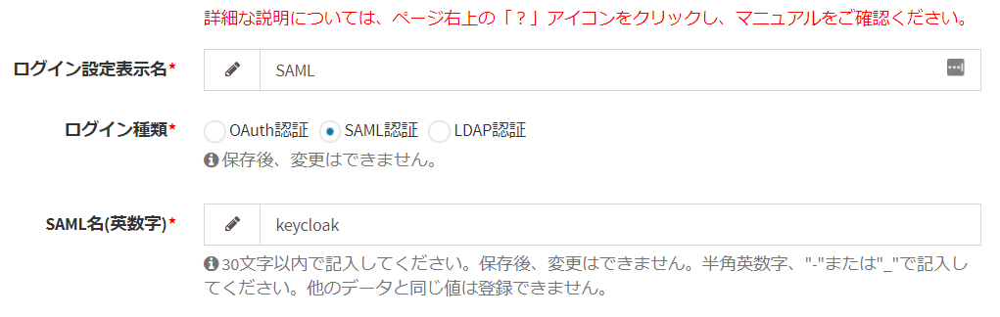
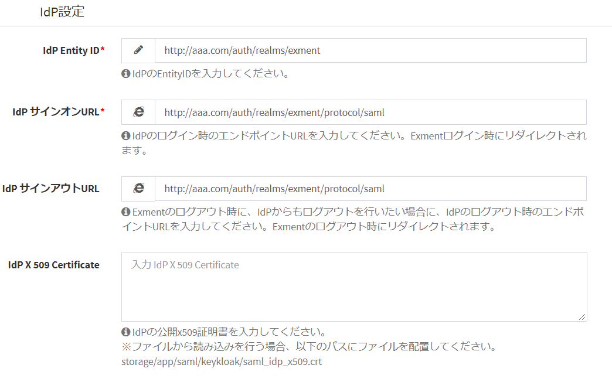
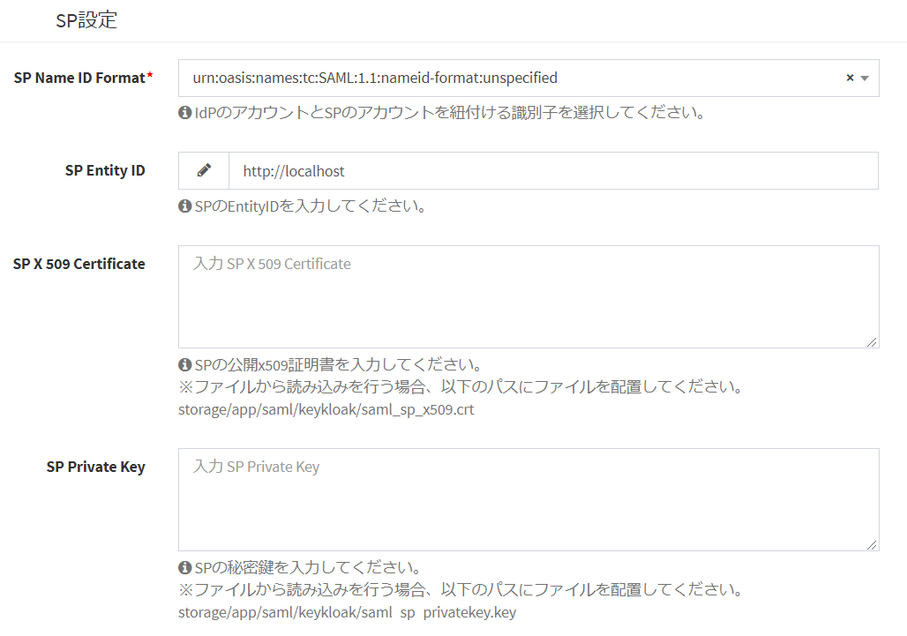
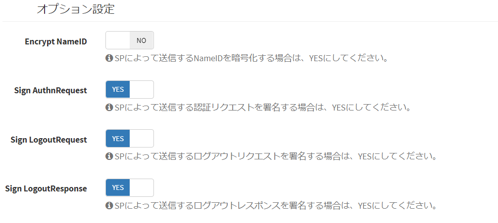
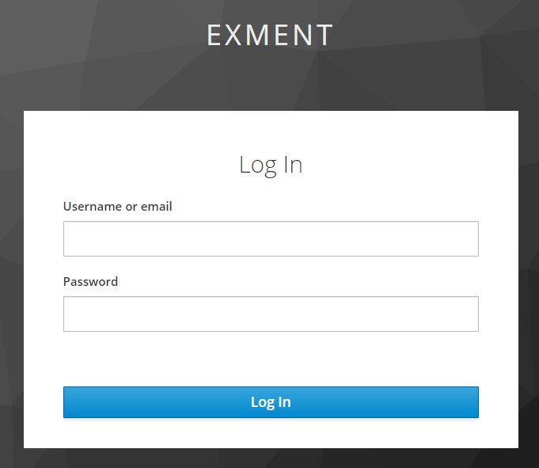
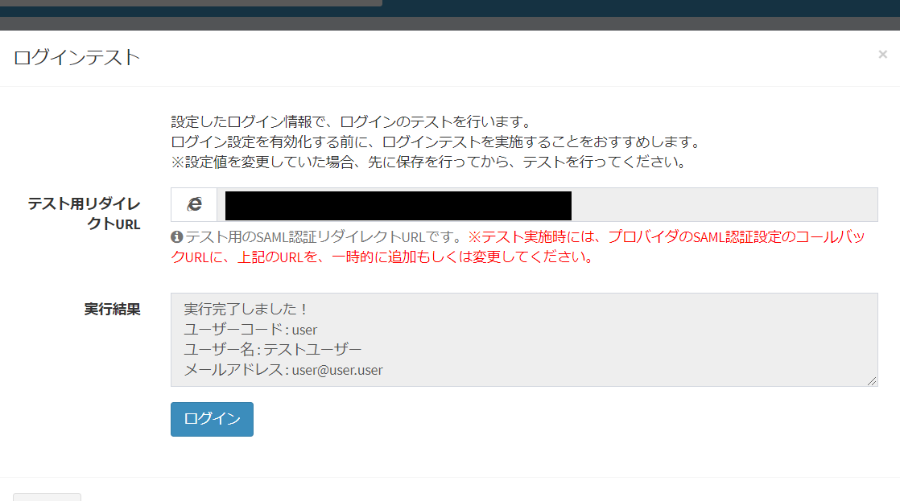

# シングルサインオン(SAML)
SAML を使ったシングルサインオン（SSO）の設定のしかたです。  
Exment では、[ログイン設定](/ja/login_setting)でシングルサインオンを追加できます。追加すると、Exment 専用のログインパスワードを管理しなくても、プロバイダ（ログインを受け持つサービス）の ID とパスワードでログインできます。

設定は、次の 2 つの順に行います。

1. **サーバーとプロバイダの準備**（ライブラリを入れ、プロバイダ側にアプリケーションを作る）… 「サーバー・プロバイダ設定」
2. **画面での設定**（ログイン設定画面で、プロバイダを追加する）… 「画面での設定」

#### 注意点
- **このマニュアルでは、SAMLに詳しい方向けの手順になります。各プロバイダの設定方法などは、各資料をご参照ください。**
- このマニュアルや Exment のページでは「SAML」と書いていますが、実際には SAML2 を使っています。

## サーバー・プロバイダ設定
ログイン設定画面でプロバイダを追加する前に、サーバーでコマンドを実行して、拡張機能をインストールする必要があります。

1. 次のコマンドを、Exment のルートディレクトリで実行します。

~~~
composer require aacotroneo/laravel-saml2
~~~

2. それぞれの SAML プロバイダで、Exment 用のアプリケーションを作ります。  
※callback URL は、次のとおりです。  
http(s)://(ExmentのURL)/saml/login/(後ほど追加するSAML名)/acs  

> ※URL は、「/admin」が付かない標準の設定（v7.2.1 以降に新しくインストールしたサイト）の場合です。`.env` の `ADMIN_ROUTE_PREFIX` に値がある場合（前の版で入れたサイトは「admin」）は、サイトの URL のあとにその値を足してください（例：`http(s)://(ExmentのURL)/admin/oauth/token`）。詳しくは[URLに含む「admin」の変更・削除](/ja/additional_prefix)をご覧ください。

3. [画面での設定](#画面での設定)を行います。

## 画面での設定
サーバーの設定が終わったら、[ログイン設定画面](/ja/login_setting)で、プロバイダを追加します。

1. 管理者アカウントで、システム設定画面を開きます。  
ページの右上の「ログイン設定」ボタンから、ログイン設定画面を開きます。  
  

2. 新規ボタンを押して、ログイン設定を作ります。入力する項目は、下のとおりです。

- **SAML名(英数字)** : コールバック URL などで使うプロバイダ名です。ほかと重ならないように、英数字で入力してください。

  

### IdP設定
IdP の設定を入力してください。
  

### SP設定
SP の設定を入力してください。
  

### オプション設定
オプションの設定を入力してください。
  

### マッピング設定
プロバイダから返ってくるフィールド名と、Exment の「ユーザー」テーブルのフィールド名を、対応させる必要があります。  

  

プロバイダから返ってくるフィールド名を入力してください。

  

書き方は 3 つあります。

| 書き方 | 使うとき | 例 |
|---|---|---|
| フィールド名をそのまま書く | 1 つのフィールドをそのまま使う | |
| カンマ区切りで複数書く | 候補がいくつかあり、値があるものを先頭から順に使う | seimei,username |
| ${フィールド名} の形で複数書く | 複数のフィールドを組み合わせて使う | ${last_name} ${first_name} |

#### フィールド名をそのまま記入する
プロバイダから返ってくるフィールド名を、そのまま書きます。
  

#### フィールド名をカンマ区切りで複数記入する
使いたいフィールドの候補がいくつかあるときは、プロバイダから返ってくるフィールド名を、カンマ区切りで書きます。  
カンマ区切りの先頭から順に値を探し、値があれば、その値を使います。  
(例：できれば姓名フィールド「seimei」を使用したいが、プロバイダ側で必須項目でないので、「seimei」に値があればその値を、なければ「username」を、ユーザー名として使用する → seimei,username と記入)
  

#### フィールド名を、${フィールド名}形式で複数記入する
プロバイダから返ってくるユーザー情報を複数組み合わせて、Exment のユーザー情報として使いたいときの書き方です。${フィールド名} の形で、フィールドを複数書いてください。  
(例：「氏名」フィールドはプロバイダにないが、「姓(last_name)」「名(first_name)」フィールドがそれぞれあるので、「姓 名」と組み合わせて使用する → ${last_name} ${first_name} と記入)
  

### ユーザー設定
ログインしたユーザーの扱いを設定します。

  

#### アカウント検索列
SSO で取得したアカウントの、どの列を使って Exment のアカウントを探すかを設定します。

#### ユーザー新規作成
- YES の場合：ログインしたユーザーが Exment にいなかったとき、ログイン情報を使って、Exment のユーザーを新しく作ります。
- NO の場合：先に、Exment にユーザーを作っておく必要があります。ログインしたユーザーが Exment にいなかったときは、エラーが表示されます。

#### 役割グループ設定
YES の場合、Exment のユーザーを新しく作るときに、役割グループに紐付けることができます。  

#### ユーザー情報を更新する
YES の場合、もう一度ログインしたときに、ユーザー名などのユーザー情報を更新します。

- データを 1 回以上保存すると、「有効化」ボタンと「ログインテスト」ボタンが表示されます。

- 有効フラグを YES にすると、ログイン画面に SSO 認証用のボタンが表示されます。  
※通常は、ユーザー ID とパスワードを入力する既定のログインフォームも、いっしょに表示されます。[SSO設定](/ja/system_setting?id=sso設定)で、画像のように表示しないこともできます。  

### ログインボタン設定
ログイン画面に表示する、ログインボタンの設定を行います。  

  

### 有効化とログインテスト
- データを 1 回以上保存すると、「有効化」ボタンと「ログインテスト」ボタンが表示されます。

  

#### 有効化
- 有効化を実行すると、ログイン画面に SSO 認証用のボタンが表示されます。  
  

#### ログインテスト
- 「ログインテスト」ボタンをクリックすると、設定したログイン情報で、ログインのテストができます。ログイン設定を有効化していなくても、テストできます。  
**そのときは、「テスト用リダイレクトURL」に表示されている URL を、プロバイダの OAuth 認証設定のコールバック URL に、一時的に追加するか、変更してください。**

  

- 「ログイン」ボタンをクリックすると、設定が正しいかをテストできます。  
結果は、「実施結果」の項目に表示されます。

  

  
  
  
[←ログイン設定へ戻る](/ja/login_setting)
