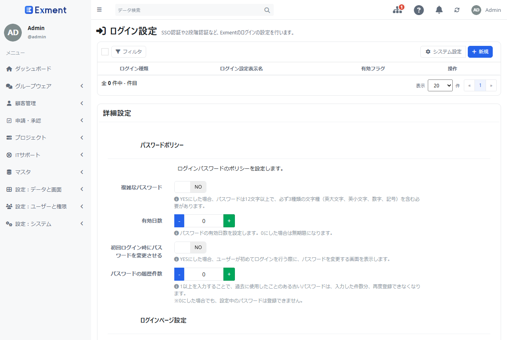
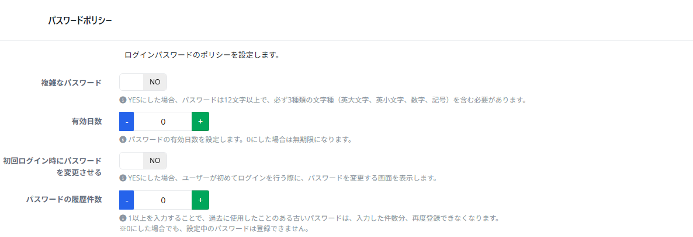
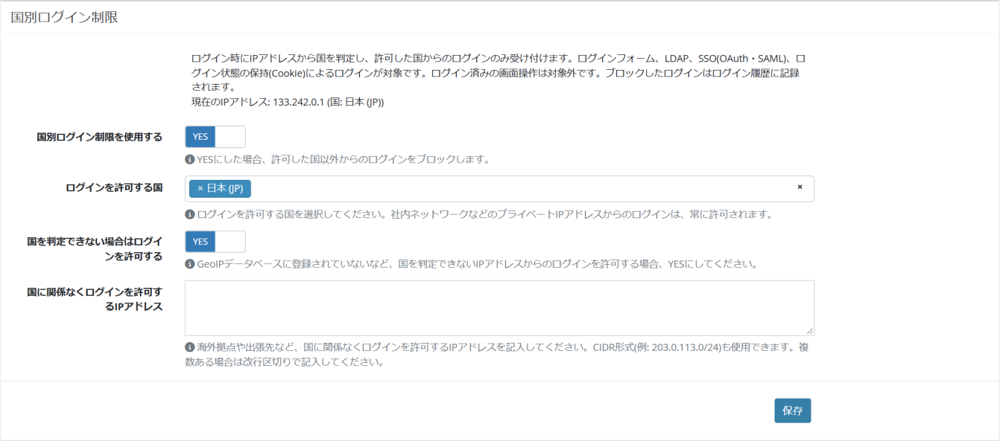
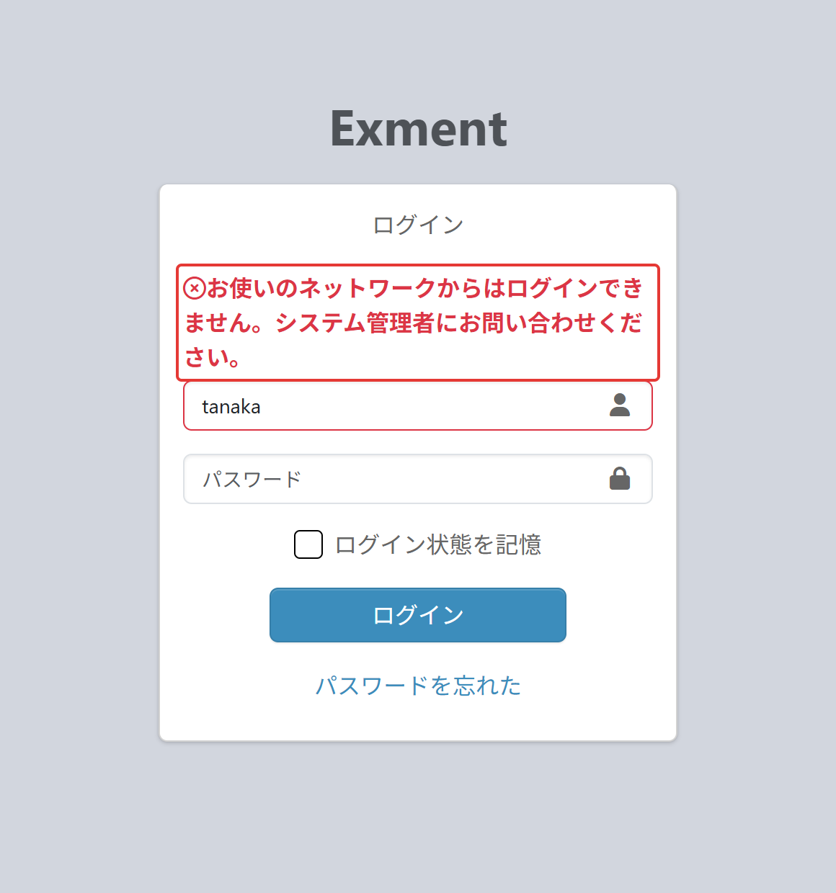
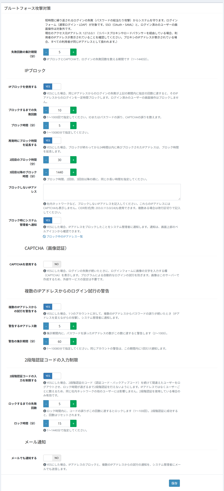
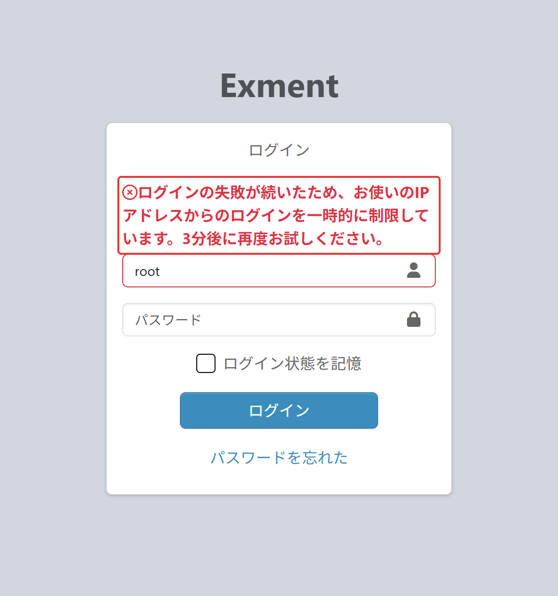
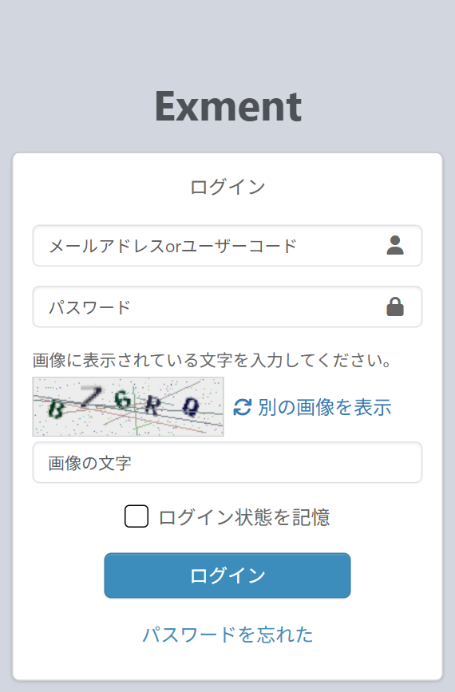
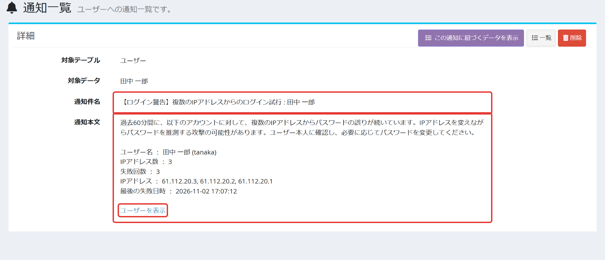

# ログイン設定
Exmentにログインを行う時の、各種ログイン設定を行います。

> SSOに関する設定・説明は、[こちら](/ja/login_sso)をご確認ください。


## 2段階認証
Exmentでは、2段階認証に対応しています。  
ユーザー情報を入力してログイン後、EメールもしくはGoogle認証システムによって送信されたコードを入力することで、Exmentにアクセスすることができるようになります。  
※2段階認証は、ログイン方式が「標準」「LDAP」の場合に利用できます。

- [2段階認証 システム設定](/ja/login_2factor_setting)
- [ログイン(2段階認証)](/ja/login_2factor)


## ログイン設定管理方法

- システム管理者が、以下のURLを入力します。  
http(s)://(ExmentのURL)/admin/login_setting  
※上記で記載の「システム設定変更」を行うことで、アクセスが出来るようになります。

- もしくは、メニューに「ログイン設定」を追加します。  
「管理者設定」 > 「メニュー」ページを開き、メニュー種類「システムメニュー」を選択すると、対象の「ログイン設定」が表示されますので、選択し、保存を行ってください。  
※「ログイン設定」は、デフォルトの設定ではメニューに表示されません。

  

- 2段階認証の管理を行うには、下記のページの手順に従い、設定を行います。

    - [2段階認証 システム設定](/ja/login_2factor_setting)


### パスワードポリシー設定
ログインパスワードに関連するルールを設定します。   

  

#### 複雑なパスワード
- 設定がYESの場合、3種類以上の文字種（半角英大文字、半角英小文字、半角数字、半角記号）を含んだ12文字以上のパスワードを設定する必要があります。
- 初期値は「NO」です。

#### 有効日数
- 指定日数経過後に初めてログインした場合、パスワード変更画面に誘導されます。パスワードを変更してから、再度ログイン処理を行ってください。
- 有効日数を「0」にした場合、パスワードは無期限になります。
- 初期値は「0」です。

#### 初回ログイン時にパスワードを変更させる
- YESにした場合、ユーザーがはじめてログインを行った際に、パスワードを変更させる画面を表示します。
- この設定をYESにした後で、新規登録、またはパスワードをリセットしたユーザーに対し、有効になります。
- この設定をYESにする前に新規登録などを行ったユーザーには、設定が反映されません。
- 初期値は「NO」です。

#### パスワードの履歴件数
- 最近使用したパスワードの再利用を制限します。新しいパスワードと直近～履歴件数分のパスワードを比較して同一だった場合はエラーにします。
- 履歴件数を「0」にした場合は比較対象外です。
- 初期値は「0」です。

#### 注意

- <span class="small">「複雑なパスワード」と「パスワードの履歴件数」は、ユーザー設定画面やパスワードのリセット画面などでユーザー自身がパスワードを設定する場合に適用されます。システム管理者が設定する場合は対象外です。</span>


### 国別ログイン制限
ログイン時に、IPアドレスから国を判定し、許可した国からのログインのみ受け付けます。  
海外からの不正ログインを防ぐ場合などにご利用ください。



- 対象となるログインは、以下の通りです。
    - ログインフォームによるログイン(標準・LDAP)
    - SSO(OAuth・SAML)によるログイン
    - 「ログイン状態を記憶」(Cookie)による自動ログイン

- ログイン済みのユーザーの画面操作は、対象外です。設定を変更しても、すでにログインしているユーザーはログアウトされません。
- APIの認証は、対象外です。
- 国の判定には、[GeoIPデータベース](/ja/login_history#geoipデータベース)が必要です。
- 設定欄の上部に、現在アクセスしているIPアドレスと、判定された国が表示されます。

#### 国別ログイン制限を使用する
- YESにした場合、許可した国以外からのログインをブロックします。
- 初期値は「NO」です。
- NOにして保存しても、「ログインを許可する国」と「国に関係なくログインを許可するIPアドレス」の設定は保持されます。

#### ログインを許可する国
- ログインを許可する国を選択します。国名または国コード(JPなど)を入力して検索できます。複数選択できます。
- 選択していない国(北朝鮮など)からのログインは拒否されます。
- 初期値は「日本」「アメリカ合衆国」「ベトナム」「タイ」です。
- 「国別ログイン制限を使用する」がYESの場合、1つ以上選択する必要があります。

#### 国を判定できない場合はログインを許可する
- GeoIPデータベースに登録されていないなど、国を判定できないIPアドレスからのログインを許可する場合、YESにします。
- 初期値は「YES」です。

#### 国に関係なくログインを許可するIPアドレス
- 海外拠点や出張先など、国に関係なくログインを許可するIPアドレスを記入します。複数ある場合は改行区切りで記入してください。
- CIDR形式(例: 203.0.113.0/24)も使用できます。

#### 判定の順序
ログインの可否は、以下の順に判定します。

1. 「国に関係なくログインを許可するIPアドレス」に含まれる場合、許可します。
1. 社内ネットワークなどのプライベートIPアドレス(10.0.0.0/8、172.16.0.0/12、192.168.0.0/16、100.64.0.0/10、ループバック、リンクローカル、IPv6のユニークローカルアドレス)の場合、許可します。
1. 国を判定できない場合、「国を判定できない場合はログインを許可する」の設定に従います。
1. 判定した国が「ログインを許可する国」に含まれる場合、許可します。それ以外の場合は、ブロックします。

#### ブロックした場合
- ログイン画面に「お使いのネットワークからはログインできません。システム管理者にお問い合わせください。」と表示されます。どの国が許可されているかは表示されません。
  

- ログインフォームの場合、パスワードの認証前にブロックします。そのため、許可していない国からは、パスワードが正しいかどうかを確認することができません。
- 「ログイン状態を記憶」による自動ログインをブロックした場合、その端末のCookieを削除し、ログイン画面を表示します。
- ブロックしたログインは、[ログイン履歴](/ja/login_history#ブロックしたログイン)に記録されます。

#### 保存できない場合
以下の場合、設定を保存できません。

- 「国別ログイン制限を使用する」がYESで、「ログインを許可する国」を選択していない場合
- 「国別ログイン制限を使用する」がYESで、GeoIPデータベースが配置されていない場合
- 「国に関係なくログインを許可するIPアドレス」に、IPアドレスまたはCIDR形式でない行がある場合
- 保存すると、設定を行っている管理者自身が、現在のIPアドレスからログインできなくなる場合  
※その場合は、現在の国を「ログインを許可する国」に追加するか、現在のIPアドレスを「国に関係なくログインを許可するIPアドレス」に追加してください。

#### 注意
- <span class="small">Exmentをリバースプロキシやロードバランサーの背後で運用している場合は、[リバースプロキシの設定](/ja/additional_reverse_proxy)を行ってください。設定していない場合、すべてのアクセスがプロキシのIPアドレス(プライベートIPアドレス)と判定され、制限が機能しません。</span>
- <span class="small">IPアドレスからの国の判定は、おおよそのものです。VPNやモバイル回線では、実際と異なる国と判定されることがあります。</span>


### ブルートフォース攻撃対策
短時間に繰り返されるログインの失敗（パスワードを総当たりで推測する攻撃）から、システムを守ります。  
同じIPアドレスからの失敗が続いた場合のブロック（IPブロック）、画像の文字を入力させる確認（CAPTCHA）、複数のIPアドレスから同じアカウントが狙われた場合の警告、2段階認証のコードの入力制限を設定できます。



- 対象は、ログインフォームによるログイン(標準・LDAP)です。
- SSO(OAuth・SAML)によるログイン、ログイン済みのユーザーの画面操作、APIの認証は対象外です。
- 設定欄の上部に、現在アクセスしているIPアドレスが表示されます。リバースプロキシやロードバランサーの背後で運用している場合は、利用者のIPアドレスが表示されていることを確認してください(下記「注意」参照)。

#### 失敗回数の集計期間（分）
- IPブロックとCAPTCHAで、ログインの失敗回数を数える期間です。1～1440分で指定します。
- 初期値は「5」です。

#### IPブロックを使用する
- YESにした場合、同じIPアドレスからのログインの失敗が、集計期間内に「ブロックするまでの失敗回数」に達すると、そのIPアドレスからのログインを一定時間ブロックします。
- IDまたはパスワードの誤り、CAPTCHAの誤りを数えます。存在しないIDでの失敗も数えます。
- 初期値は「NO」です。
- ブロック中のIPアドレスからログインすると、ログイン画面に「ログインの失敗が続いたため、お使いのIPアドレスからのログインを一時的に制限しています。N分後に再度お試しください。」と表示されます。パスワードの認証前にブロックするため、ブロック中は、パスワードが正しいかどうかを確認することができません。
  

- ブロック中でも、すでにログインしているユーザーは、そのまま利用できます。
- IPv6の場合、上位64ビットが同じアドレスを、同じIPアドレスとして扱います。

#### ブロックするまでの失敗回数
- 1～1000回で指定します。初期値は「10」です。

#### ブロック時間（分）
- 1～10080分で指定します。初期値は「5」です。

#### 再発時にブロック時間を延長する
- YESにした場合、ブロックが終わってから24時間以内に再びブロックされたIPアドレスは、ブロック時間を延長します。
- 「2回目のブロック時間（分）」(初期値「30」)、「3回目以降のブロック時間（分）」(初期値「1440」= 24時間)を指定します。ブロック時間、2回目、3回目以降の順に、同じか長い時間を指定してください。
- 初期値は「YES」です。

#### ブロックしないIPアドレス
- 社内ネットワークなど、ブロックしないIPアドレスを記入します。複数ある場合は改行区切りで記入してください。
- CIDR形式(例: 203.0.113.0/24)も使用できます。
- これらのIPアドレスには、CAPTCHAも表示しません。

#### ブロック時にシステム管理者へ通知
- YESにした場合、IPアドレスをブロックしたことを、システム管理者に通知します。通知は、画面上部のベルアイコンから確認できます。通知から、ブロック中のIPアドレスの詳細を表示できます。
- 初期値は「YES」です。

#### ブロック中のIPアドレス一覧
- 設定欄のリンク「ブロック中のIPアドレス一覧」から、現在ブロックしているIPアドレスを確認し、ブロックを解除できます。詳細は[ブロック中のIPアドレス](/ja/login_ip_block)をご確認ください。

#### CAPTCHAを使用する
- YESにした場合、ログインの失敗が続いたときに、ログインフォームに画像の文字を入力する欄(CAPTCHA)を表示します。プログラムによる自動的なログインの試行を防ぎます。
- 以下のいずれかの場合に表示します。
    - 同じIPアドレスからのログインの失敗が、集計期間内に「CAPTCHAを表示するまでの失敗回数」に達した場合
    - 同じIDのパスワードの誤りが、集計期間内に「CAPTCHAを表示するまでの失敗回数」に達した場合(IPアドレスを変えながらの攻撃への対策です)
- 画像の文字は、大文字・小文字を区別しません。読みにくい場合は「別の画像を表示」をクリックしてください。画像は10分間有効で、1回だけ使用できます。
- CAPTCHAが正しくない場合、パスワードは確認しません。CAPTCHAの誤りも、IPブロックの失敗回数に数えます。
- 画像はExmentのサーバーで作成するため、外部サービスの設定は不要です。PHPのGD拡張モジュールが必要です。
- 初期値は「NO」です。「CAPTCHAを表示するまでの失敗回数」の初期値は「3」です(1～1000回)。



#### 複数のIPアドレスからの試行を警告する
- YESにした場合、1つのアカウントに対して、複数のIPアドレスからパスワードの誤りが続いたとき、システム管理者に通知します。1つのIPアドレスあたりの失敗を少なくしてIPブロックを避ける、分散した攻撃を検知します。
- 「警告の集計期間（分）」内に、パスワードを誤ったIPアドレスの数が「警告するIPアドレス数」に達すると通知します。同じアカウントの警告は、集計期間内に1回だけ通知します。
- ユーザーコードとメールアドレスのどちらでログインしようとした場合も、同じアカウントとして数えます。存在しないIDは対象外です。
- 通知から、対象のユーザーの詳細画面を表示できます。ユーザー本人に確認し、必要に応じてパスワードを変更してください。
  

- 初期値は「YES」です。「警告するIPアドレス数」の初期値は「5」(2～1000)、「警告の集計期間（分）」の初期値は「60」(1～10080分)です。

#### 2段階認証コードの入力を制限する
- YESにした場合、2段階認証のコード（認証コード・バックアップコード）を続けて間違えたユーザーをログアウトさせ、ロック時間が過ぎるまで2段階認証を行えないようにします。
- 「ロック時間（分）」内に、コードの誤りが「ロックするまでの失敗回数」に達するとロックします。IPアドレスではなくユーザーごとに数えるため、同じ社内ネットワークの他のユーザーには影響しません。
- 2段階認証を使用している場合のみ有効です。詳細は[2段階認証コードの入力制限](/ja/login_2factor_setting#_2段階認証コードの入力制限)をご参照ください。
- 初期値は「YES」です。「ロックするまでの失敗回数」の初期値は「5」(1～100回)、「ロック時間（分）」の初期値は「15」(1～1440分)です。

#### メールでも通知する
- YESにした場合、IPアドレスのブロックと、複数のIPアドレスからの試行の通知を、システム管理者にメールでも送信します。
- 初期値は「NO」です。

#### 保存できない場合
以下の場合、設定を保存できません。

- 数値が指定の範囲外、または整数でない場合
- 「再発時にブロック時間を延長する」がYESで、2回目のブロック時間がブロック時間より短い場合、または3回目以降のブロック時間が2回目より短い場合
- 「ブロックしないIPアドレス」に、IPアドレスまたはCIDR形式でない行がある場合
- PHPのGD拡張モジュールがインストールされていないサーバーで、「CAPTCHAを使用する」をYESにした場合

#### 注意
- <span class="small">Exmentをリバースプロキシやロードバランサーの背後で運用している場合は、[リバースプロキシの設定](/ja/additional_reverse_proxy)を行ってください。設定していない場合、すべての利用者がプロキシのIPアドレスとして扱われ、1つのIPアドレスのブロックで全員がログインできなくなります。</span>
- <span class="small">ログインの失敗の記録は、7日後に自動的に削除されます(スケジュール実行が必要です)。ログインの失敗は、ログイン履歴には記録されません。</span>
- <span class="small">2段階認証のコードの誤りは、IPブロックの失敗回数には数えません。ユーザーごとに制限します。詳細は[2段階認証 システム設定](/ja/login_2factor_setting#_2段階認証コードの入力制限)をご確認ください。</span>
- <span class="small">従来からの、同じIDとIPアドレスの組み合わせによるログイン制限(「EXMENT_MAX_ATTEMPTS」など)は、引き続き動作します。</span>


### その他
- v3.3.0未満からv3.3.0以上にアップデートした場合で、ユーザーコードに「ドット(.)」を含んだプロバイダでログインを行った場合、エラーとなることがあります。  
その場合、以下の対応を行ってください。
    - 「ユーザー」テーブルの「カスタム列設定」で、「ユーザーコード」列の編集画面に遷移する。
    - 「使用可能文字」オプションで、「ドット」にチェックを入れて保存する。


- 既定の動作では、ログイン状態でブラウザを閉じた場合でも、一定時間（120分）経過するまでは、ログイン状態を維持します。  
v3.6.0以降で、ログイン状態でブラウザを閉じた場合に、自動的にログアウトにする場合には、「.env」ファイルを開き、以下のように追記を行ってください。  
※設定ファイルの編集方法について、詳細は[こちら](/ja/config)をご参照ください。

~~~
EXMENT_SESSION_EXPIRE_ON_CLOSE=true
~~~


## パスワードリセットコマンド
パスワードリセットを、コマンドにより実施することができます。

- システム管理者が、コンソールで以下のコマンドを実行します。

~~~
php artisan exment:resetpassword --email=foobar@test.com --password=P@ssw0rd!
~~~

- 上記のコマンドを実行することで、Eメールアドレスが"foobar@test.com"のユーザーに、パスワード"P@ssw0rd!"をセットします。


### コマンドの引数

```
exment:resetpassword {--id=} {--email=} {--user_code=} {--password=} {--random=0} {--send=0} {--reset_first_login=0}
```

#### 引数：ユーザー指定
※下記の引数のうち、いずれかが必須です。下記の引数のうち、複数を選択していた場合、id > email > user_codeの優先度順に検索を行います。

- ##### id
対象のユーザーのログインIDです。

- ##### email
対象のユーザーのEメールアドレスです。

- ##### user_code
対象のユーザーのユーザーコードです。


#### 引数：パスワード
※"password"の指定か、"random=1"のいずれかを指定してください。両方の入力があった場合、"password"引数を優先します。

- ##### password  
変更するパスワード文字列を指定してください。

- ##### random  
パスワード文字列をランダムに作成する場合、1を指定してください。未指定の場合、0。

#### 引数：オプション

- ##### send  
変更後のパスワードを、対象のユーザーにメール送信する場合、1を指定してください。未指定の場合、0。

- ##### reset_first_login  
パスワード変更後、ユーザーがはじめてログインを行った際に、パスワードを変更させる画面を表示します。未指定の場合、0。  
※このオプション指定に関わらず、ログイン設定で「初回ログイン時にパスワードを変更させる」をYESにしていた場合、ユーザーがはじめてログインを行った際に、パスワードを変更させる画面を表示します。

### 特記事項
- 引数で"random=1"を指定し、"send=1"の指定がなかった場合、パスワードリセット後、変更後のパスワードをコンソール表示します。


### コマンド実行例

~~~
# 例 : id1のユーザーに、パスワードを指定してリセット
php artisan exment:resetpassword --id=1 --password=P@ssw0rd!

# 例 : ユーザーコード"user1"のユーザーに、ランダムパスワードをセットし、メール送信する
php artisan exment:resetpassword --user_code=user1 --random=1 --send=1

# 例 : Eメールアドレス"foobar@test.com"のユーザーに、ランダムパスワードをセットする
php artisan exment:resetpassword --email=foobar@test.com --random=1
パスワードをリセットしました。新しいパスワード：XXXXXXXXXX #変更後のパスワードがコンソール出力される
~~~

