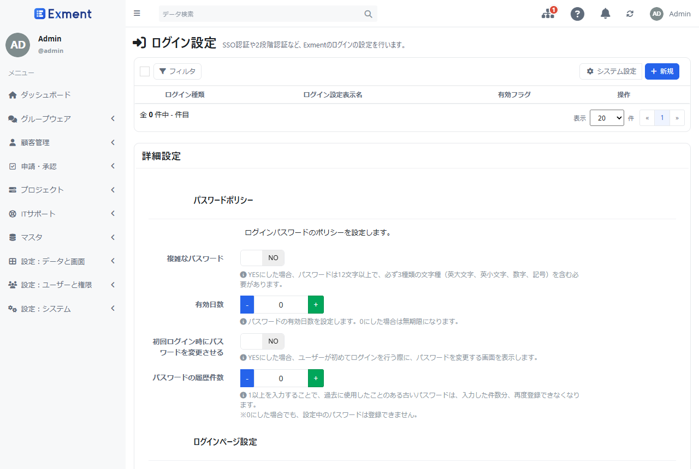

# ログイン設定(SSO)
Exment にログインするときの設定のうち、シングルサインオン(SSO)についてのページです。  
SSO は、ほかのサービス（Google・Office365 など）のアカウントで、Exment にログインできるようにするしくみです。

- 使えるログインの方式は、下の「ログイン方式」にあります。
- 設定する画面の開き方は、下の「ログイン設定管理方法」にあります。

## ログイン方式
Exment には、標準のログインのほかにも、いくつかのログイン方式があります。

| 方式 | どんなログインか | 設定のページ |
|---|---|---|
| 標準 | Exment に登録したユーザーとパスワードでログインする | - |
| OAuth | 登録しておいたプロバイダ（Google など）の画面でログインする | [シングルサインオン(OAuth)](/ja/login_oauth) |
| SAML | 登録しておいたプロバイダ（Keycloak など）の画面でログインする | [シングルサインオン(SAML)](/ja/login_saml) |
| LDAP | Exment のログインページに、LDAP（Active Directory など）の ID・パスワードを入力する | [ログイン設定(LDAP)](/ja/login_ldap) |

### 標準
Exment のデータベースにユーザーを登録し、パスワードを設定して、そのユーザーとパスワードでログインする方式です。  

### OAuth
OAuth 形式のシングルサインオンでログインする方式です。  
ログインボタンを押すと、あらかじめ登録しておいたプロバイダのログイン画面に移り、そこでログインします。  

- [シングルサインオン(OAuth)](/ja/login_oauth)
  
※プロバイダ例：  

- Google
- Facebook
- Office365

### SAML
SAML 形式のシングルサインオンでログインする方式です。  
ログインボタンを押すと、あらかじめ登録しておいたプロバイダのログイン画面に移り、そこでログインします。  
  
- [シングルサインオン(SAML)](/ja/login_saml)
  
※プロバイダ例：  

- OpenAM
- Keycloak
- ADFS

### LDAP
LDAP 形式でログインする方式です。  
Exment のログインページで、ID・パスワードの欄にユーザー情報を入力してログインボタンを押すと、LDAP で認証し、ユーザー情報を取り込みます。  
  
- [ログイン設定(LDAP)](/ja/login_ldap)
  
※プロバイダ例：  

- Active Directory

## ログイン設定管理方法

- システム管理者が、次の URL を開きます。  
http(s)://(ExmentのURL)/login_setting  
※上記で記載の「システム設定変更」を行うことで、アクセスが出来るようになります。

> ※URL は、「/admin」が付かない標準の設定（v7.2.1 以降に新しくインストールしたサイト）の場合です。`.env` の `ADMIN_ROUTE_PREFIX` に値がある場合（前の版で入れたサイトは「admin」）は、サイトの URL のあとにその値を足してください（例：`http(s)://(ExmentのURL)/admin/oauth/token`）。詳しくは[URLに含む「admin」の変更・削除](/ja/additional_prefix)をご覧ください。

- または、メニューに「ログイン設定」を足します。  
「管理者設定」 > 「メニュー」ページを開き、メニュー種類「システムメニュー」を選びます。対象に「ログイン設定」が出ますので、選んで保存してください。  
※「ログイン設定」は、デフォルトの設定ではメニューに表示されません。

  

- 新しい SSO プロバイダを足すときは、右上の「＋新規」ボタンを押します。入力する内容は、方式ごとのページをご覧ください。  
    - [シングルサインオン(OAuth)](/ja/login_oauth)
    - [シングルサインオン(SAML)](/ja/login_saml)
    - [ログイン設定(LDAP)](/ja/login_ldap)
  

### SSO設定
SSO 全体の設定です。  
※有効になっているSSOが1件以上存在する場合のみ表示されます。

#### 既定のログインを表示する
YES にすると、Exment の ID・パスワードを使うログインフォームと、ログインボタンを出します。  
※SAML・OAuth だけでログインさせたいときは、NO にしてください。ユーザー ID とパスワードを入力する既定のログインフォームが出なくなります。

#### SSOログインにリダイレクト
YES にすると、ユーザーがログイン画面を開いたときに、Exment のログインページを出さずに、SSO のログインページに直接移ります。  
※SAML、OAuthによるプロバイダが、合計1件のみの場合に有効になります。

#### ログイン許可ドメイン
ログインを許可するドメインを決めるときに入力します。いくつかあるときは、改行で区切って入力してください。  
入力したドメイン以外のユーザーがログインすると、エラーが出ます。  

### SSOログイン設定無効化
何かの理由で、SSO ログインの設定を強制的に無効にしたいときは、次の設定を行ってください。

- プロジェクトのフォルダの「.env」ファイルを開き、次のように追記してください。  
※設定ファイルの直し方は、[設定値一覧](/ja/config)をご覧ください。

~~~
EXMENT_CUSTOM_LOGIN_DISABLED=true
~~~

この設定をすると、ログイン画面に、ふつうの ID・パスワードのログインフォームが出ます。

### SSOログイン時のバリデーションについて
SSO でログインするときに、プロバイダから受け取ったユーザー情報（以下「プロバイダユーザー」）を、次のルールでチェック（バリデーション）します。  

- ユーザーテーブルで「必須」になっている列の情報が、プロバイダユーザーに入っていないときは、エラーになります。
- SSO設定で「ユーザー新規作成」が YES で、はじめて Exment にログインするときは、Exment のユーザーテーブルの設定（使用可能文字設定、文字列の長さなど）でチェックします。
- SSO設定で「ユーザー情報を更新する」が YES で、すでに Exment に登録されているユーザーでログインしたときも、Exment のユーザーテーブルの設定（使用可能文字設定、文字列の長さなど）でチェックします。

エラーになったときは、その原因を画面に出します。ログファイルにも、原因を出力します。

### その他
- v3.3.0未満からv3.3.0以上にアップデートした場合で、ユーザーコードに「ドット(.)」を含んだプロバイダでログインすると、エラーになることがあります。  
そのときは、次のように直してください。
    - 「ユーザー」テーブルの「カスタム列設定」で、「ユーザーコード」列の編集画面を開く。
    - 「使用可能文字」オプションで、「ドット」にチェックを入れて保存する。

- はじめの設定では、ログインしたままブラウザを閉じても、一定時間（120分）がすぎるまでは、ログインの状態が続きます。  
v3.6.0以降では、ブラウザを閉じたときに自動でログアウトするようにできます。「.env」ファイルを開き、次のように追記してください。  
※設定ファイルの直し方は、[設定値一覧](/ja/config)をご覧ください。

~~~
EXMENT_SESSION_EXPIRE_ON_CLOSE=true
~~~

