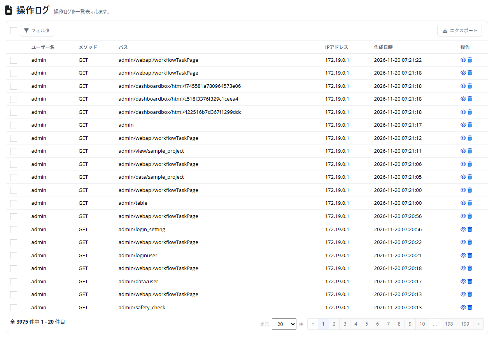
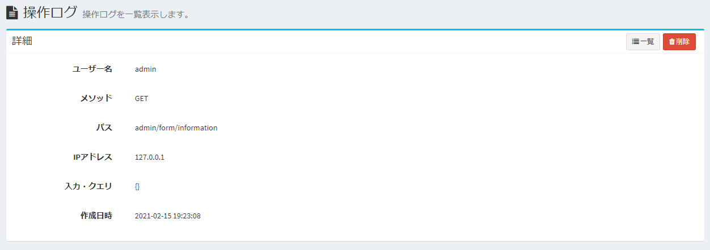
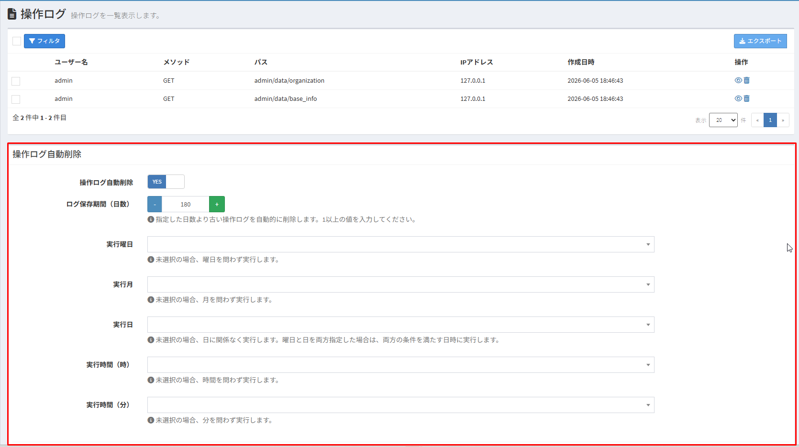

# ログ
Exmentが残す記録（ログ）の見方と、設定のしかたです。  
「だれが、いつ、何をしたか」を調べたいときは操作ログを、エラーの原因を調べたいときはログファイルを見ます。

## ログ種類
Exmentのログは、2種類あります。

| 種類 | 内容 | 見る場所 |
| --- | --- | --- |
| **操作ログ** | 各ユーザーが画面で操作した内容です。 | Exmentの画面（システム管理者） |
| **ログファイル出力** | 主にエラーが発生したときの記録です。 | サーバー上のファイル |


## 操作ログ
各ユーザーが画面で操作した内容を、Exmentの画面で一覧表示します。  
記録するのは、主に次の操作です。

- 画面の表示、データの新規追加・更新・削除など
- APIの認証、実行


### 確認方法
操作ログの画面は、システム管理者が開きます。開き方は2つあります。

- 以下のURLを入力します。  
http(s)://(ExmentのURL)/auth/logs    

> ※URL は、「/admin」が付かない標準の設定（v7.2.1 以降に新しくインストールしたサイト）の場合です。`.env` の `ADMIN_ROUTE_PREFIX` に値がある場合（前の版で入れたサイトは「admin」）は、サイトの URL のあとにその値を足してください（例：`http(s)://(ExmentのURL)/admin/oauth/token`）。詳しくは[URLに含む「admin」の変更・削除](/ja/additional_prefix)をご覧ください。

- または、メニューに「操作ログ」を追加して、そこから開きます。  
「操作ログ」は、デフォルトの設定ではメニューに表示されていません。追加するには、「管理者設定」 > 「メニュー」ページを開き、メニュー種類「システムメニュー」を選択します。対象に「操作ログ」が表示されるので、選択して保存してください。

操作ログの一覧画面が表示されます。

  

行をクリックすると、その操作の詳細が表示されます。  

  

### 各項目について

- ##### ユーザー名  
操作したユーザーです。※ログインしていない状態での操作は、空欄になります。

- ##### メソッド
HTTPリクエストのメソッドの種類です。

- ##### パス
HTTPリクエストの対象URIです。  
※GETメソッドのクエリ文字列（URLの「?」より後ろ）は、この項目には出ません。「入力・クエリ」に出ます。

- ##### IPアドレス
操作した端末のIPアドレスです。

- ##### 入力・クエリ
HTTPリクエストのクエリ文字列、もしくはPOST値です。  

- ##### 作成日時
操作した日時です。


### その他
- 「入力・クエリ」のうち、以下の項目の値は機密情報なので、文字列"***"に置き換えて（マスクして）保存しています。
    - password
    - password_confirmation
    - current_password
    - _token
    - verify_code
    - access_token
    - refresh_token
    - system_line_channel_token
    - system_line_channel_secret

※上記の項目は、下の「機密情報のマスキング」にある`config/exment.php`の設定にかかわらず、常にマスクされます。  
※「system_line_channel_token」「system_line_channel_secret」は、v7.0.0以降でマスクされます。


### 機密情報のマスキング
※この設定は、Exment v7.0.0以降で利用できます。v6.xでは、上記の「その他」に記載した項目(LINEの2項目を除く)のみがマスクされます。

操作ログには、ユーザーが入力した値、APIから送信された値、URLのパスに含まれる値が記録されることがあります。

認証情報などの機密情報がそのまま保存されないように、Exmentは操作ログを記録するときに、設定した項目とURLのパスの値をマスクします（"***"に置き換えます）。

マスキングの設定は、以下のファイルの`operation_log`セクションで変更できます。

`config/exment.php`

以下は、`config/exment.php`に記載されている`operation_log`の既定値です。(コメントは一部省略しています)

```php
'operation_log' => [
    // すべての画面でマスクする項目名
    'mask_columns' => [
        // SSO (OAuth / SAML)
        'oauth_client_id',
        'oauth_client_secret',
        'saml_sp_privatekey',
        // システム設定 (reCAPTCHAのシークレットキー、SMTPのパスワード)
        'recaptcha_secret_key',
        'system_mail_password',
        // MeilisearchのAPIキー
        'meili_key',
        // LINE Messaging APIのチャネル情報
        'system_line_channel_token',
        'system_line_channel_secret',
        // プラグインのデータベース接続パスワード
        'custom_password',
        // プラグイン(CRUDページ)の認証情報
        'crud_auth_key',
        'crud_auth_password',
    ],

    // 特定の画面・APIでのみマスクする項目名
    'mask_columns_by_uri' => [
        // API設定画面
        'api_setting*' => ['id', 'secret', 'client_api_key'],
        // OAuthのトークン取得API
        'oauth/*' => ['client_id', 'api_key', 'client_secret'],
        // パスワードリセット画面
        'auth/reset*' => ['token'],
    ],

    // 直後のパスセグメントをマスクするURIプレフィックス
    'mask_path_prefixes' => [
        'api_setting' => true,
        'oauth/clients' => true,
        // パスワードリセットのトークン。削除したり、trueに変更したりしないでください
        'auth/reset' => false,
    ],
],
```

<span class="red">※`config/exment.php`に`operation_log`を記載した場合、Exment本体の既定値とは結合されず、記載した内容で既定値全体が置き換わります。</span>  
マスク対象を追加・変更する場合は、上記の既定値をすべて記載したうえで、項目を追加・変更してください。  
特に、`mask_path_prefixes`の`'auth/reset' => false`は削除しないでください。削除すると、パスワードリセットのトークンがマスクされずに記録されます。

#### mask_columns

- どの画面・APIでも、常にマスクする項目名を指定します。
- APIキーやクライアントシークレットなど、常に機密情報として扱う値に使用してください。
- ここで指定した項目名を、カスタムテーブルのふつうの業務データの項目として使っている場合も、その値はマスクされます。

#### mask_columns_by_uri

- 特定の画面またはAPIだけでマスクする項目名を指定します。
- 配列のキーには、`admin`プレフィックスからの相対URIパターンを指定します。ワイルドカード`*`が使用できます。
- `id`、`secret`、`client_id`、`api_key`、`token`のように、他の画面ではふつうの業務データとして使われることがある項目名に使用してください。
- 一致した項目は、入れ子になった値の中も含めて、すべてマスクされます。

#### mask_path_prefixes

- URLのパスの中に機密情報が入る場合に使用します。`admin`プレフィックスからの相対URIプレフィックスを指定すると、その直後のパスセグメント（「/」で区切った次の部分）をマスクします。
- 配列の値で、マスクのしかたを指定します。
    - `true`: 値が13文字以上の場合は、先頭8文字のみを残し、以降を`***`に置き換えます。12文字以下の場合は、値全体を`***`に置き換えます。追跡が必要なレコードIDなどに使用します。
    - `false`: 値全体を`***`に置き換えます。パスワードリセットトークンなど、完全に秘匿すべき値に使用します。
- 例えば、`auth/reset`を`false`に設定した場合、URLに含まれるパスワードリセットトークン全体が`***`に置き換えられます。

#### 注意事項

- マスキングは、新しく作成される操作ログに適用されます。
- <span class="red">既存の操作ログは、Exmentのアップグレード時に自動ではマスクされません。</span>既存の操作ログにも現在の設定を適用する場合は、データベースのバックアップを取得したうえで、以下のコマンドを実行してください。マスクした値は、元に戻せません。

```
php artisan exment:patchdata patch_log_opelation
```

※コマンド名の「opelation」は誤記ではありません。上記のとおり入力してください。
- `config/exment.php`は、Exmentのアップグレード(`php artisan exment:update`)では上書きされません。そのため、新しいバージョンで既定のマスク対象が増えても、すでに`operation_log`を記載している環境には反映されません。アップグレードのときに、`operation_log`の設定を上記の既定値と比べ、足りないマスク対象を手動で追加してください。
- 常に機密情報となる値には、`mask_columns`を使用してください。特定の画面やAPIだけで機密情報となる値には、`mask_columns_by_uri`または`mask_path_prefixes`を使用してください（ふつうの業務データを誤ってマスクしないためです）。


### 操作ログ自動削除
操作ログ画面の下部で、古い操作ログを自動で削除する設定ができます。

  

#### 自動削除を有効にする
- 操作ログの自動削除を有効または無効にします。
- 有効にすると、保存期間より古いログが自動で削除されます。
- 無効にすると、ログは自動では削除されません。
- デフォルト値は「Yes」です。


#### ログ保存期間（日数）
- 操作ログを保存する日数を指定します。
- 指定した日数より古いログは自動的に削除されます。
- 1以上の値を入力してください。
- この設定は「自動削除を有効にする」が有効な場合にのみ表示されます。
- デフォルト値は「180」です。


#### 実行曜日
- 自動削除を実行する曜日を指定します。
- 未選択の場合、曜日を問わず実行します。
- プレースホルダーは「すべて」です。


#### 実行月
- 自動削除を実行する月を指定します。
- 未選択の場合、月を問わず実行します。
- プレースホルダーは「すべて」です。


#### 実行日
- 自動削除を実行する日を指定します。
- 未選択の場合、日に関係なく実行します。
- 実行曜日と実行日の両方を指定した場合は、両方の条件を満たす日時に実行します。
- プレースホルダーは「すべて」です。


#### 実行時間（時）
- 自動削除を実行する時刻（時）を指定します。
- 未選択の場合、時間を問わず実行します。
- プレースホルダーは「すべて」です。


#### 実行時間（分）
- 自動削除を実行する時刻（分）を指定します。
- 未選択の場合、分を問わず実行します。
- プレースホルダーは「すべて」です。


#### 自動削除を無効にするには
1. 「自動削除を有効にする」を「No」に設定します。
2. 「保存」をクリックします。

保存後、自動削除が無効になります。


### 操作ログの古いデータ削除
プラグイン(バッチ)を使って、古くなった操作ログを削除することもできます。  
一定の日付(既定だと14日)より古くなった操作ログを物理削除します（元に戻せません）。  
以下のリンクより、プラグイン(バッチ)を導入してください。  
[プラグイン-操作ログ 古いログ削除](https://github.com/exment-git/plugin-sample/tree/main/batch/OperationLogDelete)


## ログファイル出力  
主にエラーが発生したときに、サーバー上のログファイルに記録します。  
※下の「設定値追加」の設定をすると、エラー以外の内容も出力できます。

### 確認方法
1. Exmentを入れたサーバーで、以下のフォルダを開きます。  
(Exmentのルートフォルダ)/storage/logs  

2. laravel.logファイルをご確認ください。

### 設定値追加
- [設定値](/ja/config)を変更すると、以下の内容もログファイルに出力できます。設定の手順は、[設定値](/ja/config)をご確認ください。

- ##### リクエスト値出力
    - 設定キー : EXMENT_DEBUG_MODE_REQUEST
    - 既定値 ： false
    - 役割 : trueにすると、Exmentへのリクエスト値をログ出力します。  

- ##### SQLログ出力
    - 設定キー : EXMENT_DEBUG_MODE_SQL
    - 既定値 ： false
    - 役割 : trueにすると、Exmentが実行したSQL文をログ出力します。

- ##### SQLログ出力 - 関数表示
    - 設定キー : EXMENT_DEBUG_MODE_SQLFUNCTION
    - 既定値 ： false
    - 役割 : 「EXMENT_DEBUG_MODE_SQL」がtrueのときに、これもtrueにすると、SQL文と一緒に、呼び出し元の関数の一覧をログ出力します。

### その他
- Laravel（Exmentが使っているフレームワーク）には、ログファイルへの出力のほかにも、以下のような機能があります。
    - Slackなど、他の場所にログを出力する
    - ログのフォーマットを変更する
    - ログの出力ファイルを毎日切り替える

- これらの設定は、[Laravelのログのマニュアル](https://readouble.com/laravel/6.x/ja/logging.html)に従って行ってください。
