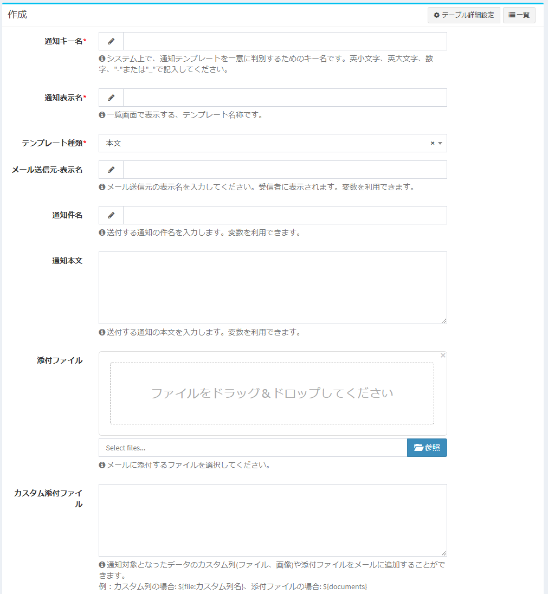
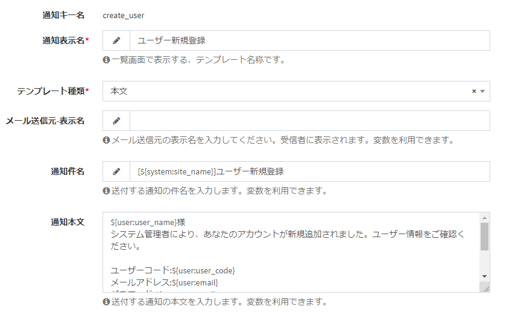

# 通知テンプレート
Exmentが送るメールや通知の、件名・本文などのひな形（通知テンプレート）を設定するページです。  
作ったテンプレートは、[通知設定](/ja/notify)などで選んで使います。  

> v3.6.0より、名称を「メールテンプレート」から「通知テンプレート」に変更しました。  
v3.6.0未満でインストールしたバージョンでは、一部の画面の名称は「メールテンプレート」のままです。

## 管理方法
### ページ表示
- 左メニューより、「通知テンプレート」を選択します。  
もしくは、以下のURLにアクセスしてください。  
http(s)://(ExmentのURL)/data/mail_template  
これにより、通知テンプレート画面が表示されます。  
  

> ※URL は、「/admin」が付かない標準の設定（v7.2.1 以降に新しくインストールしたサイト）の場合です。`.env` の `ADMIN_ROUTE_PREFIX` に値がある場合（前の版で入れたサイトは「admin」）は、サイトの URL のあとにその値を足してください（例：`http(s)://(ExmentのURL)/admin/oauth/token`）。詳しくは[URLに含む「admin」の変更・削除](/ja/additional_prefix)をご覧ください。

### テンプレートの新規追加
1. 「通知テンプレート」画面で、ページ右上の［新規］ボタンをクリックします。

2. 通知テンプレート新規追加画面が表示されます。

3. 必要事項を入力します。  

### 保存
設定を記入したら、［保存］をクリックしてください。

### 編集
テンプレートを編集するときは、その行の［編集］リンクをクリックしてください。  

### 削除
列の削除を行いたい場合、該当する行の［削除］リンクをクリックしてください。  

**※ただし、通知画面で設定済のテンプレートは削除できません。**

## 添付ファイル・カスタム添付ファイル
メールで通知するときに、通知テンプレートに設定しておいたファイルを、添付して送信できます。  
※現在、メール通知の場合のみ有効です。  
  

#### 添付ファイル
ここに登録したファイルを、メール通知のたびに、決まった添付ファイルとして送信します。

#### カスタム添付ファイル
ここにパラメーターを設定すると、それぞれのデータに登録されている、次の種類のファイルを、メール通知で送信します。  

■カスタム列の種類：「ファイル」「画像」  
パラメーター設定：${file:カスタム列名}  

■カスタム列「選択肢 (他のテーブルの値一覧から選択)」で選択しているデータの、「ファイル」「画像」列  
パラメーター設定：${file:select_table:選択肢のカスタム列名.参照先テーブルのファイル列名}  
例：列「customer」(顧客テーブルを参照)で選択している顧客の、列「contract_file」のファイルを添付する場合  
${file:select_table:customer.contract_file}  
※データが選択されていない場合や、列が存在しない場合は、何も添付されません。
  
■データ詳細画面に対して登録されている（下記の画像にあたる場所）添付ファイル  
パラメーター設定：${documents}  
  

## 変数のルール
「メール件名」と「メール本文」「メール送信元-表示名」では、変数を使えます。  
変数を使うと、登録しているデータやシステム名などを、件名・本文に入れられます。  

### 変数一覧
パラメータ変数は、以下のページをご確認ください。  
[パラメータ変数](/ja/params)
