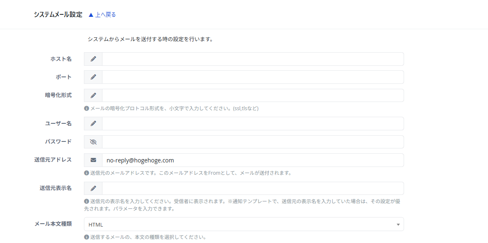
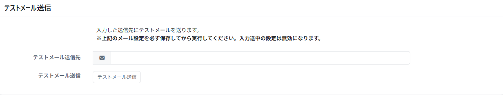

# メール送信設定
Exment からメールを送るための設定と、設定のあとにテストメールを送る手順です。  

手順は、次の 2 つです。

1. メールの送り方を設定する（ふつうは、システム設定の画面に SMTP の設定を入力します）
2. テストメールを送って、届くかを確かめる

> ※「メールが届かない」「メールが迷惑メールに分類される」といった、メール送信機能については、各サーバーや環境による部分が大きいため、お問い合わせの対象外とさせていただきます。  

## 概要
- Exment は、システムからメールを送ることがあります。  
例：
    - データ更新通知
    - 2段階認証

- メールを送るには、SMTP などの設定が必要です。

- 設定のしかたは、2 つあります。
    - [画面から設定(既定)](#設定方法-画面から設定) :   
    システム設定画面に SMTP の設定を入力します。ふつうの SMTP でメールを送るときは、こちらを使います。
    
    - [configファイルやenvファイルで設定](#設定方法-configファイルやenvファイルで設定)：  
    Amazon SES など、SMTP でない方法でメールを送るときに使います。サーバーで設定ファイルを直したり、composer を使ったりします。※上級者向けです。

### 設定方法-画面から設定
- システム管理者が、システム設定画面を開きます。

- 以下の設定を入力します。
  

- 「ホスト名」を入力して保存すると、Exment は画面の設定を使って、SMTP でメールを送ります。  
「.env」の「MAIL_MAILER」が、Laravel の初期値である「log」(メールを送信せず、ログに出力する設定)のままでも、SMTP で送ります。  
※「.env」の「MAIL_MAILER」に「log」以外(sendmail、sesなど)を設定しているときは、その送信方法を使います。  
※「.env」に「EXMENT_MAIL_SETTING_ENV_FORCE=true」を設定しているときは、画面の設定は使いません。くわしくは[configファイルやenvファイルで設定](#設定方法-configファイルやenvファイルで設定)をご覧ください。

※SMTP設定例(Xserverの場合) ： [こちら](https://www.xserver.ne.jp/manual/man_mail_setting.php)  

※SMTP設定例(さくらインターネットの場合) ： [こちら](https://help.sakura.ad.jp/hc/ja/articles/206054132--%E3%83%A9%E3%82%A4%E3%83%88-%E3%82%B9%E3%82%BF%E3%83%B3%E3%83%80%E3%83%BC%E3%83%89-%E3%83%97%E3%83%AC%E3%83%9F%E3%82%A2%E3%83%A0-%E3%83%A1%E3%83%BC%E3%83%AB%E3%83%9C%E3%83%83%E3%82%AF%E3%82%B9-%E3%83%A1%E3%83%BC%E3%83%AB%E3%82%BD%E3%83%95%E3%83%88%E3%81%AE%E4%B8%80%E8%88%AC%E7%9A%84%E3%81%AA%E8%A8%AD%E5%AE%9A%E6%96%B9%E6%B3%95)  


### 設定方法-configファイルやenvファイルで設定
Exment は、ふつう、画面の「システム設定」に登録した値でメールを送ります。  
Amazon SES など、SMTP でない方法でメールを送りたいときは、Laravel の標準の方法（「.env」ファイルに設定を書く方法）を使えます。  
この方法を使うときは、次の設定を行ってください。※上級者向けです。


- .env ファイルを開き、次の設定値を入力します。

~~~
EXMENT_MAIL_SETTING_ENV_FORCE=true
~~~

- そのあと、Laravel のメール送信ドライバを設定してください。

- あわせて、次の設定も .env に入力することをおすすめします。

~~~
MAIL_FROM_ADDRESS=(送信元アドレス)
MAIL_FROM_NAME=(送信元に表示される名前)
~~~

## OAuth 2.0 で送る（Microsoft 365・Google）
※この機能は、Exment v7.3.0 以降で使えます。

Microsoft 365 は、SMTP の基本認証（ユーザー名とパスワードでのログイン）をやめていきます。OAuth 2.0（SMTP の XOAUTH2）で送ると、パスワードを使わずに Microsoft 365・Google Workspace（Gmail）から送れます。

### 使えるようにする
1. システム管理者が「[機能の管理](/ja/feature)」で「メールの OAuth 認証（Microsoft 365・Google）」を有効にします。
2. システム設定の「メール」に、次のとおり入れます。パスワードは空でかまいません。

| 項目 | Microsoft 365 | Google |
|---|---|---|
| ホスト名 | smtp.office365.com | smtp.gmail.com |
| ポート | 587 | 587 |
| 暗号化 | tls | tls |
| ユーザー名 | 送るメールボックスのアドレス | 送る Gmail・Workspace のアドレス |
| 送信元 | ユーザー名と同じアドレス | ユーザー名と同じアドレス |

ホスト名とポートを入れないときも、上の値を使います。

3. システム設定のページのメニューから「メールの OAuth 認証」を開き、下の手順で設定します。

### Microsoft 365 の場合
アプリの資格情報（クライアントの資格情報、client credentials）で送ります。使う権限（スコープ）は `https://outlook.office365.com/.default`（SMTP.SendAsApp）です。

1. [Microsoft Entra 管理センター](https://entra.microsoft.com/)で、「アプリの登録」→「新規登録」を開き、アプリを登録します（リダイレクト URI は要りません）。「アプリケーション（クライアント）ID」と「ディレクトリ（テナント）ID」をひかえます。
2. 「証明書とシークレット」で、クライアントシークレットを作り、「値」をひかえます（あとからは見られません。期限が切れる前に作りなおします）。
3. 「API のアクセス許可」→「アクセス許可の追加」→「所属する組織で使用している API」→「Office 365 Exchange Online」→「アプリケーションの許可」で「SMTP.SendAsApp」を追加し、「管理者の同意を与えます」を押します。
4. Exchange Online PowerShell で、アプリにメールボックスから送ることを許します（「エンタープライズ アプリケーション」に出る、そのアプリの「オブジェクト ID」を使います）。

```powershell
Connect-ExchangeOnline
New-ServicePrincipal -AppId <アプリケーション（クライアント）ID> -ObjectId <エンタープライズ アプリケーションのオブジェクト ID>
Add-MailboxPermission -Identity "<送るメールボックス>" -User <エンタープライズ アプリケーションのオブジェクト ID> -AccessRights FullAccess
# そのメールボックスで SMTP の認証が止まっているときは
Set-CASMailbox -Identity "<送るメールボックス>" -SmtpClientAuthenticationDisabled $false
```

5. Exment の「メールの OAuth 認証」で、認証のしかたを「Microsoft 365（アプリの資格情報）」にし、テナント ID・クライアント ID・クライアントシークレットを入れて保存します。
6. [テストメール](#テストメール送信)を送って確かめます。

くわしくは、Microsoft の資料「[OAuth を使用して IMAP、POP、SMTP 接続を認証する](https://learn.microsoft.com/ja-jp/exchange/client-developer/legacy-protocols/how-to-authenticate-an-imap-pop-smtp-application-by-using-oauth)」をご覧ください。

### Google の場合
送るメールボックスを、画面で一度「つなぎ」ます。Exment は、そのときの更新トークンを暗号化して残し、送るたびにアクセストークンを取ります。使う権限（スコープ）は `https://mail.google.com/` です。

1. [Google Cloud コンソール](https://console.cloud.google.com/)でプロジェクトを作り、「OAuth 同意画面」を設定します。Google Workspace なら、ユーザーの種類は「内部」がかんたんです。
「外部」で「テスト」のままだと、更新トークンが 7 日で切れます。「本番」にしてください。
2. 「認証情報」→「認証情報を作成」→「OAuth クライアント ID」で、種類「ウェブ アプリケーション」を作ります。「承認済みのリダイレクト URI」には、Exment の「メールの OAuth 認証」の画面に出る URI（`https://（Exment の URL）/admin/mail_oauth_setting/google/callback`）を入れます。クライアント ID とクライアントシークレットをひかえます。
3. Exment の「メールの OAuth 認証」で、認証のしかたを「Google（Workspace・Gmail）」にし、クライアント ID・クライアントシークレットを入れて保存します。
4. 「Google でつなぐ」を押し、送るメールボックス（システム設定のユーザー名）で Google にログインして、許可します。画面に「メールボックスをつないでいます」と出れば完了です。
5. [テストメール](#テストメール送信)を送って確かめます。

### トークンが取れないとき
- アクセストークンは、期限の 1 分前まで残して使いまわします。
- トークンが取れないときは、メールは送れずに失敗します（[送信エラー時](#送信エラー時)）。あわせて、システム管理者に、画面のお知らせ（ベル）で知らせます（1 時間に 1 回）。お知らせには、Microsoft・Google が返したエラーのコードと説明を書きます。
- よくある原因：クライアントシークレットの期限切れ（Microsoft 365）、管理者の同意やメールボックスの許可がない（Microsoft 365）、更新トークンの取り消し・期限切れ（Google。もう一度「Google でつなぐ」を押します）。

## SPFレコード設定
- 送ったメールが迷惑メールになるときは、多くの場合、ドメインの「SPFレコード」の設定が足りていません。ドメインの設定で、SPF レコードを登録してください。  
[参考1](https://sendgrid.kke.co.jp/blog/?p=3509)  
[参考2](https://salt.iajapan.org/wpmu/anti_spam/admin/operation/information/spf_i01/)  


## テストメール送信
- 上の設定で、テストメールを送れます。  
画面からでも、コマンドからでも送れます。

### 画面から実行
- システム管理者が、システム設定画面を開きます。

- 「テストメール送信」の項目に送り先を入力して、［テストメール送信］を押します。

  

※先に、ページの上のほうにある「システムメール設定」を保存する必要があります。一度保存してから、テストメールを送ってください。


### コマンドから実行
- プロジェクトのルートフォルダで、次のコマンドを実行してください。

~~~
php artisan exment:notifytest --to=(メール送信先)
~~~

### 送信エラー時
- 「storage/logs/laravel.log」にエラーログが出ますので、ご確認ください。


