# メニュー
画面の左に出るメニューを、追加・並べ替え・編集・削除するページです。

| したいこと | 見るところ |
|---|---|
| メニューに項目を追加する | メニューの新規追加 |
| メニューの順番を変える | 順序並べ替え |
| 親階層を、決めた役割グループの人にだけ見せる | 見せる役割グループ |
| 更新したあと、メニューを v7.2.1 からの標準の並びにそろえる | 標準の並びに整える |

## 概要
ログインすると、画面の左にメニューが表示されます。  
メニューには、「システムで用意したページ」、「プラグインのページ」、「各テーブルへのページ」、「任意のURL」を開く項目を追加できます。  
※メニュー項目は、ログインしたユーザーが表示できるページの分だけ表示されます。


※v7.1.0以降、システム管理者が使う「安否確認管理」「ログイン設定」「APIアプリ設定」「システムパフォーマンスログ」は、「管理者設定」の中に表示されます。「LINE連携」は、左のメニューではなく、右上のユーザーメニューに表示されます（[LINE連携](/ja/line?id=連携する)）。v7.0から更新した場合、メニューがいちばん上にあるときだけ移動します。ご自身で移動したメニューはそのままです。


### v7.2.1 からのメニューの並び
v7.2.1 から、左のメニューは仕事の分類（親階層）ごとにまとまります。並びは [機能マップ](https://exment.net/feature-map/) と同じです。

```
ダッシュボード
グループウェア ▸ ファイル共有・メール（Groupware）
申請・承認 ▸ 未処理の申請・稟議・経費精算 …（同梱テンプレート「申請パック」）
プロジェクト ▸ プロジェクト管理（公式プラグイン）
ITサポート ▸ ITサポート（公式プラグイン）
マスタ ▸ 基本情報・組織・ユーザー・お知らせ
設定：データと画面 ▸ カスタムテーブル・スタジオ・メニュー・ワークフロー・通知テンプレート・通知・表示プリセット・テンプレート
設定：ユーザーと権限 ▸ ログインユーザー・役割グループ・ログイン設定・APIアプリ設定・操作ログ
設定：システム ▸ システム設定・機能の管理・プラグイン・バックアップ・チューニング・メンテナンスモード
```

- 新しくインストールしたサイトは、この形になります。
- v7.1 以前から更新したサイトは、Exment が置いたままのメニューだけが動きます（管理者設定の中が Exment の並びのまま、「マスター管理」が上から 3 番目のまま、ファイル共有がいちばん上のまま、のとき）。ご自身で動かしたメニュー・付けた名前・プラグインのメニューはそのままです。管理者設定の中にほかのメニューが入っているサイトは、管理者設定を分けません。
- 公式プラグイン（プロジェクト管理・ITサポート・Groupware）と同梱テンプレートは、それぞれの分類の下にメニューを置きます（分類がなければ作ります）。いちばん上にあるメニューだけが移ります。
- 中に表示できるメニューがない分類は表示されません（[機能の管理](/ja/feature)でオフにした機能のメニューは表示されません）。

#### 標準の並びに整える
更新しても並びが変わらなかったサイト（メニューを並べ替えたサイト、管理者設定の中にほかのメニューがあるサイト）は、「メニュー」の画面の［標準の並びに整える］で、上の形に整えられます。
- 押すと、どのメニューがどこへ動くかの一覧が出ます。確かめてから［整える］を押します。
- 動くのは、Exment と公式プラグインのメニューだけです。自分で作ったメニュー・テーブルのメニュー・そのほかのメニューは、元の場所に元の順番のまま残ります（管理者設定の中にあったものは「設定：システム」の最後に）。消すメニューはありません。
- 「HOME」「マスター管理」「管理者設定」の名前は、Exment が付けた名前のままのときだけ「ダッシュボード」「マスタ」「設定：システム」に変えます。
- 整える前のメニューを残すので、同じ画面の［元に戻す］で戻せます。
- システム管理者だけが使えます。


## メニュー管理
メニューの追加・並べ替え・編集・削除のしかたです。  

### 一覧画面表示
左メニューより、「メニュー」をクリックします。  
もしくは、以下のURLにアクセスしてください。  
これにより、メニュー設定画面が表示されます。
http(s)://(ExmentのURL)/auth/menu  
現在システムで登録されているメニューの一覧が表示されます。
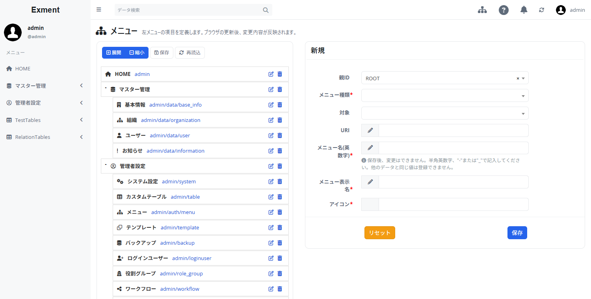

> ※URL は、「/admin」が付かない標準の設定（v7.2.1 以降に新しくインストールしたサイト）の場合です。`.env` の `ADMIN_ROUTE_PREFIX` に値がある場合（前の版で入れたサイトは「admin」）は、サイトの URL のあとにその値を足してください（例：`http(s)://(ExmentのURL)/admin/oauth/token`）。詳しくは[URLに含む「admin」の変更・削除](/ja/additional_prefix)をご覧ください。

### メニューの新規追加
「メニュー」の一覧画面で、ページ右の「新規」ボックスに、必要事項を入力します。  
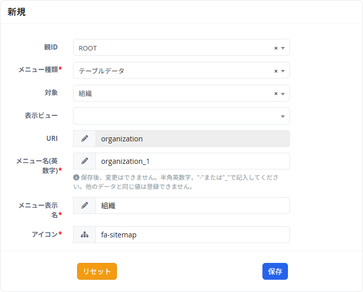

#### 親ID
追加するメニューの親となる項目を選択します。最上層にメニューを追加する場合は、「Root」を追加してください。
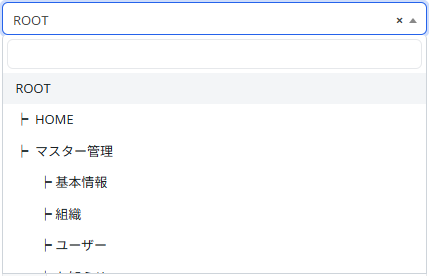

#### メニュー種類
追加するメニューの種類を、次の中から選択します。
- <span class="heading_smaller_than_h5">システムメニュー</span>  
Exmentで用意しているメニュー項目を追加したい場合に選択します。  

- <span class="heading_smaller_than_h5">プラグイン</span>  
ユーザーがアップロードしたプラグインを、メニューに表示したい場合に選択します。  

- <span class="heading_smaller_than_h5">テーブルデータ</span>  
カスタムテーブルのデータを一覧表示する画面を、メニューに表示したい場合に選択します。  

- <span class="heading_smaller_than_h5">親階層</span>  
そのメニューの下に、子階層を一覧表示する場合に選択します。  

- <span class="heading_smaller_than_h5">カスタムURL</span>  
任意のURLをメニューに追加する場合に選択します。
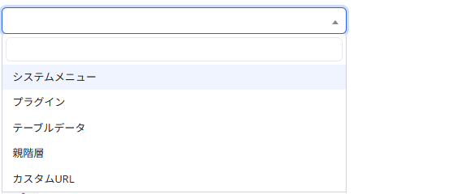

#### 対象
追加するメニューの項目を選択します。「メニュー種類」によって、表示される項目が変わります。
- メニュー種類が「システムメニュー」の場合：Exmentで用意しているページの一覧が表示されます。
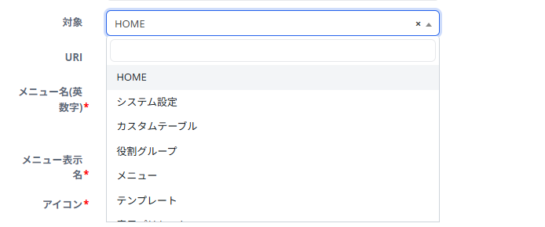

- メニュー種類が「プラグイン」の場合：ユーザーがアップロードしたプラグインの一覧が表示されます。
- メニュー種類が「テーブルデータ」の場合：カスタムテーブルの一覧が表示されます。
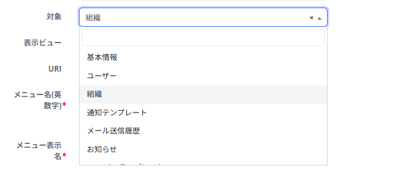

- メニュー種類が「親階層」「カスタムURL」の場合：選択不可になります。
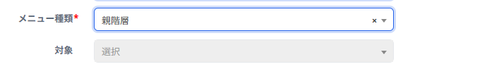


#### URI
クリックしたときに開くURIです。
- メニュー種類が「システムメニュー」「プラグイン」「テーブルデータ」「親階層」の場合：表示だけです。記入する必要はありません。  
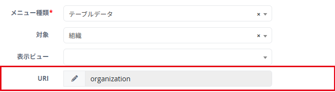

- メニュー種類が「カスタムURL」の場合：クリックしたときに開くURIを記入してください。  
※実際に開くページのURLは、以下のようになります。
http(s)://(ExmentのURL)/(記入したURI)
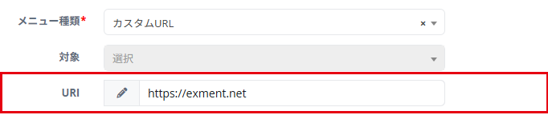

> v3.0.2未満で初回インストールを行ったサイトでは、URIに登録できる文字数上限が50字未満に設定されていました。それ以上の文字数のURIを登録する場合、[不具合修正 メニューのURL文字数が50文字まで](/ja/patch/menu_uri_length)で対応を行ってください。


#### メニュー名
メニューの名前を半角英数字で記入します。ほかのメニューと同じ名前は使えません。  
画面には表示されない項目です。
- メニュー種類が「システムメニュー」「プラグイン」「テーブルデータ」の場合：「対象」を選択すると、自動で記入されます。  
※同じメニュー項目がすでに登録されているときは、名前が重なって保存できません。値を変更してください。
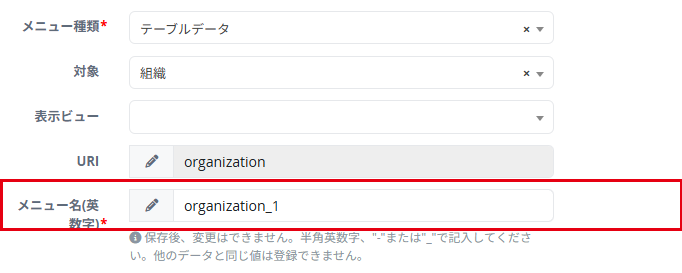

- メニュー種類が「親階層」「カスタムURL」の場合：ほかの値と重ならないように、好きな半角英数字で記入してください。  
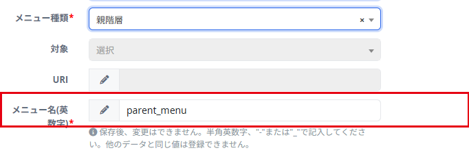


#### メニュー表示名
左メニューに表示する名前を記入します。  
※メニュー種類が「システムメニュー」「プラグイン」「テーブルデータ」の場合、「対象」を選択すると、自動で記入されます。  

#### アイコン
左メニューに表示するアイコンを記入します。  
※メニュー種類が「システムメニュー」「プラグイン」「テーブルデータ」の場合、「対象」を選択すると、自動で記入されます。  

#### 見せる役割グループ
（v7.2.1 以降。メニュー種類が「親階層」のときだけ）  
選んだ役割グループの人にだけ、この親階層を中のメニューごと表示します。空のときは、今までどおり全員に表示します（中のメニューは、それぞれの権限で表示されます）。システム管理者にはいつも表示されます。  
たとえば「申請・承認」を申請者と承認者だけに、「経理」の分類を経理の担当者だけに表示できます。  
※表示を分けるだけで、権限は変わりません。中のテーブルや画面は、それぞれの権限で開けます。  
※テンプレートに書き出すと、役割グループは名前で書かれます。取り込んだサイトに同じ名前の役割グループがあれば、それにつながります。

### 保存
設定を記入したら、［送信］をクリックしてください。  
※保存したあと、ブラウザーを読み込み直すか、もう一度Exmentにアクセスすると、左メニューに項目が反映されます。

### 順序並べ替え
保存してあるメニュー項目の順番は、一覧画面で変えられます。

1. 項目をドラッグ＆ドロップして、順番を並べ替えます。
2. 終わったら、［保存］をクリックしてください。
  
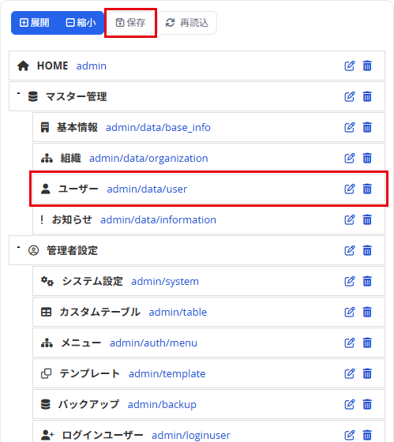


### 編集
メニューを編集するときは、その行の［編集］リンクをクリックしてください。  
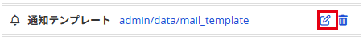

### 削除
メニューを削除するときは、その行の［削除］リンクをクリックしてください。  
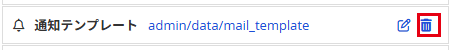

> v7.2.1 より前にインストールしたサイトでは、**操作ログ一覧**はメニュー項目に表示されません。必要な場合は一覧から設定を行ってください。v7.2.1 以降に新しくインストールしたサイトでは、「設定：ユーザーと権限」に表示されます。