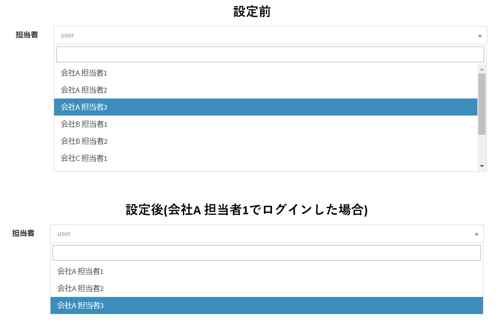
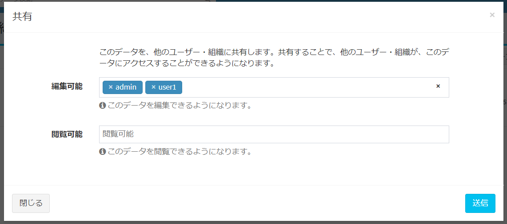
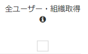

# 外部ポータルサイト向け設定(複数の組織のユーザーがログインするシステムを構築する場合)
ユーザーや組織を選ぶ・表示するところで、**「ログインユーザーが所属する組織と、その所属ユーザーだけを表示する」**ようにする設定です。  
ちがう会社の人どうしが、1 つの Exment にログインするとき（外部向けのポータルサイトなど）におすすめします。

設定そのものは、システム設定の 1 項目を変えるだけです。先に手順を知りたい方は、下の「[設定方法](/ja/multiuser?id=設定方法)」をご覧ください。

## 背景
元々Exmentでは、主に以下のような用途を想定していました。  

- 企業内・組織内での情報共有  
- グループ会社間での情報共有
- REST APIを公開し、Webデータベースとしてのデータ所持

これらの用途では、だれが使っているか、どの組織・会社が登録されているかが見えても、大きな問題にはなりません。むしろ、見えるほうが自然です。  

しかし、次のような用途では、**「他のユーザーの情報を取得できる」**ことが、問題になることがあります。  

- グループ会社間ではない、まったく異なる企業に、それぞれExmentのアカウントを払い出し、1つのWebデータベースでデータ管理を行う。
- 個人単位でExmentのアカウントを払い出し、ポータルサイトとしてシステムを構築する。

このような用途では、**各ユーザーの所属会社以外のユーザー情報、会社・組織情報を、閲覧・取得できることは、時に問題となることがあります。**  
  

例として、以下のようなExmentを構成したとします。  

- あるExment環境で、ベンダー会社A、B、Cの担当者がログインできるようになっている。
- 各ベンダーの担当者は、テーブル「製品情報」に「担当データの編集」権限を持ち、自社が担当する製品情報を入力する。
- テーブル「製品情報」では、カスタム列「担当者」がある。「担当者」列に、その製品の自社担当者を設定する。

通常の設定のままだと、**テーブル「製品情報」のカスタム列「担当者」候補には、ベンダー会社A・B・Cすべての担当者が表示されてしまいます。**    
Exmentの「ユーザー」列は、通常の設定では、権限のあるユーザーすべてを選択肢に出すためです。  
  
  
  
そこで、**「各組織のログインユーザーには、そのユーザーが所属する組織やユーザーのみ表示させる」**ようにしたい場合があります。  
  
このページでは、次の 2 つを行う手順を説明します。
- ログインユーザーが所属する組織以外を、表示できなくする。
- ならびに、それらの組織に所属するユーザー以外を表示できなくする。

## 設定方法
1. システム設定画面に遷移し、画面右上の「詳細設定」ボタンをクリックします。
2. 「組織設定」の「ユーザー・組織のフィルター」項目を、適切な設定に変更します。

  

選べる設定は、そのExmentで「組織設定を使用する」設定がYESかどうかで変わります。

### 設定値(組織を使用する設定の場合)
どの設定でも、ログインユーザーが取得できるのは、「取得できる組織」と「その組織に所属しているユーザー」だけになります（「絞り込みを行わない」を除く）。

#### 絞り込みを行わない
- 既定値です。ログインユーザーによって、組織やユーザーの絞り込みは行いません。

#### ログインユーザーが所属する組織と、親子階層の組織。ならびに、それらの所属ユーザー
- ログインユーザーは、自身が所属する組織と、その親子階層の組織情報のみ取得できます。
- それらの組織に所属しているユーザーの情報のみ取得できます。

#### ログインユーザーが所属する組織と、親階層の組織。ならびに、それらの所属ユーザー
- ログインユーザーは、自身が所属する組織と、その親階層の組織情報のみ取得できます。
- それらの組織に所属しているユーザーの情報のみ取得できます。

#### ログインユーザーが所属する組織と、子階層の組織。ならびに、それらの所属ユーザー
- ログインユーザーは、自身が所属する組織と、その子階層の組織情報のみ取得できます。
- それらの組織に所属しているユーザーの情報のみ取得できます。

#### ログインユーザーが所属する組織。ならびに、それらの所属ユーザー
- ログインユーザーは、自身が所属する組織の情報のみ取得できます。
- それらの組織に所属しているユーザーの情報のみ取得できます。

### 設定値(組織を使用しない設定の場合)
#### 絞り込みを行わない
- 既定値です。ログインユーザーによって、ユーザーの絞り込みは行いません。

#### ログインユーザーのみ
- ログインユーザー以外のユーザー情報は取得できなくなります。

## この設定を行った場合の仕様
この設定をすると、画面は次のように変わります。  

- **データ編集画面**：カスタム列「組織」の選択肢が、ログインユーザーが取得できる組織だけになります。  
カスタム列「ユーザー」の選択肢も、ログインユーザーが取得できるユーザーだけになります。

  

- **データの閲覧**：列に、ログインユーザーが取得できないユーザー・組織が入っているときは、ユーザー・組織のリンクのかわりに、「(表示権限がありません)」と表示されます。  
※対象のデータそのものを閲覧できなくする機能ではありません。ユーザー・組織だけが表示されなくなる機能です。  
この表示が出ているときは、本来の対象ではないユーザー・組織にも、データが共有されている可能性があります。[データの権限設定](/ja/permission#_3データ単位)をご確認ください。

  

- **データの共有画面**：選択肢が、ログインユーザーが取得できる組織・ユーザーだけになります。

  

- 次のユーザーだけは、所属している組織などに関わらず、すべての組織・ユーザーを取得できます。
    - システム管理者
    - [役割グループ設定](/ja/role_group)にて、「全ユーザー・組織の取得」の権限をもつログインユーザー

  
