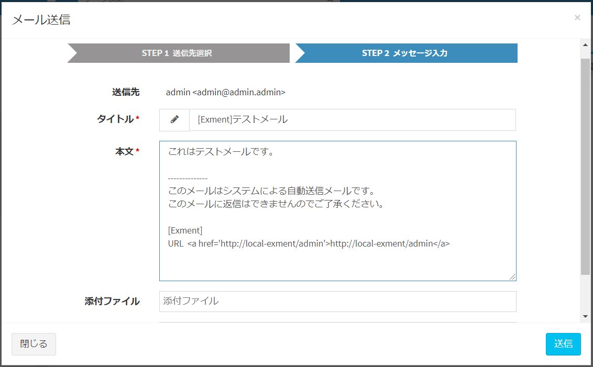
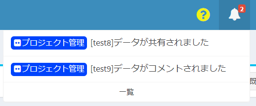
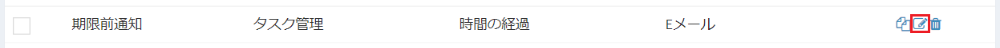
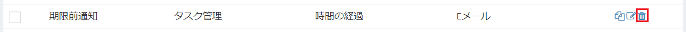
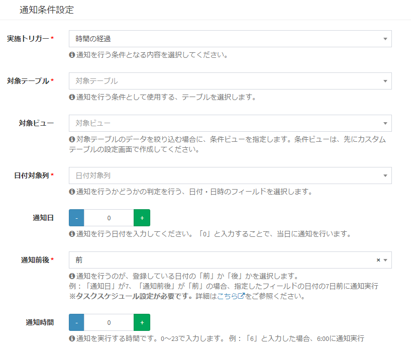
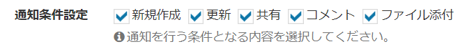

# 通知・メール送信設定
決めた条件になったときに、ユーザーや指定のメールアドレスに、メールなどで知らせる「通知」を設定するページです。

通知は、次の 3 つを決めて作ります。

| 決めること | 内容 | 見るところ |
|---|---|---|
| 通知トリガー | いつ知らせるか（データを作ったとき、日付が近づいたとき、など） | 通知トリガーの種類 |
| 通知アクション | 何で知らせるか（Eメール、システム内アラート、Slack など）と、だれに知らせるか（通知対象） | 通知アクションの種類 |
| 通知テンプレート | 件名・本文 | [通知テンプレート](/ja/mail) |

**※この機能でメール送信を実行する場合、[メール設定](/ja/system_setting#システムメール設定)を行う必要があります。**

## 通知トリガーの種類
通知トリガーは、「いつ通知するか」のきっかけです。現在、以下の種類があります。

### 時間の経過
データに登録している日付の、決めた日数だけ前（または後）の日になると、通知が実行されます。  
例：契約更新日が「7/31」で、設定で「10日前に通知」の設定を行っていた場合に、「7/21」にメールを送信します。    
**※この機能を実行する場合、事前に、[タスクスケジュール](/ja/additional_task_schedule)設定を行う必要があります。**

### データ新規作成・更新・共有・コメント
次のときに、通知が実行されます。データの変更を早く知りたいときにお使いください。  

- データの新規作成時
- データの更新時
- データに対し、コメントが実施された時
- データに対し、ファイルが添付された時
- データが共有された時  
  
※初期設定では、データの更新などを行ったログインユーザー自身には、通知されません。変えるときは、[設定値変更](/ja/config)の「通知対象がログインユーザーだった場合、通知をスキップする」を設定してください。  
※データインポートのときは、通知されません。大量の通知やメールが送られるおそれがあるためです。

### ボタン
データ詳細画面に、通知用のボタンが表示されます。  
ボタンを押して、指定のユーザーやメールアドレスに、メッセージを送信します。  
保存してあるファイルを添付することもできます。

  
  

### ワークフロー実行
ワークフローが実行されたときに、データの作成者や次の実行ユーザーに通知できます。

### 公開フォーム データ登録完了時、エラー時
公開フォームで、一般ユーザーがデータを入力したときと、エラーが発生したときに、一般ユーザーもしくは管理者に通知を送信できます。  
※公開フォームについては、[公開フォーム設定](/ja/publicform)をご確認ください。

## 通知アクションの種類
通知アクションは、「何で通知するか」です。現在、以下の種類があります。  
通知設定画面では、だれに通知するかの「通知対象」も設定します。

### Eメール
特定のEメールアドレスに、メールを送信します。

#### 通知対象（必須）

- ##### システム管理者
システム管理者に、メールを送信します。

- ##### 権限のあるユーザー
対象のデータの権限のあるユーザーに、メールを送信します。

- ##### 作成ユーザー
対象のデータを作成したユーザーに、メールを送信します。

- ##### 指定のメールアドレス
入力したメールアドレスに、メールを送信します。メールアドレスは複数指定できます。

- ##### Eメール列
通知対象のデータに、カスタム列「Eメールアドレス」があるとき、そのEメールアドレスに、メールを送信します。

- ##### ユーザー列
通知対象のデータに、カスタム列「ユーザー」があるとき、そのユーザー列に設定されているユーザーに、メールを送信します。

- ##### 選択肢 (他のテーブルの値一覧から選択) 内の Eメールアドレス列
データのカスタムテーブルに、カスタム列「選択肢 (他のテーブルの値一覧から選択)」があり、その参照先のテーブルにEメールアドレス列があるとき、そのEメールアドレスに、メールを送信します。

- ##### 指定のユーザー
選択したユーザーに、通知を送信します。  
※そのテーブルに権限が存在するユーザーのみ、選択肢候補が表示されます。権限のないユーザーには通知できません。

- ##### 指定の組織
選択した組織に、通知を送信します。  
※そのテーブルに権限が存在する組織のみ、選択肢候補が表示されます。権限のない組織には通知できません。

### システム内アラート
対象のユーザーがログインすると、ページ右上の通知アイコンに、通知アラートが表示されます。 
  

#### 通知対象（必須）

- ##### システム管理者
システム管理者に、通知を送信します。

- ##### 権限のあるユーザー
対象のデータの権限のあるユーザーに、通知を送信します。

- ##### 作成ユーザー
対象のデータを作成したユーザーに、通知を送信します。

- ##### ユーザー列
通知対象のデータに、カスタム列「ユーザー」を含んでいた場合、そのユーザーに、通知を送信します。

- ##### 指定のユーザー
選択したユーザーに、通知を送信します。  
※そのテーブルに権限が存在するユーザーのみ、選択肢候補が表示されます。権限のないユーザーには通知できません。

- ##### 指定の組織
選択した組織に、通知を送信します。  
※そのテーブルに権限が存在する組織のみ、選択肢候補が表示されます。権限のない組織には通知できません。

### Slack
Slackに通知を送信します。  
※通知を行うには、WebhookのURLが必要です。URLの取得方法は、[Webhookに通知を行う場合の設定](/ja/notify_webhook)をご参照ください。

#### メンション設定
Slackの通知に、メンション（相手を名指しする書き方）を付けられます。メンションには、次の設定があります。

- ##### 全体メンション
Slack通知に、全体のメンションを行う「@here」を追加します。

- ##### 個別メンション
Slack通知に、個別のメンションを追加します。  
メンションに使うSlackのユーザーIDは、別に設定しておく必要があります。  
Slack ID設定方法は、[Slack ID設定方法](notify_webhook#slack-id設定方法)をご確認ください。

#### メンション対象

- ##### システム管理者
システム管理者に、通知を送信します。

- ##### 権限のあるユーザー
対象のデータの権限のあるユーザーに、通知を送信します。

- ##### 作成ユーザー
対象のデータを作成したユーザーに、通知を送信します。

- ##### ユーザー列
通知対象のデータに、カスタム列「ユーザー」があるとき、そのユーザー列に設定されているSlack IDに、メンションを送信します。

### Microsoft Teams
Microsoft Teamsに通知を送信します。  
※通知を行うには、WebhookのURLが必要です。URLの取得方法は、[Webhookに通知を行う場合の設定](/ja/notify_webhook)をご参照ください。  
※Microsoft Teamsでは、メンションの追加はできません。

### LINE通知
LINE公式アカウントから、ユーザーのLINEに通知を送信します。カード形式（Flex Message）で送信することもできます。  
※通知を受け取るユーザーは、事前にLINEアカウントを連携する必要があります。LINE公式アカウントの準備や、アカウント連携の方法は、[LINE連携](/ja/line)をご確認ください。

#### 通知対象（必須）
「システム内アラート」と同様に、システム管理者、権限のあるユーザー、作成ユーザー、ユーザー列、指定のユーザー、指定の組織などから選択します。  
※LINEアカウントを連携していないユーザーには、通知は送信されません。

## 一覧画面表示
v4.2.0より、通知設定画面の場所が変わりました。通知トリガーの種類によって、次の場所から開きます。

- 時間の経過、データ新規作成・更新・共有・コメント、ボタン  
→カスタムテーブルのテーブル詳細設定ダイアログより、通知設定ボタンをクリックしてください。
  

- ワークフロー  
→ワークフロー設定のStep3にて、設定を行ってください。
  

## 新規作成 
1. 一覧画面右上の［新規］ボタンをクリックします。

2. 通知新規作成画面が表示されるので、必要事項を入力します。  
※入力する内容は、下の「設定項目詳細」をご参照ください。

3. ［送信］ボタンをクリックします。通知設定が作成されます。

## 編集
- 編集したい行の［編集］リンクをクリックしてください。  
編集画面が開き、設定を変更できます。  

  

## 複製
- 複製したい行の［複製］リンクをクリックしてください。  
その行の設定値が入った状態で、新規作成画面が開きます。

  

## 削除
列の削除を行いたい場合、該当する行の［削除］リンクをクリックしてください。  

  

## 設定項目詳細
「通知名」、いつ通知するかの「通知条件設定」、何で通知するかの「通知アクション設定」を設定します。  

### 通知名設定

#### 通知名(英数字)
- システムで使用する通知の名称です。  
プラグイン(トリガー)のトリガー条件で通知実行直前や通知実行後を設定する際などに使用します。
- 使用できるのは、半角英数字と記号の "-" と "_" です。
- 文字数は30文字以内で、他の通知で使用している通知名は使用できません。

#### 通知表示名
- 通知名の名前を表します。

### 通知条件設定

  

#### 実施トリガー
通知のきっかけを選択します。くわしくは、上の[通知トリガーの種類](#通知トリガーの種類)をご確認ください。

#### 対象ビュー
通知するデータをしぼるための、[条件ビュー](/ja/view.md?id=条件ビュー)を選択します。

### 通知条件設定(時間の経過)

#### 日付対象列
通知するかどうかを決めるもとになる、日付のカスタム列を選択します。  
選択できるカスタム列の種類は、「日付」「日時」です。  
※選択したカスタムテーブルが、「日付」「日時」を含んでいない場合、選択肢は表示されません。

#### 通知日
通知を行う日付を入力してください。「0」と入力すると、当日に通知します。

#### 通知前後
通知を行うのが、登録している日付の「前」か「後」かを選択します。  
例：「通知日」が7、「通知前後」が「前」の場合、指定したフィールドの日付の7日前に通知実行

#### 通知時間
通知を実行する時間です。0～23で入力します。  
例：「6」と入力した場合、6:00に通知実行

### 通知条件設定(データ新規作成・更新・共有・コメント)

#### 通知条件設定
通知を行う条件を設定します。
  

### 通知条件設定(ボタン)

#### ボタン表示名
画面に表示するボタンの名称を記入します。

### 通知条件設定(ワークフロー)

#### 実行後ステータス
通知を送信するステータスを選択してください。アクション実行後のステータスを参照します。※空の場合はすべてが対象となります。

#### 実施アクション
通知を送信するアクションを選択してください。※空の場合はすべてが対象となります。

### 通知アクション設定

通知のアクションを選択します。複数選択できます。  
アクションの詳細は、[通知アクションの種類](#通知アクションの種類)をご確認ください。

  

### LINE Flexテンプレート
実施アクションが「LINE通知」の場合に、LINEに送信するカードのテンプレートを選択します。選択しない場合は、テキストで送信します。  
テンプレートの作成方法は、[LINE連携](/ja/line?id=line-flexテンプレート)をご確認ください。

### 通知テンプレート
送る通知のテンプレートを選択します。新しいテンプレートを使うときは、先に通知テンプレート画面で作成しておいてください。  
通知テンプレートについて、詳細は[通知テンプレート](/ja/mail)をご参照ください。  
  
  
>  **ファイルを添付した通知を行う場合、[通知時の添付ファイルの暗号化](/ja/notify_encript)の設定を行うと、添付ファイルが暗号化されます。**

## 通知に時間がかかる場合
通知の処理は、メールでもWebHookでも、非常に時間がかかります。  
上級者向けの機能ですが、[通知の遅延実行](/ja/additional_queue)を使うと、通知が終わるのを待たずに、次の処理に進みます。

## 通知(時間の経過)のコマンド実施
実施トリガー「時間の経過」の通知は、コマンドを使って、「通知時間」の設定に関係なく、好きなときに手動で実行できます。  
以下のコマンドのいずれかを実行してください。  

~~~
# 通知ID指定
php artisan exment:notify 1

# notify_name(通知名(英数字))指定
php artisan exment:notify --name=task_limit_date_notify
~~~

  
