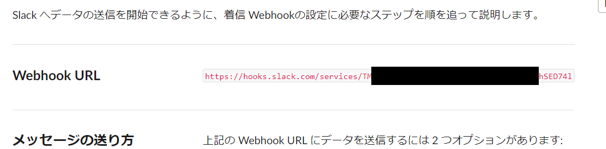
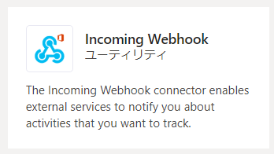
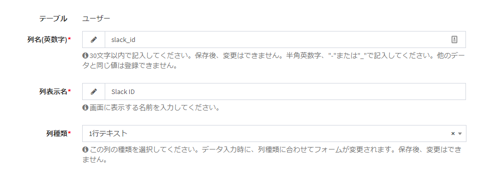

# Webhookに通知を行う場合の設定
Slack や Microsoft Teams に通知を送るには、「Webhook URL」が必要です。Webhook URL は、通知を受け取るための専用の URL です。  
このページでは、Webhook URL の取り方と、Slack で特定の人にメンションを付けるための設定を説明します。

| したいこと | 見るところ |
|---|---|
| Slack に通知する | [Slack取得手順](/ja/notify_webhook?id=slack取得手順) |
| Microsoft Teams に通知する | [Microsoft Teams取得手順](/ja/notify_webhook?id=microsoft-teams取得手順) |
| Slack の通知で、ユーザーにメンションを付ける | [Slack ID設定方法](/ja/notify_webhook?id=slack-id設定方法) |

## Slack取得手順
1. 次の URL を開きます。  
https://slack.com/services/new/incoming-webhook  

2. 通知先のチャンネルを選びます。  
そのあと、「Incoming Webhook  インテグレーションの追加」をクリックします。  
  

3. Webhook URL ができるので、コピーします。  
  

4. コピーした Webhook URL を、Exment の通知設定に貼り付けます。

## Microsoft Teams取得手順
1. Teams を開き、通知したいチームの「チームを管理」をクリックします。  
  

2. 「アプリ」タブをクリックします。  

3. 「その他のアプリ」タブをクリックします。  

4. 「Incoming Webhook」をクリックします。  

5. 「インストール」をクリックします。  

6. 通知するチャネルを選びます。そのあと、「設定」をクリックします。  

7. 通知で使う名前を入力し、「作成」をクリックします。  

8. Webhook の URL ができるので、URL をコピーし、「完了」をクリックします。  

9. コピーした Webhook URL を、Exment の通知設定に貼り付けます。

## Slack ID設定方法
Slack で、特定の人にメンション（その人あての呼びかけ）を付けたいときの設定です。  
ユーザーごとの Slack ID を入れる列を作り、システム設定でその列を選びます。最初に 1 回だけ行ってください。

1. [カスタムテーブル](/ja/table)設定で、「ユーザー」テーブルの「カスタム列設定」リンクをクリックします。  
 

2. ユーザーテーブルの[カスタム列](/ja/column)設定で、次のカスタム列を追加します。
    - 列名(英数字)、列表示名：任意の名称
    - 列種類：「1行テキスト」

     

3. [システム設定](/ja/system_setting)画面の「詳細設定」で、「Slack ID設定列(ユーザー)」に、いま追加した Slack ID の列を選びます。  
 

4. ユーザーデータの編集画面で、それぞれのユーザーの Slack ID を入力します。そのユーザーに通知するとき、メンションが付きます。  
※ Slack の画面でユーザー ID を確かめる方法は、[こちら](https://auto-worker.com/blog/?p=27)をご確認ください。  
 

これで、通知設定画面から、ユーザーデータに入力した Slack ID にメンションを付けられます。  
通知設定画面では、通知対象の表示が次のように変わります。（上：Slack ID の設定をしていないとき、下：設定をしたとき）

 
 

