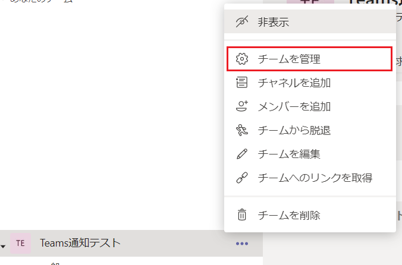
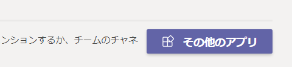
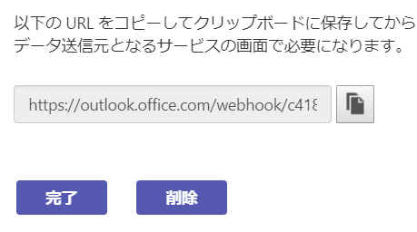
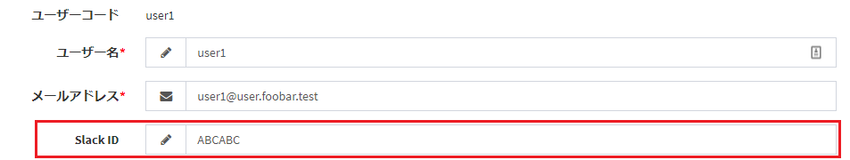

# Webhookに通知を行う場合の設定
Slack や Microsoft Teams に通知を送るには、「Webhook URL」が必要です。Webhook URL は、通知を受け取るための専用の URL です。  
このページでは、Webhook URL の取り方と、Slack で特定の人にメンションを付けるための設定を説明します。

| したいこと | 見るところ |
|---|---|
| Slack に通知する | [Slack取得手順](/ja/notify_webhook?id=slack取得手順) |
| Microsoft Teams に通知する | [Microsoft Teams取得手順](/ja/notify_webhook?id=microsoft-teams取得手順) |
| Slack の通知で、ユーザーにメンションを付ける | [Slack ID設定方法](/ja/notify_webhook?id=slack-id設定方法) |
| 好きな URL に JSON で送る（v7.3.0 以降） | [JSON の Webhook](/ja/notify_webhook?id=json-の-webhook) |

## Slack取得手順
1. 次の URL を開きます。  
https://slack.com/services/new/incoming-webhook  

2. 通知先のチャンネルを選びます。  
そのあと、「Incoming Webhook  インテグレーションの追加」をクリックします。  
  

3. Webhook URL ができるので、コピーします。  
  

4. コピーした Webhook URL を、Exment の通知設定に貼り付けます。

## Microsoft Teams取得手順
1. Teams を開き、通知したいチームの「チームを管理」をクリックします。  
  

2. 「アプリ」タブをクリックします。  


3. 「その他のアプリ」タブをクリックします。  


4. 「Incoming Webhook」をクリックします。  


5. 「インストール」をクリックします。  


6. 通知するチャネルを選びます。そのあと、「設定」をクリックします。  


7. 通知で使う名前を入力し、「作成」をクリックします。  


8. Webhook の URL ができるので、URL をコピーし、「完了」をクリックします。  


9. コピーした Webhook URL を、Exment の通知設定に貼り付けます。


## Slack ID設定方法
Slack で、特定の人にメンション（その人あての呼びかけ）を付けたいときの設定です。  
ユーザーごとの Slack ID を入れる列を作り、システム設定でその列を選びます。最初に 1 回だけ行ってください。

1. [カスタムテーブル](/ja/table)設定で、「ユーザー」テーブルの「カスタム列設定」リンクをクリックします。  
 

2. ユーザーテーブルの[カスタム列](/ja/column)設定で、次のカスタム列を追加します。
    - 列名(英数字)、列表示名：任意の名称
    - 列種類：「1行テキスト」

     

3. [システム設定](/ja/system_setting)画面の「詳細設定」で、「Slack ID設定列(ユーザー)」に、いま追加した Slack ID の列を選びます。  
 

4. ユーザーデータの編集画面で、それぞれのユーザーの Slack ID を入力します。そのユーザーに通知するとき、メンションが付きます。  
※ Slack の画面でユーザー ID を確かめる方法は、[こちら](https://auto-worker.com/blog/?p=27)をご確認ください。  
 

これで、通知設定画面から、ユーザーデータに入力した Slack ID にメンションを付けられます。  
通知設定画面では、通知対象の表示が次のように変わります。（上：Slack ID の設定をしていないとき、下：設定をしたとき）

 
 

## JSON の Webhook
※この機能は、Exment v7.3.0 以降で使えます。

通知のアクションに「Webhook（JSON）」を選ぶと、データを JSON にして、好きな URL に送ります。Zapier・n8n・Power Automate や、自分で作ったプログラムで受け取れます。

### 使えるようにする
データの値を外に送るので、初めは使えません。システム管理者が「[機能の管理](/ja/feature)」で「Webhook の通知（JSON）」を有効にします。

### 通知の設定
通知の設定のアクションで「Webhook（JSON）」を選び、次の 3 つを入れます。

| 項目 | 説明 |
|---|---|
| Webhook URL | 送り先の URL（http か https）。このサーバー自身や、社内のアドレスには送れません（Slack・Teams と同じ） |
| 送る列 | 送るデータの列。選ばない列は送りません。データの ID・名前・URL は、いつも送ります |
| 署名の秘密の値 | 入れると、送る JSON に署名をつけます。受け取る側で、同じ値を使って、本物か確かめられます。保存すると暗号化され、あとから見ることはできません |

### 送る JSON
POST で、`Content-Type: application/json` の本文を送ります。

```json
{
  "event": "exment.notify",
  "id": "3f2c6a1e-6c1b-4d8e-9a57-2f1d0c9b7e11",
  "sent_at": "2026-11-26T10:15:30+09:00",
  "trigger": "create_update_data",
  "action": "updated",
  "notify": { "id": 12, "name": "案件の更新" },
  "table": { "name": "deal", "label": "案件" },
  "record": {
    "id": 101,
    "label": "A 社 更新",
    "url": "https://exment.example.com/admin/data/deal/101",
    "created_at": "2026-11-20T09:00:00+09:00",
    "updated_at": "2026-11-26T10:15:29+09:00",
    "deleted": false,
    "values": { "status": "2", "amount": 1200000 },
    "texts": { "status": "商談中", "amount": "1,200,000" }
  },
  "user": { "id": 3, "name": "山田 太郎" },
  "subject": "[案件 101]データが更新されました",
  "body": "…メールテンプレートの本文…"
}
```

| 項目 | 説明 |
|---|---|
| trigger | 通知のきっかけ。time（日時）・create_update_data（データの作成・更新）・button（ボタン）・workflow（ワークフロー） |
| action | データの作成・更新のとき、何をしたか。created・updated・comment・attachmented |
| record.values | 選んだ列の、保存されている値（ユーザーや、ほかのテーブルのデータは ID） |
| record.texts | 選んだ列の、画面に出る値 |
| subject・body | 通知のメールテンプレートの件名と本文 |

あわせて、次のヘッダーを送ります。

| ヘッダー | 内容 |
|---|---|
| X-Exment-Event | `exment.notify` |
| X-Exment-Delivery | 送るたびに変わる ID（本文の `id` と同じ）。同じものが 2 回届いたら、2 回目は無視できます |
| X-Exment-Timestamp | 送った時刻（UNIX 時間、秒） |
| X-Exment-Signature | 署名の秘密の値を入れたときだけ。`sha256=` のあとに、「時刻 + `.` + 本文」の HMAC-SHA256（16 進） |

### 受け取る側で署名を確かめる
本文は、届いたとおりのバイト列のまま使ってください（JSON を読みなおしてから作りなおすと、署名が合いません）。古い時刻のものはことわると、同じ通知を送りなおされる攻撃を防げます。

PHP の例：

```php
$secret = '（署名の秘密の値）';
$body = file_get_contents('php://input');
$timestamp = $_SERVER['HTTP_X_EXMENT_TIMESTAMP'] ?? '';
$signature = $_SERVER['HTTP_X_EXMENT_SIGNATURE'] ?? '';

$expected = 'sha256=' . hash_hmac('sha256', $timestamp . '.' . $body, $secret);
if (!hash_equals($expected, $signature) || abs(time() - (int)$timestamp) > 300) {
    http_response_code(401);
    exit;
}
$data = json_decode($body, true);
```

Node.js（Express）の例：

```js
const crypto = require('crypto');
app.post('/exment', express.raw({ type: 'application/json' }), (req, res) => {
  const timestamp = req.get('X-Exment-Timestamp') || '';
  const expected = 'sha256=' + crypto.createHmac('sha256', process.env.EXMENT_SECRET)
    .update(timestamp + '.' + req.body).digest('hex');
  const signature = req.get('X-Exment-Signature') || '';
  const ok = signature.length === expected.length
    && crypto.timingSafeEqual(Buffer.from(signature), Buffer.from(expected))
    && Math.abs(Date.now() / 1000 - Number(timestamp)) <= 300;
  if (!ok) return res.sendStatus(401);
  const data = JSON.parse(req.body);
  res.sendStatus(204);
});
```

### 送れなかったとき
- 受け取る側は、2xx（200・204 など）を返してください。ほかの答えは、送れなかったことになります。
- 5xx・408・429 や、つながらなかったときは、全部で 3 回まで送りなおします。キューのワーカーがあるときは 1 分後・5 分後、ないとき（`QUEUE_CONNECTION=sync`）は 1 秒後・2 秒後です。
- ほかの 4xx と、ほかの URL への転送（3xx）は、送りなおしません。転送にはついていきません。
- 最後まで送れなかったときは、その通知を作った人に、画面のお知らせ（ベル）で知らせます。お知らせには、送り先のホスト名だけを書きます。
- 送るのは、データを保存した画面の答えのあと（またはキュー）です。保存は待たされません（[通知を送るとき](/ja/additional_queue?id=通知を送るとき)）。
