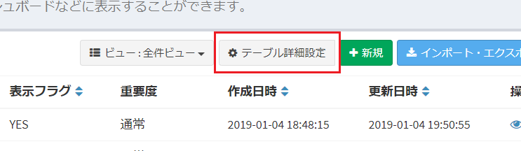
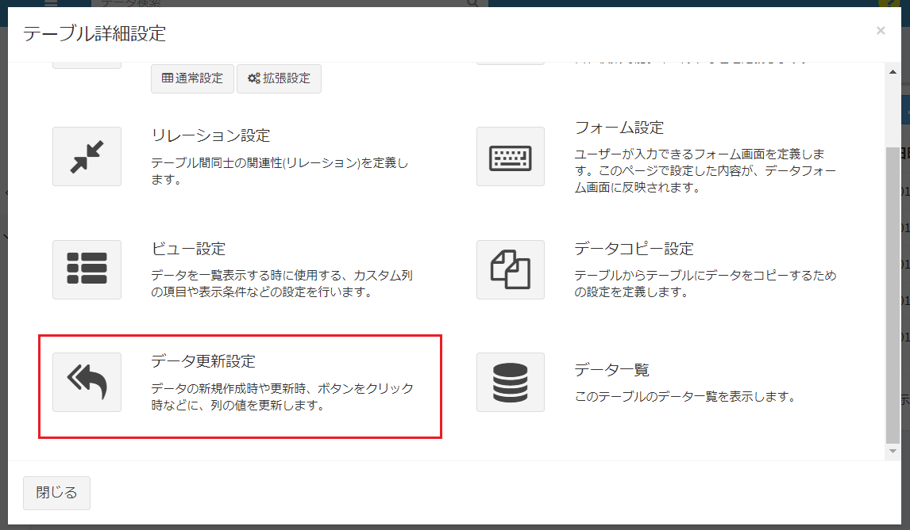
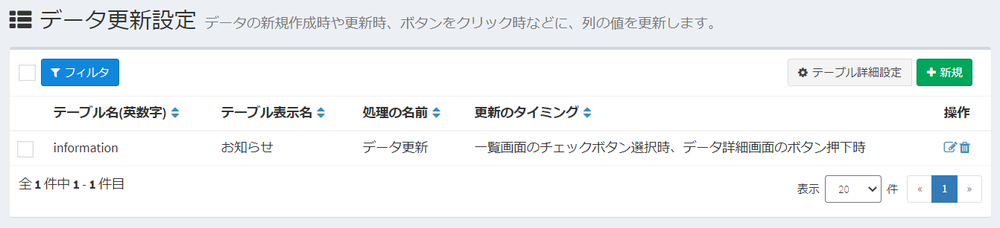
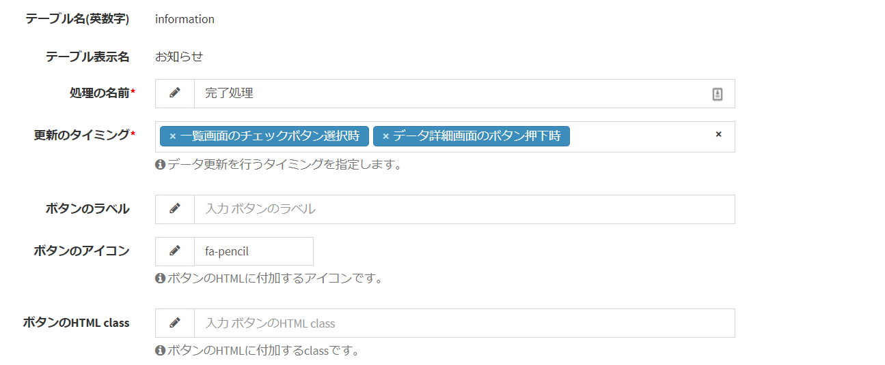
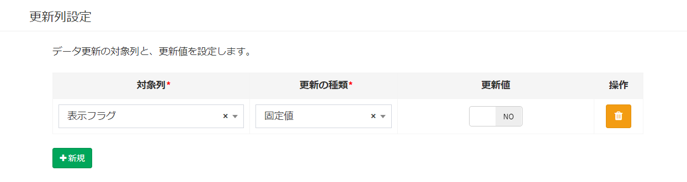
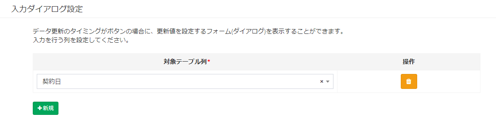
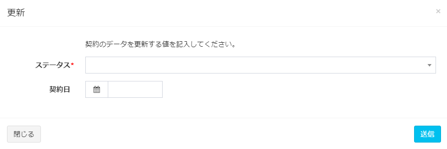

# データ更新設定
「ボタンをクリックしたとき」「データを新しく作ったとき」など、決めたきっかけ（トリガー）で、データの値をまとめて書きかえる設定です。  
たとえば、次のように使えます。  

- テーブル「タスク情報」のデータ詳細画面に「完了」ボタンを出し、クリックすると、カスタム列「ステータス」の値を完了にする。
- データを更新したとき、カスタム列「担当者」の値を、自動でログインユーザーにする。

設定の流れは、次のとおりです。

1. データ更新設定の画面を開く（「設定画面」）
2. ［新規］から、いつ（更新のタイミング）・どの列を・どの値にするかを決めて、保存する（「新規追加」「記入項目の詳細」）
3. 決めたタイミングで、更新が行われる（「更新実行」）

> この機能は、v3.5.0未満では「データ一括更新」という名前でした。v3.5.0より、機能を広げました。  
もっと複雑な条件や内容で更新したいときは、[プラグイン(ボタン)](/ja/plugin_quickstart_button)や、[プラグイン(イベント)](/ja/plugin_quickstart_event)を作ってください。

## 更新タイミングの種類

- ##### 一覧画面のチェック選択時

  

データ一覧画面に、ボタンが追加されます。  
一覧画面のチェックボックスにチェックを入れて、ボタンをクリックすると、チェックしたデータを、設定した内容で更新します。

- ##### データ詳細画面のボタン押下時

  

データ詳細画面に、ボタンが出ます。  
ボタンをクリックすると、設定した内容でデータを更新します。

- ##### データ新規作成時
ユーザーが画面やAPI、インポートなどでデータを新しく作ったときに、設定した内容でデータを更新します。

- ##### データ更新時
ユーザーが画面やAPI、インポートなどでデータを更新したときに、設定した内容で、追加でデータを更新します。

## 設定画面
1. カスタムテーブル一覧で、設定したいテーブルにチェックを1つ入れ、右上の「テーブル詳細設定」をクリックします。  

  

- または、メニューから設定したいテーブルを選んでから、同じように右上の「テーブル詳細設定」をクリックします。  
※そのテーブルを、あらかじめメニューに出しておく必要があります。  

  

2. そのあと、そのカスタムテーブルの「データ更新設定」を開きます。

  

3. データ更新設定画面が出ます。

  

## 新規追加
1. 「データ更新設定」画面で、ページ右上の［新規］ボタンをクリックします。

2. データ更新設定の新規追加画面が出ます。必要なことを入力します。

  

## 保存
設定を入力したら、［送信］をクリックしてください。

## 編集
データ更新設定を編集するには、その行の［編集］リンクをクリックしてください。  

## 削除
データ更新設定を削除するには、その行の［削除］リンクをクリックしてください。  

## 記入項目の詳細

### 基本設定

  

- ##### 処理の名前
このデータ更新設定の名前です。

- ##### 更新のタイミング
いつデータを更新するかを選びます。  
このページの上のほうの「更新タイミングの種類」を見て、選んでください。

- ##### ボタンのラベル
画面のボタンに出す文言です。  
※「更新のタイミング」が「一覧画面のチェックボタン選択時」「データ詳細画面のボタン押下時」のときだけ出ます。

- ##### ボタンのアイコン
画面のボタンに出すアイコンです。  
※「更新のタイミング」が「データ詳細画面のボタン押下時」のときだけ出ます。

- ##### ボタンのHTML class
画面のボタンに付ける、HTMLのclassです。  
※「更新のタイミング」が「データ詳細画面のボタン押下時」のときだけ出ます。

- ##### ワークフローで編集不可のデータにもボタンを表示する
ふつう、ワークフローのステータスが「データ編集不可」のデータには、データ詳細画面にボタンを出しません。  
YESにすると、このようなデータにもボタンを出します。既定値はNOです。  
ボタンが出るのは、そのデータを編集する権限を持つユーザーだけです。  
※「更新のタイミング」が「データ詳細画面のボタン押下時」のときだけ出ます。

- ##### 有効フラグ
データ更新設定を一時的に止めたいときや、作りかけの設定をいったん保存するときは、「有効フラグ」をNOにしてください。  

### 更新列設定

  

更新する列と、更新値を設定します。  

- ##### 対象列
更新する列を選びます。  

- ##### 更新の種類
対象列のカスタム列種類が「日付」「時刻」「日付と時刻」「ユーザー」「組織」のときは、「固定値」「システム値」のどちらかを選べます。  
それ以外のときは、「固定値」だけです。

- ##### 更新値
    - 更新の種類が「固定値」のときは、更新したい値を入力してください。
    - 更新の種類が「システム値」のときは、対象列のカスタム列種類によって、次の選択肢が出ます。

| 対象列のカスタム列種類 | 選択肢 |
|---|---|
| 「日付」「時刻」「日付と時刻」 | 「実行日時」 |
| 「ユーザー」 | 「ログインユーザー」「作成者」 |
| 「組織」 | 「所属組織」 |

### 更新条件

  

この更新設定を実行できるデータの条件を指定します。条件を満たしたときだけ、更新を実行できます。  
※条件を1件も設定していないときは、すべてのデータで更新を実行できます。  

### 入力ダイアログ設定

  

更新を実行するときにダイアログを出して、対象列の更新値を手で入力できるようにします。  
※「更新のタイミング」が「一覧画面のチェックボタン選択時」「データ詳細画面のボタン押下時」のときだけ選べます。

## 更新実行
設定が終わると、設定項目「更新のタイミング」で決めたタイミングで、更新が行われます。  

### 更新内容
- データの値を、設定項目「更新列設定」で決めた値にします。  
ただし、更新の種類が「システム値」のときは、次の値になります。  

    - 更新値が「実行日時」の場合、その更新処理を実施した実行日時をセット
    - 更新値が「ログインユーザー」の場合、その更新処理を実施したログインユーザーのIDをセット
    - 更新値が「作成者」の場合、そのデータを作成したユーザーのIDをセット
    - 更新値が「所属組織」の場合、その更新処理を実施したログインユーザーが所属する組織のIDをセット  
    ※ログインユーザーが複数の組織に所属していて、更新する列が「複数選択を許可する」設定でないときは、1件目の組織が、そのデータに保存されます。

- 設定項目「入力ダイアログ設定」で対象テーブル列を選んでいるときは、更新値を入力するダイアログが出ます。  

  

    
### 更新条件
- 「更新条件」で設定した条件を満たしていないデータは、更新を実行できません。  
- 「更新のタイミング」が「一覧画面のチェックボタン選択時」のとき、条件を満たしていないデータにチェックを入れて更新ボタンをクリックすると、エラーが出ます。そのときは、条件を満たしていたほかのデータも、更新しません。

