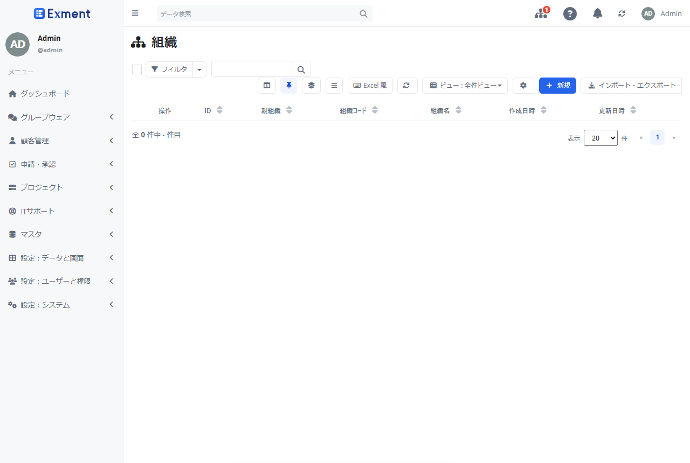
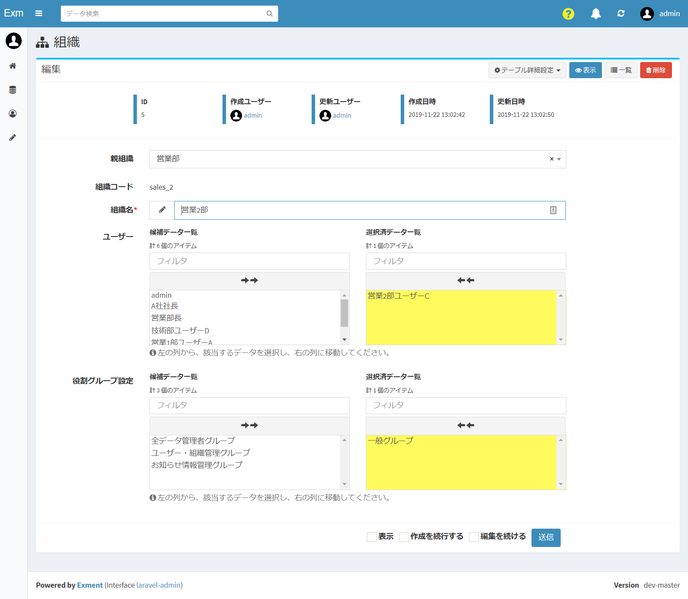
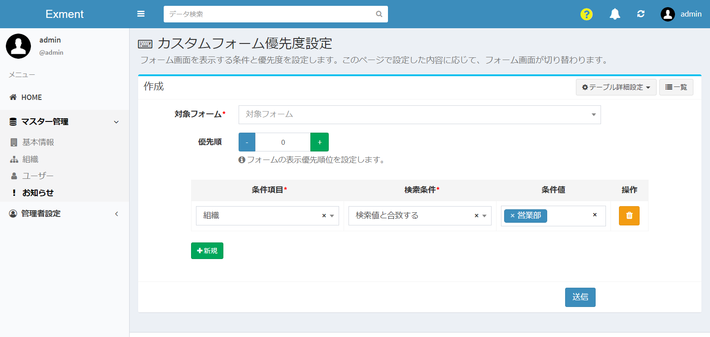
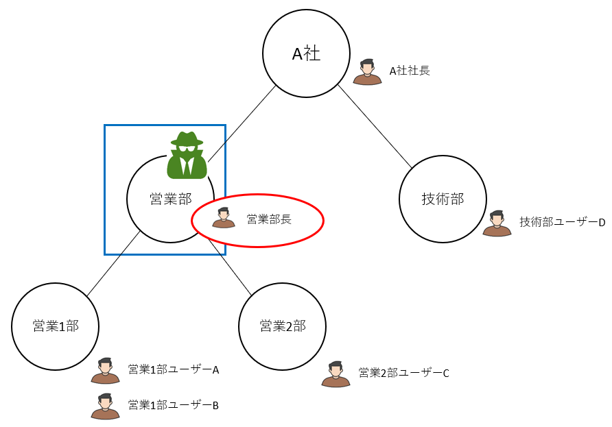
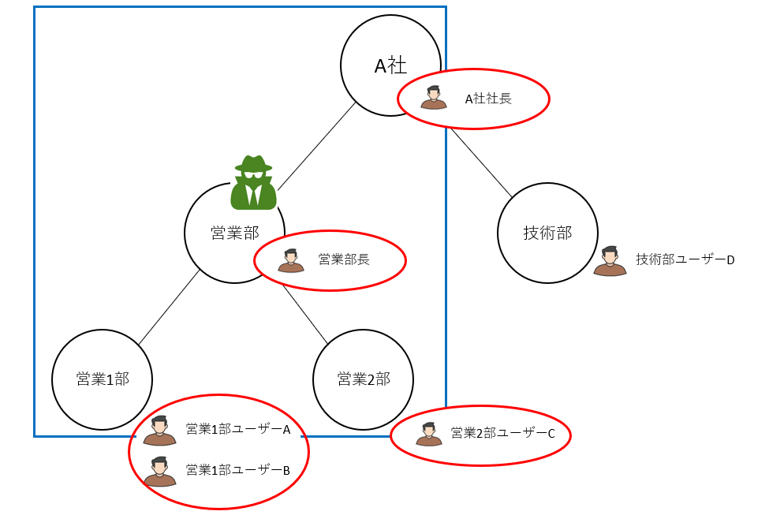
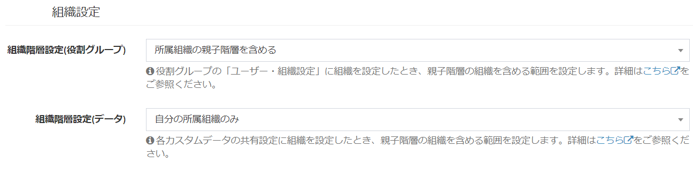
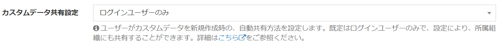

# 組織
会社の部や課などの「組織」を、Exment に登録して管理するページです。  
組織を登録しておくと、権限・フォーム・ワークフロー・データの共有を、組織ごとに決められます。

> 組織の設定を行う前に、[Exmentにおける役割・権限の概要](/ja/permission)ページのご確認を推奨しております。

このページの内容は、次のとおりです。

| 知りたいこと | 見るところ |
|---|---|
| 組織を登録する・直す・消す | 組織管理 |
| 登録した組織を、どこで使うか | 組織の使用場所 |
| 親の組織・子の組織を、どこまで含めるか | 組織階層について |

## 組織管理
組織の登録・編集・削除のしかたです。

### 一覧画面表示
左メニューより、「組織」をクリックします。  
もしくは、以下のURLにアクセスしてください。  
これにより、組織管理画面が表示されます。  
http(s)://(ExmentのURL)/data/organization  
現在システムで登録されている組織の一覧が表示されます。
  

> ※URL は、「/admin」が付かない標準の設定（v7.2.1 以降に新しくインストールしたサイト）の場合です。`.env` の `ADMIN_ROUTE_PREFIX` に値がある場合（前の版で入れたサイトは「admin」）は、サイトの URL のあとにその値を足してください（例：`http(s)://(ExmentのURL)/admin/data/organization`）。詳しくは[URLに含む「admin」の変更・削除](/ja/additional_prefix)をご覧ください。
  
※[設定値](/ja/config#組織一覧ページで階層表示を行う)で、「EXMENT_SHOW_ORGANIZATION_TREE=true」とすることで、階層が表示されます。

### 組織の新規追加
1. 「組織」の一覧画面で、ページ右上の［新規］ボタンをクリックします。
2. 新規追加画面が表示されますので、必要事項を入力します。  
※項目「親組織」は、その組織の親階層を選択してください。

### 保存
入力が終わったら、［送信］をクリックしてください。

### 編集
組織を直すときは、その行の［編集］リンクをクリックしてください。  

### 削除
組織を消すときは、その行の［削除］リンクをクリックしてください。  

## 組織の使用場所
登録した組織は、次の場所で使えます。

| 使う場所 | できること |
|---|---|
| 役割グループ | 組織に所属するユーザーが、ページにアクセスできるかどうかを決めます |
| 複数フォーム切り替え | 組織に所属するユーザーに、決めたフォームを使わせます |
| ワークフロー | 組織に所属するユーザーが、ワークフローのアクションを実行できます |
| カスタムデータの共有 | 組織に所属するユーザーが、共有したデータを編集・閲覧できます |

#### 役割グループ 
役割グループに組織を設定することができます。

- この設定により、組織に所属しているユーザーが、ページにアクセスできる・できないが制御されます。  
この画像は、上がユーザーがアクセスできる場合、下がユーザーがアクセスできない場合です。

#### 複数フォーム切り替え 
複数フォーム切り替え条件に、組織を設定できます。  
ログインユーザーがその組織に所属していた場合、フォームが使用されます。

#### ワークフロー 
ワークフローの作業ユーザー設定に、組織を設定できます。  
ログインユーザーがその組織に所属していた場合、ワークフローのアクションを実行できます。

#### カスタムデータの共有 
カスタムデータの共有先に、組織を設定できます。  
ログインユーザーがその組織に所属していた場合、カスタムデータの権限が割り振られ、データの編集や閲覧ができるようになります。

## 組織階層について
Exmentでは、下の図のように、組織に親と子の階層を付けられます。

### (上級者向け)階層の種類
組織に階層があるとき、「その組織に所属するユーザー」をどこまで含めるかは、次の 4 つから選びます。  
ここでは例として、「**営業部**」を基準にして説明します。

| 種類 | 含める組織 | 例（営業部を基準にしたとき） |
|---|---|---|
| ユーザーが所属している組織 | 対象の組織だけ | 営業部長 |
| 親階層の組織を含む | 対象の組織と、その親階層の組織 | 営業部長、A社社長 |
| 子階層の組織を含む | 対象の組織と、その子階層の組織 | 営業部長、営業1部ユーザーA、営業2部ユーザーB |
| 親子階層の組織を含む | 対象の組織と、その親階層・子階層の組織 | 営業部長、A社社長、営業1部ユーザーA、営業2部ユーザーB |

#### ユーザーが所属している組織

対象の組織そのものに、所属しているユーザーのみです。  
例の場合、営業部に所属しているのは「営業部長」のみです。

#### 親階層の組織を含む

対象の組織と、その親階層の組織です。  
例の場合、営業部に所属している「営業部長」と、その親階層の「A社」に所属する「A社社長」が該当します。

#### 子階層の組織を含む

対象の組織と、その子階層の組織です。  
例の場合、営業部に所属している「営業部長」と、その子階層の「営業1部」「営業2部」に所属する、「営業1部ユーザーA」「営業2部ユーザーB」が該当します。

#### 親子階層の組織を含む

対象の組織と、その親子階層の組織です。  
例の場合、営業部に所属している「営業部長」と、その親階層の「A社」に所属する「A社社長」、その子階層の「営業1部」「営業2部」に所属する、「営業1部ユーザーA」「営業2部ユーザーB」が該当します。

<h4 id="kaisou_syurui">(上級者向け)階層の種類の設定</h4>

階層をどこまで含めるかは、「システム設定」 > 「組織設定」で設定します。

- 階層の設定ができるのは、「役割グループ」「カスタムデータの共有」だけです。
- 「フォーム優先順位設定」「ワークフロー」では、ユーザーが所属している組織だけが対象です。

### データ共有設定
[カスタムデータのデータ共有設定](/ja/data_details#データ共有)を使うと、ほかの組織も、そのデータにアクセスできるようになります。

#### カスタムデータ共有時の有効範囲
- 組織にデータを共有した場合、その組織に所属しているユーザーがアクセスできます。
- 親組織・子組織に所属するユーザーがアクセスできるかどうかは、上の「階層の種類の設定 > 組織階層設定(データ)」で決まります。
- 他系列の組織はアクセスできません。

<h4 id="kyouyu_jidou">(上級者向け)データ保存時自動共有</h4>

カスタムデータを新規作成すると、作成したデータに、自動で共有設定が付きます。

- 標準では、「ログインユーザー」だけに共有設定が付きます。
- 設定を変えると、ログインユーザーが所属する組織にも、共有設定が付きます。
- この設定は、「システム設定」 > 「組織設定」で行います。

それぞれの設定の内容は、次のとおりです。

##### (1)ログインユーザーのみ
カスタムデータの新規作成時、ログインユーザーにのみ共有されます。  
- **例**：「営業1部ユーザーA」がデータを新規作成時、ユーザー「営業1部ユーザーA」のみアクセスできる。  

##### (2)ログインユーザーと、所属する組織
カスタムデータの新規作成時、ログインユーザーと、**所属する組織**に、共有されます。  
- **例**：「営業1部ユーザーA」がデータを新規作成時、ユーザー「営業1部ユーザーA」と、組織「営業1部」に共有される。  
→結果として、組織「営業1部」に所属するユーザー「営業1部ユーザーB」も、アクセスできる

