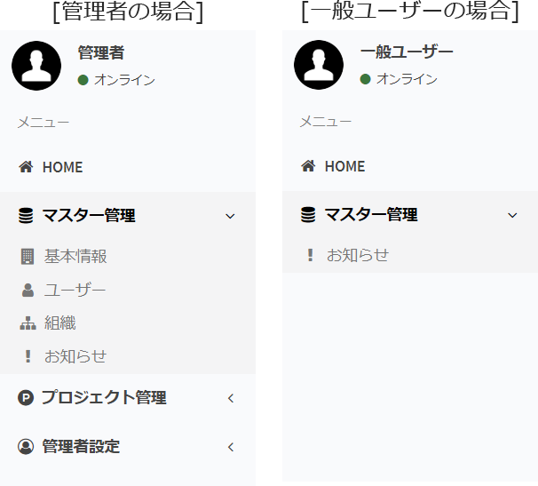
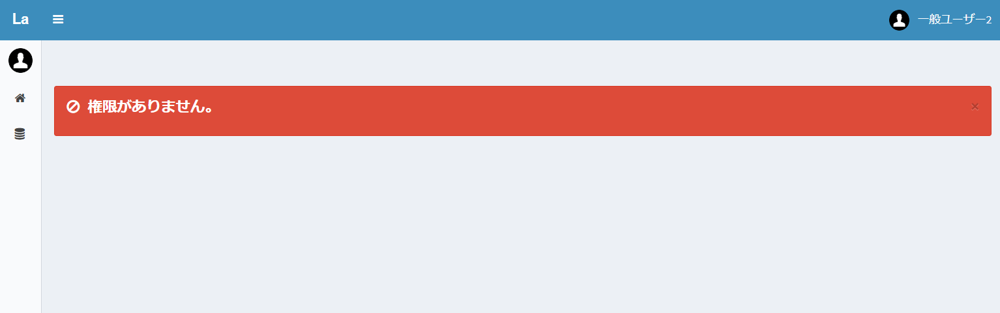
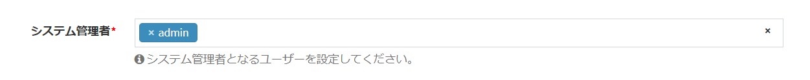
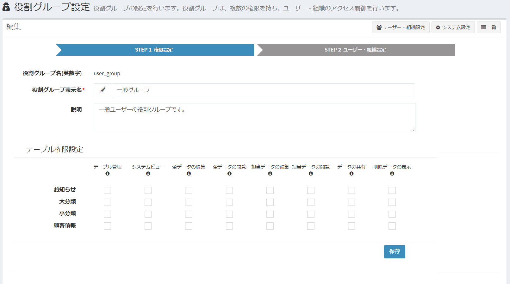
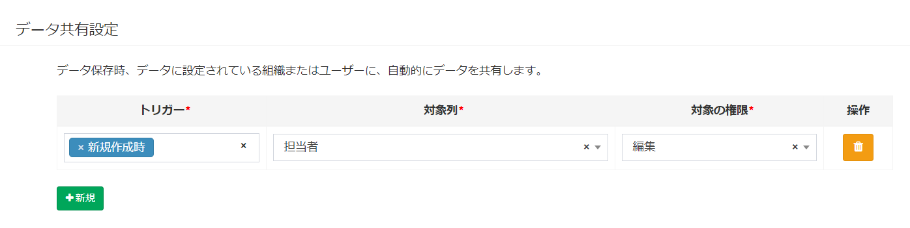
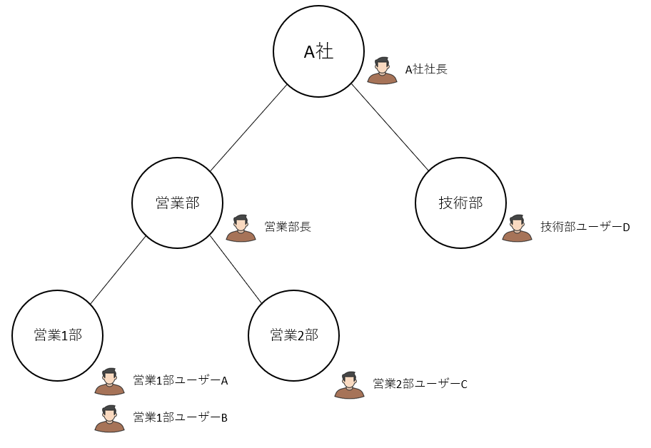

# 役割・権限の概要
Exmentの役割・権限のあらましを説明します。  
権限は、決まったデータやページを、決めたユーザーだけが操作(アクション)できるようにするための、大事な考え方です。

- 新しく追加したユーザーは、はじめの設定では、ログインしても、ほとんどの機能を使えません。  
- システム管理者は、追加したユーザーに、合った役割・権限を設定する必要があります。

権限は、次の3つの単位で管理します。くわしくは、下の「権限の管理単位」をご覧ください。

| 単位 | 決められること（例） | 設定するところ |
|---|---|---|
| (1)システム全体 | サイト名を変える、ログインユーザーを管理する | [システム設定](/ja/system_setting)の「システム管理者」、[役割グループ](/ja/role_group)の「システム権限」 |
| (2)テーブル単位 | そのテーブルの設定を変える、テーブルのデータを編集・閲覧する | [テーブル設定](/ja/table)、[役割グループ](/ja/role_group)の「テーブル権限」 |
| (3)データ単位 | 特定のデータだけを編集・閲覧する | [データ詳細画面](/ja/data_details)の「共有」など |  

## 権限の利用有無
権限設定を使わないときは、[システム設定](/ja/system_setting)で、「権限を利用する」をNoに切り替えてください。  
使わないときは、すべてのユーザーが、すべての操作をできます。  

## 権限の有無による違い (一例)
権限があるかないかで、ユーザーができる操作や、画面の表示が変わります。

##### ■権限があるメニューのみ表示される
→ログインユーザーのメニューには、権限のある項目だけが出ます。  

##### ■アクセスエラーになる  
→権限がないページを開こうとすると、アクセスエラーになります。

##### ■データフォームの選択肢に項目が表示されない  
→列が「選択肢 (他のテーブルの値一覧から選択)」の場合、参照先テーブルの権限がないと、選択肢が出ません。  

## 権限の管理単位
Exmentで権限を管理する単位は、主に次の3つです。

- システム全体
- テーブル単位
- データ単位

### 全体図

### (1)システム全体

Exmentのシステム設定を操作する権限です。  
たとえば、次のような操作です。  

- サイト名を変更する。
- ログインユーザーを管理する。
- 全テーブルの作成・編集・閲覧などを行う。

#### 権限設定方法

##### システム管理者設定
[システム設定](/ja/system_setting)で、「システム管理者」を追加・変更できます。「システム管理者」は、システムのすべての操作ができます。

##### その他のシステム設定
システム管理者でないユーザーも、[役割グループ](/ja/role_group)を付けると、システム全体の操作ができます。  
システムの操作の権限は、[役割グループ](/ja/role_group)で、「システム権限」を追加・変更してください。

### (2)テーブル単位

Exmentで作るテーブルの権限です。  
テーブルごとに権限を設定します。設定した内容によって、それぞれのユーザーができる操作が変わります。  
テーブルの権限がまったくないユーザーは、そのテーブルのどのページも開けません。  
  
たとえば、次のような操作です。  

- 列の追加など、そのテーブルの設定を変更する。
- テーブル内のすべてのデータを編集できる。
- テーブル内のすべてのデータを閲覧でき、自分が担当のデータを編集できる。
- テーブル内の、自分が担当のデータを閲覧できる。

#### 権限設定方法

##### 全ユーザー一括設定
役割や組織などに関係なく、すべてのユーザーに、編集、閲覧などの権限を付けます。テーブルの中のすべてのデータが対象です。[テーブル設定](/ja/table)で変えられます。

##### その他のテーブル設定
ユーザーごとに違う権限を付けるときは、[役割グループ](/ja/role_group)を使います。  
テーブルの操作の権限は、[役割グループ](/ja/role_group)で、「テーブル権限」を追加・変更してください。

### (3)データ単位

データ1件ごとの権限です。  
データ単位で権限を付けると、「すべてのデータではなく、特定のデータだけを見せたい」のような、細かい使い方ができます。  
たとえば、次のような操作です。

- 特定のデータを編集する。
- 特定のデータを閲覧する。

#### 権限設定方法

##### データを新規作成した時の基本動作
ユーザーがデータを保存すると、そのユーザー自身に、そのデータの編集権限が自動で付きます。（ユーザーが何かをする必要はありません）

##### データを新規作成した時に、データ作成者の所属組織にも権限を追加する
データを作成したユーザーだけでなく、そのユーザーが所属する組織にも、自動で共有できます。  

- 例：営業部のユーザーが作成したデータは、自動で営業部の全員にも共有する

設定方法は、[組織設定](/ja/organization)をご確認ください。

##### 後から手動で権限を追加(共有)
作成済みのデータを、ほかのユーザーに共有できます。権限は、閲覧・編集から選べます。  
[データ詳細画面](/ja/data_details)で「共有」を選んでください。

  

##### データの新規作成・更新時に、列に設定されたユーザー・組織にも権限を追加する
Exmentでは、カスタム列として「ユーザー」「組織」の列を追加できます。  
画面やAPIでデータを新規作成・更新したときに、この「ユーザー」「組織」列に入っているユーザー・組織に、自動でデータを共有できます。  

- 例：『タスク管理』テーブルの『担当者』列に入れたユーザーには、データを保存したときに、自動でそのデータの編集権限を付ける

設定方法は、[データ自動共有設定](/ja/table#データ自動共有設定)をご確認ください。

#### データが多いテーブルでの表示の速さ
データ単位の権限（データ共有）でデータを見られるユーザーは、一覧画面を開くたびに「どのデータを見てよいか」を1件ずつ確かめます。そのため、**データ共有で見られるデータがとても多い**（例：数万件）と、とくに**絞り込みのない一覧**の表示に時間がかかります。  
（v7.1.0 での計測例：9万件のテーブルで、9万件すべてをデータ共有で見られるユーザーの場合、絞り込みのない一覧の表示に約1.3秒。全データの閲覧権限を持つユーザーは約0.4秒）

テーブルのデータを**すべて**見せたいユーザーには、データ共有ではなく、[役割グループ](/ja/role_group)の「テーブル権限」で「全データの閲覧」（または「全データの編集」）を付与してください。データを1件ずつ確かめる必要がなくなり、表示が速くなります。

※「全データの閲覧」を付与すると、そのテーブルの**これから追加されるデータも含めて、すべてのデータ**が見られるようになります。一部のデータだけを見せたい場合は、これまでどおりデータ共有を使ってください。

## 組織・ユーザー設定
Exmentの組織・ユーザー設定のあらましです。  

#### 組織の利用有無
組織設定を使わないときは、[システム設定](/ja/system_setting)で、「組織を利用する」をNoに切り替えてください。

#### 組織の階層設定
Exmentでは、組織を階層で管理できます。  

組織に[役割グループ設定](/ja/role_group)やデータ共有をしたときに、組織の階層の「親子」「親」「子」を含めるかどうかを指定できます。  
設定方法は、[組織設定](/ja/organization)をご確認ください。

#### 別組織のユーザー・組織情報の取得範囲について
Exmentを社内ポータルサイトのように使うときは、「どのユーザーが使っているか」「どの組織・どの会社が登録されているか」がほかのユーザーに見えても、大きな問題にはなりません。

しかし、Exmentを社外のユーザーにも使ってもらうときは、ほかの会社のユーザー情報を取得・閲覧できることが、問題になることがあります。

  
[外部ポータルサイト向け設定](/ja/multiuser)をすると、ほかの会社のユーザー情報の取得・閲覧を制限できます。

## 関連ページ
- [システム設定](/ja/system_setting)
- [役割グループ設定](/ja/role_group)
- [データ詳細画面](/ja/data_details)
- [組織設定](/ja/organization)
- [外部ポータルサイト向け設定](/ja/multiuser)  