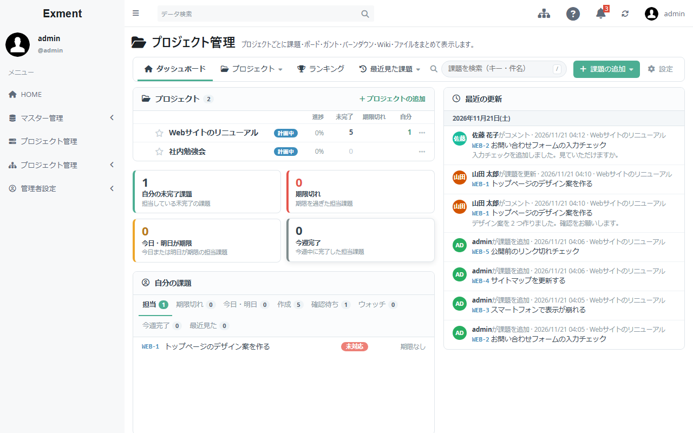
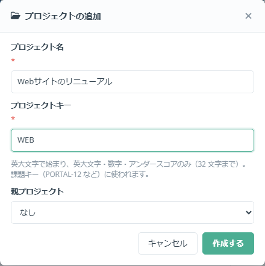
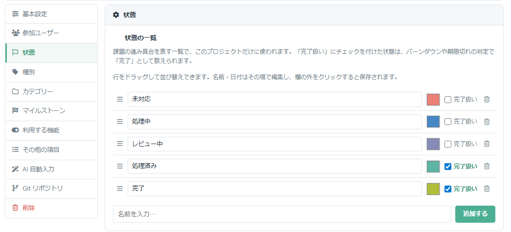
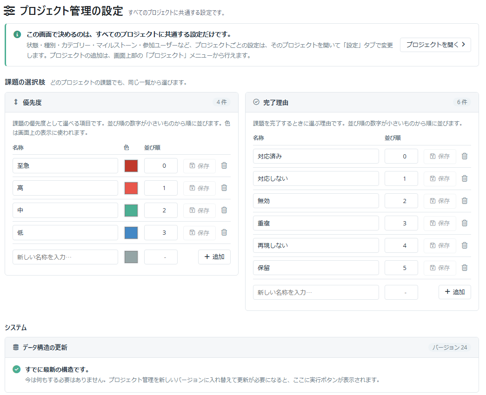

# プロジェクト管理（公式プラグイン）

「プロジェクト管理」は、エクシード・ワンが作り、テストし、サポートしている、Exment の**公式プラグイン**です。  
プロジェクトとチケット（課題）を、Exment のテーブルの上で管理できます。無料で使えます。

- ソースコード・説明：[exceedone/exment-plugins（project-management）](https://github.com/exceedone/exment-plugins/tree/main/project-management)
- ライセンス：GPL-3.0（Exment と同じ）
- 紹介ページ：[プロジェクト管理（exment.net）](https://exment.net/project-management/)
- プラグインの一覧に出る名前：Exment Plugin PM（プロジェクト管理）。zip・内部の名前は `ExmentPM` です（1.2.0 までは `PmPortal`、1.3.0 は `ExmentPluginPM`）。



## できること

| 機能 | 内容 |
| --- | --- |
| プロジェクト | プロジェクトごとに、課題・ボード・ガントチャート・Wiki・ファイルをまとめます。メンバーは、管理者・メンバー・閲覧者の3種類です（Exment の役割グループを使います）。 |
| 課題 | 一覧（絞り込み・クイックフィルター）、親子のツリー表示、一覧での直接編集、一括更新、添付ファイル。本文は Markdown で書けて、画像も貼り付けられます。 |
| マイルストーン | マイルストーンごとの課題の管理と、バーンダウンチャート。 |
| ボード・ガントチャート | 課題をステータスごとのボードや、ガントチャートで表示します。 |
| Wiki・ファイル | プロジェクトの資料を Wiki とファイルで共有します。 |
| コメント | 課題にコメントを書けます。お知らせしたいユーザーを指定（メンション）したり、確認（レビュー）を依頼したりできます。 |
| 既読・未読 | だれが課題を読んだかが分かります。まだ見ていない課題は、一覧で色が付きます。 |
| 通知 | 画面のベルでのお知らせと、課題の登録・コメント・「メールで知らせる」ボタンでのメールです（メールは Exment のメール設定で送ります）。 |
| 設定 | ⚙ 設定から、ポータルの設定や、データ構造の更新を行います。システム管理者は、プロジェクトをコメント・変更履歴・添付ファイルごと ZIP に書き出し、別の Exment に取り込む「データ移行」を使えます（先に確認だけして、それから書き込みます）。 |

## 動作要件
- Exment 7.0 以上（PHP 8.2 以上）
- メールで知らせる機能を使うときは、Exment のメール送信の設定が必要です（[メール送信設定](/ja/mailsend_setting)）。ベルのお知らせだけなら、設定は要りません。
- 画面は日本語だけです。

## インストール

### 1. ダウンロード
GitHub の [Releases](https://github.com/exceedone/exment-plugins/releases) から、最新の zip をダウンロードします。展開はしません。

- 最新版（v1.4.1）：[ExmentPM-1.4.1.zip](https://github.com/exceedone/exment-plugins/releases/download/ExmentPM-v1.4.1/ExmentPM-1.4.1.zip)

※緑色の「Code → Download ZIP」のボタンは使わないでください。リポジトリ全体の zip で、Exment では読み込めません。

※Exment SaaS（`*.exments.com`）をお使いの場合は、ダウンロードは要りません。[Exment SaaS の場合](/ja/plugin_pm?id=exment-saas-の場合)をご覧ください。

### 2. アップロード
- システム管理者で Exment にログインします。
- 「管理者設定」→「プラグイン」を開き、「プラグインアップロード」で、ダウンロードした zip を選んで「アップロード」を押します。詳細は[プラグイン](/ja/plugin?id=プラグインアップロード)をご確認ください。


- 下の一覧に「ExmentPM」が出れば、アップロードは終わりです。この時点では、まだテーブルもメニューもできていません。

### 3. 初期セットアップ
- システム管理者で、`/admin/plugins/exment_pm` を開きます（Exment SaaS では `/plugins/exment_pm`）。
- 「初期セットアップ」の画面が出ます。作られるテーブルの一覧を確かめて、「テーブルを作成する」を押します。


- 同じ名前のテーブルがすでにあるときは、赤く表示されます。「テーブル名の接頭辞」（例：`pm2_`）を入れると、別の名前のテーブルとして作れます。画面に出る名前は変わりません。
- 終わると、プロジェクト管理のダッシュボードが開きます。左のメニューに「プロジェクト管理」が 1 つ増えます（1.4.1 から）。ふだんはここから開きます。
- 初期セットアップで、次のものも作られます。
    - 役割グループ：プロジェクト管理者グループ・プロジェクトメンバーグループ・プロジェクト閲覧者グループ
    - 通知：課題の登録・更新通知（ベル）
    - 優先度（至急・高・中・低）と完了理由（対応済み・対応しない・無効・重複・再現しない・保留）

※初期セットアップは、システム管理者だけができます。  
※サンプルのプロジェクトや課題は作られません。

## はじめの設定

初めて使うときは、次の順番で設定します。

1. 使う人を役割グループに入れる
2. プロジェクトを作る
3. プロジェクトにメンバーを入れる
4. 状態・種別などを、プロジェクトに合わせて直す（そのままでも使えます）
5. 通知を確かめる

### 1. 使う人を役割グループに入れる
プロジェクト管理を使う人は、どれかの役割グループに入っている必要があります。入っていない人は、メニューに「プロジェクト管理」が出ず、開くと「権限がありません。」と出ます（システム管理者は、入れなくても使えます）。

「管理者設定」→「役割グループ」で、初期セットアップで作られた次のグループに、ユーザーか組織を入れます。くわしくは[役割グループ](/ja/role_group)をご覧ください。

| 役割グループ | 名前（英数字） | できること |
| --- | --- | --- |
| プロジェクト管理者グループ | `pm_admin_group` | すべてのプロジェクトと課題を見たり、直したりできます。状態・種別・優先度などの一覧も直せます。 |
| プロジェクトメンバーグループ | `pm_member_group` | 参加しているプロジェクトで、課題の追加・編集ができます。 |
| プロジェクト閲覧者グループ | `pm_viewer_group` | 参加しているプロジェクトを見るだけです。 |


※役割グループに入れるだけでは、プロジェクトは見えません。「3. プロジェクトにメンバーを入れる」も行ってください。

### 2. プロジェクトを作る
- プロジェクト管理のダッシュボードで「＋プロジェクトの追加」を押します（画面上部の「プロジェクト」メニューの中にもあります）。
- 「プロジェクト名」と「プロジェクトキー」を入れて、「作成する」を押します。
    - プロジェクトキーは、課題の番号の頭に付きます（例：`WEB` なら `WEB-1`）。英大文字で始まり、英大文字・数字・`_` だけで、32 文字までです。
    - 「親プロジェクト」を選ぶと、プロジェクトを階層にできます。



- 作ると、そのプロジェクトの「設定」タブが開きます。作った人が、プロジェクトマネージャ（責任者）になります。

※プロジェクトを作れるのは、プロジェクトのテーブルにデータを追加できる人です（システム管理者、プロジェクト管理者グループなど）。

### 3. プロジェクトにメンバーを入れる
プロジェクトの「設定」タブ →「参加ユーザー」で、だれが参加するかを決めて、「保存する」を押します。

| 項目 | 内容 |
| --- | --- |
| プロジェクトマネージャ | プロジェクトの責任者です。課題の追加・編集と、プロジェクトの設定の変更ができます。 |
| メンバー（編集） | 課題の追加・編集ができます。 |
| 参照メンバー（閲覧） | 見るだけです。 |
| メンバー組織（編集）・参照組織（閲覧） | 組織（チーム）を入れると、その組織の全員が同じ権限で参加します。 |


- 一覧から外した人は、保存したときから、そのプロジェクト（課題・Wiki を含む）を開けなくなります。
- システム管理者と、プロジェクト管理者グループの人は、この一覧に入っていなくても、すべてのプロジェクトを開けます。
- プロジェクトの設定を変えられるのは、プロジェクトマネージャと、プロジェクト管理者グループの人（とシステム管理者）です。

### 4. 状態・種別などの一覧（マスタ）
課題で選ぶ項目の一覧は、そのまま使えます。プロジェクトに合わせて、名前や色、並び順を直せます。

| 一覧 | 決める単位 | 直す場所 | 初めの値 |
| --- | --- | --- | --- |
| 状態 | プロジェクトごと | プロジェクトの「設定」→「状態」 | 未対応・処理中・レビュー中・処理済み・完了 |
| 種別 | プロジェクトごと | プロジェクトの「設定」→「種別」 | タスク・バグ・要望・改善・その他 |
| カテゴリー | プロジェクトごと | プロジェクトの「設定」→「カテゴリー」 | （なし） |
| マイルストーン | プロジェクトごと | プロジェクトの「設定」→「マイルストーン」 | （なし） |
| 優先度 | すべてのプロジェクトで共通 | ⚙ プロジェクト管理の設定 →「課題の選択肢」 | 至急・高・中・低 |
| 完了理由 | すべてのプロジェクトで共通 | ⚙ プロジェクト管理の設定 →「課題の選択肢」 | 対応済み・対応しない・無効・重複・再現しない・保留 |

- 状態の「完了扱い」にチェックを付けると、その状態の課題は、バーンダウンや期限切れの判定で「完了」として数えます。
- 使われている行は消せません。



**⚙ プロジェクト管理の設定**は、プロジェクト管理の画面の右上にある「⚙ 設定」から開きます。すべてのプロジェクトに共通する設定の画面で、システム管理者だけが開けます（ほかの人には「⚙ 設定」が出ません）。



### 5. 通知
通知には、画面右上のベルと、メールの 2 つがあります。

**ベル（何もしなくても届きます）**
- 課題が登録・更新されたり、コメントが付いたりすると、担当者・「お知らせ先」の人・課題を作った人に届きます。変更した本人には届きません。
- コメントを書くときに「お知らせしたい人」で選んだ人と、課題を「ウォッチ」している人にも届きます。
- コメントで `@` を付けてメンバーの名前を書くと、その人に届きます（メンション）。
- 「確認を依頼する」にチェックを付けると、選んだ人に「【確認依頼】」のお知らせが届きます。相手が「確認しました」を押すと、コメントを書いた人に届きます。
- 課題を見る権限がない人には届きません。


**メール（送るときに選びます）**  
メールは、自動では送りません。次のどちらかで送ります。
- 課題やコメントを登録するときに「メールでも知らせる」にチェックを付けます。ベルを受け取る人に、同じ内容をメールでも送ります。
- 課題の画面の「…その他」→「メールで知らせる」で、送る相手を選んで「送信」を押します。課題を見る権限がある人にだけ送ります。本文の抜き出しと、課題へのリンクが付きます。


- メールは、Exment のメール送信の設定で送ります。先に[メール送信設定](/ja/mailsend_setting)を済ませてください。
- ユーザーにメールアドレスがないと、その人には送りません。
- ベルの通知「課題の登録・更新通知」は、Exment の[通知設定](/ja/notify)の画面で見られます。

### 6. AI と Git の連携（使う場合だけ）
どちらも、初めはオフです。使わなくても、プロジェクト管理はふつうに使えます。

**AI 自動入力**  
課題の画面に「AI で自動入力」のボタンが出ます。押すと、空いている「種別」「カテゴリー」「優先度」を AI が埋めます。保存する前に、人が確かめて直せます。
- AI は TypeSafe（外部のサービス）を使います。課題の件名と詳細が TypeSafe のサーバーに送られます。メールアドレスと電話番号は、送る前に隠します。
- システム管理者が「管理者設定」→「プラグイン」→「Exment Plugin PM」の設定画面の「AI 自動入力（TypeSafe）」に、API キーを入れます（サーバーの環境変数 `TYPESAFE_KEY` があれば、そちらを使います）。
- プロジェクトの「設定」→「AI 自動入力」で「AI 自動入力を使う」にチェックを付けて、保存します。「接続テスト」で、つながるかを確かめられます。
- 「担当者も自動入力する」をオンにすると、空いている担当者も入れます。担当者は AI ではなく決まりで選びます（カテゴリーの既定の担当者、いなければ未完了の課題がいちばん少ないメンバー）。


**Git リポジトリ**  
プロジェクトごとに、Git のリポジトリ（Gitea・Forgejo）を作ってもらい、使えるようにします。
- サーバーの管理者が、Git サーバーの接続先を、サーバーの環境変数（`PMPORTAL_GIT_PROVIDER`・`PMPORTAL_GIT_API_URL`・`PMPORTAL_GIT_API_TOKEN` など）に設定します。画面からは設定できません。
- プロジェクトの「設定」→「Git リポジトリ」で「Git を有効にする」を押し、プロジェクトマネージャが「リポジトリ名」を入れて「リポジトリの作成をリクエスト」を押します。Git サーバーが設定されていないと、「作成待ち」のままになります。
- リポジトリができたら、各自で「HTTP クローン用パスワードを発行」を押して、パスワードを受け取ります。パスワードは 1 回だけ表示されます。


## 更新
- 新しい版の zip をダウンロードし、インストールと同じ手順でアップロードします。プラグインが置き換わり、データはそのまま残ります。
- システム管理者で、プロジェクト管理の「⚙ 設定」を開き、「データ構造の更新」を見ます。
    - 「すでに最新の構造です。」なら、何もしなくてかまいません。
    - 「データ構造の更新が必要です。」と出たら、データベースのバックアップを取ってから、「更新を実行する」を押します。この更新は元に戻せません。


※Exment SaaS では、[Exment SaaS の場合](/ja/plugin_pm?id=exment-saas-の場合)もご覧ください。

### 1.4.0 にするとき（PmPortal・ExmentPluginPM を入れている場合）
1.4.0 で内部の名前が `ExmentPM` に、アドレスが `/admin/plugins/exment_pm` に変わりました。すでに PmPortal（1.2.0 まで）か ExmentPluginPM（1.3.0）を入れている Exment では、zip をそのままアップロードすると「UUIDは存在しますが、プラグイン名が正しくありません」と出て止まります。[README の「ExmentPM への移行」](https://github.com/exceedone/exment-plugins/blob/main/project-management/README.md#moving-to-exmentpm-from-pmportal-or-exmentpluginpm--exmentpm-への移行)の手順を 1 回だけ行ってください。古いアドレス（`/admin/plugins/pm_portal/...`）へのリンクやブックマークは開けなくなります。

※Exment SaaS では、利用者の作業はありません（エクシード・ワンが行います）。

※v1.2.0 から、データ移行の機能はこのプラグインに入りました。以前の版で、データ移行のプラグインを別に入れていた場合は、更新後に「管理者設定」→「プラグイン」で削除してかまいません。

## ほかの Exment からの移行
プロジェクトを、課題・Wiki・コメント・変更履歴・添付ファイルごと、別の Exment に移せます。  
「⚙ プロジェクト管理の設定」の「データ移行」を、移行元と移行先の両方で使います。**システム管理者だけ**が使えます。


### 始める前に
- 移行元と移行先の両方に、このプラグインを入れて、初期セットアップを済ませます。できれば同じ版にそろえます。
- 移行先のプロジェクト・課題・Wiki・マイルストーン・カテゴリーなどのテーブルは、**空**である必要があります（番号をそのまま引き継ぐためです）。新しく用意した Exment に移す使い方です。
- 移行先に、ユーザーを先に作っておきます。
- データベースは MySQL・MariaDB だけに対応しています。
- 移行先のデータベースのバックアップを取ります。

### 1. 書き出し（移行元で実行）
- 移すプロジェクトにチェックを付けます。親子のプロジェクトは、親も一緒に選びます。
- 「ZIP を書き出す」を押すと、`pm-migrate-日付-時刻.zip` がダウンロードされます。
- Git のパスワードと AI の記録は書き出しません。

### 2. 取り込み（移行先で実行）
1. 「移行ファイル(ZIP)」で、書き出した ZIP を選びます。
2. 「ユーザー対応表」に、移行元のユーザーを、移行先のどのユーザーにするかを書きます。1 行に 1 人で、`旧ユーザーコード=新ユーザーコード` と書きます。`*=ユーザーコード` の行は、書いていない人全員に使います。
    ```
    yamada=t.yamada
    sato=h.sato
    *=admin
    ```
    担当者・メンバー・コメントを書いた人・変更履歴の実行者などが、ここで置き換わります。移行先にないユーザーコードを書くと、エラーになります。
3. 「マスター（ステータス・課題種別・優先度・完了理由）」で、移行先に違う内容の行があったときの動きを選びます。
    - 移行先に違う内容の行があれば止める（初めの値）
    - 移行先の行を削除して、移行元の内容で置き換える
4. 「確認のみ（書き込まない）」を押します。書き込む予定の件数と、エラー・注意が表示されます。
5. 問題がなければ、「移行先のデータベースのバックアップを取り、…確認しました」にチェックを付けて、「実行（書き込む）」を押します。
    - エラーがあると、書き込みません。
    - 途中で失敗したときは、すべて取り消します。

※コメントの中に書いた `@ユーザー名` は書き換わりません。  
※組織の権限は移りません。移行先で、プロジェクトの「参加ユーザー」を確かめてください。

## Exment SaaS の場合
Exment SaaS（`*.exments.com`）では、zip のダウンロードは要りません。「プラグインマーケット」から入れます。

1. システム管理者でログインし、「プラグインマーケット」を開きます。
2. 「Exment Plugin PM（プロジェクト管理）」を選んで、インストールします。
3. `/plugins/exment_pm` を開いて、[初期セットアップ](/ja/plugin_pm?id=_3-初期セットアップ)を行います。そのあとは、[はじめの設定](/ja/plugin_pm?id=はじめの設定)と同じです。

- アドレスは `https://（テナント名）.exments.com/plugins/exment_pm` です（`/admin` は付きません）。

!> **更新のときのご注意**：今は、プラグインマーケットの「更新」ボタンで、このプラグインを正しく更新できないことがあります。直るまでは、新しい版の zip をダウンロードして、「管理者設定」→「プラグイン」の「プラグインアップロード」でアップロードしてください。そのあと、[更新](/ja/plugin_pm?id=更新)のとおり「データ構造の更新」を確かめます。

## よくある質問・つまずきやすい所

### メニューに「プロジェクト管理」が出ない・「権限がありません。」と出る
そのユーザーが、プロジェクト管理の役割グループに入っていません。システム管理者が「管理者設定」→「役割グループ」で、プロジェクト管理者グループ・プロジェクトメンバーグループ・プロジェクト閲覧者グループのどれかに入れてください（[使う人を役割グループに入れる](/ja/plugin_pm?id=_1-使う人を役割グループに入れる)）。

### 画面は開けるが、プロジェクトが出てこない
そのプロジェクトの「参加ユーザー」に入っていません。プロジェクトマネージャかシステム管理者が、「設定」→「参加ユーザー」で入れて、保存してください。

### メニューに「プロジェクト管理」が 2 つある
1.4.0 までを新しく入れると、中のテーブル（プロジェクト・課題・マイルストーン・カテゴリー）を開くフォルダ「プロジェクト管理」もできていました。1.4.1 に更新して「データ構造の更新」を押すと、プラグインが作ったこのフォルダとメニューは外れます（管理者が足したメニューは残ります）。テーブルの画面とデータはそのまま残ります。

### 「⚙ 設定」が見当たらない
「⚙ 設定」（プロジェクト管理の設定）は、システム管理者にだけ出ます。プロジェクトごとの設定は、プロジェクトの「設定」タブで行います。

### 更新したのに、画面がおかしい・新しい機能が出ない
「⚙ 設定」→「データ構造の更新」を確かめてください。「データ構造の更新が必要です。」と出ていたら、バックアップを取ってから「更新を実行する」を押します。この案内は、ダッシュボードなどほかの画面には出ません。

### メールが届かない
- メールは自動では送りません。「メールでも知らせる」にチェックを付けるか、「メールで知らせる」で送ります。
- Exment の[メール送信設定](/ja/mailsend_setting)ができているか、相手のユーザーにメールアドレスがあるかを確かめてください。

### 初期セットアップで、テーブルが赤く表示される
同じ名前のテーブルが、すでにあります。「テーブル名の接頭辞」を入れて、別の名前で作ってください。

### 1.4.0 にしたら、前のリンクが開けない
1.4.0 で、アドレスが `/admin/plugins/pm_portal` から `/admin/plugins/exment_pm` に変わりました（Exment SaaS では `/plugins/pm_portal` から `/plugins/exment_pm`）。古いアドレスへのリンクやブックマークは、「404 not found」になります。メニュー・ベル・新しく送るメールは、新しいアドレスになっています。課題の本文・コメント・Wiki に書いたリンクは、[README](https://github.com/exceedone/exment-plugins/blob/main/project-management/README.md) の `tools/rewrite-old-links.php` で書き換えられます。

### プラグインの名前が違う（PmPortal・ExmentPluginPM）
同じプラグインです。名前が、PmPortal（1.2.0 まで）→ ExmentPluginPM（1.3.0）→ ExmentPM（1.4.0 から）と変わりました。古い名前のまま入っている Exment を 1.4.0 にするときは、[1.4.0 にするとき](/ja/plugin_pm?id=_140-にするとき（pmportal・exmentpluginpm-を入れている場合）)をご覧ください。

## 関連項目
- [プラグイン](/ja/plugin)
- [役割グループ](/ja/role_group)
- [メール送信設定](/ja/mailsend_setting)
- [通知](/ja/notify)
- [README（GitHub）](https://github.com/exceedone/exment-plugins/blob/main/project-management/README.md)
