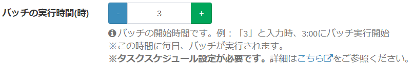
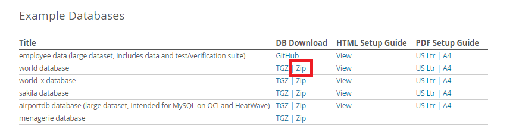

# プラグイン(バッチ)
決まった周期で、または管理者が指定したタイミングで、独自の処理を実行するプラグインです。
毎日必ず実行する処理などを追加したい場合に、おすすめです。

## 作成方法
「論理削除しているデータを、物理削除する」バッチを例に、作成手順を説明します。
※Exmentの標準では、画面から削除したデータは「論理削除」になり、データベースには残ったままです。
このデータを完全に削除する（物理削除する）バッチです。

### config.json作成
- 以下のconfig.jsonファイルを作成します。  

~~~ json
{
    "uuid": "b5c0a5d2-2716-4161-98d0-b490c1ebc521",
    "plugin_name": "harddelete_data",
    "plugin_view_name": "データの物理削除",
    "description": "論理削除しているすべてのデータを、完全に削除します。",
    "author":  "Kajitori",
    "version": "1.0.0",
    "plugin_type": "batch",
    "batch_hour": 0,
    "batch_cron": "0 0 * * *"
}
~~~

- plugin_name : プラグイン名です。半角英数で記入してください。
- uuid : プラグインを見分けるための文字列です。32文字とハイフンで、合計36文字です。ほかのプラグインと同じ値にならないようにします。  
次のURLなどで作れます。  
https://www.famkruithof.net/uuid/uuidgen
- plugin_type : batchと記入してください。  
- batch_hour(任意) : プラグインを毎日実行する時刻(時)です。0～23の整数で記入してください。
- batch_cron(任意) : 上級者向けです。プラグインを実行するタイミングを、cron記法で記入します。バッチを起動するタイミングを柔軟に指定できます。

※batch_hourとbatch_cronは、後から画面で変更できます。config.jsonに書いた値は、アップロードした後の初期値になります。

### PHPファイル作成
- 以下のようなPHPファイルを作成します。名前は「Plugin.php」としてください。

~~~ php
<?php
namespace App\Plugins\HarddeleteData;

use Exceedone\Exment\Services\Plugin\PluginBatchBase;
use Exceedone\Exment\Model\CustomTable;

class Plugin extends PluginBatchBase{
    /**
     * execute
     */
    public function execute() {
        $tables = CustomTable::all();

        foreach($tables as $table){
            $modelname = getModelName($table);
            if(!isset($modelname)){
                continue;
            }

            $modelname::onlyTrashed()
                ->forceDelete();
        }
    }
    
}
~~~
- namespaceは、**App\Plugins\\(プラグイン名のパスカルケース)** としてください。[詳細はこちら](/ja/plugin_quickstart#プラグイン名のnamespace)

- プラグイン管理画面で登録したトリガーの条件に合ったときに、プラグインが呼び出され、Plugin.php内のexecute関数が実行されます。

- Pluginクラスは、クラスPluginBatchBaseを継承しています。  

### zipに圧縮
上記2ファイルを最小構成として、zipに圧縮します。  
- HarddeleteData.zip
    - config.json
    - Plugin.php

### アップロード
プラグインをアップロードします。アップロード方法は、[プラグイン](/ja/plugin)をご参照ください。

- バッチ処理は、アップロードした直後は有効フラグが「無効」で、自動では実行されません。実行するには、[プラグイン](/ja/plugin)で有効フラグを切り替えてください。
- **この設定のほかに、タスクスケジュールの設定が必要です**。詳細は[タスクスケジュール](/ja/additional_task_schedule)をご確認ください。

### バッチの起動方法
アップロードしたバッチを起動する方法は、次の3つです。

| 方法 | 実行されるタイミング |
| ---- | ---- |
| バッチの実行時間(時)指定 | 毎日、指定した時刻 |
| バッチ実行cron指定 | cron記法で指定したタイミング |
| コマンド実行 | コマンドを実行したとき(手動) |

#### バッチの実行時間(時)指定
プラグイン設定画面で、0～23を入力します。
毎日、その時刻にプラグインが実行されます。（例：「5」と設定した場合、毎日5:00にプラグイン実行）
  

#### バッチ実行cron指定
上級者向けです。プラグインを実行するタイミングを、cron記法で入力できます。
※この設定を記入した場合、上の「バッチの実行時間(時)」は無効になります。
  

#### コマンド実行
コマンドラインから、好きなタイミングで手動でバッチを実行することもできます。
以下のコマンドのいずれかを実行してください。

~~~
# プラグインID指定
php artisan exment:batch 1

# plugin_name(プラグイン名)指定
php artisan exment:batch --name=harddelete_data

# uuid指定
php artisan exment:batch --uuid=b5c0a5d2-2716-4161-98d0-b490c1ebc521
~~~

### サンプルプラグイン
[データの物理削除プラグイン](https://github.com/exment-git/plugin-sample/tree/main/batch/HarddeleteBatch)  
- 論理削除済のデータを物理削除するバッチです。  
  
[外部データベース連携](https://github.com/exment-git/plugin-sample/tree/main/batch/PluginSyncBatch)  
- 外部データベースに保存された情報をExmentのテーブルに一括で取り込むバッチです。  
- 事前準備として、以下の処理を実行してください。
    1. Exmentの管理者設定→テンプレートから、[テンプレート](https://exment.net/downloads/sample/template/city_template.zip)をインポートします。  
    2. 外部データベースを作成します。本プラグインではMySQLのサンプルデータベース「world」を利用しています。[公式サイト](https://dev.mysql.com/doc/index-other.html)からzipをダウンロードした上で、お使いのMySQL（またはMariaDB）環境で解凍したSQLを実行してください。
  
    3. Exmentの管理者設定→プラグインから、[プラグイン](https://github.com/exment-git/plugin-sample/tree/main/batch/PluginSyncBatch)をアップロードします。  
    4. プラグインの設定画面を開き、2.で作成した外部データベースの接続情報を入力→保存してください。  
  
