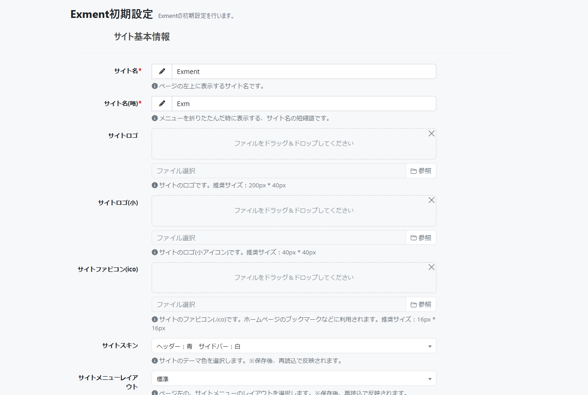

# インストールの流れ
Exment を自分のサーバーに入れて、使い始めるまでの流れです。全体は 4 つの手順です。

> **サーバーを用意せずに使いたいとき**  
> インストールなしで使える **Exment SaaS** もあります（上の 01・02 が要りません）。まずは触ってみたいときは、[デモ](https://exment.net/demo-env/)をどうぞ。くわしくは[料金・サポート](https://exment.net/plan/)を。

## 1. サーバーを用意する
Exment は、PHP が動く Web サーバーとデータベースがあれば動きます。

| 必要なもの | 内容 |
|---|---|
| Web サーバー | Apache・nginx・IIS など |
| PHP | 8.2 以上 |
| データベース | MySQL 8.0 以上・MariaDB 10.11 以上・SQL Server 13.0 以上のいずれか |

くわしい動作環境と設定は、[サーバー設定](/ja/server)を見てください。環境ごとの手順もあります。

| 使う環境 | 手順 |
|---|---|
| 試しに自分のパソコンで | [XAMPP（Windows）](/ja/install_xampp)・[XAMPP（Mac）](/ja/install_xampp_mac) |
| レンタルサーバー（Xserver など） | [レンタルサーバー](/ja/install_rental) |
| Linux サーバー | [Linux](/ja/install_linux) |
| クラウド | [AWS](/ja/install_aws)・[AWS（1 台）](/ja/install_aws_single)・[Azure Web Apps](/ja/install_azure_web_apps) |
| Docker | [Docker](/ja/install_docker) |
| Windows サーバー | [IIS](/ja/install_iis) |

## 2. Exment を入れる
次のどれかで入れます。迷ったら「かんたんインストール」をおすすめします。

| 方法 | こんなとき | 手順 |
|---|---|---|
| **かんたんインストール（おすすめ）** | zip を置いて、画面の案内どおりに進める | [かんたんインストール](/ja/quickstart_easy) |
| 手動インストール | composer とコマンドで入れる | [手動インストール](/ja/quickstart_manual) |
| Docker | コンテナで動かす | [Docker](/ja/install_docker) |

- 最新版の zip と、過去の版・SHA-256 は[ダウンロード](https://exment.net/download/)にあります。
- v7.2.1 以降の新しいインストールでは、URL に「/admin」が付きません（例：`http://localhost`）。付けたいときは、インストールの画面の「URL の頭に付ける値」で決められます（[URL に含む admin](/ja/additional_prefix)）。

## 3. 初期設定をする
インストールが終わると、初期設定の画面が出ます。

- 会社名・システム管理者のアカウントを決めます。
- **おすすめの設定**（Exment のキャッシュ・設定のキャッシュ・ファイルの権限など）が、チェックの付いた状態で出ます。速く・安全に使うために、そのまま入れるのがおすすめです（[チューニング](/ja/tuning)）。
- 使いたいテンプレート（顧客管理・申請パックなど）を選ぶと、テーブルやメニューがまとめて入ります。

くわしくは[初期設定](/ja/first_setting)を見てください。

## 4. 使い始める
- **まず決めておくこと（どのサイトでも必要）**：[タスクスケジュール](/ja/additional_task_schedule)（cron）を設定してください。通知・スケジュール・自動バックアップなどが動きます。
- 業務に合わせて、[テーブル](/ja/table)・[フォーム](/ja/form)・[ビュー](/ja/view)を作ります。
- [機能の管理](/ja/feature)で、使う機能と、無料の公式プラグイン（プロジェクト管理・サポートデスク・Groupware）を選びます。
- [セキュリティチェック](/ja/security_check)と[チューニング](/ja/tuning)で、安全と速さの設定を確かめます。
- そのほかの設定（メール・ファイルの置き場所・キューなど）は[追加設定](/ja/quickstart_more)にあります。

## うまくいかないとき
- インストールでエラーになったときは、[トラブルシューティング](/ja/troubleshooting)を見てください。
- インストールやサーバー構築についての個別のお問い合わせは、無料ではお受けしていません。個別の対応が必要なときは、[有償のサポート](https://exment.net/plan/)をご利用ください。
