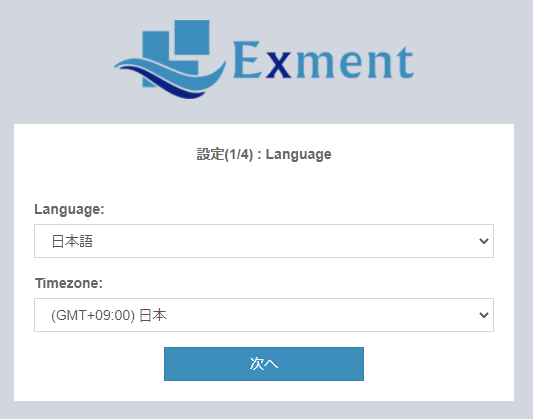
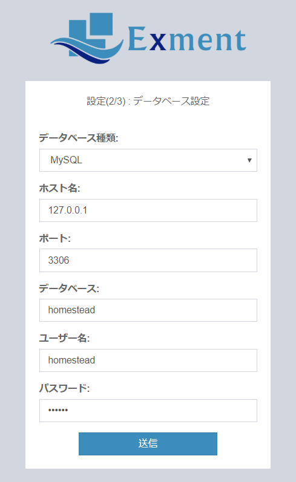
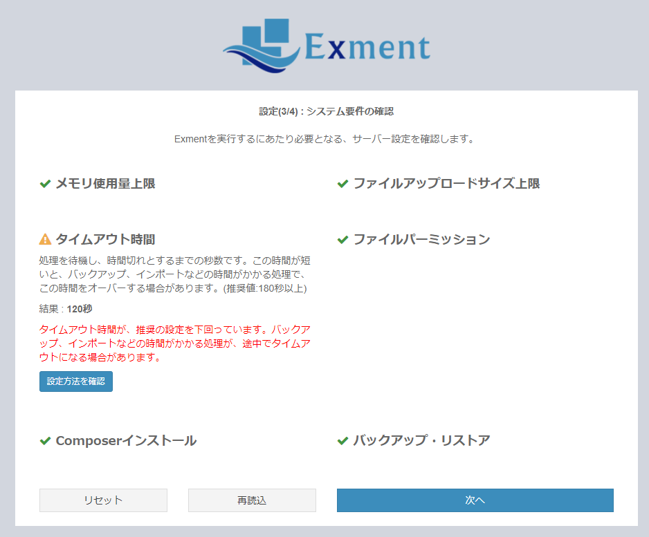

# インストール手順(かんたんインストール)
zip ファイルを置いて、画面の案内にそって Exment をインストールする手順です。  

手順は、次の 3 つです。

1. サーバーを用意する
2. zip ファイルをダウンロードして、サーバーに展開する
3. ブラウザーで Exment を開き、画面の案内にそってインストールする

> ※手動インストールや、バージョンを指定してのインストールを行う場合、[手動インストール](/ja/quickstart_manual)をご覧ください。

## 注意点
- インストールでエラーになったときは、[トラブルシューティング](/ja/troubleshooting)をご覧ください。
- ※インストール手順やサーバー構築についての個別のお問い合わせは、お受けしていません。個別の対応が必要なときは、有償のサポートをご利用ください。　　

## サーバー構築
Web サーバーやデータベースサーバーをまだ用意していないときは、先に用意してください。  
手順は、[サーバー設定](/ja/server)をご覧ください。

## Exmentアプリ設定
サーバーの用意ができたら、Exment のアプリを置きます。

### zipダウンロード・展開

- 次のリンクから、zip ファイルをダウンロードします。  
<a id="link" href="https://exment.net/downloads/ja/exment.zip" target="_blank">[Exment zipファイル（最新版）]</a>  
今の最新版は **v7.2.1**（2026/11/23 公開・PHP 8.2 以上）です。版ごとの zip・公開日・SHA-256・対応する PHP は、[ダウンロードのページ](https://exment.net/download/)にあります（ダウンロードしたファイルが壊れていないかも、そこで確かめられます）。            
  
- どうしても PHP7.4 を使うときは、次のリンクからダウンロードしてください。この版は、サポート・お問い合わせ・Github issue などの対象外です。また、予告なく削除することがあります。  
<a href="https://exment.net/downloads/ja/exment_v4_4_2.zip" target="_blank">[Exment zipファイル（PHP 7.4 で動く最後の版：v4.4.2）]</a>

- zip ファイルを、PHP が動く場所に展開します。  
例1(XAMPP Windows)： C:\xampp\local\exment  
例2(XAMPP Mac)： /Applications/XAMPP/local/exment  
例3(XServer) : $HOME/domain.com.foobar/exment/  
  
- サーバーの公開フォルダ(例linuxの場合 : /var/www/html)のすぐ下に、zipファイルをそのまま入れないでください。データベースの設定や、メールのパスワードなどが書かれた設定ファイルが外から見えてしまい、重大な情報流出につながります。  

## 初期データのインストール
画面の案内にそって、Exment をインストールします。  
※各設定画面の「リセット」を押すと、言語とタイムゾーン設定から、インストールをやり直します。

### インストール画面にアクセス
まず、ブラウザーで Exment のページを開きます。  
例 ： http(s)://(あなたのサイトURL)  

### 言語とタイムゾーン設定
言語とタイムゾーンを決めます。  
必要なときは、初期値から変えてください。  
  

### データベース設定
データベースの設定を入力します。  
お使いの環境に合わせて、次の内容を入力してください。   
※値がわからないときは、[サーバー設定](/ja/server)の各環境の手順に書いてありますので、もう一度ご確認ください。
~~~
データベースの種類
データベースのホスト名
データベースのポート番号
Exment用データベース名
Exment用データベースのユーザー名
Exment用データベースのパスワード
~~~  

  
  

### システム要件の確認
Exment を動かすために必要な、サーバーの設定を確かめる画面です。  
Web サーバーなどの設定値を調べて、おすすめしない設定や、問題のある設定があると、警告かエラーを出します。  
※エラーがあると、次の画面に進めません。  
※この画面のくわしい説明は、[システム要件確認](/ja/server#システム要件確認)をご覧ください。

  

### インストール実行
「インストール実行」を押してください。  
  

> **任意：パスワードのハッシュ化コスト**  
> パスワードはbcryptでハッシュ化され、計算コスト(ラウンド数)の既定値は12です。変更したい場合は、".env" に `BCRYPT_ROUNDS` を追記してください。設定例は[手動インストール](/ja/quickstart_manual)をご参照ください。

### 設定完了
インストールが終わったら、続けて[初期設定](/ja/first_setting.md)を行ってください。  

## その他の追加設定
ここまでの作業で、Exment を使い始められます。ただし、一部の機能を使うには、追加の設定が必要です。  
次のページをご確認ください。  
- [追加設定](/ja/quickstart_more)

[←インストール-概要へ戻る](/ja/quickstart)