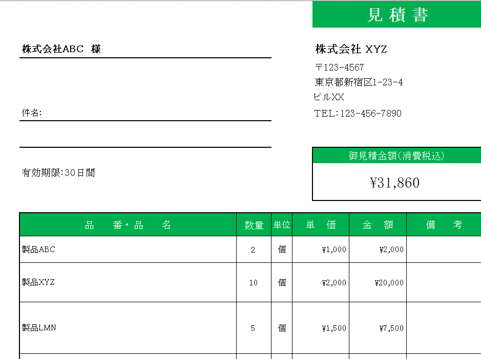
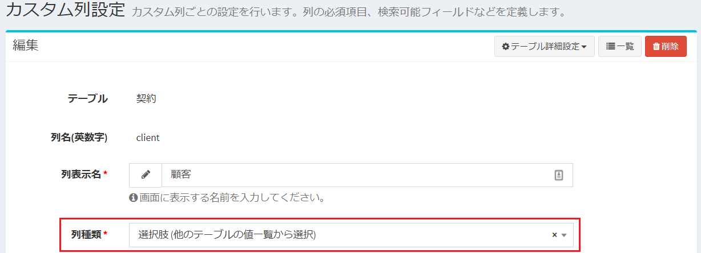
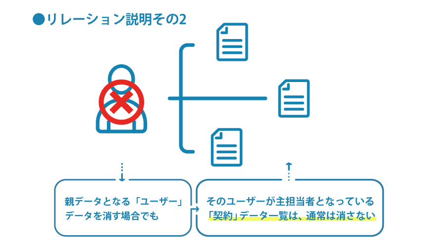
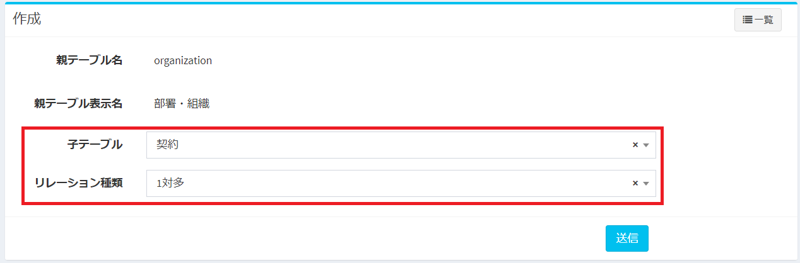
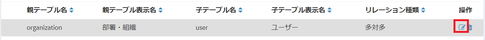
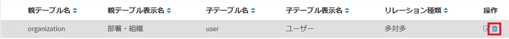

# リレーション設定
テーブルとテーブルのデータには、つながり（リレーション）があることがあります。  
例：
- 見積と、その見積明細情報  
- 会社の組織と、その組織に所属するユーザー  

このページでは、テーブルどうしのつながりを、どう設定するかを説明します。

- 先に、「どの方法でつなぐか」を決めます（下の「Exmentにおけるリレーションの概念」）。
- 画面での操作だけを知りたいときは、下の「リレーション設定の操作方法」をご覧ください。

## Exmentにおけるリレーションの概念
Exment でテーブルどうしをつなぐ考え方は、少し複雑です。  
「1. リレーションの種類」と「2. 設定方法」の 2 つを知っておく必要があります。  
画面で設定する前に、次の内容をお読みください。

### 1. リレーションの種類
データのつながりには、ふつう、次の 2 種類があります。  
#### 1対多
親テーブルの 1 つのデータに、明細として、子テーブルのいくつものデータがつながる   

- 例：見積とその見積明細  
「見積」テーブルには「見積日」や「顧客情報」や「件名」を登録する。「見積明細」には、その見積の品名・数量・金額を、明細としていくつも登録する  

- 例：契約と、その契約の主担当者  
1 人のユーザーが、いくつもの契約の主担当者になることがあるので、ユーザーと契約は、1対多の関係になる  

#### 多対多
複数のテーブル(親テーブル)のデータに、子テーブルの複数データが紐付く  

- 例：組織と、その組織に所属するユーザー  
ユーザーは、いくつもの組織に所属することがある（兼任など）ので、多対多の関係になる  
  

はじめに、つなぎたいデータが、上のどちらの種類なのかを考えます。  

### 2.「(1)関連テーブル設定」と「(2)カスタム列の選択肢 (他のテーブルの値一覧から選択)」
Exment でデータをつなぐ方法は、「(1)関連テーブル」と「(2)選択肢 (他のテーブルの値一覧から選択)」の 2 つです。  

##### (1)関連テーブル設定
このページで説明している方法です。
「カスタムテーブル」ページから、［リレーション設定］ボタンを押して登録します。    

##### (2)カスタム列の選択肢 (他のテーブルの値一覧から選択)
[カスタム列](/ja/column)画面で設定する方法です。  
カスタム列の列種類の 1 つに、「選択肢 (他のテーブルの値一覧から選択)」があります。この種類の列を作ります。  

この設定をすると、[データフォーム画面](/ja/data_form)で、ほかのテーブルから値を選べるようになります。  
例（顧客はテストデータです）：

>選択肢として一覧に表示される文言は、[見出し表示列設定](/ja/table#見出し表示列設定)で変更できます。

### リレーション設定方法の決定
(1) と (2) のどちらを使うかは、迷いやすいところです。
次の基準で決めてください。

| リレーションの種類 | こんなとき | 使う方法 |
|---|---|---|
| 1対多 | 親と子がいつもセット。親を消すときは、子も消すのが正しい（例：見積と見積明細） | (1)リレーション設定 |
| 1対多 | いつもセットとは限らない。参照先のデータを消しても、参照しているデータまで消すのは問題がある（例：見積と主担当者） | (2)カスタム列の選択肢 (他のテーブルの値一覧から選択) |
| 多対多 | 基本的にこちら | (1)リレーション設定 |

#### 1. リレーションの種類が「1対多」の場合
次の 2 つの基準で決めてください。
1. **親データと子データは、常にセットで、密かどうか**  
たとえば「見積」テーブルと「見積明細」テーブルでは、見積明細のデータには、いつも見積のデータがあり、セットになっています。  
このようなときは、「(1)リレーション設定」でつなぎます。  
一方、「見積」テーブルと、その見積の「主担当者」は、データの参照先としてはつながっていますが、いつもセットというわけではありません。  
このようなときは、「(2)カスタム列の選択肢 (他のテーブルの値一覧から選択)」でつなぎます。  

2. **親データを削除するとき、子データを削除するのが常に正しいか**  
たとえば「見積」テーブルと「見積明細」テーブルでは、親の「見積」データを消すときは、子の「見積明細」データもすべて消すのが正しい動きです。  
このようなときは、「(1)リレーション設定」でつなぎます。  

一方、「見積」テーブルと、その見積の「主担当者」では、「主担当者」のデータを消したからといって、その人が主担当者になっている「見積」データをすべて消すのは、問題があります。  
このようなときは、「(2)カスタム列の選択肢 (他のテーブルの値一覧から選択)」でつなぎます。  

#### 2. リレーションの種類が「多対多」の場合
基本的には、「(1)リレーション設定」でつないでください。  
「(2)カスタム列の選択肢 (他のテーブルの値一覧から選択)」で「複数選択を許可」しても対応できますが、データ検索に弱いなどの課題があります。  

   
ここまでで、テーブルをどの方法でつなぐかが決まります。  
以下は、「(1)関連テーブル設定」を行うときの手順です。  

## リレーション設定の操作方法

### ページ表示
- カスタムテーブル一覧で、設定したいテーブルに 1 つだけチェックを入れ、右上の「テーブル詳細設定」を押します。  

- または、メニューから設定したいテーブルを選んだあと、同じように右上の「テーブル詳細設定」を押します。  
※そのテーブルをメニューに出す設定が、先に必要です。  

- 出てきたテーブル詳細設定の画面で、リレーション設定のアイコンを押します。

- これで、そのカスタムテーブルのリレーション設定の一覧が出ます。  

### 新規追加
- 「リレーション設定」画面で、ページ右上の［新規］ボタンを押します。

- つなぐ子テーブルと、リレーションの種類を選び、「送信」を押してください。
  

### 編集
列の編集を行いたい場合、該当する行の［編集］リンクをクリックしてください。  
  

### 削除
列の削除を行いたい場合、該当する行の［削除］リンクをクリックしてください。  

