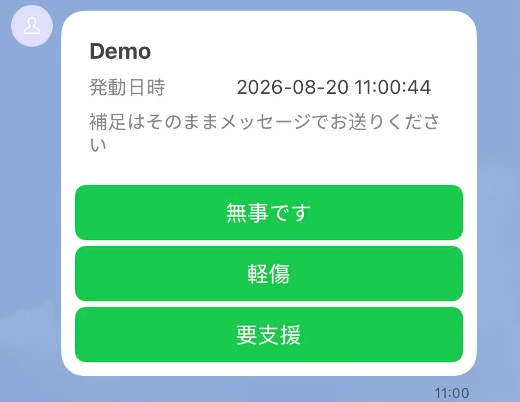
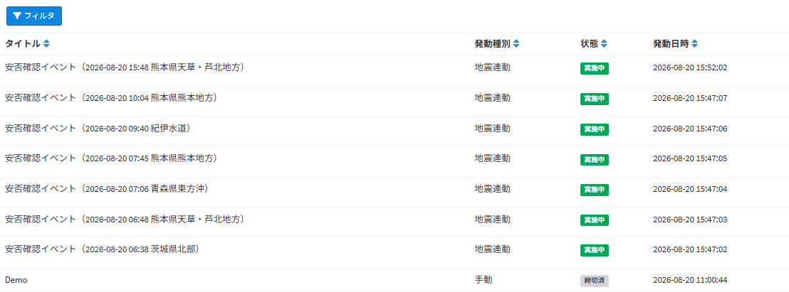
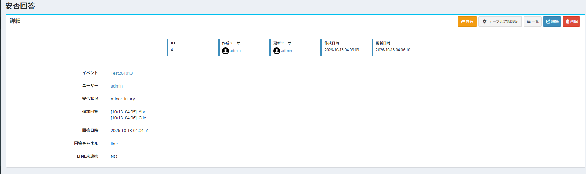
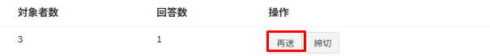

# 安否確認
地震や台風などの緊急時に、従業員の安否を、LINEとメールで確認する機能です。  
管理者が画面から送信するほか、設定した震度以上の地震が発生した場合に、自動で送信することもできます。  
回答状況は、安否確認管理画面と、安否回答テーブルで確認できます。  
※安否確認は、v7.0.0より利用できます。

## 安否確認の仕組み
- 安否確認を送信するたびに、「安否確認イベント」のデータが1件作成されます。
- 同時に、すべてのユーザーについて、安否状況が「not_answered」（未回答）の「安否回答」のデータが作成されます。
- 各ユーザーには、以下の方法で送信されます。LINEとメールの両方を受け取ったユーザーは、どちらから回答してもかまいません。

| 送信方法 | 送信の対象 | 回答方法 |
| --- | --- | --- |
| LINE | [LINEアカウントを連携](/ja/line?id=lineアカウント連携)しているユーザー | カードの「無事です」「軽傷」「要支援」ボタン |
| メール | メールアドレスが登録されているユーザー（LINEアカウントを連携しているユーザーを含む） | メールのリンクから開く回答画面（ログイン不要） |

※LINEアカウントを連携しておらず、メールアドレスも登録されていないユーザーには、送信されません。

### 発動種別
安否確認には、以下の発動種別があります。

| 発動種別 | 内容 |
| --- | --- |
| 手動 | 管理者が、安否確認管理画面から送信します。地震・台風・火災など、さまざまな緊急時に使用できます。 |
| 訓練 | 手動と同じ方法で送信します。送信するメッセージのタイトルの先頭に「【訓練】」が付きます。 |
| 地震連動 | 設定した震度以上の地震が発生した場合に、自動で送信されます。 |

## 事前準備
- **LINEで送信する場合**：[LINE連携](/ja/line)の設定（LINE公式アカウントの準備、システム設定の「LINE設定」、Webhookの設定）を行い、各ユーザーにLINEアカウントを連携してもらいます。
- **メールで送信する場合**：[メール送信設定](/ja/mailsend_setting)を行います。あわせて、[メールの設定](/ja/safety_check?id=メールの設定)をご確認ください。
- **地震発生時に自動で送信する場合**：[タスクスケジュール](/ja/additional_task_schedule)の設定が必要です。また、Exmentのサーバーから、地震情報を取得するAPI（https://api.p2pquake.net）にアクセスできる必要があります。

※安否確認管理画面は、システム管理者の権限を持つユーザーのみ利用できます。

## インストール
安否確認で使用するテーブルやメニューは、Exmentのインストール時・アップデート時に、自動で作成されます。  
既存の環境では、[アップデート](/ja/update)の手順で、「php artisan exment:update」を実行してください。

以下が作成されます。

| 種類 | 名前 | 内容 |
| --- | --- | --- |
| テーブル | 安否確認イベント | 安否確認を送信するたびに、1件のデータが作成されます。 |
| テーブル | 安否回答 | 安否確認ごと、ユーザーごとに、1件のデータが作成されます。 |
| メニュー | 安否確認管理 | 安否確認の送信・再送・締切を行う画面です。 |
| 通知テンプレート | 安否確認メール | 安否確認のメールのテンプレートです。 |
| LINE Flexテンプレート | 安否確認 | Flexキーは「safety_check」です。安否確認のLINEのカードの内容は固定のため、このテンプレートを編集してもカードは変わりません。通知設定で選択したり、編集・削除したりしないでください。 |

※作成されない場合は、「php artisan exment:patchdata line_safety_check」を実行してください。

## 安否確認設定
左メニューの「管理者設定」→「システム設定」をクリックし、右上のボタンから［詳細設定］に切り替えます。  
「安否確認設定」（「LINE設定」の下）で以下の項目を設定し、［保存］をクリックします。

| 項目 | 内容 |
| --- | --- |
| 地震発生時に自動送信する | YESの場合、「自動送信する最小震度」以上の地震が発生すると、安否確認を自動で送信します。NOの場合は、安否確認管理画面からの送信のみ行えます。 初期値：NO |
| 自動送信する最小震度 | 自動送信の基準とする震度を、震度4・震度5弱・震度5強・震度6弱・震度6強・震度7から選択します。地震情報の、全国の最大震度で判定します。地域による絞り込みはできません。 初期値：震度5弱 |
| 再送信までの間隔（分） | 同じ地震について、再度自動送信しない時間（分）です。1つの地震について、速報・詳細・訂正など、複数の地震情報が発表されます。同じ地震で送信してから、この時間内に届いた情報では送信しません。別の地震の場合は、この時間に関係なく送信します。 初期値：60 |
| 追加回答の受付時間（分） | LINEで回答ボタンを押した後、続けて送信されたメッセージを「追加回答」として記録する時間（分）です。追加回答を送信するたびに、受付時間は延長されます。 初期値：60 |
| 地震履歴取得範囲（分） | 発表からこの時間（分）を過ぎた地震情報では、自動送信しません。機能を有効にした直後や、タスクスケジュールが停止していた後に、過去の地震で一斉に送信されることを防ぎます。通常は「10」のまま変更しないでください。 初期値：10 |
| 手動再送間隔（分） | ［再送］を実行した後、次の［再送］を実行できるようになるまでの時間（分）です。0の場合は制限しません。 初期値：5 |

※「手動再送間隔（分）」以外の数値の項目で、0または空欄を保存した場合は、初期値が使用されます。

## メールの設定

### 回答用リンク
安否確認のメールには、回答画面を開くためのリンク（回答用リンク）が記載されます。以下の点にご注意ください。

- 回答用リンクは、ExmentのURLから作成されます。地震発生時の自動送信では、「.env」ファイルの「APP_URL」が使用されます。「APP_URL」には、従業員が社外からもアクセスできるURLを設定してください。画面から送信する場合も、従業員がアクセスできるURLでExmentを開いて送信してください。
- 回答用リンクには、「.env」ファイルの「APP_KEY」を使用した署名が付いています。メールを送信した後に「APP_KEY」を変更すると、送信済みのリンクは無効になります。その場合は、［再送］で新しいリンクを送信してください。

### メールのテンプレート
メールの件名・本文は、[通知テンプレート](/ja/mail)の「安否確認メール」で変更できます。初期値は、以下のとおりです。

~~~
件名：
[${system:site_name}] ${safety_title}

本文：
${safety_body}

下記のリンクから安否状況を回答してください。
${answer_url}

LINEアカウントを連携すると、次回からLINEで受信・回答できます。
~~~

| 変数 | 内容 |
| --- | --- |
| ${safety_title} | 安否確認のタイトルです。訓練の場合は、先頭に「【訓練】」が付きます。 |
| ${safety_body} | 発動日時と、地震情報（地震連動の場合）です。 |
| ${answer_url} | 回答用リンクです。 |

※本文から「${answer_url}」を削除すると、メールから回答できなくなります。必ず残してください。

## 安否確認を送信する

### 画面を開く
左メニューの「安否確認管理」をクリックします。以下のURLからも表示できます。

~~~
http(s)://(ExmentのURL)/admin/safety_check
~~~

### 手動・訓練で送信する
- 「新規送信」の「タイトル」に、安否確認のタイトルを入力します（例：台風15号 安否確認）。
- 「発動種別」で、「手動」または「訓練」を選択します。
- ［送信］をクリックします。「安否確認を送信しました。」と表示され、一覧に「実施中」の安否確認が追加されます。

※「訓練」も、すべてのユーザーに送信されます。LINEのメッセージ数にも数えられます。  
※「送信処理中です。しばらく待ってから画面を更新してください。」と表示された場合は、前の送信を処理しています。しばらく待ってから画面を更新してください。［送信］を繰り返しクリックしないでください。  
※ユーザー数が多い場合は、送信の完了までに時間がかかることがあります。[通知処理の遅延実行](/ja/additional_queue)を設定すると、送信処理をキューで実行します。キューで実行した場合、送信に失敗したメッセージは、自動で再送信されます（最初の送信を含めて、最大3回まで試行します）。LINEは、LINEのサーバーの混雑（HTTP 429）やサーバーエラー（HTTP 5xx）で失敗した場合のみ、再送信します。

### 地震発生時に自動で送信する
「安否確認設定」の「地震発生時に自動送信する」をYESにすると、Exmentは毎分、気象庁の地震情報を、P2P地震情報のAPIから取得します。  
以下の条件をすべて満たす地震情報があると、発動種別「地震連動」の安否確認を、自動で送信します。

- 全国の最大震度が、「自動送信する最小震度」以上である
- 地震情報の発表から、「地震履歴取得範囲（分）」を過ぎていない
- 同じ地震で、「再送信までの間隔（分）」以内に送信していない

自動で送信した安否確認のタイトルは、「安否確認イベント（(発生日時) (震源地)）」です。  
震源地が確定する前の情報（震度速報）で送信した場合、震源地は「震源調査中」と表示されます。後から届いた情報で震源地が確定すると、タイトルが更新されます（再送信はされません）。

※自動送信には、[タスクスケジュール](/ja/additional_task_schedule)の設定が必要です。タスクスケジュールにより、コマンド「exment:safetywatch」が毎分実行されます。

## 回答する
ユーザーが回答する手順です。従業員への案内にご利用ください。

### LINEで回答する
LINEアカウントを連携しているユーザーには、「無事です」「軽傷」「要支援」のボタン付きのカードが届きます。

- いずれかのボタンを押します。「「無事です」を記録しました。補足があればそのままメッセージをお送りください。」のように返信が届きます。
- 回答を変更する場合は、もう一度、別のボタンを押します。最後に押したボタンの内容が記録されます。
- 状況を補足する場合は、ボタンを押した後に、続けてメッセージを送信します。「追加回答を追記しました。」と返信が届き、メッセージが「追加回答」として記録されます。

※追加回答は、ボタンを押してから、または前回の追加回答を送信してから、「追加回答の受付時間（分）」（初期設定では60分）以内に送信してください。受付時間を過ぎた場合は、もう一度ボタンを押してから送信してください。

### メールで回答する
メールアドレスが登録されているユーザーには、回答用リンクが記載されたメールが届きます。

- メールのリンクをクリックします。ログインせずに、回答画面が開きます。
- 現在の状況（「無事です」「軽傷」「要支援」）を選択し、必要に応じて「追加回答（任意）」を入力して、［送信］をクリックします。

- 「回答を受け付けました」と表示されれば、回答は完了です。
- 同じリンクを開き直すと、現在の回答が表示されます。安否確認が締め切られるまでは、回答を変更できます。

※回答用リンクに有効期限はありません。安否確認が締め切られると、回答できなくなります。  
※リンクを知っていれば、誰でもそのユーザーとして回答できます。安否確認のメールは、他の人に転送しないでください。  
※[IPフィルタ設定](/ja/additional_ip_filter)を行っている場合も、回答画面は社外から開けます。

回答画面に、以下のメッセージが表示される場合があります。

| メッセージ | 内容 |
| --- | --- |
| この安否確認は締め切られました。 | 安否確認が締め切られているため、回答できません。 |
| リンクが無効です。管理者にお問い合わせください。 | リンクが正しくありません。リンクの一部が欠けている場合や、メールの送信後に「APP_KEY」が変更された場合に表示されます。 |

## 回答状況を確認する

### 安否確認管理画面
安否確認管理画面の一覧で、安否確認ごとの状況を確認できます。

| 列 | 内容 |
| --- | --- |
| タイトル | 安否確認のタイトルです。 |
| 発動種別 | 「手動」「訓練」「地震連動」のいずれかです。 |
| 状態 | 「実施中」または「締切済」です。 |
| 発動日時 | 安否確認を送信した日時です。 |
| 送信数 | 最初の送信で、LINEまたはメールの少なくとも一方を送信したユーザーの数です。［再送］では変わりません。 |
| 対象者数 | 安否確認の対象となったユーザーの数です。 |
| 回答数 | 回答済みのユーザーの数です。 |
| 操作 | ［再送］［締切］ボタンです。締切済の安否確認には表示されません。 |

### 安否回答テーブル
ユーザーごとの回答は、「安否回答」テーブルで確認できます。  
安否回答テーブルは、左メニューに表示されません。以下のURLにアクセスしてください。

~~~
http(s)://(ExmentのURL)/admin/data/safety_check_answer
~~~

| 列 | 内容 |
| --- | --- |
| イベント | 回答の対象の、安否確認です。 |
| ユーザー | 回答するユーザーです。 |
| 安否状況 | 「not_answered」（未回答）、「safe」（無事です）、「minor_injury」（軽傷）、「need_help」（要支援）のいずれかです。 |
| 追加回答 | 追加回答の内容です。送信のたびに、送信日時（月/日 時:分）付きで追記されます。 |
| 回答日時 | 最後に回答した日時です。 |
| 回答チャネル | 回答に使用した方法です。「line」または「mail」です。 |
| LINE未連携 | 送信時に、LINEアカウントを連携していなかった場合はYESです。 |

※「LINE未連携」がYESでも、メールで回答している場合があります。LINEにもメールにも送信されなかったユーザーを確認する場合は、「LINE未連携」がYESで、メールアドレスが登録されていないユーザーを確認してください。

#### ビューの作成例
安否回答テーブルに、[カスタムビュー](/ja/view)を作成すると、状況を確認しやすくなります。

- **未回答者の一覧**：ビュー（通常ビュー）を作成し、データ表示条件に、「安否状況」が「not_answered」の条件を設定します。「イベント」の条件を追加すると、特定の安否確認に絞り込めます。
- **安否状況ごとの人数**：集計ビューを作成し、「安否状況」でグループ化して、件数を表示します。

## 再送・締切
安否確認管理画面の一覧で、安否確認ごとに［再送］［締切］を実行できます。

### 再送
［再送］をクリックし、確認ダイアログで［確認］をクリックします。  
**まだ回答していないユーザーにのみ**、LINEとメールを再送信します。回答済みのユーザーには送信されません。  
最初の送信の後に追加されたユーザーにも送信され、「対象者数」が更新されます。

※前回の［再送］から、「手動再送間隔（分）」（初期設定では5分）が経過するまでは、再送できません。「再送は5分以上間隔をあけてから行ってください。」のように表示されます。  
※「送信数」は、最初の送信時の値のままです。最新の回答状況は、「回答数」や安否回答テーブルで確認してください。

### 締切
［締切］をクリックし、確認ダイアログで［確認］をクリックします。  
状態が「締切済」になり、以降はLINE・メールのどちらからも回答できなくなります。記録済みの回答は、そのまま残ります。

※締め切った安否確認を、再び「実施中」に戻すことはできません。再度安否を確認する場合は、新しく安否確認を送信してください。  
※締め切った後に、LINEのボタンを押したり、メールのリンクを開いたりすると、「この安否確認は締め切られました。」と表示されます。

## うまく動作しない場合
| 現象 | 主な原因 | 対処 |
| --- | --- | --- |
| 安否確認管理画面に、「安否確認のテーブルがインストールされていないか、不足しています。」と表示される | アップデート、または安否確認のテーブルの作成が完了していない | 「php artisan migrate」を実行してください。それでも表示される場合は、「php artisan exment:patchdata line_safety_check」を実行してください。 |
| 地震が発生しても、自動で送信されない | ・「地震発生時に自動送信する」がNO ・タスクスケジュールが動作していない ・全国の最大震度が「自動送信する最小震度」未満 ・地震情報が「地震履歴取得範囲（分）」より古い | 設定と[タスクスケジュール](/ja/additional_task_schedule)を確認してください。「storage/logs/laravel.log」で「safety check」を含むログを確認してください。 |
| メールが届かない | ・メール送信設定が正しくない ・ユーザーにメールアドレスが登録されていない | システム設定のテストメール送信で、メールが送信できるかを確認してください。「storage/logs/laravel.log」で「safety check mail」を含むログを確認してください。 |
| メールのリンクを開くと、「リンクが無効です。」と表示される | ・メールの送信後に「APP_KEY」が変更された ・リンクの一部が欠けている | ［再送］で新しいリンクを送信してください。 |
| メールのリンクを開けない | 回答用リンクのURLに、社外からアクセスできない（localhostや社内のIPアドレスなど） | [回答用リンク](/ja/safety_check?id=回答用リンク)を確認し、［再送］で新しいリンクを送信してください。 |
| LINEでメッセージを送信すると、「無効なコマンドです。」と返信される | ・回答ボタンを押していない ・「追加回答の受付時間（分）」を過ぎている ・安否確認が締め切られている | 回答ボタンを押してから、続けてメッセージを送信してください。メールの回答画面からも、追加回答を入力できます。 |
