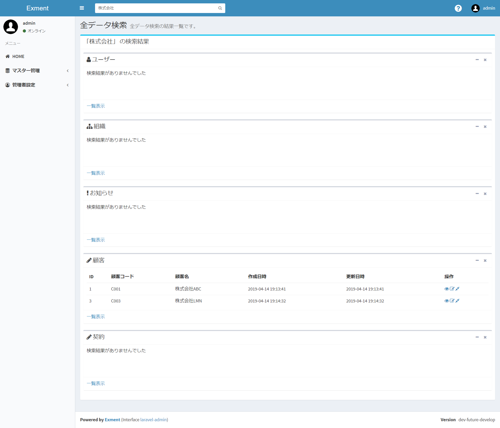
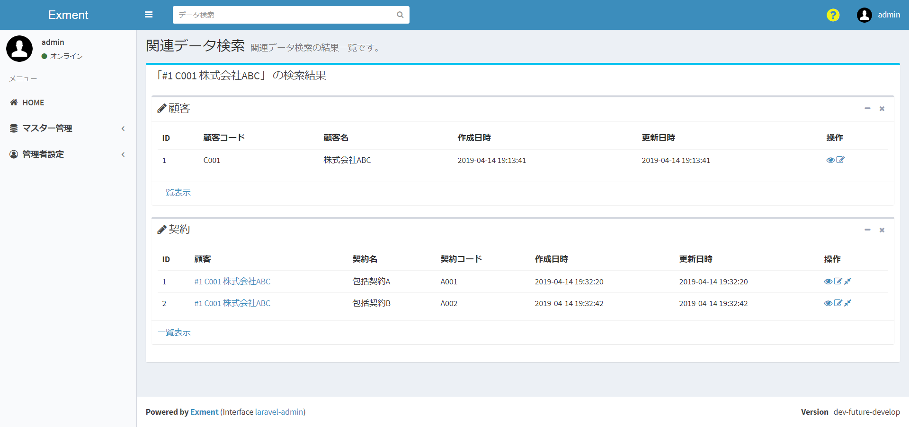
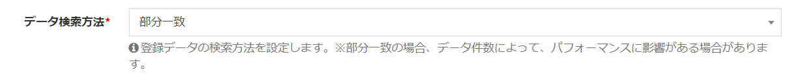
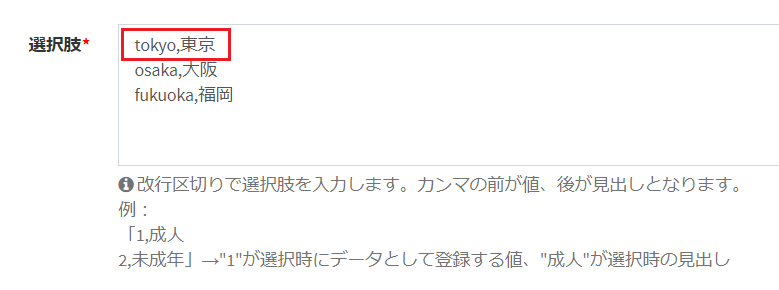
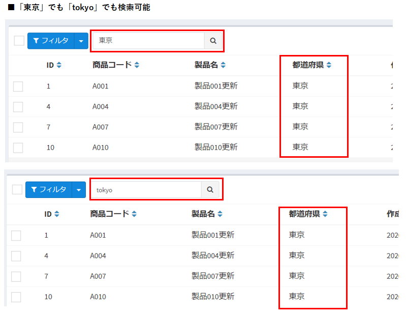
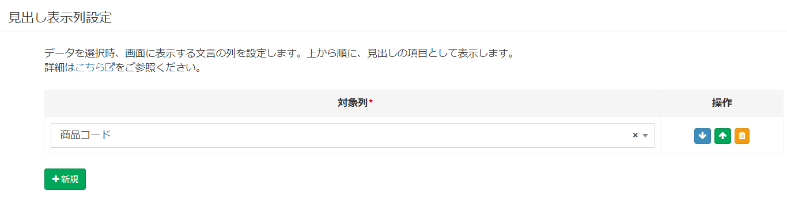

# 検索
Exmentのデータを探す方法の説明です。探し方は、大きく2つあります。

| 探し方 | 探す範囲 |
|---|---|
| ページの上の検索バー | 検索の対象にしている、すべてのテーブル |
| データ一覧画面の検索（検索バー・フィルタ） | 今開いているテーブル |

- **検索は、はじめは前方一致です**（入力した文字で始まるデータを探します）。部分一致にする方法は、下の「データ検索を部分一致に切り替え」をご覧ください。

## 検索バーによる検索（フリーワード検索）
各ページの上には、検索バーがあります。  
  
この検索バーに単語を入力すると、Exmentに登録しているデータを検索できます。  
検索には、「単語検索」と「関連データ検索」の2種類があります。  

### 単語検索
ふつうの検索です。入力した単語を含む（前方一致する）データが、結果に出ます。  
  

検索バーに単語を入力し、そのまま検索ボタンをクリックすると、検索します。  
はじめに検索の対象になるテーブルの一覧が出て、そのあと、当てはまるデータを探します。

**検索の対象になるもの**

- テーブル：カスタムテーブル設定で「検索対象とする」がYESになっているテーブルです。  

- カスタム列：カスタム列設定で「検索インデックス」がYES、「フリーワード検索対象」もYESになっている列です。  
※「検索インデックス」がYESのカスタム列が1件もないテーブルは、検索結果に出ません。  

> v3.4.0より、検索の対象になる条件として、「フリーワード検索対象」がYESになっていることが必要になりました。  
それより前は、「検索インデックス」がYESの列すべてで検索していました。しかし、検索インデックスが10～20個設定されていると、パフォーマンスが下がるおそれがあるため、フリーワード検索の対象を絞れるようにしました。

- 検索されるのは、ユーザーが閲覧する権限を持つテーブルだけです。  

- **デフォルトの検索設定は前方一致です。** これは、検索の速さのためです。  
部分一致に変えたいときは、下の「データ検索を部分一致に切り替え」をご覧ください。

**検索結果**

検索結果のデータには、［表示］［編集］［関連データ検索］のアイコンが出ます。  
    
［関連データ検索］アイコンをクリックすると、下の「関連データ検索」を行います。  

### 関連データ検索
関連データ検索は、あるデータにひも付くデータを探す機能です。  
たとえば「顧客」テーブルがあるとき、その顧客にひも付く「契約」のデータ一覧を見たいことがあります。  
  
そのとき、この「関連データ検索」を使うと、顧客にひも付く契約データを一覧で見られます。  

関連データ検索が行われるのは、次のときです。  
- 検索バーに単語を入力し、出てきた候補を選んだとき  
  
>候補として一覧に出る文言は、[見出し表示列設定](/ja/table#見出し表示列設定)で変えられます。

- 単語検索を行い、その結果に出る［関連データ検索］アイコンを選んだとき  
  
  
関連データ検索で一覧に出るのは、次の条件でひも付くデータです。  
- カスタム列の「選択肢」で、検索で選んだデータを選んでいるデータ(ただし、カスタム列設定で「検索インデックス」がYESになっている必要があります)  
- リレーション設定で、1:nもしくはn:nとして、検索で選んだデータを親として登録しているデータ  
  
関連データ検索では、選んだデータそのものと、上の条件の関連データが、一覧で出ます。  
下の例では、選んだ顧客「株式会社ABC」のデータと、その顧客に関連する契約が、一覧で出ています。  
  

## データ一覧画面の検索
データ一覧画面でも、検索できます。
方法は、検索バーによる検索と、列を指定してのフィルタ検索の2種類です。

  

### 検索バーによる検索（フリーワード検索）
この検索バーに単語を入力すると、表示しているテーブルの中のデータを検索できます。  

  

検索バーに単語を入力し、そのまま検索ボタンをクリックすると、検索します。  

  

- フリーワード検索は、今選んでいるカスタムビューとは別の機能です。  
探す範囲は、そのテーブルの全データです。すべてのフリーワード検索列を対象に検索します。  
そのため、結果は、今選んでいるカスタムビューではなく、全件ビューの形で出ます。

- 検索の対象になるカスタム列は、カスタム列設定で「検索インデックス」がYES、「フリーワード検索対象」もYESになっている列です。  

> v3.4.0より、検索の対象になる条件として、「フリーワード検索対象」がYESになっていることが必要になりました。  
それより前は、「検索インデックス」がYESの列すべてで検索していました。しかし、検索インデックスが10～20個設定されていると、パフォーマンスが下がるおそれがあるため、フリーワード検索の対象を絞れるようにしました。

- **デフォルトの検索設定は前方一致です。** これは、検索の速さのためです。  
部分一致に変えたいときは、下の「データ検索を部分一致に切り替え」をご覧ください。

### 列を指定してのフィルタ検索
「フィルタ」ボタンをクリックすると、列を指定してくわしく検索するためのボックスが出ます。

  

  

- 検索列の項目として出るのは、次のとおりです。
    1. ID、作成日時、更新日時
    2. ワークフロー設定が行われているテーブルの場合、「ワークフローステータス」と、「自分が担当者のデータ」の絞り込み
    3. そのテーブルを子とするリレーション設定が行われている場合、親データを絞り込む選択肢を表示
    4. そのテーブルの、カスタム列設定「検索インデックス」がYESになっているカスタム列

※このうち、1と2は、システム設定の詳細設定画面で出さないようにできます。

  

## 補足事項

### データ検索を部分一致に切り替え
データの単語検索は、デフォルトでは前方一致です。  
これは、検索を速くするためです。部分一致では、検索の速さが十分に出ません。  
  
ただし、部分一致に切り替えることはできます。  
メニュー「管理者設定 > システム設定(詳細設定)」で、「データ検索方法」を部分一致に変えてください。  
  
  

これで、検索が部分一致になります。  
※この設定で、検索が遅くなることがあります。ご了承ください。

### 全文検索エンジン(Meilisearch)の利用
データの件数が多い環境では、部分一致で検索すると、検索が遅くなることがあります。  
そのときは、全文検索エンジン「Meilisearch」を使うと、速く検索できます。  
くわしくは[全文検索エンジン(Meilisearch)](/ja/additional_meilisearch)をご確認ください。

### カスタム列の種類による、フリーワード検索の仕様について
フリーワード検索で探せるのは、基本的には、データベースに入っている値だけです。  
ただし、一部のカスタム列では、ユーザーが入力した検索値を、システムが先に書きかえてから検索します。  
その仕様を、下に書きます。

> 現在、Google検索のような、半角スペースを入力しての複数列のAND検索には対応しておりません。

#### 選択肢(値とテキスト)
設定値「値」に設定した値、または設定値「テキスト」に設定した値で、検索できます。

  

  

#### 選択肢 (他のテーブルの値一覧から選択)
「見出し列」に設定されている文言で、検索できます。  

例：  
- 「商品マスター」がある。  

  

- その「商品マスター」では、「テーブル設定(拡張設定)」の「見出し列設定」に「商品コード」が設定されている。  

  

- テーブル「商品在庫情報」に、その「商品マスター」を参照先とする列「商品マスター」を追加する。  

  

- このような設定のとき、フリーワード検索で商品コード「A001」と入力すると、商品マスター「A001」を参照先とする「商品在庫情報」の一覧が出ます。

  

#### YES/NO
0/1、もしくはNO/YESの文字列で検索できます。  
（「0」や「1」、「NO」や「YES」という、どこにでもある文字列で検索することになるため、「フリーワード検索」の対象にすることは、あまりおすすめしません。）

#### 2値の選択
選択肢の値、もしくは見出しで検索できます。  

  
  

