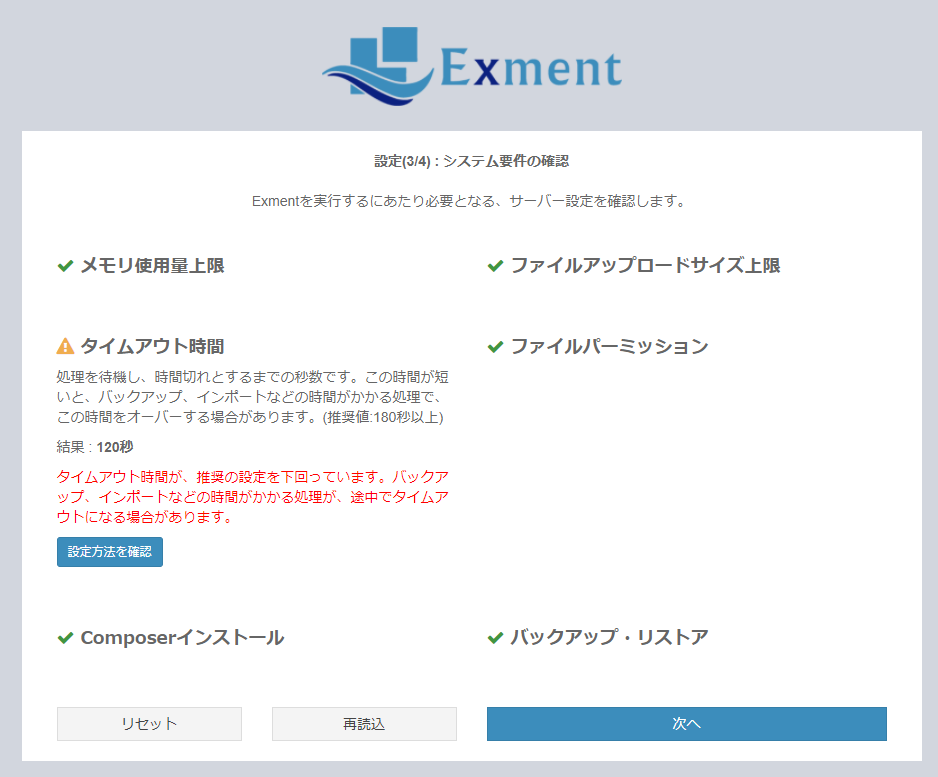
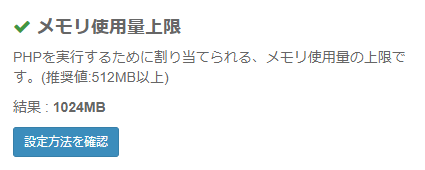
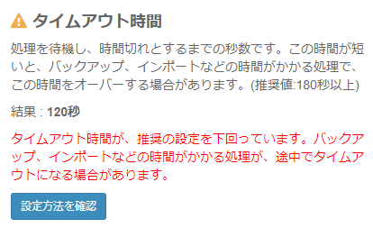
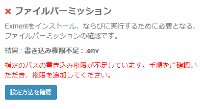

# サーバー設定
Exment を入れる前に用意する、Web サーバーとデータベースの設定をまとめたページです。  
お使いの環境に合う手順で、設定してください。

このページで行うことは、次の 4 つです。

1. Web サーバーを用意する（下の「Webサーバー」）
2. composer を入れる（下の「composer導入」）
3. データベースを用意する（下の「データベース」）
4. Exment のアプリをインストールする（下の「アプリのインストール」）

必要な PHP・データベースの版は、下の「動作環境」にあります。

- <span class="red bold">※インストール手順やサーバー構築についての個別のお問い合わせは、お受けしていません。個別の対応が必要なときは、有償のサポートをご利用ください。</span>　　
- 下の一覧にない環境のマニュアルは、ご用意していません。ご了承ください。

## Webサーバー
次のどれかの手順で、Web サーバーを用意してください。  
※PHP・Apache・MySQL のそろった環境を、開発用にはじめから作るときは、XAMPP をおすすめします。  

- [XAMPP構築(開発・検証環境) Windows](/ja/install_xampp)  
→まずは手持ちのパソコンに、Exment を入れてみたいとき(Windows版)

- [XAMPP構築(開発・検証環境) Mac](/ja/install_xampp_mac)  
→まずは手持ちのパソコンに、Exment を入れてみたいとき(Mac版)

- [レンタルサーバー構築](/ja/install_rental)  
→Exment を公開して、ほかのメンバーやスマートフォンからも手軽に使いたいとき

- [Linuxに構築](/ja/install_centos_stream)  
→Exment を Linux(CentOS Stream)に入れるときの手順  
 ※CentOS8で構築していた方は[こちら](/ja/install_linux)

- [IISに構築](/ja/install_iis)  
→Exment を IIS に入れるときの手順

- [AWSに構築-シングル構成](/ja/install_aws_single)  
→Exment を AWS に、シングル構成で入れるときの手順

- [AWSに構築-冗長化](/ja/install_aws)  
→Exment を AWS に、冗長化した構成で入れるときの手順

- [Dockerで構築](/ja/install_docker)  
→Exment を Docker で動かすときの手順


### ファイルパーミッション設定

Exment のプロジェクトフォルダのうち、次のフォルダ・ファイルには、Web サーバーを動かすユーザー(apache, www-dataなど)の書き込み権限が必要です。  

| 種類 | ファイル・フォルダ名 | 必要となる機能 |
| ---- | ---- | ---- |
| フォルダ | storage | 全機能 |
| フォルダ | bootstrap/cache | 全機能 |
| ファイル | .env | かんたんインストール、リストア |
| フォルダ | config | かんたんインストール、リストア |
| フォルダ | app | かんたんインストール |
| フォルダ | public | かんたんインストール |
| フォルダ | resources | かんたんインストール |

- かんたんインストールのための権限は、インストールのときだけ必要です。権限をより厳しくしたいときは、かんたんインストールのあとに、フォルダの書き込み権限を外してください。

#### 初期フォルダ自動生成
- はじめに必要なフォルダの構成は、次のコマンドで自動で作ることもできます。  
    - --user=(ユーザー名。未指定の場合は実行後に入力画面表示)
    - --group=(グループ名。未指定の場合は実行後に入力画面表示)
    - --easy=(かんたんインストールにてExmentインストールを行う場合は1。既定は0)
    - --easy_clear=(かんたんインストール実行後に、フォルダ権限を適切なものに戻したい場合は1。既定は0)

```
php artisan exment:setup-dir {--user=} {--group=} {--easy=0} {--easy_clear=0}

# 手動インストールの場合
php artisan exment:setup-dir
# かんたんインストールの場合
php artisan exment:setup-dir --easy=1
# かんたんインストール完了後、フォルダ権限を本来のものに戻す場合
php artisan exment:setup-dir --easy_clear=1
```


## composer導入
Exment を使うには、Web サーバーに composer を入れる必要があります。composer は、Exment に必要なパッケージのインストールと、Exment のアップデートに使います。  
入れ方は、次のページをご覧ください。  
- [公式サイト](https://getcomposer.org/download/)
- [Windows版 解説サイト](https://weblabo.oscasierra.net/php-composer-windows-install/)
- [Linux版 解説サイト](https://weblabo.oscasierra.net/php-composer-centos-install/)
- [Mac版 解説サイト](https://weblabo.oscasierra.net/php-composer-macos-homebrew-install/)


## データベース
Exment のデータベースには、次のどれかが必要です。

- MySQL 8.0以上
- MariaDB 10.11以上
- SQL Server 13.0.0以上(現在、自動のバックアップ・リストアが未対応です)

### データベース環境構築
- データベースサーバーをまだ用意していないときは、先に用意してください。  
手順は、次のページをご覧ください。  
※すでに用意してあるときは、いりません。  

    - [MySQL](/ja/install_mysql)
    - [SQL Server](/ja/install_sqlserver)

### データベース作成

- お使いのデータベースで、Exment 用のデータベースを作ってください。  


## アプリのインストール
環境の用意ができたら、次のどちらかの手順で、Exment のアプリをインストールしてください。

1. **かんたんインストール**  
→Web の画面に出る案内にそって、インストールする方法です。手順は、[かんたんインストール](/ja/quickstart_easy)をご覧ください。

1. **手動インストール**  
→コマンドを使って、手作業でインストールする方法です。手順は、[手動インストール](/ja/quickstart_manual)をご覧ください。


## 動作環境
### サーバー
- PHP 8.2以上(`^8.2.0`。Exment7.0.0では、使用しているLaravel12の要件に合わせ、PHP8.2以上が必要です)
- Laravel12.X(Exment7.0.0より、Laravelバージョンが12.Xに変更になりました)
- ※Exment v6.xの場合は、PHP 8.2、Laravel10.Xです。
- データベース：以下のいずれか
    - MySQL 8.0以上
    - MariaDB 10.11以上
    - SQL Server 13.0.0以上
- PHP の gd 拡張（FreeType 付き。`imagettftext` が使えること）：二次元バーコードのラベルの PDF に使います。ないと、ラベルの PDF を作るときにエラーになります。確かめ方と入れ方は[二次元バーコード設定](/ja/2d_barcode)をご覧ください。

### 動作確認ブラウザ
- Google Chrome
- Microsoft Edge


### 推奨設定

- PHPメモリ最大許容値：512MB
- ファイルアップロード最大値：10MB
- タイムアウト時間：180秒


## システム要件確認

サーバーが Exment の要件を満たしているか、設定値が足りているかを、画面またはコマンドで確かめられます。  

  


### 確認方法
次のどれかで確かめられます。

- [かんたんインストール](/ja/quickstart_easy)のインストール画面
- インストールのあとの、[システム設定画面](/ja/system_setting)
- コマンド（下の「コマンドから実行」）

### 確認項目詳細

#### メモリ使用量上限
PHP を動かすために使えるメモリの上限です。    
変え方は、[PHP設定値変更](/ja/additional_php_ini)をご覧ください。

#### １度にPOSTできる上限数
PHP が 1 度に受け取れる、POST パラメータの数の上限です。一部の画面では、保存のときにたくさんの項目を送るので、この上限を変えることをおすすめします。  
変え方は、[PHP設定値変更](/ja/additional_php_ini)をご覧ください。

#### ファイルアップロードサイズ上限
アップロードできるファイルの大きさの上限です。必要な大きさは、管理したいファイルによって変わります。  
変え方は、[PHP設定値変更](/ja/additional_php_ini)をご覧ください。

#### タイムアウト時間
処理を待って、時間切れにするまでの秒数です。短いと、バックアップ・インポートなどの時間のかかる処理が、この時間をこえることがあります。  
変え方は、[PHP設定値変更](/ja/additional_php_ini)をご覧ください。

#### ファイルパーミッション
Exment を動かすために必要な、ファイルの権限があるかを確かめます。  
くわしくは、上の[ファイルパーミッション設定](#ファイルパーミッション設定)をご覧ください。


#### Composerインストール
Exment のアップデートに使う Composer が、Web サーバーに入っているかを確かめます。  
※composer が入っているのに、警告が出ることがあります。Web サーバーを動かすユーザーから composer のパスが通っていない、権限が足りない、などが理由です。  
composer が正しく入っていて、実際にアップデートをするユーザーが実行できるときは、この警告は無視してください。  
※composer のパスを通すには、[トラブルシューティング](/ja/troubleshooting#composerのパスを通すには)の「composerのパスを通すには」をお試しください。


#### バックアップ・リストア
バックアップ・リストアを行うためのサーバーの設定ができているかを確かめます。  
※エラーになるときは、[トラブルシューティング](/ja/troubleshooting)の「バックアップ・リストアに失敗する」をご覧ください。  
※SQL Server をお使いのときは、いつも警告になります。手作業でのバックアップ・リストアが必要です。手順は[SQL Server のバックアップ・リストア](/ja/backup_sqlserver)をご覧ください。


### 結果表示
#### 正常
緑色のチェックが出ます。

  

行を押すと、くわしい内容が出ます。

  

#### 警告
黄色の警告マークが出ます。設定をおすすめする項目か、使うときに気をつける点がある項目です。

  

#### エラー
赤色のバツマークが出ます。設定を変える必要があります。

  


### コマンドから実行

次のコマンドでも、システム要件を確かめられます。

```
php artisan exment:checkrequire
```

[←インストール-概要へ戻る](/ja/quickstart)