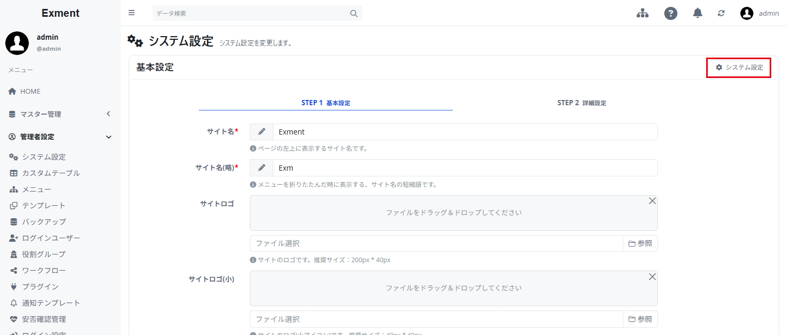
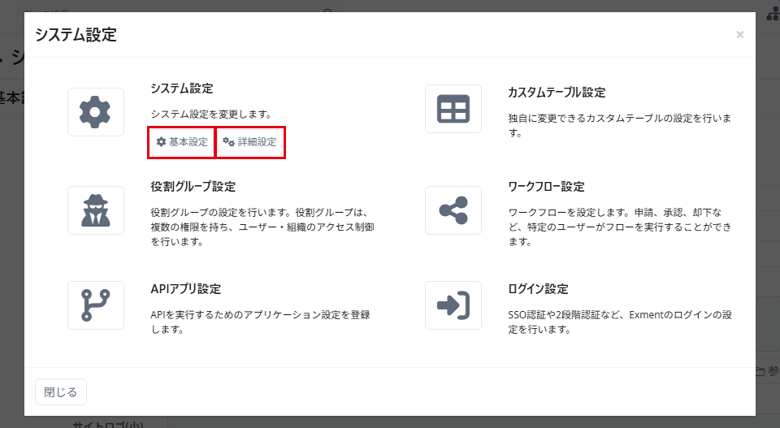
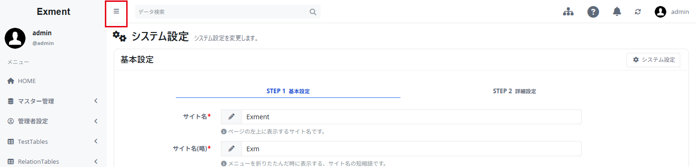
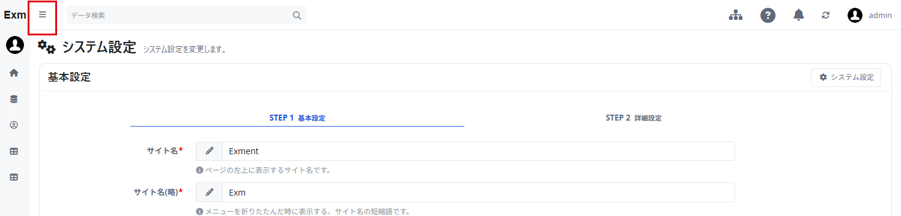
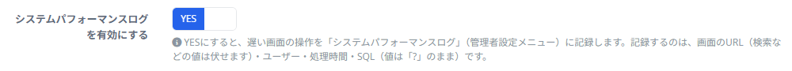
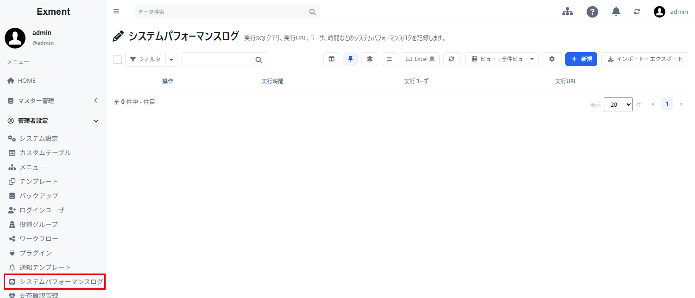
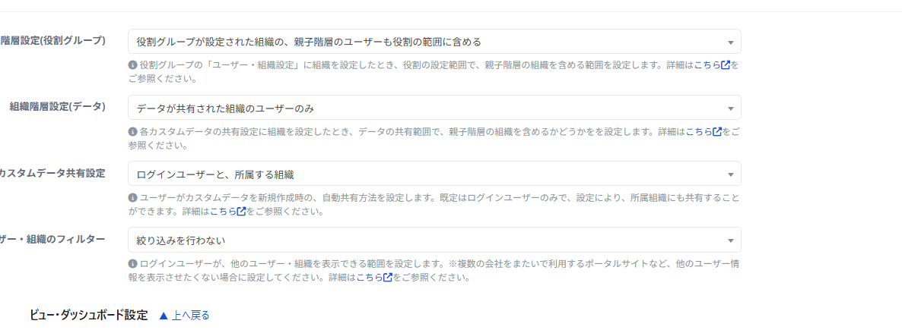
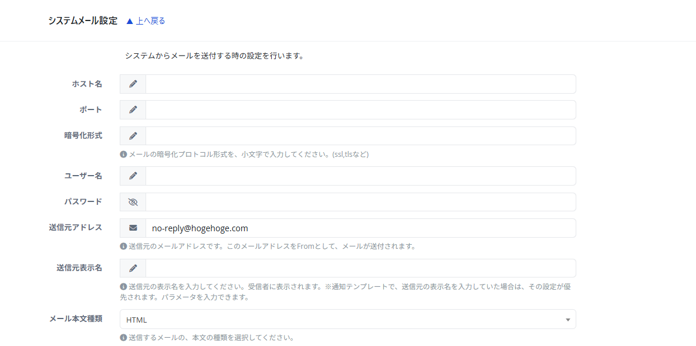

# システム設定
サイトの名前・ロゴ・デザインや、権限の使い方など、Exment のシステム全体にかかわる設定を行う画面です。  
このページでは、画面の項目を上から順に説明します。メール・LINE・IP フィルタなどは、それぞれのページへのリンクがあります。  

## 設定画面
メニューの「システム設定」を押します。  
システム設定の画面が出ます。  
システム設定は［基本設定］と［詳細設定］に分かれています。  
右上のボタンを押し、出てきたダイアログで選ぶと、切り替えられます。

  
  

## サイト基本情報
サイトの名前・ロゴ・メニューの形など、サイトの基本の情報を決めます。

- Exment のメニューレイアウト（メニューの形）には、「標準」と「小アイコン」の２種類があります。  
ちがいは、下の画像をご覧ください。  
- はじめに出るメニューレイアウトは、[サイトメニューレイアウト](#サイトメニューレイアウト)で決めます。画像の赤枠のところを押すと、そのつど切り替えることもできます。

標準
  

小アイコン
  

#### サイト名 ※必須
- メニューレイアウトが「標準」のときに、ページの左上に出るサイト名です。  
- 初期値は「Exment」です。  

#### サイト名(略) ※必須
- メニューレイアウトが「小アイコン」のときに、左上に出るサイト名です。
- 初期値は「Exm」です。  

#### サイトロゴ
- メニューレイアウトが「標準」のときに、ページの左上に出るサイトのロゴです。  
- ［参照］ボタンをクリックして使用したい画像を選択してください。  
- 推奨サイズ：200px * 40px  

※サイトロゴを設定すると、メニューレイアウトが「標準」のとき、左上には、サイト名のかわりにサイトロゴが出ます。

#### サイトロゴ(小)
- メニューレイアウトが「小アイコン」のときに、ページの左上に出るサイトのロゴです。  
- ［参照］ボタンをクリックして使用したい画像を選択してください。  
- 推奨サイズ：40px * 40px  

※サイトロゴ(小)を設定すると、メニューレイアウトが「小アイコン」のとき、左上には、サイト名のかわりにサイトロゴ(小)が出ます。

#### サイトファビコン(ico)  
- 下の画像のように、サイトを見ているときや、ブックマークするときに使われるアイコンの画像です。  
- ［参照］ボタンをクリックして使用したい画像を選択してください。  
- 推奨サイズ：16px * 16px  

  

#### サイトスキン
- サイトのテーマ色です。ヘッダーとサイドバーの色を、次の組み合わせから選びます。  
- ヘッダー(初期設定は青)：青・黄・緑・紫・赤・白
- サイドバー(初期設定は白)：黒・白

※[画面のデザイン](#画面のデザイン)が「モダン」のときは、ヘッダーとサイドバーは白と灰色のままで、選んだ色が「アクセント色」になります（大事なボタン・リンク・選択中のメニュー・入力中の欄の枠など）。青以外の色では、ヘッダーの上のふちに、その色の細い線が入ります。「-light」のつく色は、つかない色と同じアクセント色です。  
※v7.1.0以降は、保存するとすぐに反映されます。v7.0以前は、保存のあと、WEBページを読み込み直すと反映されます。

#### サイトメニューレイアウト
- サイトメニューのレイアウトを、「標準」か「小アイコン」から選びます。  
それぞれの例は、上の画像をご覧ください。
- 初期値は「標準」です。  

※保存のあと、WEBページを読み込み直すと反映されます。

#### 画面のデザイン
- ログイン画面と管理画面のデザインを、「モダン」と「クラシック」のどちらかから選択します。
    - モダン：白と灰色を基本にした、新しいデザインです。
    - クラシック：v7.0以前と同じデザインです。
- 初期値は「モダン」です。

※v7.1.0より利用できます。  
※v7.1.0にアップデートすると、画面のデザインは「モダン」に変わります。これまでのデザインに戻したい場合は、この項目で「クラシック」を選択して保存してください。  
※「モダン」では、ヘッダーとサイドバーは白と灰色を基本にした表示になり、[サイトスキン](#サイトスキン)で選んだ色がアクセント色になります。サイトロゴに画像を設定している場合は、ロゴの後ろにアクセント色の背景がつきます。  
※「モダン」のデータ一覧では、操作列（表示・編集・削除）がチェックボックスのすぐ右（左側）に表示されます。  
※サーバーの設定（.envファイルの「EXMENT_UI_DESIGN」）でデザインを固定している場合は、そちらが優先されます。このとき、この項目は変更できず、「(サーバーの設定で固定されています)」と表示されます。詳細は[設定値一覧](/ja/config?id=画面のデザイン)をご参照ください。  
※保存するとすぐに反映されます。表示がくずれる場合は、ブラウザで Ctrl+F5（スーパーリロード）を押してください。

#### APIを使用する
- 「YES」にすることで、APIを使用することができます。
- 初期値は「NO」です。

#### サーバー外部通信を行う
- YESにすると、Exmentの最新バージョンの通知など、外部のサーバーと通信する処理（データを受け取るだけ）を行えます。
- 初期値は「YES」です。  

#### 権限管理を使用する
- 設定がYESの場合、[システム全体に対する権限や、カスタムテーブル毎の権限](/ja/role_group)を設定することができます。  
- YESのときは、ユーザーを指定して権限を付けられます。
- 初期値は「YES」です。  

#### 組織管理を使用する
- 設定がYESの場合、[権限管理を使用する](#権限管理を使用する)にあたり、組織を指定して権限を付けられます。  
- 初期値は「YES」です。  

#### システムパフォーマンスログを有効にする
- YESにすると、遅い画面の操作を「システムパフォーマンスログ」に記録します。
- 記録するのは、画面のURL（検索などの値は「***」で伏せます）・ユーザー・処理時間・SQLです。SQLは値を埋め込まず、「?」のまま記録します。
- 初期値は「NO」です。

YESにすると、次の3つの項目が表示されます（v7.1.0以降）。

| 項目 | 内容 | 初期値 |
| --- | --- | --- |
| パフォーマンスログ: 遅い画面の秒数 | 画面の処理にこの秒数以上かかったときに記録します。0にすると、この条件では記録しません。 | 3 |
| パフォーマンスログ: 遅いSQLの秒数 | 1つのSQLにこの秒数以上かかったときに記録します。0にすると、この条件では記録しません。 | 1 |
| パフォーマンスログ: 1時間に記録する上限 | 1時間に記録する件数の上限です。上限を超えた分は記録しません。0にすると上限なしです。 | 100 |

※「遅い画面の秒数」と「遅いSQLの秒数」を両方0にすると、すべての操作を記録します（v7.0以前と同じ動きです）。調査のときだけにしてください。v7.0以前からログをONにしていた環境は、更新後もこの「すべて記録」のままです。  
※ログを見るには、左メニューの「管理者設定」→「システムパフォーマンスログ」を開きます。  
※v7.0.3以降は、YESにして保存すると、ログのテーブルとメニュー（「管理者設定」の中）が自動で作られます。テンプレートのインストールは不要です。  
※v7.0.2以前は、テンプレート（[Template zip file](https://exment.net/template/system_logs.zip)）をインストールして、`php artisan exment:update` を実行してください。

#### システム管理者
- システム管理者となるユーザーを設定することができます。
- 初期値は、Exment をインストールしたときに初期設定を行ったユーザーです。

#### データ一覧の表示件数
- データ一覧のページで、はじめに出すデータの件数です。  
  「10件」「20件」「30件」「50件」「100件」いずれかを選択します。
- 初期値は「20件」です。  

#### 検索・ダッシュボードの表示件数
- [キーワード検索](/ja/search.md?id=単語検索)を行った際や、[ダッシュボードのデータ一覧](/ja/dashboard.md?id=データ一覧)で、はじめに出すデータの件数です。  
「5件」「10件」「20件」いずれかを選択します。  
- 初期値は「5件」です。  

#### 日時表示書式
- 日付の表示形式を、３種類（「標準（Y-m-d H:i:s）」「カスタム（Y/m/d H:i:s）」「ローカル（Y年m月d日 H時i分s秒）」）の中から選べます。初期値は「標準（Y-m-d H:i:s）」です。

#### データ検索方法
- 登録したデータの検索方法を、「前方一致」（頭が同じもの）か「部分一致」（途中に含むもの）から選びます。
- 初期値は「前方一致」です。

#### データ一覧のフィルタ非表示
- チェックした項目は、データ一覧画面のフィルタに出なくなります。

#### データ画面のシステム項目表示位置
- データ編集画面とデータ詳細画面で、システム項目を出す位置を決めます。  
- 「上部」「下部」「非表示」から選択可能です。初期値は「上部」です。  

#### データ保存後の既定リダイレクト先
- [データ登録](/ja/data_form#データ保存後の遷移先)画面には、データを保存したあとにどの画面へ移るかを選ぶチェックボックスがあります。そのチェックボックスに、はじめからチェックを入れておけます。

#### ヘッダーのユーザー情報の表示内容
- ヘッダーのユーザー情報に出す内容を決められます。空欄にすると、出しません。
- ユーザーテーブルのカスタム列と、作成日時から選べます。

#### ユーザーが選べる言語
- ユーザーが右上のメニュー・ログインの画面・ログインユーザー設定で選べる言語です（v7.2.4 以降）。空欄のときは、入っているすべての言語を選べます。サイトの言語は、いつでも選べます。
- 詳しくは[ユーザーごとの言語とタイムゾーン](/ja/user_locale)をご覧ください。

#### ユーザーが言語を選んでいないとき、ブラウザーの言語を使う
- YES にすると、言語を選んでいないユーザーには、ブラウザーの言語（ユーザーが選べる言語の中から）で画面を出します。NO にすると、サイトの言語で出します（v7.2.4 以降）。
- 初期値は「YES」です。全員をサイトの言語のままにするときは、NO にしてください。

## 組織設定
権限や共有の設定で、組織をどこまで含めるかを決めます。

#### 組織階層設定(役割グループ)
-  役割グループの「ユーザー・組織設定」に組織を設定したとき、その組織の親や子の組織を、どこまで含めるかを決めます。
- 初期値は「所属組織の親子階層を含める」に設定されています。

#### 組織階層設定(データ)
- 各カスタムデータの共有設定に組織を設定したとき、その組織の親や子の組織を、どこまで含めるかを決めます。
- 初期値は「データが共有された組織のユーザーのみ」に設定されています。

#### カスタムデータ共有設定
-  ユーザーがデータを新規作成したときに、自動で共有する相手を、そのユーザーだけにするか、所属する組織も含めるかを決めます。
- 初期値は「ログインユーザーのみ」です。

## システムメール設定
システムからメールを送るための設定です。  
画面から設定するときは、SMTP の設定値を入力します。  
くわしくは[メール送信設定](/ja/mailsend_setting)をご覧ください。

## LINE設定
［詳細設定］の「LINE設定」で、[LINE連携](/ja/line)で使用する、LINE公式アカウントの情報（チャネルアクセストークン、チャネルシークレット、ベーシックID）を設定します。  
くわしくは[LINE連携のシステム設定](/ja/line?id=システム設定)をご覧ください。

## 安否確認設定
［詳細設定］の「安否確認設定」で、[安否確認](/ja/safety_check)の、地震発生時の自動送信などを設定します。  
くわしくは[安否確認設定](/ja/safety_check?id=安否確認設定)をご覧ください。

## IPフィルタ設定
通信を許可するIPアドレスを、固定IP（例：12.3.5.6）か、範囲指定形式（例：123.4.5.0/24）で設定します。  
未設定の場合は、すべてのIPアドレスを許可します。
詳しくは[IPフィルター](/ja/additional_ip_filter.md)をご覧ください。
7.3.0 から、IP の制限からはずすユーザー・組織・役割グループも選べます（[IPフィルター](/ja/additional_ip_filter)の「IP 制限からはずす人」）。  
API を使える人も、ここで選べます（[API設定](/ja/api)の「APIを使える人」）。

## パスワードポリシー

> [ログイン設定](/ja/login_setting)に移動しました。

## SSO設定

> [ログイン設定(SSO)](/ja/login_sso)に移動しました。
