# カスタムテーブル設定
Exment では、データを「カスタムテーブル」（表）に入れて管理します。顧客・見積・タスクなど、管理したいものごとに、テーブルを作ります。  
このページでは、テーブルを作る・直す・消す方法と、テーブルごとの設定（データで使える機能・権限など）を説明します。

- はじめてテーブルを作るとき：下の「新規作成」→「設定項目の詳細」→「保存」の順にご覧ください。
- 重複のチェックや、検索の候補に出す文言など、いくつかの列を使う設定：下の「拡張設定」をご覧ください。

## 一覧
メニューの「カスタムテーブル」を押します。  
今あるカスタムテーブルの一覧が出ます。  

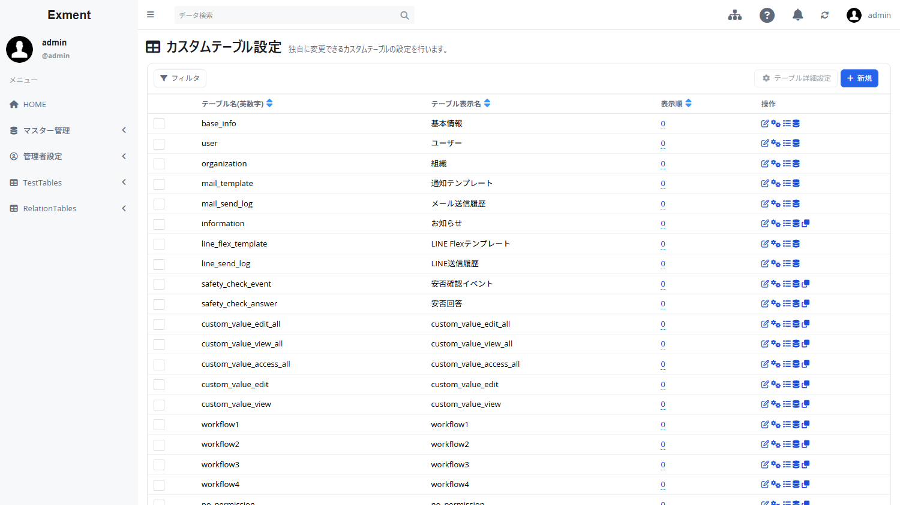

※「基本情報」「ユーザー」「組織」「通知テンプレート」「メール送信履歴」「お知らせ」  
これらのテーブルは、Exment をインストールしたときから入っています。  
テンプレートでインポートしたテーブルも、この一覧に出ます。  

## 新規作成

- 一覧画面の右上の［新規］ボタンを押します。
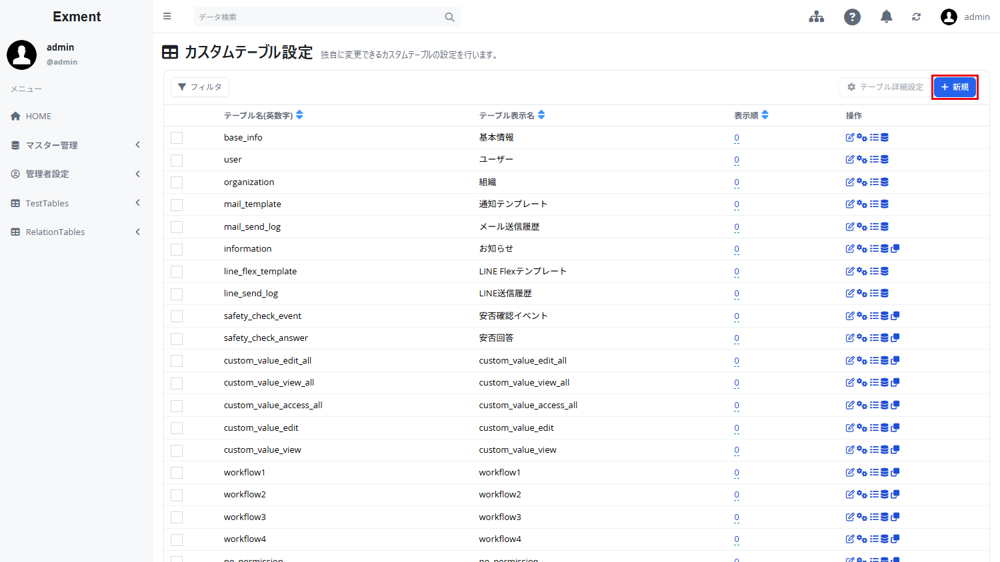  
  
- テーブル作成画面が出ますので、必要な項目を入力します。項目の説明は、下の「設定項目の詳細」にあります。
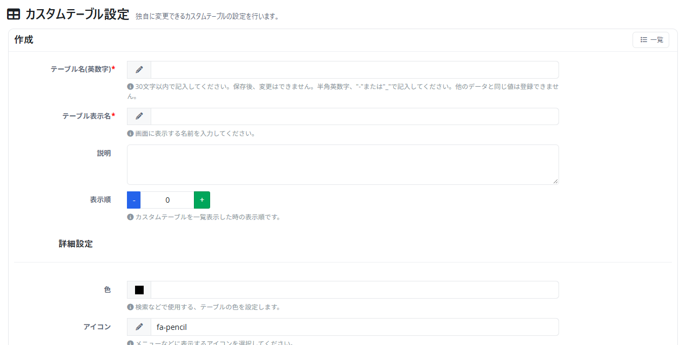

## 設定項目の詳細

#### テーブル名(英数字) ※必須
- テーブルの名前を表します。(例：user , information , estimate )  
- ここで決めた英数字は、テーブルを開いたときの URL などに使われます。(例：http(s)://(ExmentのURL)/data/user)  
- 使用できるのは、半角英数字と記号の "-" と "_" です。
- 他のテーブルで使用しているテーブル名は使用できません。  
- テーブル名の文字数は30文字以内、テーブル名の先頭は英字を指定してください。  
- テーブルを新しく作るときにだけ決められます。保存したあとは変えられません。  

> ※URL は、「/admin」が付かない標準の設定（v7.2.1 以降に新しくインストールしたサイト）の場合です。`.env` の `ADMIN_ROUTE_PREFIX` に値がある場合（前の版で入れたサイトは「admin」）は、サイトの URL のあとにその値を足してください（例：`http(s)://(ExmentのURL)/admin/oauth/token`）。詳しくは[URLに含む「admin」の変更・削除](/ja/additional_prefix)をご覧ください。

#### テーブル表示名 ※必須
- 画面に表示する名称です。日本語の使用も可能です。(例：ユーザー 、お知らせ 、見積 )  

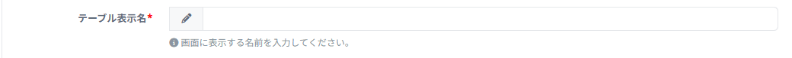  

#### ほかの言語の名前（v7.3.0 以降）
テーブルの設定画面の「ほかの言語の名前」に、ユーザーが選べる言語ごとの入力欄があります（サイトの言語は除きます）。  
言語を選んでいるユーザーには、その言語の名前が表示されます。空のときは、上で入力した名前が表示されます。  
くわしくは [名前を言語ごとに持つ](/ja/name_locales) を見てください。

#### 説明
- テーブルに関する説明です。

- 入力した説明は、下の画像のように、データ画面で、テーブル表示名の右に出ます。  

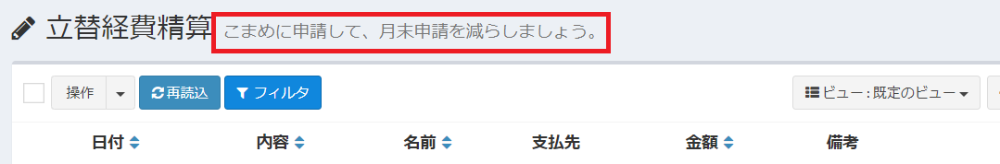

#### 表示順
- カスタムテーブル設定の一覧画面における表示順です。  
- 半角入力、もしくは左右の［－］［＋］ ボタンで数字を指定してください。

#### 色
- テーブルの色を決めます。この色は、検索のときの候補（サジェスト）などに使われます。

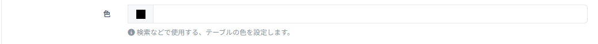

- 今の色を押すと、色を選ぶ画面が出ます。

#### アイコン
- テーブルのアイコンを決めます。このアイコンは、メニューや検索結果に出ます。  

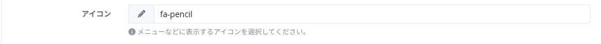

- 今のアイコンを押すと、アイコンを選ぶ画面が出ます。

#### 検索可能
- 検索バーから[検索](/ja/search.md)を行うときに、このテーブルを検索の対象にするかどうかを決めます。既定値はYESです。  
隠しておきたいテーブルなど、検索結果に出したくないときは、NOにしてください。

#### IDをラベルに使用する
- 検索バーに出る検索の候補で、ラベルの頭にデータのIDを付けられます。くわしくは[見出し表示列設定](#見出し表示列設定)をご覧ください。既定値はNOです。  

#### 1件のみ登録可能
- データを何件も登録せず、1件だけ登録できるテーブルにするときは、YESにしてください。既定値はNOです。  

#### 添付ファイル使用
- テーブルのデータに、[添付ファイル](/ja/data_details?id=添付ファイル)をアップロードできるようにするときは、YESにしてください。既定値はYESです。  

#### コメント使用
- テーブルのデータに、[コメント](/ja/data_details?id=コメント)を書けるようにするときは、YESにしてください。既定値はYESです。  

#### データ変更履歴使用
- だれが・どのような内容でデータを更新したかを、リビジョン（履歴）として残したいときは、YESにしてください。既定値はYESです。  

#### 変更履歴バージョン数
- 「データ変更履歴使用」がYESのときに、変更履歴をいくつまで残すか（バージョン数）を、整数で入力します。  
「200」と入力すると、201回目の更新で、1回目の変更履歴が消えます。既定値は100です。  

#### 一覧表示を最適化する
- YESにすると、データ一覧の画面を先に表示し、その後で行を自動的に読み込みます。件数や列の多いテーブルで、一覧の画面が出るまでの時間を短くします。既定値はNOです。
- 行の描画を後から行う設定です。データベースへの問い合わせを減らすものではありません。
- 設定は、データ一覧を開き直すと適用されます。

※v7.1.0より利用できます。

#### 全ユーザーが編集可能

> テーブルの権限の概要については、[Exmentにおける役割・権限の概要](/ja/permission)ページを、はじめにご確認ください。

- YESにすると、すべてのユーザーが、このテーブルのすべてのデータを編集できます。ユーザーごとに権限を付ける必要がなくなります。既定値はNOです。  

#### 全ユーザーが閲覧可能

> テーブルの権限の概要については、[Exmentにおける役割・権限の概要](/ja/permission)ページを、はじめにご確認ください。

- YESにすると、すべてのユーザーが、このテーブルのすべてのデータを閲覧できます。ユーザーごとに権限を付ける必要がなくなります。既定値はNOです。  

※Exmentインストール時に、「お知らせ」テーブルのみ「全ユーザーが閲覧可能」がYESに初期設定されています。これは、すべてのユーザーが、お知らせ情報を閲覧できるようにするためです。  
一方、お知らせ情報を編集できるのは、管理者だけです。

#### 全ユーザーが参照可能

> テーブルの権限の概要については、[Exmentにおける役割・権限の概要](/ja/permission)ページを、はじめにご確認ください。

- YESにすると、すべてのユーザーが、このテーブルのすべてのデータを参照できます。ユーザーごとに権限を付ける必要がなくなります。既定値はNOです。  

※「全ユーザーが参照可能」だけをYESにすると、そのテーブルをメニューや一覧画面に出すことはできませんが、ほかのテーブルから参照することはできます。  

例：「消費税」テーブルは、一般ユーザーに一覧画面を見せる必要はありませんが、選択肢として「消費税」を選んでもらう必要があります。このようなテーブルでは、「全ユーザーが参照可能」をYESにしてください。  

#### 親データの権限で閲覧可能

> テーブルの権限の概要については、[Exmentにおける役割・権限の概要](/ja/permission)ページを、はじめにご確認ください。

- YESにすると、親データ（1対多）の権限でデータを閲覧できます。ただし、このテーブル自体に担当者の閲覧等の権限を持っている必要があります。既定値はNOです。  

※ 1対多リレーションの子テーブルにだけ表示されるオプションです。  

※ 親データの編集権限を持っていても、子データを編集することはできません。閲覧だけできます。  

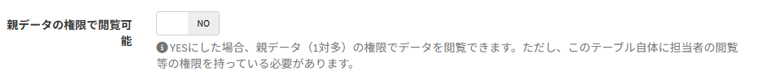

#### 親データの編集権限が必要

> テーブルの権限の概要については、[Exmentにおける役割・権限の概要](/ja/permission)ページを、はじめにご確認ください。

- YESにすると、このテーブルのデータを編集するには、親データ（1対多）の編集権限が必要になります。既定値はYESです。  

※ 1対多リレーションの子テーブルにだけ表示されるオプションです。  

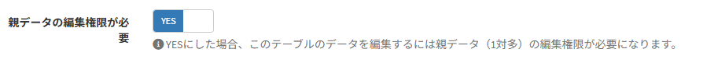

#### メニューに追加する
- YESにすると、テーブルの保存といっしょに、そのテーブルをメニューに追加します。既定値はNOです。  

※テーブルを新しく作るときにだけ出る項目です。メニューに追加したあとで、メニューの設定を変えるときは、[メニュー](/ja/menu.md)画面で行ってください。  

#### 追加先の親メニュー
- 「メニューに追加する」をYESにすると出る項目です。追加するメニューの、親になるメニュー名を選んでください。  

例：「マニュアル」テーブルを新しく作るときに、親メニューに「管理者設定」を選ぶと、画像のように、「マニュアル」テーブルのメニューが、「管理者設定」の中のいちばん下にできます。

#### 通知に追加する
- YESにすると、テーブルの保存といっしょに、通知の設定を追加します。データの新規作成・更新・共有、コメントのときに、権限のあるユーザーにシステム内通知を行う設定です。  

※テーブルを新しく作るときにだけ出る項目です。通知に追加したあとで、通知の設定を変えるときは、[通知](/ja/notify.md)画面で行ってください。  

## 保存
- ［送信］ボタンを押すと、設定が保存され、その内容でテーブルができます。

- テーブルを新しく作ったときは、保存のあと、[カスタム列一覧画面](/ja/column.md)に変わります。  
続けて、カスタム列を登録してください。

## 編集
- カスタムテーブル一覧で、直したいテーブルの［編集］ボタンを押してください。  
編集画面に変わり、設定を変えられます。  

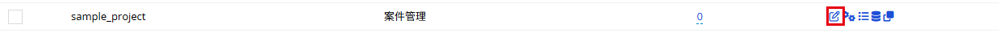

## 削除
- テーブルを消したいときは、はじめに、上の「編集」と同じ手順で編集画面を開いてください。

- 次に、編集画面の右上にある［削除］ボタンを押してください。  

  

- 下の画像のような確認画面が出ます。テキストエリアにdelete meと入力し、［確認］ボタンを押すと、テーブルが削除されます。  
**※ただし、次の種類のテーブルに関しては削除できません。 ・システムでインストールしているテーブル ・リレーションを子として設定されているテーブル**

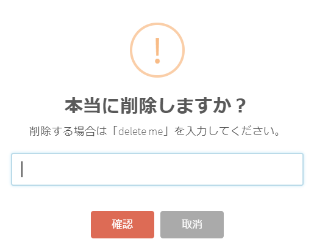

## 拡張設定
テーブルの中のいくつかの列を使う設定（重複のチェック・列どうしの比較・見出し・データの自動共有など）を行えます。

- カスタムテーブル一覧で、設定したいテーブルの［拡張設定］ボタンを押してください。  

- 設定画面に変わります。

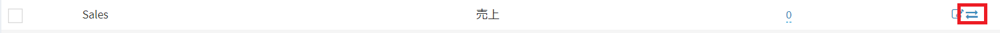  

### 複合ユニークキー設定
いくつかの列をまとめてユニークキー（重複を許さない組み合わせ）にすると、データの新規登録のときに、同じ組み合わせの値が二重に登録されるのを防げます。  

- 組み合わせで重複を防ぎたい列を、２～３種類選んでください。
- データを新規登録するとき、選んだ列のすべてで、登録しようとする値が登録ずみの値と同じ場合に、エラーになります。  

例：下の画像のように「次回予定日」「名前」をユニークキーにすると、同じ次回予定日に同じ名前が何件も登録されるのを防げます。  
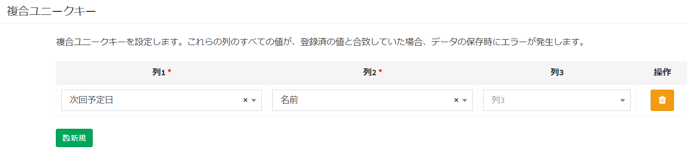

※１種類の列だけで重複を防ぎたいときは、[カスタム列設定](/ja/column.md)で、その列のユニークをYESにしてください。

※ 1:N のリレーション（[Exmentのリレーション設定参照](/ja/relation.md)）の場合、子テーブルに複合ユニークキーを設定するときに、親テーブルもユニークキーの 1 つとして選べます。  
こうすると、同じ親データの中だけで、重複をチェックできます。

### 2つの列を比較
データの新規作成と更新のときに、2つの列をくらべます。列の値が、設定した条件に合うときだけ保存できます。合わないときは、エラーメッセージを出します。  
次のようなときに使えます。  

- 「開始日」は「終了日」以前の場合のみ保存できる。
-  「X」の値は「Y」の値以上の場合のみ保存できる。
- 「担当者」と「確認者」は異なる場合のみ保存できる。

    

#### 未入力の場合の扱い
片方または両方の項目が未入力のときは、選んだ条件によって結果が変わります。  
ここでは、保存できる場合を"true"、エラーになる場合を"false"と書きます。

- **AとBで合致する** : 値が両方とも未入力の場合true。どちらかのみ未入力の場合false。
- **AとBで合致しない** : 値がどちらかのみ未入力の場合true。両方とも未入力の場合false。
- **それ以外** : 常にtrue。日付や数値は、値が空のときは、ふつう比較ができないためです。  
未入力にさせたくないときは、カスタム列設定やカスタムフォーム設定で、必須にしてください。

#### 列の種類ごとの扱い
- 大小（AはBより大きい、AはBより小さい、AはB以上である、AはB以下である）の比較は、以下の列種類でのみ行えます。
    - 整数
    - 小数
    - 通貨
    - 日付
    - 時間
    - 日時

- それ以外の列種類で大小をくらべようとすると、常にtrueになります。

- 列の種類がそろっていないと、大小はくらべられません（たとえば「整数」と「日時」）。本来は、この設定を保存するときにエラーにするべきものです。  
ただし、今は、保存のときにこのチェックを行っていません。種類の合う2つの列を選んでください。

#### その他
- 3列以上の値での比較、特別な条件を使った比較、ほかのテーブルの値を使った比較などを行いたいときは、[プラグインのバリデーション](/ja/plugin_quickstart_validate)を作成してください。

### 見出し表示列設定
検索バーの候補や、選択肢の一覧に出す文言（見出し）を、どの列の値で作るかを決める設定です。  
  
たとえば、下のような「顧客情報」というテーブルがあるとします。  
顧客情報テーブルには、「顧客コード」「顧客名」「電話番号」「メールアドレス」といった列があります。  
    

検索バーに検索ワードを入力すると、検索の候補が出ます。  
この候補を、次のように出したいとします。  
「(顧客コード) (顧客名)」  
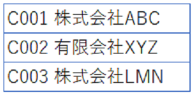    
  
そのときは、カスタムテーブルの拡張設定画面で、見出しに出したい列を、次のように登録します。  
  
  
こう登録すると、ページの上の検索バーに文字を入力したときに、候補が次のように出ます。  
候補の文字列は、拡張設定画面で上から登録した列の順に並びます。  
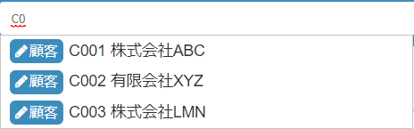  
  
「メールアドレス」も出したいときは、「メールアドレス」の列を追加してください。  
  
  
  
また、カスタムテーブル設定に、「IDをラベルに使用する」の項目があります。
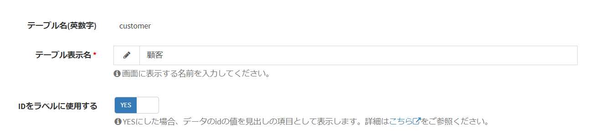  
この設定をYESにすると、ラベルの頭に、「#(id)」という文言が追加されます。  
  

#### その他
- この見出し表示列設定を登録していないときは、カスタム列設定で1番目の列の値を表示します。
- カスタム列設定で1番目の列の値が空のときは、IDを表示します。
- IDを追加できるのは、ラベルの先頭だけです。ほかの場所には追加できません。  

### データ自動共有設定

> データ共有設定については、[Exmentにおける役割・権限の概要](/ja/permission)ページを、はじめにご確認ください。

データを保存するときに、列の値に入っている組織やユーザーに、自動でデータを共有できます。  
次のようなときに使えます。  

- データ「契約情報」の新規作成時に、列「主担当者」に割り振られたユーザーに、自動的に編集権限を追加する。  
- データ「契約情報」の更新時に、列「関係組織」に割り振られた組織に、自動的に閲覧権限を追加する。  
- データ「タスク管理」の新規作成時に、列「担当者」に割り振られたユーザーに、自動的に編集権限を追加する。  

※先に、カスタムテーブルに、列種類が「ユーザー」か「組織」の列が必要です。

#### 例  
「顧客管理」テーブルで、このような列設定が定義されている場合に、

『「新規作成時」に、列「担当者」に割り振られたユーザーに、「編集」権限を追加する』という設定をします。

その後、担当者をユーザー「user1」とするデータを新規作成時に、
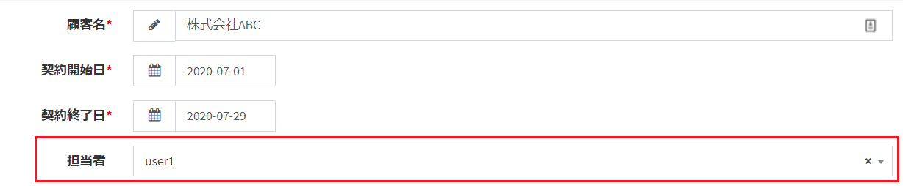

ユーザー「user1」に、このデータが、編集権限で共有されます。

#### 設定方法

- ##### トリガー
データを共有するタイミングです。  
「新規作成時」または「更新時」を選択できます。  

- ##### 対象列
データ共有の対象となる、ユーザーまたは組織です。

- ##### 対象の権限
編集権限と閲覧権限のどちらで共有するかを選びます。

#### 共有の同期設定
はじめの設定では、トリガーが「更新時」のとき、対象の列のユーザー・組織を変えても、前に入っていたユーザー・組織への共有は消えず、共有されたままになります。  

設定を変えると、データの更新のときに、「列に入っているユーザー・組織」と「更新したユーザー」以外のユーザー・組織を、共有から外せるようになります。

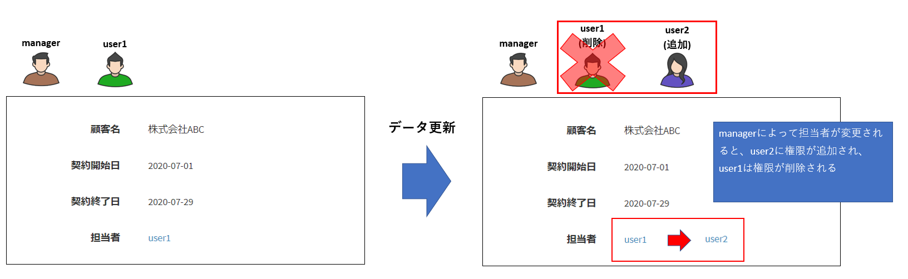

そうするには、オプション設定の「更新時、データ自動共有設定を同期する」をYESにしてください。

### 画面からの実行不可設定

データの新規作成・編集・削除や、インポート・エクスポートを、画面から行わせたくないときに設定します。  
設定すると、そのボタンが画面に出なくなります。  

- 「画面からの変更不可」項目が表示されます。

  

- 設定例：「エクスポート」を非表示にした場合

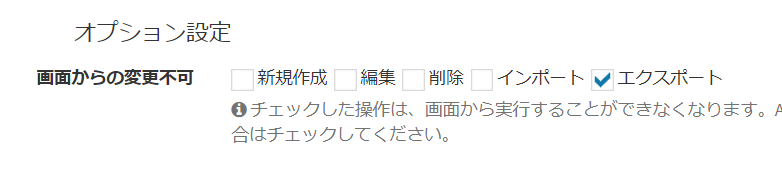  

  

### データ画面のシステム項目表示位置

データ編集画面とデータ詳細画面で、システム項目を出す位置を決めます。  
「システム設定に合わせる」「上部」「下部」「非表示」から選択可能です。（初期値は「システム設定に合わせる」）  
※システム全体の表示位置はシステム設定で変更できます。  

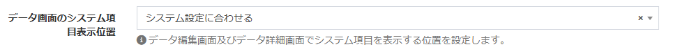  

### 行クリック時の画面遷移

データ一覧画面で行を押したときに、どの画面を開くかを決めます。  
「既定値に合わせる」「データ編集画面」「データ詳細画面」「遷移しない」から選択可能です。（初期値は「既定値に合わせる」）  
※システム全体の既定値は「データ詳細画面」ですが、.envの設定値（`EXMENT_GRIDROW_SELECT_EDIT`・`EXMENT_GRIDROW_SELECT_DISABLED`。[設定値](/ja/config#一覧グリッド)）により変更できます。  

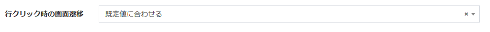  

### 見出しフォーマット設定
> この設定は、[エキスパートモード](/ja/additional_expert)を有効にしていた場合のみ表示されます。

パラメータ変数を使って、見出しに出す値を、自由な形で決められます。  

- エキスパートモードを有効にし、拡張設定画面を開きます。

- 「フォーマット文字列入力」項目が表示されます。  

  

- データに保存している値を見出しに出すときは、[パラメータ変数](/ja/params)を使います。  
例：ユーザー情報で、「ユーザー名&lt;admin@admin.admin&gt;」と表示する場合  
${value:user_name}&lt;${value:email}&gt;  
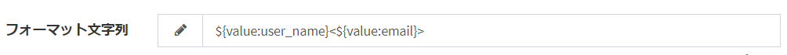  

- このように入力すると、見出しに出す項目を決められます。  
  

#### その他
- この見出し表示フォーマット設定を設定していると、「見出し表示列設定」は無効になります。
