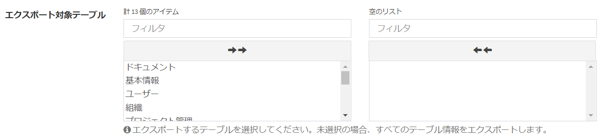
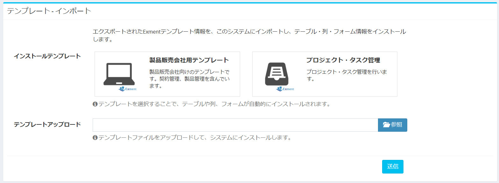

# テンプレート
「テンプレート」は、テーブル・列・フォーム・メニュー・ダッシュボードなどの設定を、1 つのファイルにまとめたものです。このページでは、テンプレートの取り込み（インポート）と書き出し（エクスポート）のしかたを説明します。

| したいこと | 見るところ |
|---|---|
| このシステムで作ったテーブルなどを、ほかのユーザーが使えるようにする | エクスポート |
| ほかの人が作ったテンプレートや、Exmentで用意しているテンプレートを取り込む | インポート |
| 申請・承認のしくみを、まとめて入れる | 同梱テンプレート「申請パック」 |
| Excelに書いて、複数のテーブルをまとめて作る | インポート - Excelテンプレート |

テンプレートを取り込むと、カスタムテーブルなどを 1 から作る手間が省けます。

## ページ表示
- 左メニューより、「テンプレート」を選択します。  
もしくは、以下のURLにアクセスしてください。  
http(s)://(ExmentのURL)/template  
これにより、テンプレート画面が表示されます。  
  

> ※URL は、「/admin」が付かない標準の設定（v7.2.1 以降に新しくインストールしたサイト）の場合です。`.env` の `ADMIN_ROUTE_PREFIX` に値がある場合（前の版で入れたサイトは「admin」）は、サイトの URL のあとにその値を足してください（例：`http(s)://(ExmentのURL)/admin/oauth/token`）。詳しくは[URLに含む「admin」の変更・削除](/ja/additional_prefix)をご覧ください。

## エクスポート
ページの上のほうにある「エクスポート」に必要事項を記入して、「送信」をクリックします。設定の入ったzipファイルが出力されます。  
  

##### テンプレート名  
システムの中で使う名前です。半角英数字、"-"または"_"で記入します。  
ほかのテンプレートファイルと重ならない名前にしてください。  

##### テンプレート表示名  
テンプレート画面で表示するテンプレート名を記入します。

##### テンプレート説明文  
テンプレート画面で表示する説明文を記入します。

##### サムネイル  
テンプレート画面で表示するサムネイルをアップロードします。推奨サイズは256px*256pxです。  
アップロードしない場合、テンプレート画面では「No Image」画像が表示されます。

##### エクスポート対象  
このテンプレートに入れるものを選択します。テンプレートをインポートすると、ここで選択した項目が、システムに取り込まれます。  
選択できる対象は、「テーブル」「メニュー」「ダッシュボード」「役割グループ」「ワークフロー」です。  
※「ワークフロー」は、v7.0.0以降で選択できます。  
  

##### エクスポート対象テーブル
「エクスポート対象」で、「テーブル」「メニュー」「役割グループ」「ワークフロー」を選択したとき、ここで選択したテーブルに関連する内容だけが、エクスポートされます。  
自分が作成したテーブルに関連する内容だけでテンプレートを作りたいときに、選択してください。  
※未選択の場合、すべての項目がエクスポートされます。
  

##### 保存
入力が終わったら、［送信］をクリックします。入力した内容で、テンプレートファイルがエクスポートされます。データ形式はzipファイルです。

## インポート
インポートできるテンプレートは、現在以下の3通りあります。  
- Exmentで用意しているテンプレート
- 画面からアップロードしたテンプレート
- 過去にそのシステムでアップロードしたテンプレート（再度インポートできます）
  

以下のいずれかの方法で、インポートを実行してください。

- ##### インストールテンプレート：
Exmentで用意しているテンプレートと、過去にアップロードしたテンプレートの一覧が表示されています。  
その中から、インポートしたいテンプレートを選択してください。

- ##### テンプレートアップロード(zip)：
お持ちのExmentテンプレートファイルを、画面からアップロードしてください。  
ファイル形式はzipです。

- ##### テンプレートアップロード(Excel)：
作成したExcelテンプレートファイルを、画面からアップロードしてください。   
ファイル形式はxlsxです。  
※詳細は[「Excelテンプレート」](#import-excel)をご参照ください。

##### 保存  
上記のどちらかを行ったら、「送信」をクリックします。選択したテンプレート、もしくはアップロードしたテンプレートが、システムにインポートされます。  
テンプレートで定義しているテーブル・フォーム・ビュー・ダッシュボードなどの情報が、システムにインストールされます。

### 同梱テンプレート「申請パック」
（v7.2.1 以降）稟議・経費精算・出張申請・支払い申請・休暇申請を、承認のワークフローとセットで入れるテンプレートです。「インストールテンプレート」から「申請パック」を選んでインポートします。

| 入るもの | 中身 |
|---|---|
| テーブル | 稟議・経費精算（明細：日付・科目・支払先・金額・領収書）・出張申請・支払い申請・休暇申請 |
| ワークフロー「申請・承認（標準）」 | 5 つの申請で共通。下書き →［申請］→ 申請中 →［承認］→ 承認済み（編集できなくなります）／［差し戻し］（コメント必須）→ 差し戻し →［再申請］→ 申請中 |
| 役割グループ | 申請者（自分の申請を作る・直す）・承認者（すべての申請を見る） |
| メニュー | 申請・承認 ▸ 未処理の申請・稟議・経費精算・出張申請・支払い申請・休暇申請 |

#### 入れたあとにすること
1. 「役割グループ」で、申請する社員を **申請者** に、承認する人を **承認者** に入れます。
2. 「申請・承認」のメニューは、申請者と承認者（とシステム管理者）にだけ表示されます（[見せる役割グループ](/ja/menu?id=見せる役割グループ)）。入れた直後は申請者がいないので、システム管理者にしか表示されません。

#### 申請から承認まで
1. 申請者が「稟議」などを作って保存し、［申請］を押します。このとき、**承認する人を選びます**。
2. 選ばれた人の「未処理の申請」に入ります。中身を見て［承認］か［差し戻し］を押します。
3. 差し戻されたら、申請者が直して［再申請］を押します。

※承認する人は申請のときに選びます。役割グループで決める形ではありません（ワークフローの権限は、ユーザー・組織・作成ユーザー・列で決めるため）。決まった人が承認する形にしたいときは、「[ワークフロー](/ja/workflow_setting)」で「承認」「差し戻し」のアクションの実行者を変えてください。
※テーブル・フォーム・ワークフローは、ふつうのカスタムテーブル・ワークフローと同じように直せます。

<h3 id="import-excel"><a href="#/ja/template?id=import-excel" data-id="import-excel" class="anchor">インポート - Excelテンプレート</a></h3>

Excelテンプレートファイルに必要事項を記入して、テーブル設定などをインポートできます。  
画面で 1 つずつ作るのとちがい、複数のテーブルなどをまとめて作成できます。

  

#### 実行方法
- [Excelテンプレートファイル](https://exment.net/downloads/template/exment_template.xlsx)をダウンロードし、ファイルを開きます。  

- テンプレートファイルに、設定値を入力します。設定と、対応するシート名は、次のとおりです。
    - カスタムテーブル　：　custom_tables
    - カスタム列　：　custom_columns
    - カスタムテーブル(拡張設定)　：　custom_column_multisettings
    - リレーション設定　：　custom_relations
    - メニュー　：　admin_menu

- 記入したら、テンプレート画面の「アップロード(Excel)」項目で、作成したExcelファイルを選択して、アップロードしてください。

  

#### 注意事項
- Excelテンプレートファイルでインポートできるのは、現在、以下の設定です。それ以外の設定(フォームやビューなど)は、画面から設定してください。
    - カスタムテーブル
    - カスタム列
    - カスタムテーブル(拡張設定)
    - リレーション設定
    - メニュー

- カスタム列のうち、「計算式」の設定には対応していません。  
この設定は、画面から行ってください。

- カスタム列で、「ユーザー」「組織」列を追加する場合は、シート「custom_columns」のD列「column_type：列種類」を、「user」「organization」と記入を行ってください。  
D列「column_type：列種類」を「select_table」に、AD列「options.select_target_table_name：選択肢(対象テーブル名を入力) 」を「user」「organization」にすると、正常に動作しません。  
すでに取り込んでしまった場合は、[対応手順のページ](/ja/patch/select_table_user_org)で、更新を行ってください。

- Excelファイルの、各シート名は変更しないでください。また、Excel列の追加も行わないでください。  
(シートの追加は問題ございません。)

- 現在、インポート処理では、バリデーション（入力内容のチェック）を行っていません。  
先にテスト環境などで試してから、本番環境に取り込むことをおすすめします。  

#### テンプレート、サンプル
- [Excelテンプレートファイル](https://exment.net/downloads/template/exment_template.xlsx)

- [Excelテンプレートファイル - サンプル](https://exment.net/downloads/sample/template/exment_template_sample.xlsx)