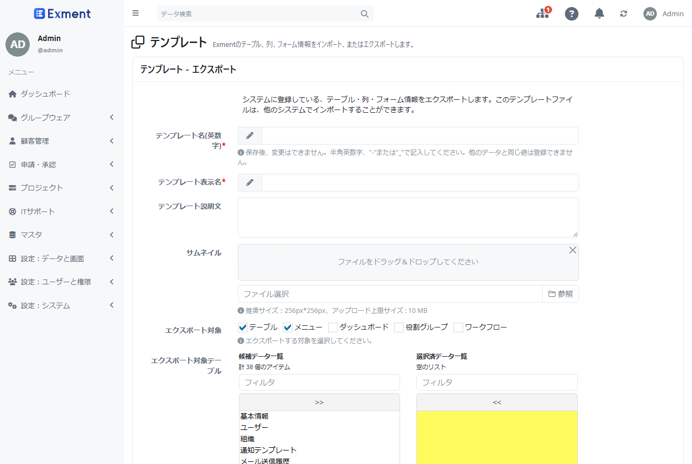

# テンプレート
Exmentのテーブル、列、フォーム情報や、メニュー、ダッシュボードなどの情報を、インポート、またはエクスポートします。  
別のユーザーが作成したテンプレートを、このシステムに取り込むことで、カスタムテーブルなどを作成する手間が省けます。  
また、このシステムで作成したカスタムテーブルなどを、テンプレートとしてエクスポートすることで、他のユーザーが利用することができます。

## ページ表示
- 左メニューより、「テンプレート」を選択します。  
もしくは、以下のURLにアクセスしてください。  
http(s)://(ExmentのURL)/admin/template  
これにより、テンプレート画面が表示されます。  
  

> ※URL の「admin」は、標準の設定の場合です。`.env` の `ADMIN_ROUTE_PREFIX` で変更・削除している場合は、「admin」をその値に読み替えてください（削除している場合は「/admin」を除きます。例：`http(s)://(ExmentのURL)/oauth/token`）。詳しくは[URLに含む「admin」の変更・削除](/ja/additional_prefix)をご覧ください。

## エクスポート
テンプレートをエクスポートします。  
ページ上項目の「エクスポート」に、必要事項を記入していき、「送信」をクリックすることで、必要情報が記入されたzipファイルが出力されます。  
  

##### テンプレート名  
エクスポートしたときに、システムで使用するための名称を、半角英数字、"-"または"_"で記入します。  
他のテンプレートファイルと重複しないような名称を記入してください。  

##### テンプレート表示名  
テンプレート画面で表示するテンプレート名を記入します。

##### テンプレート説明文  
テンプレート画面で表示する説明文を記入します。

##### サムネイル  
テンプレート画面で表示するサムネイルをアップロードします。推奨サイズは256px*256pxです。  
アップロードしない場合、テンプレート画面では「No Image」画像が表示されます。

##### エクスポート対象  
このテンプレートでエクスポートする対象を選択します。テンプレートをインポート時、選択した項目が、システムにインポートされます。  
選択できる対象は、「テーブル」「メニュー」「ダッシュボード」「役割グループ」「ワークフロー」です。  
※「ワークフロー」は、v7.0.0以降で選択できます。  
  

##### エクスポート対象テーブル
「エクスポート対象」で、「テーブル」「メニュー」「役割グループ」「ワークフロー」を選択時、このテーブルで選択したテーブルに関連する内容のみ、エクスポートされます。  
自身が作成したテーブルに関連する内容のみ、エクスポートしてテンプレートを作成したい場合、選択してください。  
※未選択の場合、すべての項目がエクスポートされます。
  

##### 保存
入力が完了したら、［送信］をクリックします。それにより、入力した内容に従って、テンプレートファイルがエクスポートされます。データ形式はzipファイルです。

## インポート
テンプレートをインポートします。  
インポートできるテンプレートは、現在以下の3通りあります。  
- Exmentで用意しているテンプレート
- 画面からアップロードしたテンプレート
- 過去にそのシステムでアップロードしたテンプレート（再度インポートできます）
  

以下のいづれかの方法で、インポートを実行してください。

- ##### インストールテンプレート：
Exmentで用意しているテンプレート、もしくは過去にアップロードしたテンプレートの一覧が表示されています。  
その中から、インポートを行いたいテンプレートを選択してください。

- ##### テンプレートアップロード(zip)：
ユーザーがお持ちのExmentテンプレートファイルを、画面からアップロードしてください。  
ファイル形式はzipです。

- ##### テンプレートアップロード(Excel)：
作成したExcelテンプレートファイルを、画面からアップロードしてください。   
ファイル形式はxlsxです。  
※詳細は[「Excelテンプレート」](#import-excel)をご参照ください。

##### 保存  
上記のどちらかを行ったら、「送信」をクリックします。それにより、選択したテンプレート、もしくはアップロードしたテンプレートが、システムにインポートされます。  
それにより、テンプレートで定義しているテーブル・フォーム・ビュー・ダッシュボードなどの情報が、システムにインストールされます。

### 同梱テンプレート「申請パック」
（v7.2.1 以降）稟議・経費精算・出張申請・支払い申請・休暇申請を、承認のワークフローとセットで入れるテンプレートです。「インストールテンプレート」から「申請パック」を選んでインポートします。

| 入るもの | 中身 |
|---|---|
| テーブル | 稟議・経費精算（明細：日付・科目・支払先・金額・領収書。v7.3.0 以降は明細の金額の **合計** も入ります）・出張申請・支払い申請・休暇申請 |
| ワークフロー「申請・承認（標準）」 | 5 つの申請で共通。下書き →［申請］→ 申請中 →［承認］→ 承認済み（編集できなくなります）／［差し戻し］（コメント必須）→ 差し戻し →［再申請］→ 申請中 |
| 役割グループ | 申請者（自分の申請を作る・直す）・承認者（すべての申請を見る） |
| メニュー | 申請・承認 ▸ 未処理の申請・稟議・経費精算・出張申請・支払い申請・休暇申請 |

#### 入れたあとにすること
1. 「役割グループ」で、申請する社員を **申請者** に、承認する人を **承認者** に入れます。
2. 「申請・承認」のメニューは、申請者と承認者（とシステム管理者）にだけ表示されます（[見せる役割グループ](/ja/menu?id=見せる役割グループ)）。入れた直後は申請者がいないので、システム管理者にしか表示されません。

#### 申請から承認まで
1. 申請者が「稟議」などを作って保存し、［申請］を押します。このとき、**承認する人を選びます**。
2. 選ばれた人の「未処理の申請」に入ります。中身を見て［承認］か［差し戻し］を押します。
3. 差し戻されたら、申請者が直して［再申請］を押します。

※承認する人は申請のときに選びます。役割グループで決める形ではありません（ワークフローの権限は、ユーザー・組織・作成ユーザー・列で決めるため）。決まった人が承認する形にしたいときは、「[ワークフロー](/ja/workflow_setting)」で「承認」「差し戻し」のアクションの実行者を変えてください。
※テーブル・フォーム・ワークフローは、ふつうのカスタムテーブル・ワークフローと同じように直せます。

### 同梱テンプレート「営業パック」
（v7.3.0 以降）顧客・案件・見積・契約を入れるテンプレートです。「インストールテンプレート」から「営業パック」を選んでインポートします。

| 入るもの | 中身 |
|---|---|
| テーブル | 顧客（明細：顧客の担当者）・案件（状態：問い合わせ → 提案 → 見積 → 受注／失注、見込み金額、受注予定日、確度）・見積（明細：品名・数量・単位・単価・金額）・契約（開始日・終了日・自動更新・金額・契約書） |
| 計算 | 見積明細の **金額** は数量 × 単価、見積の **合計** は明細の金額の合計です（入力すると入ります） |
| 役割グループ | 営業（すべて見る・作る・直す） |
| メニュー | 営業・顧客 ▸ 顧客・案件・見積・契約（営業の人とシステム管理者にだけ表示） |

入れたあとに、「役割グループ」で営業の社員を **営業** に入れてください。

### 同梱テンプレート「資産パック」
（v7.3.0 以降）資産・備品の台帳と、購入・移転・廃棄の申請、棚卸、貸出を入れるテンプレートです。

| 入るもの | 中身 |
|---|---|
| テーブル | 資産（資産番号・区分・場所・管理部署・使う人・購入日・購入金額・状態・写真）・資産の申請（購入／移転／廃棄）・棚卸（明細：資産・結果 あり／見つからない／破損）・貸出（貸出日・返却予定日・返却日） |
| 二次元バーコード | 資産のテーブルは二次元バーコード（QR）を使う設定です。一覧の［二次元バーコード新規作成］で作り、資産に貼ると、読み取ってその資産を開けます（[二次元バーコード](/ja/2d_barcode)） |
| ワークフロー「資産の申請（標準）」 | 資産の申請だけ。申請パックと同じ流れで、承認する人は申請のときに選びます |
| 役割グループ | 資産管理者（すべて見る・作る・直す）・資産の利用者（資産と貸出を見る、資産の申請を出す） |
| メニュー | 資産管理 ▸ 資産・資産の申請・棚卸・貸出（2 つの役割グループの人とシステム管理者にだけ表示） |

※承認されても、資産の「状態」は自動では変わりません。資産管理者が直してください。

### 同梱テンプレート「人事・総務パック」
（v7.3.0 以降）社員名簿と、入社・退社・異動の手続きを入れるテンプレートです。

| 入るもの | 中身 |
|---|---|
| テーブル | 社員名簿（社員番号・ユーザー・所属・役職・雇用形態・入社日・内線・勤務地・状態 在籍／休職／退職）・入退社の手続き（種類・対象の人・予定日・状態 準備中／手続き中／完了。明細：やること・担当・期限・完了） |
| 役割グループ | 人事・総務（すべて見る・作る・直す）・社員（社員名簿を見る） |
| メニュー | 人事・総務 ▸ 社員名簿・入退社の手続き（2 つの役割グループの人とシステム管理者にだけ表示） |

社員名簿は、ログインユーザーの表に列を足さず、別のテーブルにして「ユーザー」の列でつないでいます。入社前でユーザーがまだない人の手続きは、「対象の人」に名前を書きます。

<h3 id="import-excel"><a href="#/ja/template?id=import-excel" data-id="import-excel" class="anchor">インポート - Excelテンプレート</a></h3>

Excelテンプレートファイルに、必要事項を記入し、テーブル設定などをインポートすることができます。  
画面から1からテーブルを作成する場合と比較し、一括で複数のテーブルなどを作成できます。

  

#### 実行方法
- [Excelテンプレートファイル](https://exment.net/downloads/template/exment_template.xlsx)をダウンロードし、ファイルを開きます。  

- テンプレートファイルに、設定値を入力していきます。各設定と、対応するシート名は以下になります。
    - カスタムテーブル　：　custom_tables
    - カスタム列　：　custom_columns
    - カスタムテーブル(拡張設定)　：　custom_column_multisettings
    - リレーション設定　：　custom_relations
    - メニュー　：　admin_menu

- 記入後、テンプレート画面の「アップロード(Excel)」項目で、作成したExcelファイルを選択して、アップロードを行ってください。

  

#### 注意事項
- Excelテンプレートファイルによるインポートで、現在対応しているのは、以下の設定になります。それ以外の設定(フォームやビューなど)は、画面から設定を行ってください。
    - カスタムテーブル
    - カスタム列
    - カスタムテーブル(拡張設定)
    - リレーション設定
    - メニュー

- カスタム列のうち、「計算式」の設定は対応しておりません。  
こちらの設定は、画面から設定を行ってください。

- カスタム列で、「ユーザー」「組織」列を追加する場合は、シート「custom_columns」のD列「column_type：列種類」を、「user」「organization」と記入を行ってください。  
D列「column_type：列種類」を「select_table」に、AD列「options.select_target_table_name：選択肢(対象テーブル名を入力) 」を「user」「organization」にすると、正常に動作しません。  
なお、すでに取込済だった場合、[こちら](/ja/patch/select_table_user_org)で、更新を行ってください。

- Excelファイルの、各シート名は変更しないでください。また、Excel列の追加も行わないでください。  
(シートの追加は問題ございません。)

- 現在、インポート処理では、バリデーションを設定しておりません。  
インポートを実行する際には、一度テスト環境などを用意し、検証を行ってから、本番環境に取り込みを行うことを推奨しております。  

#### テンプレート、サンプル
- [Excelテンプレートファイル](https://exment.net/downloads/template/exment_template.xlsx)

- [Excelテンプレートファイル - サンプル](https://exment.net/downloads/sample/template/exment_template_sample.xlsx)