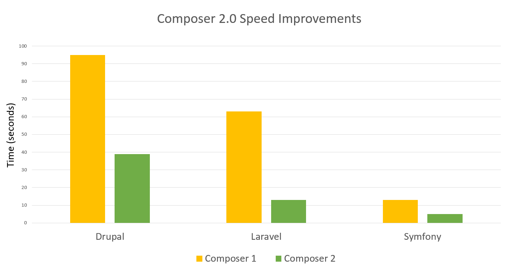

# composer更新
composer を、バージョン 1 からバージョン 2 にアップデートする手順です。  
composer は、Exment のインストールとアップデートで使っているライブラリです。

> 万が一、このアップデートのあとで、Exment の更新時にエラーが出るようになった場合は、[こちら](https://github.com/exceedone/exment/issues/849)にご報告いただけると、非常に幸いです。  

## アップデートの流れ
1. 今の composer のバージョンを確かめる（すでに 2.X.X なら、これ以降は不要です）
2. laravel/framework のバージョンを確かめる（古いときは、先にアップデートします）
3. composer をアップデートする

## composer 2 について
2020/10に、composerのver2がリリースされました。  
ver2 では、次の点が良くなっています。

- 速度とメモリ使用量の両方の点で大幅な改善
- require/remove および部分的な更新がはるかに高速



引用：  
https://blog.packagist.com/composer-2-0-is-now-available  
https://qiita.com/ucan-lab/items/289009ffe5bb417c808e  

Exment でも、composer2 でのインストールとアップデートを検証し、問題なく実施できることを確認しています。  
環境にもよりますが、composer1 のときによく起きていた、メモリの使いすぎが良くなると期待できます。そのため、composer2 へのアップデートをおすすめしています。


## アップデート手順
composer2 にアップデートするには、いくつかの手順が必要です。  
<span class="red">※ できるだけ、開発環境などで同じ手順を試してから、本番環境で行ってください。</span>

### 現在のcomposerバージョンの確認

- 今の composer のバージョンを、次のコマンドで確かめます。（どのフォルダーで実行してもかまいません）

```
composer --version
```

| 結果 | すること |
|---|---|
| composer2.X.X で、Exment のアップデートも問題なく終わっている | composer のアップデートは済んでいます。これ以降の手順は不要です |
| composer1.X.X | これ以降の手順を行ってください |

### 現在のlaravel/frameworkのバージョンの確認、アップデート

Exment で使っている、laravel/framework のバージョンを確かめます。  
※ 同じサーバーに Exment を複数インストールしている場合は、すべての Exment で、次の手順を行ってください。  

- 次のコマンドを、Exment のルートフォルダーで実行します。

```
php artisan --version
# 以下のような結果が表示されます
# Laravel Framework 5.6.39
```

- 結果が version5.6.40 以上のときは、何もする必要はありません。

- 結果が version5.6.40 未満のときは、次のコマンドで、プロジェクト全体をアップデートします。  

```
composer update
```

### composerアップデート

- composer のバージョンを、2.X.X にアップデートします。

```
# 以下のいずれかを実施してください
composer self-update --2
composer selfupdate --2
```

- アップデートのあとで不具合が起きた場合は、次のコマンドで、version1.X.X に戻せます。  
ただし、このコマンドは、**Exmentのフォルダ以外のパス**で実行してください。Exment のフォルダーの中で実行すると、エラーになるようです。

```
composer self-update --1
composer selfupdate --1
```
