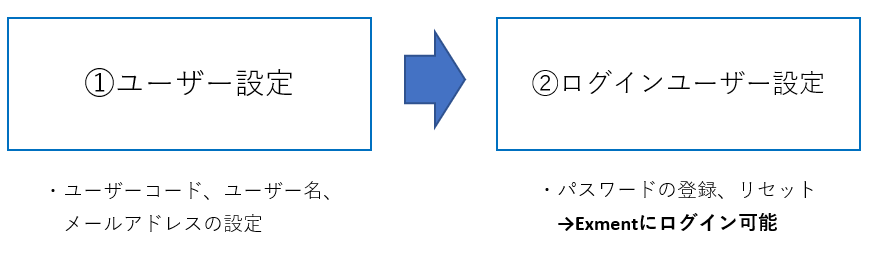
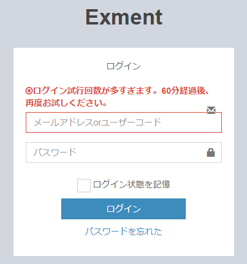
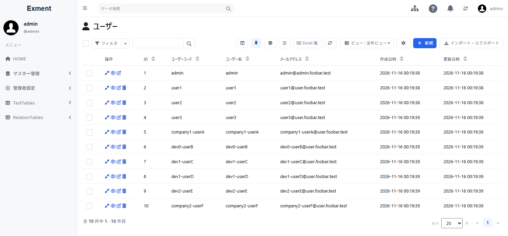
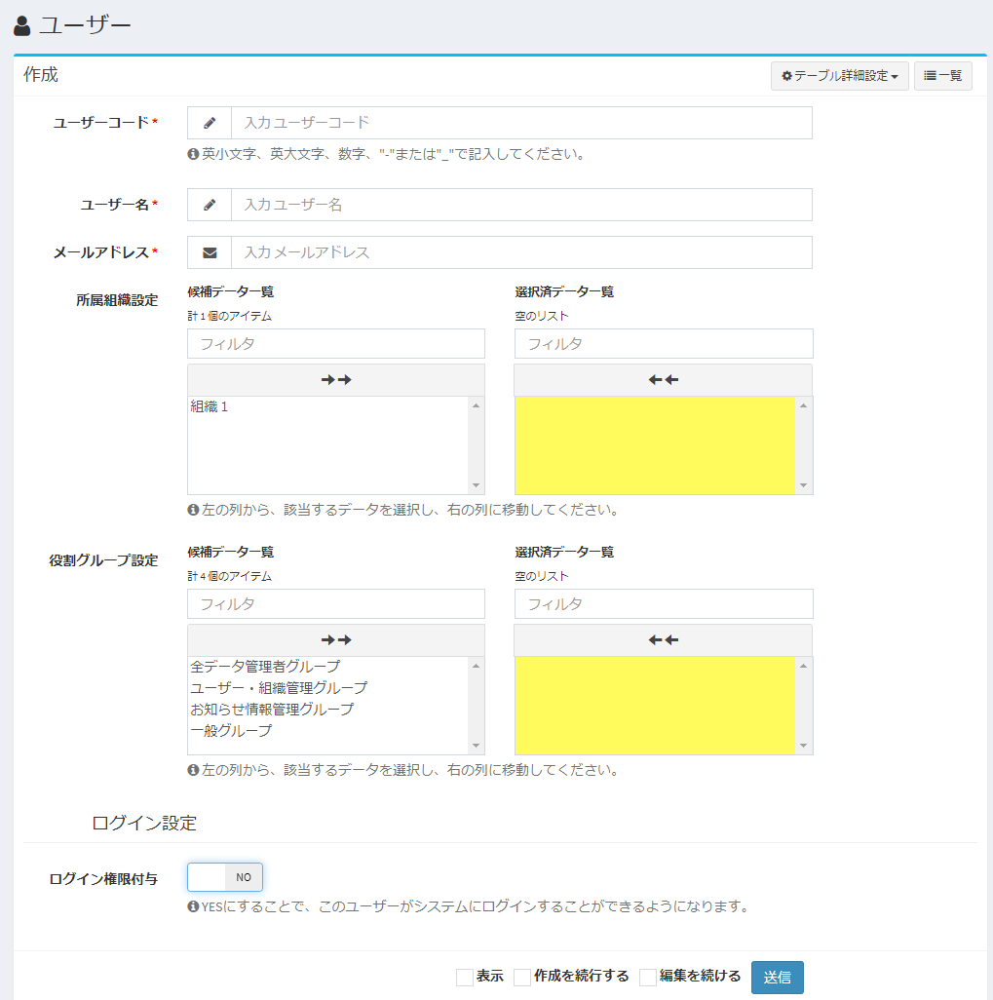
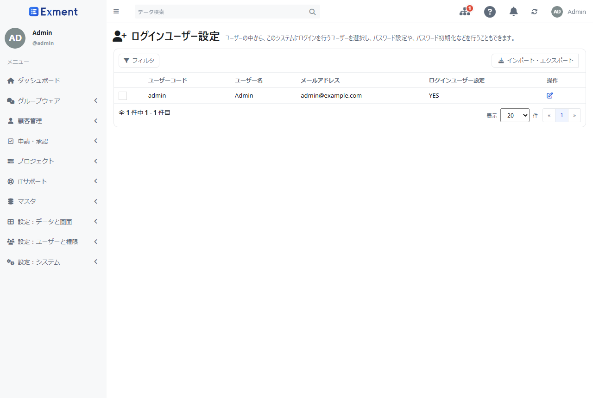
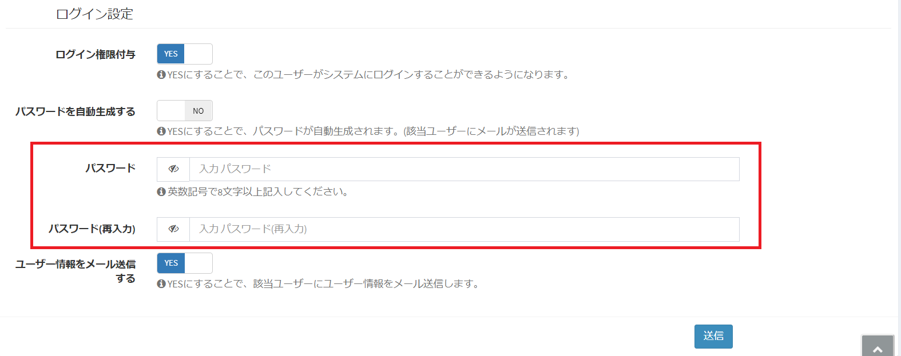
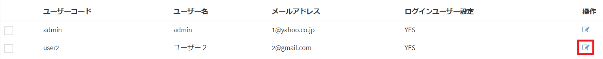
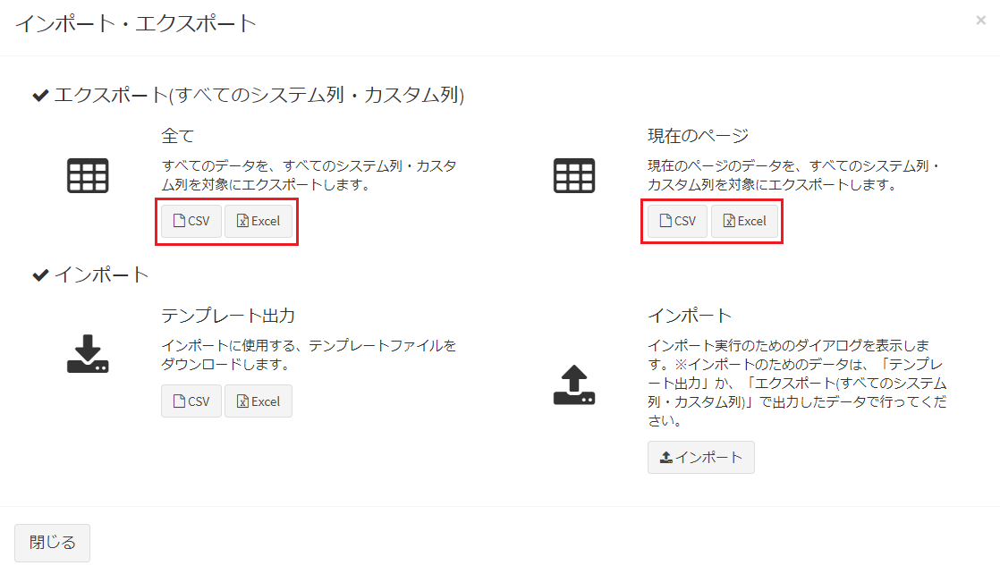
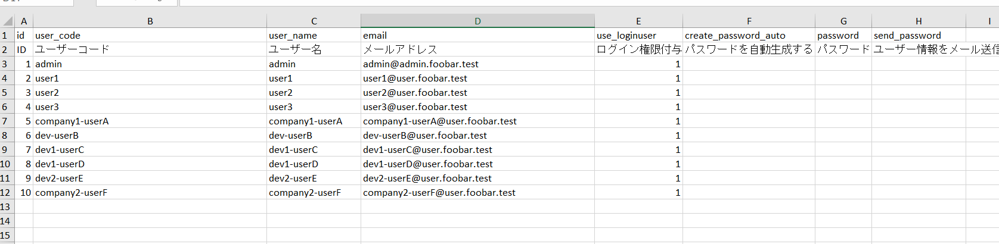
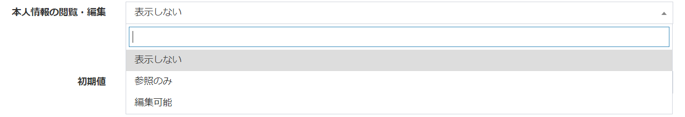

# ユーザー・ログインユーザー
ユーザーと、ログインユーザーを管理する画面の説明です。

| したいこと | 見るところ |
|---|---|
| ユーザーを追加・編集・削除する | 「ユーザー管理」 |
| ユーザーがログインできるようにする・パスワードを決める | 「ログインユーザー管理」 |
| たくさんのユーザーに、まとめてログイン設定をする | 「ログインユーザー情報の一括インポート」 |
| ユーザーが自分の情報を見る・変えられるようにする | 「ログインユーザーによる本人情報の閲覧・編集」 |

## 名称定義
### ユーザー
自社や組織に所属する社員などの、人です。  
このシステムを使わない方も、ユーザーとして追加できます。  
ユーザーコード、Eメールアドレスが必須です。  
ユーザーは、ほかのテーブルのデータにひも付けて登録できます。ただし、ユーザーであるだけでは、システムにログインできません。

### ログインユーザー
ユーザーのうち、Exmentにログインできる人です。  
ユーザー情報にパスワードが付くので、Exmentのログイン画面からログインして、データの登録や参照などができます。  

#### ユーザー、ログインユーザーの設定手順

Exmentにログインできるようになるまでの流れは、上の図のとおりです。  
①ユーザー管理画面で、ユーザーのユーザーコード、ユーザー名、メールアドレスを登録します。  
②ログインユーザー管理画面で、①で登録したユーザーのパスワードを設定します。  
これで、登録したユーザーがExmentにログインできるようになります。  

> ログインのとき、パスワードを決まった回数まちがえると、そのユーザーは、しばらくの間ログインできなくなります。  

## ユーザー管理
すべてのユーザーの情報を管理する方法を書きます。  

### 一覧画面表示
左メニューの「ユーザー」をクリックします。  
または、次のURLを開いてください。  
これにより、ログインユーザー設定画面が表示されます。
http(s)://(ExmentのURL)/data/user  
今システムに登録されているユーザーの一覧が出ます。

> ※URL は、「/admin」が付かない標準の設定（v7.2.1 以降に新しくインストールしたサイト）の場合です。`.env` の `ADMIN_ROUTE_PREFIX` に値がある場合（前の版で入れたサイトは「admin」）は、サイトの URL のあとにその値を足してください（例：`http(s)://(ExmentのURL)/admin/oauth/token`）。詳しくは[URLに含む「admin」の変更・削除](/ja/additional_prefix)をご覧ください。

### ユーザーの新規追加
- 「ユーザー」の一覧画面で、ページ右上の［新規］ボタンをクリックします。

- 新規追加画面が出ます。必要なことを入力します。

#### 所属組織設定
ユーザーを所属させる組織があるときは、候補データ一覧から選んで、選択済データに移してください。  
※組織が作られていないときは、この項目は出ません。

#### 役割グループ設定
ユーザーに付ける役割グループがあるときは、候補データ一覧から選んで、選択済データに移してください。

#### ログイン設定
ログイン権限付与をYESにすると、ユーザーをログインユーザーとして作れます。  
設定のしかたは、下の[ログインユーザー管理](#ログインユーザー管理)をご覧ください。

### 保存
設定を入力したら、［送信］をクリックしてください。

### 編集
ユーザーを編集するには、その行の［編集］リンクをクリックしてください。  

### 削除
ユーザーを削除するには、その行の［削除］リンクをクリックしてください。  

## ログインユーザー管理
上の画面で作ったユーザーについて、ログインユーザーの管理をします。  
パスワードの追加、パスワードの再発行、ログイン権限の削除などができます。  

### 画面表示
左メニューの「ログインユーザー」をクリックします。  
または、次のURLを開いてください。  
これにより、ユーザー設定画面が表示されます。
http(s)://(ExmentのURL)/loginuser  
今システムに登録されているユーザーと、そのログイン情報が出ます。  

### ログイン情報追加
ログイン情報を追加するユーザーの行の、［編集］リンクをクリックしてください。  

- ログイン情報編集画面が出ます。  
  
ログイン権限を追加するときは、「ログイン権限付与」をYESにします。  
YESにすると、「パスワードを自動生成する」の項目が出ます。

#### パスワードを自動生成する
YESのときは、ログイン権限を追加するときに、パスワードを自動で作ります。  
作ったあと、そのユーザーのメールアドレスに、パスワードのメールが自動で送られます。  
**※この機能を使うには、[メール設定](/ja/system_setting#システムメール設定)が必要です。**  
  
NOのときは、パスワードを入力するテキストボックスと、「ユーザー情報をメール送信する」の項目が出ます。

#### パスワード入力
「パスワードを自動生成する」がNOのときに出ます。  
ログインユーザーのパスワードを入力してください。  

#### ユーザー情報をメール送信する
「パスワードを自動生成する」がNOのときに出ます。  
この項目がYESのときは、そのユーザーのメールアドレスに、パスワードのメールが送られます。  
**※この機能を使うには、[メール設定](/ja/system_setting#システムメール設定)が必要です。**

#### 初回ログイン時にパスワードを変更させる
YESにすると、ユーザーがはじめてログインしたときに、パスワードを変える画面を出します。  
新しく登録したユーザーと、パスワードをリセットしたユーザーに効きます。

### ログイン権限削除
ログイン権限を削除します。  
一覧画面で、列「ログインユーザー設定」が「YES」のユーザーの、［編集］リンクをクリックしてください。  
  

「ログイン権限付与」をNOに変えます。  
  
そのあと、［送信］をクリックしてください。  

### ログインユーザー情報の一括インポート
ログインユーザー情報を、まとめてインポートできます。  
ユーザー画面から1件ずつログイン設定をしなくても、まとめてログイン設定ができます。

流れは、次のとおりです。

1. ユーザーを登録する（「ユーザー情報登録」）  
2. ログインユーザー情報をエクスポートする（「ログインユーザー情報出力」）  
3. エクスポートしたファイルを編集する（「インポートファイルの作成」）  
4. インポートする（「インポート」）

#### ユーザー情報登録
先に、ログイン情報を付けたいユーザーを、[ユーザー管理](#ユーザー管理)画面で追加してください。

#### ログインユーザー情報出力
- 左メニューの「ログインユーザー」をクリックします。  
または、次のURLを開いてください。  
これにより、ログインユーザー設定画面が表示されます。
http(s)://(ExmentのURL)/loginuser  
今システムに登録されているユーザーと、そのログイン情報が出ます。  

- 画面右上の「インポート・エクスポート」ボタンをクリックします。  
そのあと、「エクスポート」をクリックします。

  

- 登録しているユーザー情報と、そのユーザーのログインユーザー情報が出力されます。

  

#### 各列の内容
- id  
ユーザーのidです。あとでインポートするときに、この値は変えないでください。  

- ユーザー名、ユーザーコード、メールアドレス  
ユーザー情報です。  
※あとでインポートするときに、この値を変えていても、ユーザー情報には反映されません。ユーザー情報は、「ユーザー」画面で変えてください。

- ログイン権限付与  
そのユーザーに、Exment標準のログイン情報が付いているかどうかです。1のときは、ログイン情報が付いています。

- パスワードを自動生成する、パスワード、ユーザー情報をメール送信する  
エクスポートしたときは、値は空です。インポートのときに使います。

#### インポートファイルの作成
上でエクスポートしたファイルを編集して、取込ファイルを作ります。  
それぞれの列には、次のように入力してください。

- ログイン権限付与  
    - そのユーザーに、Exment標準のログイン権限を付けたいときは、1にしてください。  
    - すでにログイン権限が付いていて、そのまま付けておくときは、1のままにしてください。  
    - すでにログイン権限が付いているユーザーから、ログイン権限を削除したいときは、0にしてください。

- パスワードを自動生成する  
そのユーザーのパスワードを自動で作りたいときは、1を入力してください。  
すでにログイン権限が付いているユーザーに設定すると、パスワードリセットになります。

- パスワード  
ユーザーのパスワードを自分で決めたいときは、パスワードの文字列を入力してください。  
すでにログイン権限が付いているユーザーに設定すると、パスワードリセットになります。

- ユーザー情報をメール送信する  
ログイン情報を新しく付けたとき、またはパスワードを変えたときに、パスワードをメールで送りたいときは、1を入力してください。

#### インポート
- ログインユーザー設定画面で、画面右上の「インポート・エクスポート」ボタンをクリックします。  
そのあと、「インポート」をクリックします。

  

- 作ったインポートファイルをアップロードします。

- ログイン情報が付きます。

## ログインユーザーによる本人情報の閲覧・編集
ユーザーには、「ユーザーコード」「ユーザー名」「メールアドレス」「アバター」「パスワード」などの情報が登録されています。

- 「アバター」「パスワード」は、はじめから、ログインユーザー自身で表示・変更できます。  
- 「ユーザーコード」「ユーザー名」「メールアドレス」「その他新規作成した列」は、次の設定をすると、ログインユーザー自身で閲覧・編集できるようになります。  

#### カスタム列設定：本人情報の閲覧・編集

ユーザーテーブルのカスタム列設定では、「本人情報の閲覧・編集」を設定できます。  
選べるのは、「表示しない」「参照のみ」「編集可能」の３種類です。  
それぞれ、ログインユーザーができることは、次のとおりです。

##### 表示しない
ログインユーザーは、登録情報を表示できません。  

##### 参照のみ
ログインユーザーは、登録情報を表示できますが、編集はできません。  

##### 編集可能
ログインユーザーは、登録情報の表示も編集もできます。
> 「1度のみ入力可能」などのオプションが設定されているときは、そちらが優先されます。

#### ログインユーザー画面における閲覧・編集

Exmentの画面右上にあるログインユーザー名をクリックして、［設定］をクリックします。  

ログインユーザーが表示できる情報が出ます。  
入力できる列は、本人が編集して保存できます。    

※画像の例では、「ユーザーコード」を参照のみ、「ユーザー名」「メールアドレス」を編集可能にしています。  

