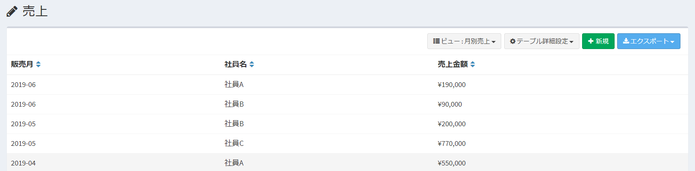
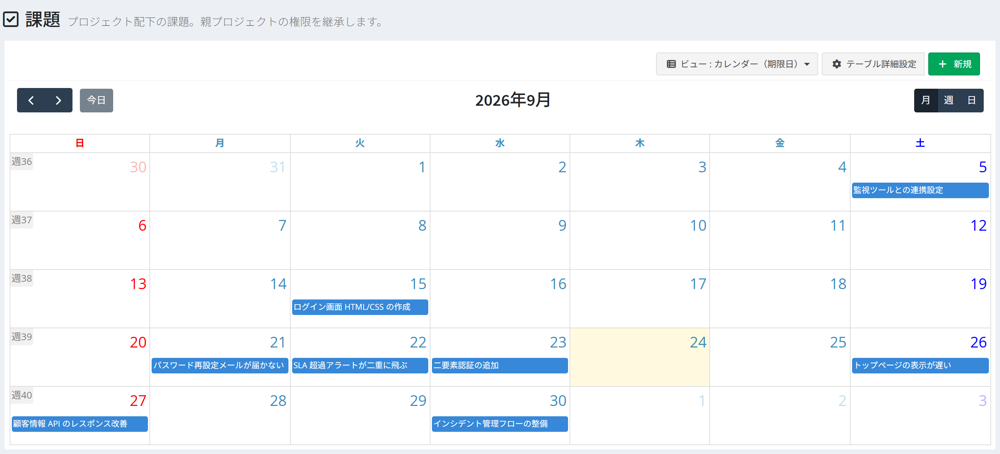
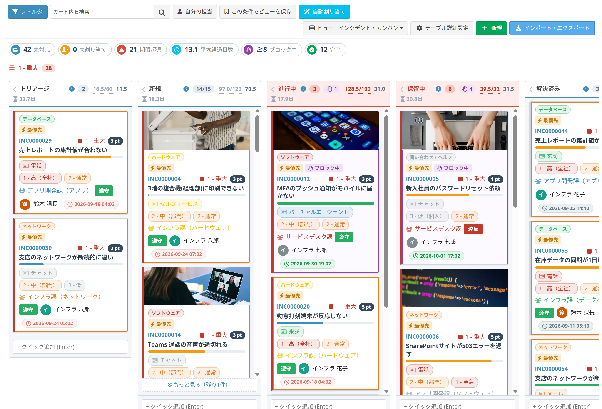
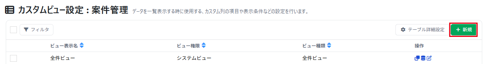
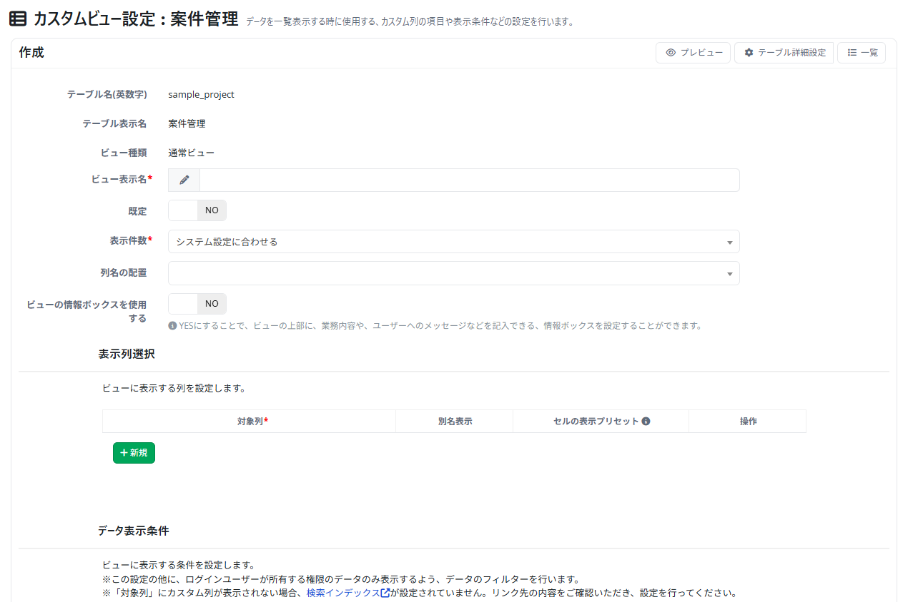
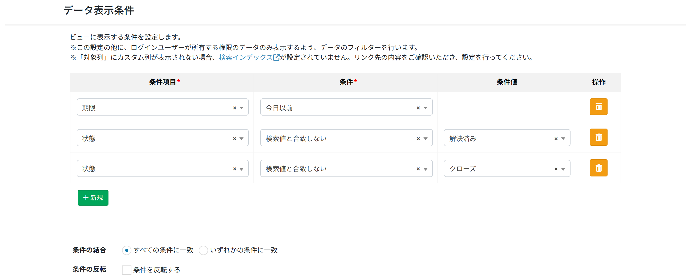
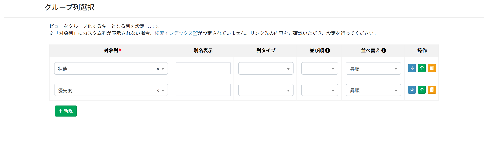
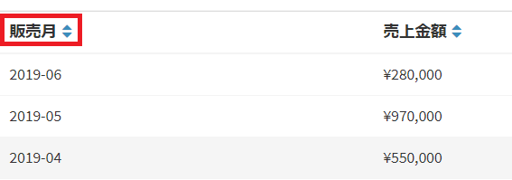
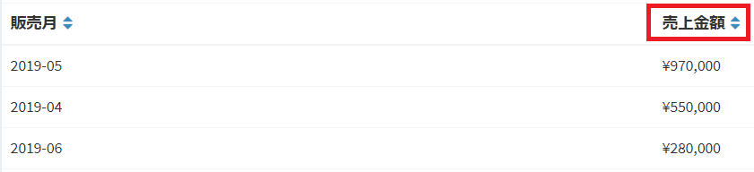
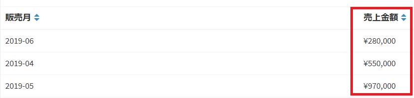

# カスタムビュー
ビューは、[データ一覧画面](/ja/data_grid.md)の「見せ方」です。どの列を出すか、どのデータに絞り込むか、どの順に並べるかを、ビューごとに決めます。  
このページでは、ビューの種類と、ビューの作り方・設定項目を説明します。

設定の流れは、次のとおりです。

1. ビューの一覧を開く（「ページ表示」）  
2. ［新規］で、作りたい種類のビューを選ぶ（「ビューの新規追加」）  
3. 設定項目を入力して、［送信］で保存する

## ビューの種類
今は、次の種類があります。

| 種類 | 使いみち |
|---|---|
| ビュー（通常ビュー） | データを一覧で見る |
| 集計ビュー | グループごとに、合計・件数などを見る |
| カレンダービュー | カレンダーの形で見る |
| カンバンビュー | 状態ごとの列に、カードの形で見る |
| ガントチャートビュー | 開始日から期限日までを、横棒で見る |
| 全件ビュー | システムが自動で作る、通常ビューと同じ形のビュー |
| 条件ビュー | 通知の条件などで、絞り込みだけに使う |

### ビュー（通常ビュー）

ふつうのビューで、データ一覧です。  
登録しているデータを一覧で出します。

### 集計ビュー

登録しているデータをグループにまとめて、合計、件数、最大値などの集計値を出します。  
ダッシュボードでは、グラフにできます。

### カレンダービュー

登録しているデータを、カレンダーの形で出します。

### カンバンビュー

登録しているデータを、状態ごとの列に、カードの形で出します。  
カードを別の列にドラッグすると、その項目の値を変えられます。  
くわしくは[カンバンビュー](/ja/view_kanban.md)をご覧ください。

### ガントチャートビュー
登録しているデータを、開始日から期限日(終了日)までの横棒（バー）で、時間の順に出します。  
くわしくは[ガントチャートビュー](/ja/view_gantt.md)をご覧ください。

### 全件ビュー
基本は通常ビューと同じですが、次の点が違います。  
- システムが自動で作ります。  
- 1件だけ作られます。ユーザーが新しく作ったり、削除したりすることはできません。  
- [検索](/ja/search)画面で、一覧を出すときに使われます。  
- 集計ビューから、その明細データを出すときに使われます。

### 条件ビュー
絞り込みだけに使うビューです。[通知](/ja/notify)の通知条件や、カスタム列の列設定が「選択肢 (他のテーブルの値一覧から選択)」のときの絞り込みに使われます。  
- 表示列の設定はありません。  
- データ一覧画面には出ません。  
- 設定できるのは管理者だけです。一般ユーザーは設定できません。

## ページ表示
- カスタムテーブル一覧で、設定したいテーブルにチェックを1つ入れ、右上の「テーブル詳細設定」をクリックします。  
  
- または、メニューから設定したいテーブルを選んでから、同じように右上の「テーブル詳細設定」をクリックします。  
※そのテーブルを、あらかじめメニューに出しておく必要があります。  
  
- テーブル詳細設定の画面で、ビュー設定のアイコンをクリックします。  

- これで、そのカスタムテーブルのビューの一覧が出ます。  

## ビューの新規追加
- 「カスタムビュー設定」画面で、ページ右上にある［新規］ボタンをクリックします。

ダイアログに出た中から、作りたい種類のボタンをクリックします。  
  
- ビューの新規追加画面が出ます。必要なことを入力します。

## ビューの設定項目
#### ビュー表示名
ビューの名前を入力します。  

#### ほかの言語の名前（v7.3.0 以降）
ビューの設定画面の「ほかの言語の名前」に、ユーザーが選べる言語ごとの入力欄があります（サイトの言語は除きます）。  
言語を選んでいるユーザーには、その言語の名前が表示されます。空のときは、上で入力した名前が表示されます。  
くわしくは [名前を言語ごとに持つ](/ja/name_locales) を見てください。

#### ビュー権限
だれがこのビューを使えるかを、システムビュー ・ ユーザービュー のどちらかで決めます。

- システムビュー  
設定できるのは、システム管理者だけです。  
テーブルへのアクセス権限がある全ユーザーが使えるビューです。

- ユーザービュー  
システム管理者でなくても設定できるビューです。  
作成したユーザーだけが使えるビューです。

※システムビューを、あとからユーザービューに変えることはできません。  
**システム管理者が作成したユーザービュー**は、あとからシステムビューに変えられます。  
※[ユーザービュー無効](/ja/config.md?id=ユーザービュー無効)の設定をすると、一般ユーザーはビューを作れなくなります。

#### 表示件数
データ一覧で、１ページに何件のデータを出すかを選びます。

#### 既定
ビューを複数作ったとき、ユーザーがデータ一覧を開くと最初に出るのは、「YES」にしているビューです。  
※「NO」にしているビューも、ビューの一覧から選べば表示できます。  
※「既定」を「YES」にできるのは、１つのカスタムテーブルで１つのビューだけです。  
２つ以上のビューで「YES」にすると、最後に「YES」にしたビュー以外は、「NO」に変わります。

#### ビューの情報ボックスを使用する
［YES］にすると、ビューの上に情報ボックスを出せます。  
タイトルや本文を入力して、業務の内容や、ユーザーへのメッセージを出せます。

#### 表示列選択
ビューに出す列の設定です。  
ここで設定した列が、データ一覧画面などに出ます。

##### 対象列
ビューに出す列です。  
  
##### 別名表示  
ここに入れた名前で、ビューに出ます。  

##### セルの表示プリセット  
このビューで、その列をどんな見た目で出すかを選びます。  
※カスタム列設定の内容より優先されます。くわしくは[表示プリセット](/ja/cell_style_preset.md)をご覧ください。  

##### ［↓］ボタン  
ビューに出す項目を、右に動かします。  

##### ［↑］ボタン  
ビューに出す項目を、左に動かします。  

##### ［削除］ボタン  
ビューの表示を削除します。

##### ［新規］ボタン  
ビューの表示列を新しく追加します。

#### データ表示条件
ビューに出すデータを絞り込む条件です。  
「期間内のものだけを出す」「特定のステータスのものだけを出す」のように絞り込みたいときに、条件を追加します。  
※この設定とは別に、ログインユーザーが権限を持つデータだけを出すように、絞り込みがかかります。権限のないデータは、この設定に関係なく出ません。

>条件項目の列種類が選択肢 (他のテーブルの値一覧から選択)の場合、条件値に出る文言は、[見出し表示列設定](/ja/table#見出し表示列設定)で変更できます。

##### 対象列　　
絞り込みの条件に使う列です。  
  
##### 条件
条件の内容を選びます。  
くわしくは、[検索条件について](/ja/view.md?id=検索条件について)をご確認ください。  

##### 検索値　　
条件と比べる値を入力します。  
  
##### ［削除］ボタン　　
ビューの表示条件を削除します。
  
##### ［新規］ボタン　　
ビューの表示条件を新しく追加します。

#####   条件の結合
「すべての条件に一致」を選ぶと、すべての条件に合うデータを出します。  
「いずれかの条件に一致」を選ぶと、どれか1つでも条件に合うデータを出します。

#####   条件の反転
「条件を反転する」にチェックを入れると、条件に合わないデータを出します。  
※集計ビューでは、条件の反転は使えません。

#### 検索条件について
「対象列」で選んだ列の種類（「日付」「ユーザー」など）によって、条件の選択肢が変わります。  
ここでは、説明がいる検索条件だけを書きます。

##### 対象列の種類が「日付」の場合
- X日前の日付以降  
- X日後の日付以降  
- X日前の日付以前  
- X日後の日付以前  
データの日付がその範囲に入っているときに、ビューに出ます。  

例：現在日付が1/15で、検索値を「8」で登録している場合  

##### 対象列の種類が「ユーザー」の場合
- ログインユーザーに合致する  
データの値が、ログインしているユーザーと同じときに、ビューに出ます。  

- ログインユーザーに合致しない    
データの値が、ログインしているユーザーと違うときに、ビューに出ます。  

#### データ並べ替え
ビューに出すデータの並べ替え(表示順序)を設定します。

 
##### 対象列  
並べ替えに使う列です。  

##### 並べ替え  
ソートを、「昇順(小さい順)」「降順（大きい順）」のどちらで実行するかを指定します。  

##### ［↓］ボタン  
優先度を下げて並び順で表示します。  

##### ［↑］ボタン  
優先度を上げて並び順で表示します。  

##### ［削除］ボタン  
ビューのデータ並べ替えを削除します。  

##### ［新規］ボタン　　
データの並べ替えを新しく追加します。

#### ビューの「フィルタ」項目指定

ビューの上に出る「フィルタ」で、選択肢として出す列を指定します。
  

##### 対象列  
「フィルタ」に出す列です。  

##### ［↓］ボタン  
「フィルタ」の項目表示を下に移行します。  

##### ［↑］ボタン  
「フィルタ」の項目表示を上に移行します。  

##### ［削除］ボタン  
ビューの「フィルタ」項目表示を削除します。  

##### ［新規］ボタン　　
ビューの「フィルタ」表示列を新しく追加します。  

## 集計ビューの新規追加
- 「カスタムビュー設定」画面で、ページ右上にある［新規］の「集計ビュー新規作成」をクリックします。

- 集計ビュー新規追加画面が出ます。必要なことを入力します。

## 集計ビューの設定項目

#### ビュー表示名・ビュー権限・既定
上の[ビューの設定項目](/ja/view.md?id=ビューの設定項目)と同じ設定項目です。

#### グループ列選択
ここで選んだ列の値ごとに、データをグループにまとめて集計します。  
複数の列を設定すると、複数の項目の組み合わせごとに分けて集計します。

##### 対象列  
グループにまとめるときの、もとにする列です。  

- 例1：対象列を２列設定すると、画像のように、２列の組み合わせでグループにまとめて集計します。  
※"売上金額"は、グループ列ではなく、集計列として設定している列です。

  

- 例2："販売月"の列だけをグループ列にすると、例1で"社員名"の列も含めて分かれていたデータが、1つの列のグループにまとまって集計されます。  

  

##### 別名表示　　
ここに入れた名前で、ビューに出ます。  

##### 列タイプ　　
対象列のカスタム列種類が「日付」または「日付と時刻」のときだけ、次の中から選べます。  
「年毎」「年月毎」「年月日毎」「月毎」「日毎」「曜日毎」  
対象列を、ここで選んだ日付の単位でグループにまとめます。  
※例1～3の画像は、販売月の列タイプを「年月毎」にしたときの表示です。

##### 並び順　　
集計ビューで、データを出す順番の設定です。  
どの列の値の大小を先に見てデータを並べるか、列の優先順位を決めます。  
順番は、グループ列選択と集計列選択の両方を合わせて付けます。  

- 例3：上の 例2 は、並び順で"販売月"の列を1、"売上金額"を2にしたときの表示です。並び順で"販売月"を2、"売上金額"を1にすると、下の画像のように、"売上金額"の列の値を優先した並び順になります。  

  

##### 並び替え  
対象列を、値の小さい順・大きい順のどちらで並べるかを設定します。  
「昇順(小さい順)」「降順(大きい順)」のどちらかを選びます。  

- 例4：上の 例3 は、並び替えで"売上金額"を降順にしたときの表示です。昇順にすると、下の画像のようになります。  

  

##### ［矢印］ボタン
集計ビューでの、列の並び順を設定します。  
グループ列選択で上にある項目ほど、集計ビューでは左に出ます。  

##### ［削除］ボタン  
ビューのグループ列を削除します。

##### ［新規］ボタン  
ビューのグループ列を新しく追加します。

#### 集計列選択
ここで選んだ列の値を集計します。  

##### 対象列  
値を集計する列です。  

##### 集計タイプ  
「合計」「件数」「最小値」「最大値」  
この4種類の集計タイプから選びます。選んだ集計の結果が、ビューの対象列に出ます。

##### 別名表示  
ここに入れた名前で、ビューに出ます。  

##### ［削除］ボタン  
ビューの集計列を削除します。
  
##### ［新規］ボタン  
ビューの集計列を新しく追加します。

#### 表示条件
ビューに出すデータを絞り込む条件です。  
「期間内のものだけを出す」「特定のステータスのものだけを出す」のように絞り込みたいときに、条件を追加します。  
※この設定とは別に、ログインユーザーが権限を持つデータだけを出すように、絞り込みがかかります。権限のないデータは、この設定に関係なく出ません。

>条件項目の列種類が選択肢 (他のテーブルの値一覧から選択)の場合、条件値に出る文言は、[見出し表示列設定](/ja/table#見出し表示列設定)で変更できます。

##### 対象列  
絞り込みの条件に使う列です。  
  
##### 検索条件  
条件の内容を選びます。  
くわしくは、[検索条件について](/ja/view.md?id=検索条件について)をご確認ください。  
  
##### 検索値  
条件と比べる値を入力します。  
  
##### ［削除］ボタン  
ビューの表示条件を削除します。
  
##### ［新規］ボタン  
ビューの表示条件を新しく追加します。

## カレンダービューの新規追加

- 「カスタムビュー設定」画面で、ページ右上にある［新規］の「カレンダービュー新規作成」をクリックします。

- カレンダービュー新規追加画面が出ます。必要なことを入力します。

## カレンダービューの設定項目

#### ビュー表示名・ビュー権限・既定
上の[ビューの設定項目](/ja/view.md?id=ビューの設定項目)と同じ設定項目です。

#### 表示列選択
ビューに出す列の設定です。  
カレンダービューでは、開始日と終了日を設定すると、日付列のデータを期間として出せます。  
※1日だけで出したいときは、開始日だけを指定してください。

##### 開始日  
期間の開始日にする列を設定してください。  
※終了日を設定しないときは、開始日に設定した列の日に、1日だけで出ます。

##### 終了日  
期間の終了日にする列を設定してください。

##### 表示色  
ビューに出すデータの背景色を設定します。

##### 文字色  
ビューに出すデータの文字色を設定します。

##### ［削除］ボタン  
ビューの表示を削除します。

##### ［新規］ボタン  
ビューの表示列を新しく追加します。

#### 表示条件
ビューに出すデータを絞り込む条件です。  
「期間内のものだけを出す」「特定のステータスのものだけを出す」のように絞り込みたいときに、条件を追加します。  
※この設定とは別に、ログインユーザーが権限を持つデータだけを出すように、絞り込みがかかります。権限のないデータは、この設定に関係なく出ません。

>条件項目の列種類が選択肢 (他のテーブルの値一覧から選択)の場合、条件値に出る文言は、[見出し表示列設定](/ja/table#見出し表示列設定)で変更できます。

##### 対象列  
絞り込みの条件に使う列です。  
  
##### 検索条件  
条件の内容を選びます。  
くわしくは、[検索条件について](/ja/view.md?id=検索条件について)をご確認ください。  
  
##### 検索値  
条件と比べる値を入力します。  
  
##### ［削除］ボタン  
ビューの表示条件を削除します。
  
##### ［新規］ボタン  
ビューの表示条件を新しく追加します。

#### カレンダービューにおける見出し
画像の例のように、カレンダービューでは、データの日付のところに見出しが出ます。  

- 出る見出しは、[見出し表示列設定](/ja/table#見出し表示列設定)で設定しているものです。

- また、表示列選択の開始日に、カスタム列の種類が「日付と時刻」の列を設定しているときは、データの時刻が見出しの先頭に出ます。  

## 保存
設定を入力したら、［送信］をクリックしてください。

## プレビュー
ビューの新規作成・編集画面で、ページ右上の［プレビュー］ボタンをクリックすると、入力中の設定でデータがどう見えるか（データ一覧・カンバン・ガントチャート）を、別ウィンドウで確かめられます。  
設定を保存する前に、見え方を確かめられます。

- ［プレビュー］ボタンが出るのは、通常ビュー・全件ビュー・カンバンビュー・ガントチャートビューです。集計ビュー・カレンダービュー・条件ビューなどでは出ません。  
- プレビューでは、設定は保存されません。設定を変えたあとで表示を新しくするには、元の画面でもう一度［プレビュー］ボタンをクリックしてください。  
- 「表示列選択」「データ表示条件」「データ並べ替え」で、対象列や条件が選ばれていない行は、プレビューには反映されません。その場合、プレビュー画面に「○ 件の行は、対象の列または条件が選ばれていないため、このプレビューでは表示していません。」と出ます。

## 編集
ビューを編集するには、その行の［編集］リンクをクリックしてください。  

## 削除
ビューを削除するには、その行の［削除］リンクをクリックしてください。  

## カスタムビューの複製
［このビューの複製］リンクをクリックすると、同じ設定で、ビュー表示名だけが空欄のビューが作られます。

## データ一覧表示
［このビューでデータ一覧表示］ボタンをクリックすると、そのビューの設定で、データ一覧が出ます。

## カスタムビューの共有
作成したカスタムビューを、ほかのユーザー・組織に共有します。  
※共有できるのは「ユーザービュー」だけです。（「システムビュー」は、はじめから、権限のあるすべてのユーザーに公開されています。）  
※共有先に選べるのは、テーブルへのアクセス権限があるユーザーまたは組織です。  

#### 共有方法
1. カスタムビューの編集画面にある「共有」ボタンをクリックします。  
※新規作成のときは、このボタンは出ません。  

2. カスタムビューの共有ダイアログが出ます。  

3. 共有したいユーザーまたは組織を追加して、「送信」をクリックします。これで共有できます。  
  
