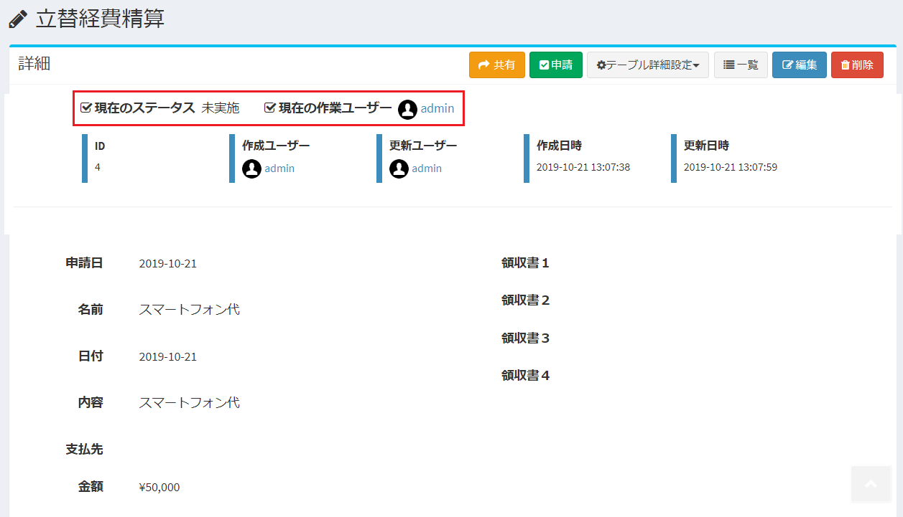
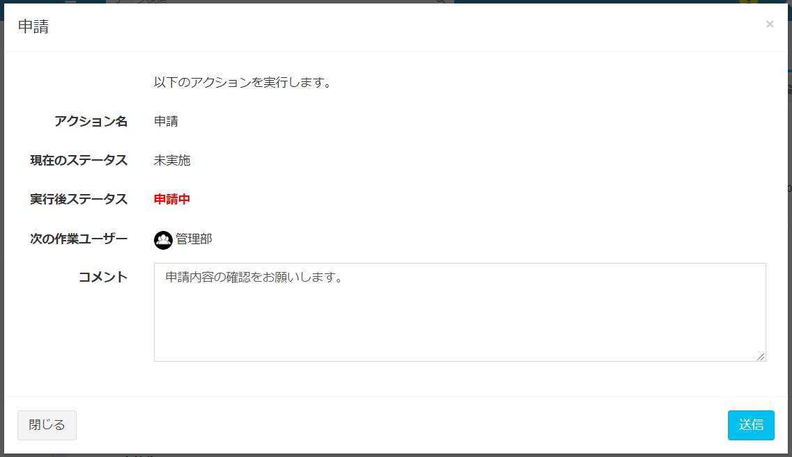

# ワークフロー実行
ワークフローのアクション（申請・承認など）を、ユーザーが実行する手順です。  
先に、管理者が[ワークフロー設定](/ja/workflow_example)を行っておく必要があります。

## ワークフロー実施
1. データを開くと、現在のステータスと、次にアクションを行う作業ユーザー・組織が表示されます。
  

2. ログインユーザーに次のアクションを行う権限があるときは、ページ右上にアクションボタンが表示されます。  
  

3. ボタンをクリックすると、アクションの実行確認ダイアログが表示されます。  
  

   - アクション名  
   今回実行するアクションの名称が表示されます。  

   - ステータス  
   このアクションを実行する前後のステータスが表示されます。  

   - 次の作業ユーザー  
   このアクション実行後の、作業ユーザー・組織が表示されます。  

   - コメント  
   アクション実施時のコメントを入力してください。  

4. 内容に問題がなければ、［送信］をクリックします。アクションが実行されます。

5. アクションが実行されると、「現在のステータス」や「現在の作業ユーザー」が変わります。  
※ワークフロー設定によっては、「現在のステータス」に鍵マークが表示されます。そのときは、データがロックされ、編集や削除ができなくなります。

  

※v7.1.0以降は、データ一覧でチェックした複数のデータのアクションを、まとめて実行することもできます。詳細は[データ一覧の操作ツール](/ja/data_grid_tools?id=ワークフローを実行)をご覧ください。

## 未処理タスクの確認
自分がアクションを実行する必要があるデータは、ページ右上の未処理タスクのアイコンや、未処理タスク一覧の画面で、すべてのテーブルからまとめて確認できます。  
詳細は[未処理タスク](/ja/workflow_task)をご確認ください。

## ワークフローのデータのリセット

進行中のワークフローのデータは、リセットできます。なんらかの理由で、ワークフローを進められなくなったときに実行してください。  
リセットは、コマンドで行います。プロジェクトのルートディレクトリで、以下のコマンドを実行してください。

~~~
php artisan exment:workflow-clear (テーブル名) (ID)

# 実行例 テーブル名"estimate"、 ID"6"のデータのワークフロー進行をリセットする場合
php artisan exment:workflow-clear estimate 6

# 実行例 テーブル名"syusseki"、 ID"600"のデータのワークフロー進行をリセットする場合
php artisan exment:workflow-clear syusseki 600
~~~
