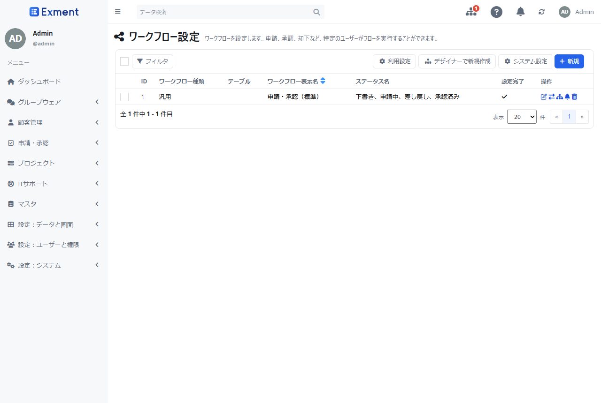
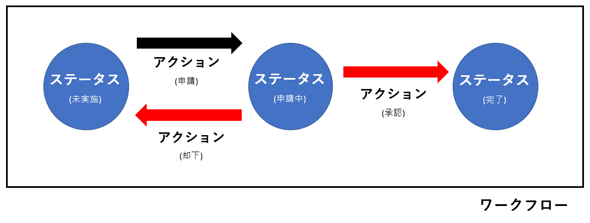
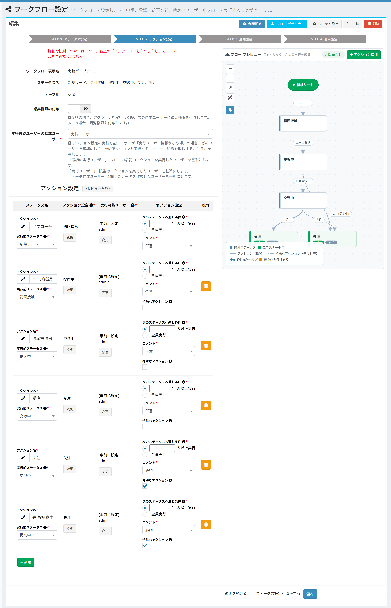
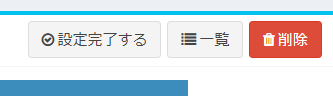

# ワークフロー設定
申請・承認などの「ワークフロー」を作って、テーブルで使えるようにするページです。システム管理者が設定します。

設定の流れは、次のとおりです。

1. **Step1.ステータス設定**：「未申請」「承認待ち」「完了」などの状態を決めます。
2. **Step2.アクション設定**：「申請」「承認」などの操作と、だれが実行できるかを決めます。
3. **設定完了する**：ワークフローの設定を完了します。このあとは、ステータスの追加・削除・順番変更ができません。
4. **Step3.通知設定**：ワークフローを実行したときに送る通知を決めます。
5. **Step4.利用設定**：どのテーブルで使うかを決めます。

※ステータスとアクションは、フロー図の上で直接作成・編集することもできます。詳細は[フロー デザイナー](/ja/workflow_design.md)をご参照ください。

## ワークフローとは
ワークフローとは、「業務の一連のやりとりの流れ」のことです。  
多くの業務には、「だれが始めて、だれが判断や処理をして、どう完了するか」という流れがあります。  
Exmentでワークフローを設定すると、たとえば次のような流れを実行できます。

  
- ユーザーは、管理部に経費を申請する
- 管理部は、経費申請を承認する。もしくは却下する
- 承認された経費は、以降データを修正することはできない

## 用語集
Exmentのワークフローで使う用語です。

  

##### ワークフロー  
申請や承認など、業務の流れ全体を表します。  

##### ステータス  
ワークフローの現在の状態を表します。  
例：未申請、承認待ち、完了  

##### アクション  
ユーザーが実行する操作です。実行すると、あるステータスから別のステータスに移ります。  
例：申請、承認、却下、差し戻し

##### 作業ユーザー  
次のアクションを実行する番のユーザーです。

## 一覧画面表示
システム管理者が、メニューの「管理者設定 > ワークフロー」をクリックします。  
保存されているワークフローの一覧が表示されます。

## 新規作成

1. 一覧画面右上の［新規］ボタンをクリックします。
2. ワークフロー作成画面の「Step1.ステータス設定」が表示されるので、必要事項を入力します。

### Step1.ステータス設定
ワークフローのステータスを設定します。

  

#### ワークフロー表示名 ※必須
- 画面に表示する、ワークフロー名称です。日本語の使用も可能です。(例：承認フロー)  

#### ワークフロー種類 ※必須
- 作成するワークフローの種類です。「汎用」もしくは「テーブル専用」のどちらかを選択してください。  
※作成後の変更はできません。  
##### 汎用  
複数のテーブルで、ワークフローを使用できます。  
「申請」「承認」「却下」など、標準的なステータス・アクションのみ使用したい場合にこちらを選択してください。  
##### テーブル専用  
新規作成時に選択したテーブルでしか使えません。そのかわり、そのテーブルのカスタム列を使って、アクションの実行先を変えられます。  
例：「経費精算」テーブルで、カスタム列「金額」が100,000円以上なら「部長承認」アクション、100,000円未満なら「課長承認」アクションを実行する、という切り分けができます。

#### 開始ステータス名 ※必須
- まだワークフローを実行していない状態でのステータス名を設定します。

#### ステータス設定
- ワークフローの設定や、使用するステータスを定義します。  
※表の最終行のステータスは、フロー完了を表すものとしてください。
##### ステータス名  
そのステータスの名称です。
##### データの編集不可  
このステータスのあいだ、対象のデータを編集できなくするかどうかです。編集させたくないときは、YESにしてください。  
例：「未申請」のときはデータを編集・削除できるが、「申請中」「完了」のときは編集・削除させたくない。この場合、「申請中」「完了」をYESにします。

### Step2.アクション設定

  
#### ワークフロー表示名  
ステータス設定で設定した表示名が表示されます。
#### ステータス名  
ステータス設定で設定したステータス名が表示されます。
#### 編集権限の付与  
ワークフロー実行時、「次の作業ユーザー」に編集権限を付与することができます。
#### 実行可能ユーザーの基準ユーザー ※必須  
アクションの実行可能ユーザーが「実行ユーザー情報取得」の場合に基準となるユーザーを設定します。「最初の実行ユーザー」「実行ユーザー」「データ作成ユーザー」から選択できます。

#### アクション設定
- ワークフローで実施するアクションを設定します。  
##### アクション名  
そのアクションの名称です。
##### 実行前ステータス  
そのアクションを実行するための、ステータス状態を設定します。  
例：実施前ステータスを「未実施」としていた場合、各データのステータスが「未実施」であれば、そのアクションを実行できる。  
##### アクション設定  
どのようなアクションを実行できるかを設定します。［変更］ボタンをクリックすることで、設定変更を行います。  
ワークフロー種類によって、設定内容が異なります。  

  ※ワークフロー種類が「汎用」の場合：  
    このアクションを実行した後のステータスを設定します。「実行前ステータス」とは別のアクションを選択してください。

  ※ワークフロー種類が「テーブル専用」の場合：  
アクションを実行する条件と実行後のステータスを設定します。条件とステータスの組合せは最大3つまで設定できます。

> 条件項目の列種類が選択肢 (他のテーブルの値一覧から選択)の場合、条件値に表示される文言は、[見出し表示列設定](/ja/table#見出し表示列設定)で変更できます。

#### 実行可能ユーザー  

このアクションを実行できるユーザー・組織などを選択します。［変更］ボタンをクリックすることで、設定変更を行います。
  

##### 実行可能ユーザー：前アクションの実行ユーザーが選択
アクションを実行するユーザーが、そのたびに、どのユーザー・組織あてにするかを選びます。  
  

##### 実行可能ユーザー：事前に設定
どのユーザー・組織あてにするかを、管理者があらかじめ決めておきます。フローは、その設定のとおりに進みます。  
  

**■設定項目**

- ユーザー  
指定したユーザーが、アクションを実行できます。  

- 組織  
指定した組織に所属するユーザーが、アクションを実行できます。  

- カスタム列  
対象データのカスタム列に設定されたユーザーまたは組織が、アクションを実行できます。「テーブル専用」のみの機能です。  

- システム > 作成ユーザー  
カスタムデータを作成したユーザーが、アクションを実行できます。

##### 実行可能ユーザー：実行ユーザー情報から取得
ワークフローを実行するユーザーの情報から、あて先を決めます。そのユーザーに設定されているユーザー・組織項目（上長など）の値を取り、そのユーザー・組織あてにアクションを実行します。

- 例1：ユーザーAの上長が「部長X」の場合、部長Xにアクションを実行
- 例2：ユーザーBの上長が「部長Y」「部長Z」の場合、部長Y・部長Zにアクションを実行
  

※この機能を実現するには、システム管理者があらかじめ、「ユーザー」テーブルに、カスタム列種類「ユーザー」「組織」の列を追加する必要があります。また、これらの列は「検索インデックス」をYESにする必要があります。

**■基準ユーザー**

実行可能ユーザーを取得する際の、基準となるユーザーです。[ワークフロー単位で設定](/ja/workflow_setting?id=実行可能ユーザーの基準ユーザー-必須)します。  

- 「最初の実行ユーザー」：フローの最初のアクションを実行したユーザーを基準にします。  
- 「実行ユーザー」：該当のアクションを実行したユーザーを基準にします。  
- 「データ作成ユーザー」：データを作成したユーザーを基準にします。  

> 基準ユーザーの違いによる動作の差異は、[ワークフロー例](/ja/workflow_example)をご確認ください。

**■カスタム列**

ユーザーテーブルの「ユーザー」列や「組織」列が、候補に表示されます。アクション実行時、基準ユーザーの該当列に設定されたユーザーまたは組織が、次のアクションを実行できます。  

#### オプション設定 > 次のステータスへ進む条件  
このアクションを何人が実行したら、次のステータスへ進むかを設定します。  
※ふつうは、1人が実行すればフローが進みます。「3人以上承認した場合のみ、次のステータスへ進む」「管理組織の全ユーザーが承認した場合のみ、次のステータスへ進む」のようにしたいときに、この設定値を変えてください。  

#### オプション設定 > コメント  
アクションを実行するときに、コメントを入力できるかどうかです。  
「必須」「任意」「使用しない」から選択できます。  
※「必須」に設定したアクションは、[LINE](/ja/line?id=lineからワークフローのアクションを実行する)の通知カードにボタンが表示されず、LINEから実行できません。

#### オプション設定 > 特殊なアクション  
チェックすると、このアクションの「実行可能ユーザー」を、現在の作業ユーザーに含めません。  
（現在の作業ユーザーとは、今のステータスで、なんらかのワークフローアクションを実行できるユーザーのことです）  
管理者が特例で承認するアクションなどに、チェックしてください。  
※作業ユーザーが、「特殊なアクション」にのみ割り振られていた場合、対象のユーザーには通知が行われません。また、「現在の作業ユーザー」にも表示されません。

※主な用途として、進行中のワークフローを管理者権限で最初に戻したり、特例でフローを完了まで持っていくためのアクションとなります。

#### 通常のアクションとの違い
| 概要 | 通常 | 特殊なアクション |
| ---- | ---- | ---- |
| 実行可能ユーザー設定 | 制限なし | 「事前に設定」のみ |
| 対象ユーザーへの通知 | 実施される | 実施されない |
| 「現在の作業ユーザー」への表示 | 表示される | 表示されない |
| [未処理タスク](/ja/workflow_task)への表示 | 表示される | 表示されない |

### 設定完了する
ステータス設定とアクション設定の両方を行うと、ページ右上に「設定完了する」ボタンが表示されます。  

  

クリックすると、ワークフローの設定を完了します。  
※設定完了すると、次のことができなくなります。 
- ステータスの追加、削除、順番変更

### Step3.通知設定
ステップ3・ステップ4は、［設定完了する］を実行した後に表示されます。  
ワークフローを実行したときに送る通知を設定します。設定項目は[通知・メール送信設定](/ja/notify.md)をご参照ください。

### Step4.利用設定
どのテーブルで、どのワークフローを実行するかを設定します。  
  

- テーブルごとに表示されるのは、「汎用」か、そのテーブル専用に作ったワークフローのうち、「設定完了済」のものです。

- ワークフローを使うときは、「使用する」チェックボックスにチェックしてください。  

- 日付でワークフローを切り替えるときは、「使用開始日」「使用終了日」に日付を入れます。期間が重ならないようにして、保存してください。

これで、ワークフロー設定が完了します。  
実際にワークフローを実行する場合には、[ワークフロー実施](/ja/workflow_execution)をご確認ください。

### ワークフローの削除
登録したワークフロー設定は、削除できます。  
すでに利用設定しているワークフロー設定を削除するときは、次の点にご注意ください。

- ワークフロー設定の復元が出来なくなります。
- 進行中のワークフローが無効化されます。
- **ステータス設定で「データの編集不可」設定がYESになっている場合でも、編集不可になっているデータが再度編集可になります。**

  

### その他の細かい仕様

- 「実行可能ユーザー：実行ユーザー情報から取得」「実行可能ユーザーの基準ユーザー：実行ユーザー」で、「オプション設定 > 次のステータスへ進む条件」を2人以上にした場合、次の作業ユーザーは、最後に実行したユーザーを基準に取得します。  
例：「次のステータスへ進む条件」を3人とした場合、「次のアクションを実行するユーザー」を取得する基準のユーザーは、3人目のアクション実施ユーザーのみです。1～2人目のユーザーの情報は取得しません。

- 「実行前ステータス」が同一のアクションで、「実行可能ユーザー：事前に設定」と「実行可能ユーザー：前アクションの実行ユーザーが選択」を同時に設定することはできません。(「実行可能ユーザー：事前に設定」を「特殊なアクション」にした場合は除く。)

- 「実行前ステータス」が同一のアクションで、「実行可能ユーザー：実行ユーザー情報から取得」と「実行可能ユーザー：前アクションの実行ユーザーが選択」を同時に設定することはできません。(「実行可能ユーザー：実行ユーザー情報から取得」を「特殊なアクション」にした場合は除く。)

