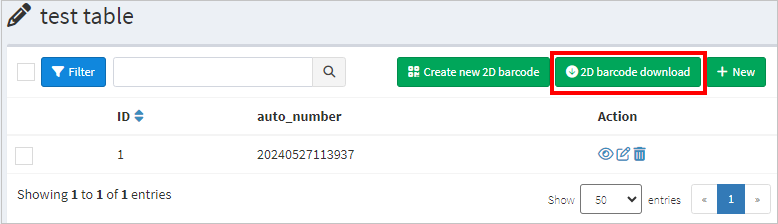

# 2차원 바코드 설정
테이블마다 2차원 바코드 라벨의 모양과, 읽어 들였을 때의 동작을 정하는 화면의 설명입니다.

쓰기까지의 순서는 다음과 같습니다.

1. 2차원 바코드 설정 화면을 엽니다
2. 설정하고 저장합니다
3. "활성화" 버튼을 누릅니다
4. 데이터 목록에서 2차원 바코드의 PDF를 만듭니다

## 2차원 바코드 기능의 개요
2차원 바코드 기능의 개요는 [공식 사이트의 게시글](https://exment.net/release_v6-1-0/)을 참고하십시오.

### 필요한 PHP 확장(라벨의 PDF)
2차원 바코드 라벨의 PDF를 만들려면 PHP의 gd 확장이 FreeType 포함(`imagettftext`를 쓸 수 있음)으로 설치되어 있어야 합니다. 설치되어 있지 않으면 라벨의 PDF를 만들 때 오류가 납니다.

- docker-exment를 쓰는 경우: docker-exment를 업데이트하고(2026-11-23의 PR #23 이후), php 이미지를 다시 만드십시오(`docker compose build php` 다음에 `docker compose up -d`).
- 다른 서버의 경우: FreeType이 포함된 gd를 설치하십시오(보통은 배포판의 php-gd 패키지에 들어 있습니다). 쓸 수 있는지는 다음 명령으로 확인할 수 있습니다. `bool(true)`라고 나오면 쓸 수 있습니다.

```
php -r 'var_dump(function_exists("imagettftext"));'
```

## 페이지 표시
- 사용자 정의 테이블 목록에서 설정할 테이블에 체크하고, 오른쪽 위의 "테이블 상세 설정"을 클릭합니다.  


> ※ 그 사용자 정의 테이블의 데이터 목록 화면이나 데이터 등록 화면에서 바로 이동할 수도 있습니다. 그 경우에도 오른쪽 위의 "테이블 상세 설정"을 클릭하십시오.  


- 테이블 상세 설정 화면에서 2차원 바코드 설정 아이콘을 클릭하면 2차원 바코드 설정 화면이 표시됩니다.  


## 2차원 바코드의 설정 항목


### 2차원 바코드 보충 정보
2차원 바코드의 오른쪽에 표시할 정보를 설정합니다.

- #### 제목
2차원 바코드의 오른쪽에 표시할 정해진 문구를 입력합니다.

- #### 표시 열
2차원 바코드의 오른쪽에 표시할 사용자 정의 데이터의 열을 고릅니다.   
ID 열, 또는 자동 번호 열(고유하고 필수일 것)을 고를 수 있습니다.

### 2차원 바코드 레이아웃 크기
2차원 바코드의 레이아웃 크기를 설정합니다. 
아래 표를 참고하십시오.

| Case | Cell width | Cell height | Margin right | Margin top | Column per page | Row per page | Column spacing | Row spacing |
| ---- | ---- | ---- | ---- | ---- | ---- | ---- | ---- | ---- |
| 2x5 | 84 | 52 | 17 | 10.5 | 2 | 5 | 8 | 4 |
| 2x6 | 83.8 | 42.3 | 19.3 | 21.5 | 2 | 6 | 3.8 | 0 |
| 2x7 | 83 | 32 | 20 | 24 | 2 | 7 | 4 | 4 |
| 3x6 | 63.5 | 46.5 | 7.2 | 9 | 3 | 6 | 2.55 | 0 |
| 3x7 | 63.5 | 38 | 7.2 | 15.5 | 3 | 7 | 2.55 | 0 |
| 3x8 | 56 | 30 | 17 | 14.5 | 3 | 8 | 4 | 4 |
| 3x9 | 62 | 31 | 9 | 9 | 3 | 9 | 3 | 0 |
| 3x10 | 53.3 | 25.4 | 19 | 21.5 | 3 | 10 | 3.8 | 0 |
| 3x12 | 60 | 20 | 12 | 12 | 3 | 12 | 3 | 3 |
| 4x11 | 48.3 | 25.4 | 8.4 | 8.8 | 4 | 11 | 0 | 0 |


### 2차원 바코드 읽기
2차원 바코드를 읽어 들였을 때의 동작을 설정합니다. 

- #### 2차원 바코드 읽기 후 폼
2차원 바코드를 읽어 들인 다음에 열 등록 폼을 고릅니다.  
그 테이블에 등록된 사용자 정의 폼 중에서 고를 수 있습니다. 

- #### 데이터 등록 후 액션  
데이터를 등록한 다음에 표시할 화면을 고릅니다.  
TOP 화면, 목록 화면, 상세 화면, 편집 화면, 카메라 실행 화면 중에서 고를 수 있습니다.

설정했으면 "저장" 버튼을 클릭합니다.  

### 2차원 바코드 설정을 활성화하기  
- 그 테이블에서 2차원 바코드 기능을 쓸 수 있게 하려면 "활성화"해야 합니다. 한 번 저장한 다음, 페이지 오른쪽 위의 "활성화" 버튼을 클릭하십시오.


## 2차원 바코드 새로 만들기
- 2차원 바코드 기능을 활성화하면 그 테이블의 데이터 목록에 "2차원 바코드 새로 만들기" 버튼이 나옵니다.  
버튼 이름 중 "2차원 바코드" 부분은 .env 파일의 "EXMENT_TEXT_QR_BUTTON_JA/EN"으로 바꿀 수 있습니다.  


- "2차원 바코드 새로 만들기"를 클릭하면 2차원 바코드 새로 만들기 화면이 표시됩니다.

- 2차원 바코드의 건수를 입력하고 저장하면 그 수만큼 데이터가 만들어지고, 2차원 바코드의 PDF도 출력됩니다.


## 2차원 바코드 다운로드
- 2차원 바코드 기능을 활성화하면 그 테이블의 데이터 목록에 "2차원 바코드 다운로드" 버튼이 나옵니다.  
버튼 이름 중 "2차원 바코드" 부분은 .env 파일의 "EXMENT_TEXT_QR_BUTTON_JA/EN"으로 바꿀 수 있습니다.


- 데이터를 고르고 "2차원 바코드 다운로드"를 클릭하면, 고른 데이터의 2차원 바코드가 PDF로 출력됩니다.


## Exment에서 카메라 화면 실행
- Exment의 대시보드에서 2차원 바코드를 읽어 들이기 위한 카메라 화면을 실행할 수 있습니다.

- 대시보드에 아이템 "2차원/JAN 바코드"를 추가하는 절차는 [대시보드](/ko/dashboard)를 참고하십시오.
