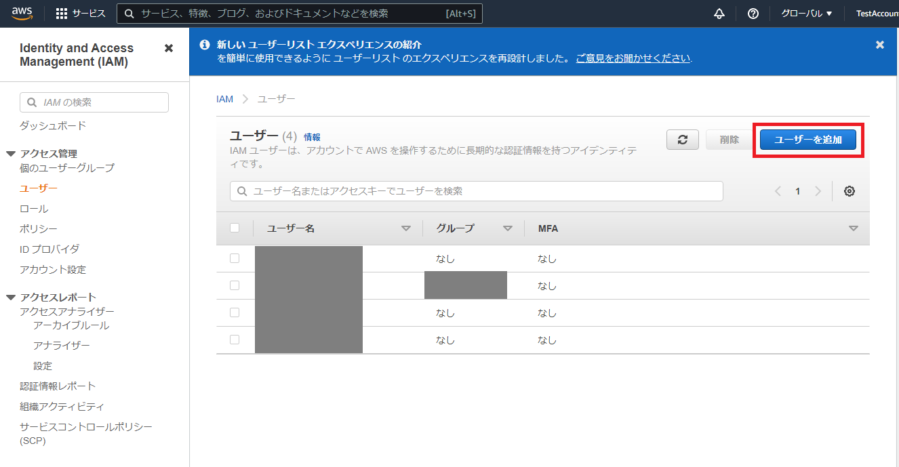
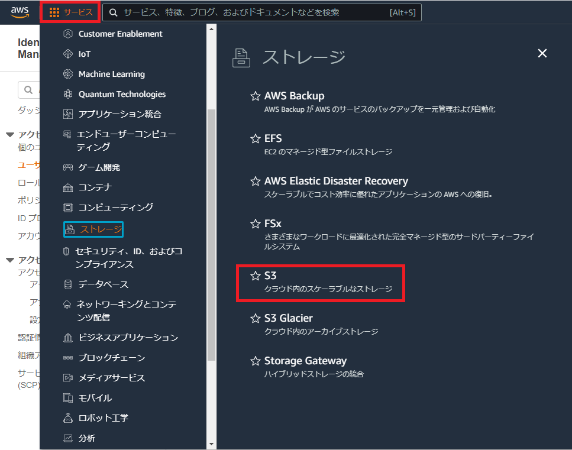
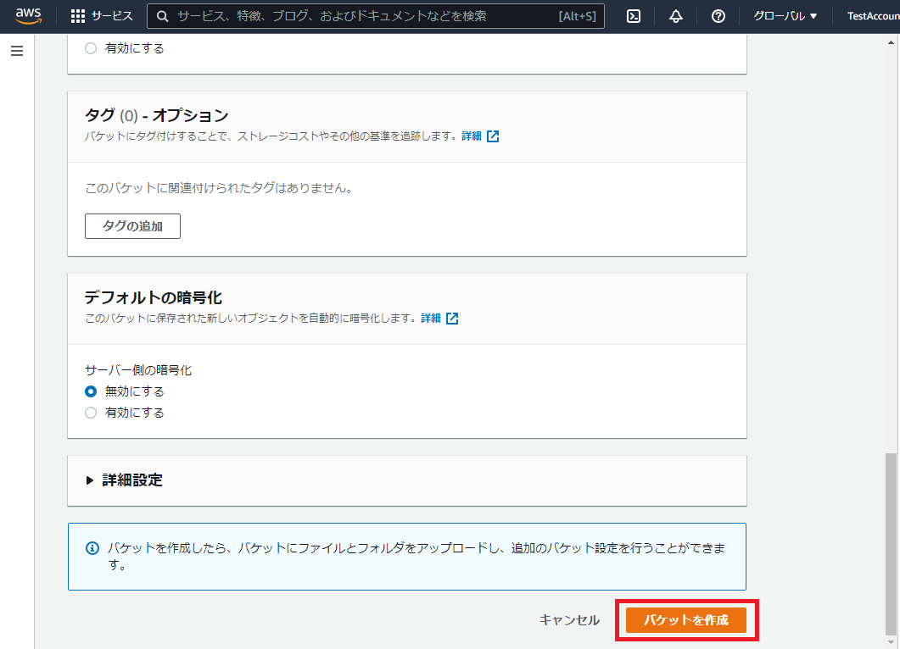
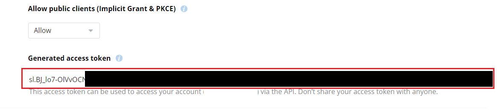

# (고급 사용자용) 파일 저장 위치 변경
첨부 파일이나 백업 등의 파일을 웹 서버가 아닌 곳(FTP나 Amazon S3 등)에 저장하기 위한 설정입니다.  
표준 설정에서는 첨부 파일이 웹 서버에 저장됩니다. 예를 들어 다음과 같은 경우에 저장 위치를 바꿉니다.

- 백업 파일을 FTP에 저장한다
- 이중화를 위해 파일을 AWS S3에 저장한다

설정은 다음 순서로 합니다.

1. 저장 위치를 바꾸려는 "파일의 종류"와, 사용하려는 "업로드 위치(드라이버)"를 정합니다.
2. "공통 설정"에서 파일의 종류별로 드라이버를 지정합니다.
3. "드라이버별 설정"에서 접속 대상의 정보를 설정합니다.

## 파일의 종류
현재 Exment에는 다음과 같은 파일의 종류가 있습니다. 저장 위치는 종류별로 정할 수 있습니다.  
※ 키 이름은 이 뒤의 설정에서 사용합니다.

| 파일의 종류 | 내용 | 키 이름 |
| ---- | ---- | ---- |
| **첨부 파일** | 화면에서 저장하는, 데이터의 첨부 파일 | exment |
| **백업** | 백업 화면에서 실행하는, Exment 데이터의 백업 파일 | backup |
| **플러그인** | Exment의 확장 기능으로 업로드한 플러그인 파일 | plugin |
| **템플릿** | Exment의 사용자 정의 테이블이나 사용자 정의 열 등의 설정 파일 | template |


## 업로드 위치(드라이버)의 종류
현재 Exment는 다음 업로드 위치(드라이버)를 지원합니다.  
※ 키 이름은 이 뒤의 설정에서 사용합니다.

| 업로드 위치(드라이버) | 저장하는 곳 | 키 이름 |
| ---- | ---- | ---- |
| **로컬(기본)** | 웹 서버 | local |
| **FTP** | FTP | ftp |
| **SFTP** | SFTP | sftp |
| **Amazon S3** | Amazon S3 | s3 |
| **Azure Blob** | Azure Blob | azure |

> v3.6.2부터 자체 드라이버를 지원합니다. 자세한 내용은 이 페이지 아래쪽의 "자체 드라이버 추가"를 확인하십시오.

## 설정 방법

### 공통 설정
- ".env"를 열고, 바꾸려는 파일의 종류별로 드라이버를 지정합니다.

~~~
EXMENT_DRIVER_EXMENT=(첨부 파일에서 사용할 드라이버의 키 이름)
EXMENT_DRIVER_BACKUP=(백업에서 사용할 드라이버의 키 이름)
EXMENT_DRIVER_TEMPLATE=(템플릿에서 사용할 드라이버의 키 이름)
EXMENT_DRIVER_PLUGIN=(플러그인에서 사용할 드라이버의 키 이름)

// 예 1: 백업 위치만 FTP로 하려는 경우
EXMENT_DRIVER_BACKUP=ftp

// 예 2: 모든 업로드 위치를 Amazon S3로 바꾸려는 경우
EXMENT_DRIVER_EXMENT=s3
EXMENT_DRIVER_BACKUP=s3
EXMENT_DRIVER_TEMPLATE=s3
EXMENT_DRIVER_PLUGIN=s3
~~~

### 처음 설치한 버전이 v3.0.8 미만인 경우
Exment를 처음 설치한 버전이 v3.0.8 미만이면 다음 수정이 필요합니다.  
(처음 설치한 버전을 모르는 경우에는 만일을 위해 확인하십시오)

- 프로젝트 루트 폴더의 "config/exment.php"를 엽니다.

- 다음과 같은 기술을 찾습니다.

~~~ php
    /*
    |--------------------------------------------------------------------------
    | driver
    |--------------------------------------------------------------------------
    |
    | file upload driver
    |
    */
    'driver' => [
        'default' => env('EXMENT_DRIVER_DEFAULT', 'local'),
    ],
~~~

- 이 기술을 다음과 같이 바꿉니다.

~~~ php
    /*
    |--------------------------------------------------------------------------
    | driver
    |--------------------------------------------------------------------------
    |
    | file upload driver
    |
    */
    'driver' => [
        'exment' => env('EXMENT_DRIVER_EXMENT', 'local'), //수정
        'backup' => env('EXMENT_DRIVER_BACKUP', 'local'), //추가
        'plugin' => env('EXMENT_DRIVER_PLUGIN', 'local'), //추가
        'template' => env('EXMENT_DRIVER_TEMPLATE', 'local'), //추가
    ],
~~~

### (1 권장) 드라이버별 설정 - config와 .env 설정
config에 적는 내용은 최소한으로 하고, 설정값은 .env에 적는 방법입니다.  
설정값을 파일의 종류 사이에서 함께 쓸 수 있으므로, 비교적 쉽게 설정할 수 있습니다.

#### FTP

- 다음 명령을 실행합니다.

~~~
composer require league/flysystem-ftp ~3.0
~~~

- "config/filesystems.php"를 열고 "disks.ftp"의 설정값을 확인합니다.  
없으면 다음 설정을 추가합니다.

~~~php
    'disks' => [
        // 여기부터 추가
        'ftp' => [
            'driver'   => 'ftp',
            'host'     => env('FTP_HOST'),
            'username' => env('FTP_USERNAME'),
            'password' => env('FTP_PASSWORD'),
    
            // FTP 설정의 옵션
            'port'     => env('FTP_PORT', 21),
            'ssl'      => env('FTP_SSL', false),
            'timeout'  => env('FTP_TIMEOUT', 30),
        ],
    ],
~~~

- ".env"를 열고 다음 내용을 추가합니다.  

~~~
FTP_HOST=(FTP의 호스트 이름)
FTP_USERNAME=(FTP의 사용자 이름)
FTP_PASSWORD=(FTP의 비밀번호)
~~~

- FTP를 사용하려는 파일의 종류별로 다음 설정을 추가합니다.

~~~
FTP_ROOT_EXMENT=(첨부 파일에서 사용할 FTP의 루트 경로)
FTP_ROOT_BACKUP=(백업에서 사용할 FTP의 루트 경로)
FTP_ROOT_TEMPLATE=(템플릿에서 사용할 FTP의 루트 경로)
FTP_ROOT_PLUGIN=(플러그인에서 사용할 FTP의 루트 경로)

// 예 1: 백업의 FTP 루트 경로를 지정
FTP_ROOT_BACKUP=/var/foo/exment/ftp/backup

// 예 2: 모든 FTP 루트 경로를 지정
FTP_ROOT_EXMENT=/var/foo/exment/ftp/admin
FTP_ROOT_BACKUP=/var/foo/exment/ftp/backup
FTP_ROOT_TEMPLATE=/var/foo/exment/ftp/template
FTP_ROOT_PLUGIN=/var/foo/exment/ftp/plugin
~~~


#### SFTP

- 다음 명령을 실행합니다.

~~~
composer require league/flysystem-sftp-v3 ~3.0
~~~

- "config/filesystems.php"를 열고 "disks.sftp"의 설정값을 확인합니다.  
없으면 다음 설정을 추가합니다.

~~~php
    'disks' => [

        // 여기부터 추가
        'sftp' => [
            'driver'   => 'sftp',
            'host'     => env('SFTP_HOST'),
            'username' => env('SFTP_USERNAME'),
            'password' => env('SFTP_PASSWORD'),

            // SSH key 기반 인증의 설정(필요한 경우에만 기입)
            // 'privateKey' => env('SFTP_PRIVATE_KEY'),
            // 'password' => env('SFTP_PASSWORD'),

            // FTP 설정의 옵션
            'port' => env('SFTP_PORT', 22),
            'timeout' => env('SFTP_TIMEOUT', 30),
        ],
    ],
~~~

- ".env"를 열고 다음 내용을 추가합니다.  

~~~
SFTP_HOST=(SFTP의 호스트 이름)
SFTP_USERNAME=(SFTP의 사용자 이름)
SFTP_PASSWORD=(SFTP의 비밀번호)
~~~

- SFTP를 사용하려는 파일의 종류별로 다음 설정을 추가합니다.

~~~
SFTP_ROOT_EXMENT=(첨부 파일에서 사용할 SFTP의 루트 경로)
SFTP_ROOT_BACKUP=(백업에서 사용할 SFTP의 루트 경로)
SFTP_ROOT_TEMPLATE=(템플릿에서 사용할 SFTP의 루트 경로)
SFTP_ROOT_PLUGIN=(플러그인에서 사용할 SFTP의 루트 경로)

// 예 1: 백업의 SFTP 루트 경로를 지정
SFTP_ROOT_BACKUP=/var/foo/exment/sftp/backup

// 예 2: 모든 SFTP 루트 경로를 지정
SFTP_ROOT_EXMENT=/var/foo/exment/sftp/admin
SFTP_ROOT_BACKUP=/var/foo/exment/sftp/backup
SFTP_ROOT_TEMPLATE=/var/foo/exment/sftp/template
SFTP_ROOT_PLUGIN=/var/foo/exment/sftp/plugin
~~~


#### Amazon S3
- 먼저 [AWS S3의 버킷 만들기, IAM 만들기](/ko/additional_file_saveplace?id=S3용-IAM-만들기)를 합니다.  
※ 여러 파일의 종류에 대응시키려면 파일의 종류별로 버킷을 나누어 만드십시오

- 다음 명령을 실행합니다.

~~~
composer require league/flysystem-aws-s3-v3 ~3.0
~~~

- "config/filesystems.php"를 열고 "disks.s3"의 설정값을 확인합니다.  
없으면 다음 설정을 추가합니다.

~~~php
    'disks' => [

        // 여기부터 추가
        's3' => [
            'driver' => 's3',
            'key' => env('AWS_ACCESS_KEY_ID'),
            'secret' => env('AWS_SECRET_ACCESS_KEY'),
            'region' => env('AWS_DEFAULT_REGION'),

            // 아래는 PrivateLink 사용 등으로 엔드포인트를 바꾸는 경우에만 기입
            'endpoint' => env('AWS_ENDPOINT'),
        ],
    ],
~~~

- 다음 내용을 ".env"에 추가합니다.  

~~~
AWS_ACCESS_KEY_ID=(AWS S3의 액세스 키)
AWS_SECRET_ACCESS_KEY=(AWS S3의 시크릿 액세스 키)
AWS_DEFAULT_REGION=(AWS S3의 리전)
#아래는 PrivateLink 사용 등으로 엔드포인트를 바꾸는 경우에만 기입
AWS_ENDPOINT=(AWS S3의 엔드포인트)
~~~

> **액세스 키를 사용하지 않고 IAM 역할로 접속하는 경우**
> "AWS_ACCESS_KEY_ID"와 "AWS_SECRET_ACCESS_KEY"를 둘 다 설정한 경우에만 그 액세스 키로 접속합니다.
> 둘 중 하나라도 설정하지 않으면 AWS SDK의 기본 방법으로 인증 정보를 가져옵니다(환경 변수, 공유 인증 정보 파일, ECS 태스크나 EC2 인스턴스의 IAM 역할 등).
> EC2나 ECS에 IAM 역할을 할당한 경우에는, 이 2가지를 기입하지 않으면 액세스 키를 저장하지 않고 S3에 접속할 수 있습니다. "AWS_DEFAULT_REGION"과 버킷의 설정은 필요합니다.

- Amazon S3를 사용하려는 파일의 종류별로 다음 설정을 추가합니다.

~~~
AWS_BUCKET_EXMENT=(첨부 파일에서 사용할 AWS S3의 버킷)
AWS_BUCKET_BACKUP=(백업에서 사용할 AWS S3의 버킷)
AWS_BUCKET_TEMPLATE=(템플릿에서 사용할 AWS S3의 버킷)
AWS_BUCKET_PLUGIN=(플러그인에서 사용할 AWS S3의 버킷)

// 예 1: 백업의 AWS S3 버킷을 지정
AWS_BUCKET_BACKUP=exment_backup

// 예 2: 모든 AWS S3 버킷을 지정
AWS_BUCKET_EXMENT=exment_default
AWS_BUCKET_BACKUP=exment_backup
AWS_BUCKET_TEMPLATE=exment_template
AWS_BUCKET_PLUGIN=exment_plugin
~~~

- 첨부 파일의 저장 위치를 Amazon S3로 한 경우, 첨부 파일을 다운로드할 때는 Amazon S3의 임시 URL(서명된 URL)로 리디렉션됩니다. 브라우저가 Exment를 거치지 않고 Amazon S3에서 직접 파일을 다운로드합니다.  
그래서 사용자의 브라우저에서 Amazon S3(의 엔드포인트)에 접속할 수 있어야 합니다.  
※ 임시 URL의 유효 기간(분)은 ".env"의 "EXMENT_FILE_DOWNLOAD_TEMPORARY_URL_MINUTES"로 바꿀 수 있습니다(기본값은 15). 자세한 내용은 [여기](/ko/config)를 확인하십시오.


#### Azure Blob
- Azure의 Blob을 만듭니다.  
※ 여러 파일의 종류에 대응시키려면 파일의 종류별로 컨테이너를 나누어 만드십시오

- 다음 명령을 실행합니다.

~~~
composer require league/flysystem-azure-blob-storage ~3.0
~~~

- "config/filesystems.php"를 열고 "disks.azure"의 설정값을 확인합니다.  
없으면 다음 설정을 추가합니다.

~~~php
    'disks' => [
        // 여기부터 추가
        'azure' => [
            'driver' => 'azure',
            'account' => env('AZURE_STORAGE_ACCOUNT'),
            'key' => env('AZURE_STORAGE_KEY'),
        ],
    ],
~~~

- 다음 내용을 ".env"에 추가합니다.  

~~~
AZURE_STORAGE_ACCOUNT=(Azure Blob의 계정)
AZURE_STORAGE_KEY=(Azure Blob의 액세스 키)
~~~

- Azure Blob을 사용하려는 파일의 종류별로 다음 설정을 추가합니다.

~~~
AZURE_STORAGE_CONTAINER_EXMENT=(첨부 파일에서 사용할 Azure Blob의 컨테이너)
AZURE_STORAGE_CONTAINER_BACKUP=(백업에서 사용할 Azure Blob의 컨테이너)
AZURE_STORAGE_CONTAINER_TEMPLATE=(템플릿에서 사용할 Azure Blob의 컨테이너)
AZURE_STORAGE_CONTAINER_PLUGIN=(플러그인에서 사용할 Azure Blob의 컨테이너)

// 예 1: 백업의 Azure Blob 컨테이너를 지정
AZURE_STORAGE_CONTAINER_BACKUP=exment_backup

// 예 2: 모든 Azure Blob 컨테이너를 지정
AZURE_STORAGE_CONTAINER_EXMENT=exment_default
AZURE_STORAGE_CONTAINER_BACKUP=exment_backup
AZURE_STORAGE_CONTAINER_TEMPLATE=exment_template
AZURE_STORAGE_CONTAINER_PLUGIN=exment_plugin
~~~


### (2 비권장) 드라이버별 설정 - config에 개별로 지정
파일의 종류별로 각 드라이버 정보를 config에 세밀하게 설정하는 방법입니다.

#### 예: FTP
- "config/filesystems.php"를 열고 다음 값을 추가합니다.  

~~~php
    'disks' => [
        // 파일의 종류가 백업인 경우, 여기부터 추가
        'backup' => [ // 파일의 종류의 키 이름을 입력
            'driver'   => 'ftp',
            'host'     => env('FTP_HOST'),
            'username' => env('FTP_USERNAME'),
            'password' => env('FTP_PASSWORD'),
            'root' => env('FTP_ROOT'),
    
            // FTP 설정의 옵션
            'port'     => env('FTP_PORT', 21),
            'ssl'      => env('FTP_SSL', false),
            'timeout'  => env('FTP_TIMEOUT', 30),
        ],

        // 다른 파일 종류의 드라이버를 바꾸려면 여기에 같은 방식의 설정을 기재
    ],
~~~

- ".env"를 열고, 위의 "env" 함수 안에 적힌 설정값을 추가합니다.

- 다른 파일 종류의 드라이버를 바꾸려면 ".env" 파일에 설정을 추가하십시오.


### 주의 사항
- 서버에 따라서는 파일을 저장하지 못할 수 있습니다.  
특히 임대 서버에서는 **제공 회사의 설정으로 FTP 등이 제한되어 있을 수 있습니다**. 미리 양해해 주십시오.


## (고급 사용자·개발자용) 자체 드라이버 추가
Exment는 표준으로 FTP나 Amazon S3 같은 드라이버를 지원합니다.  
여기서는 표준으로는 지원하지 않는 자체 드라이버를 사용하는 방법을 설명합니다.  

### 전제
- ※ Exment에서는 앞에서 설명한 "파일의 종류(첨부 파일, 백업, 플러그인, 템플릿)"별로 루트 폴더를 나누어야 합니다.  

- 사용하는 파일 시스템에 루트 폴더를 나누는 기능이 없으면, 업로드 위치를 바꾸거나 파일의 종류별로 애플리케이션을 만드는 등의 대응이 필요합니다.

### 이용 조건
Exment에서는 [Laravel의 파일 시스템](https://readouble.com/laravel/12.x/ja/filesystem.html) 기능을 사용하여 자체 드라이버를 관리합니다.  
그래서 Laravel의 파일 시스템이 준비되어 있는 서비스만 Exment의 파일 관리에 대응합니다. (또는 직접 드라이버를 준비해야 합니다.)

### 개발 방법
여기서는 예로, 파일의 업로드 위치를 Dropbox로 하는 방법을 설명합니다.  
※ Dropbox 쪽의 설정은 [참고: Dropbox의 액세스 토큰 가져오는 방법](/ko/additional_file_saveplace?id=참고:-Dropbox의-액세스-토큰-가져오는-방법)을 확인하십시오.  

#### 필요한 패키지 가져오기
Laravel에서 Dropbox를 관리하는 데 필요한 패키지를 추가합니다.

```
composer require spatie/flysystem-dropbox=^2.0.5
```

#### 파일 만들기·추가
다음 파일을 추가하거나 내용을 덧붙입니다.

- ##### 어댑터
"app/Exment/Driver" 폴더를 새로 만들고, 파일 "ExmentAdapterDropbox.php"를 만듭니다.

``` php
<?php

namespace App\Exment\Driver;

use Spatie\FlysystemDropbox\DropboxAdapter;

use Exceedone\Exment\Model\File;
use Exceedone\Exment\Enums\Driver;
use Exceedone\Exment\Storage\Adapter\ExmentAdapterInterface2;
use Exceedone\Exment\Storage\Adapter\AdapterTrait;

// (1) DropboxAdapter를 상속. ※ DropboxAdapter는 \League\Flysystem\Adapter\AbstractAdapter를 상속
// (2) ExmentAdapterInterface 또는 ExmentAdapterInterface2를 구현
class ExmentAdapterDropbox extends DropboxAdapter implements ExmentAdapterInterface2
{
    //(3) AdapterTrait를 use한다
    use AdapterTrait;
    
    /**
     * (4) 파일의 URL을 가져온다. 기본적으로는 아래 처리를 그대로 사용하십시오
     */
    public function getUrl(string $path): string
    {
        return File::getUrl($path);
    }
    
    /**
     * (5) 어댑터의 인스턴스를 만들 때 호출되는 메서드
     */
    public static function getAdapter($app, $config, $driverKey)
    {
        $mergeConfig = static::getConfig($config);

        $client = new \Spatie\Dropbox\Client(array_get($mergeConfig, 'token'));

        // Let's teach Flysystem to interact with Dropdox,
        // thanks to an adapter made by Spatie as usual.
        $driver = new self($client);
        return $driver;
    }


    /**
     * (6) 설정 파일의 병합
     * @param string $mergeFrom 'exment', 'backup', 'plugin', 'template' 문자열
     */
    public static function getMergeConfigKeys(string $mergeFrom, array $options = []) : array{
        return [
            'token' => config('filesystems.disks.dropbox.access_token_' . $mergeFrom),
        ];
    }

    /**
     * (7) 설정 정보 가져오기
     * *Exment5.0.0부터 필요한 항목*
     *
     * @param array $config
     * @return array
     */
    public static function getConfig($config) : array
    {
        $mergeFrom = array_get($config, 'mergeFrom');
        $mergeConfig = static::mergeFileConfig('filesystems.disks.dropbox', "filesystems.disks.$mergeFrom", $mergeFrom); // "dropbox" 부분만 직접 적은 어댑터 이름으로 바꾸십시오
        return $mergeConfig;
    }
}

```

```
(1) 어댑터 파일에서는 \League\Flysystem\Adapter\AbstractAdapter를 상속하도록 하십시오.  
Dropbox에서는 \Spatie\FlysystemDropbox\DropboxAdapter가 위 클래스를 상속하고 있으므로, 그것을 상속하십시오.  

(2) \Exceedone\Exment\Storage\Adapter\ExmentAdapterInterface2 또는 \Exceedone\Exment\Storage\Adapter\ExmentAdapterInterface를 구현하십시오.  
※ ExmentAdapterInterface와 ExmentAdapterInterface2는 함수 getUrl의 인수와 반환값에 형이 명시되어 있는지 여부만 다릅니다.  

(3) AdapterTrait를 use하십시오.  

(4) 기본적으로는 적혀 있는 처리를 그대로 사용하십시오.  

(5) 어댑터의 인스턴스를 만들 때 호출되는 메서드입니다. 기본적으로 각 파일 서비스의 인스턴스 생성 방법에 따라 구현하십시오.  

(6) 설정 정보에 병합할 키 값과 설정값의 쌍을 연관 배열로 설정합니다.  

(7) 병합이 끝난 설정 정보를 반환합니다. 기본적으로 "dropbox" 부분만 직접 적은 어댑터 이름으로 바꾸고, 그대로 복사해 붙여 넣으십시오.
  ※ Exment5.0.0부터 필요해진 항목입니다.

※ Exment에서는 앞에서 설명한 "파일의 종류(첨부 파일, 백업, 플러그인, 템플릿)"별로 루트 폴더를 나누어야 합니다.  
Dropbox의 경우, 같은 앱에서 루트 폴더를 나누는 기능이 없습니다.  
그래서 파일의 종류별로 개별 Dropbox 앱을 만들어야 합니다.  
이 병합 처리는 파일의 종류별로 각각 만들어지는 액세스 토큰을 설정값으로 나누어 넣기 위한 처리입니다.
```

    
- ##### 훅
"app/Exment" 폴더의 "bootstrap.php"에 다음을 덧붙입니다.

``` php
<?php
// \Exceedone\Exment\Enums\Driver::extend 메서드 실행
// 첫 번째 인수: 어댑터의 키 이름
// 두 번째 인수: 구현한 Adapter의 경로
\Exceedone\Exment\Enums\Driver::extend('dropbox', \App\Exment\Driver\ExmentAdapterDropbox::class);

```

    
- ##### 설정값
"config" 폴더의 "filesystems.php"에 다음을 덧붙입니다.  
파일의 종류별로 Dropbox의 앱을 나누어야 하므로, 파일의 종류별 토큰을 설정합니다.

``` php
    'dropbox' => [
        'driver' => 'dropbox',
        'access_token_exment' => env('DROPBOX_ACCESS_TOKEN_EXMENT'),
        'access_token_backup' => env('DROPBOX_ACCESS_TOKEN_BACKUP'),
        'access_token_plugin' => env('DROPBOX_ACCESS_TOKEN_PLUGIN'),
        'access_token_template' => env('DROPBOX_ACCESS_TOKEN_TEMPLATE'),
    ],
```

    
- ##### .env 파일
루트 폴더의 ".env"에 다음을 덧붙입니다.  
※ 액세스 토큰을 가져오는 방법은 아래의 "참고: Dropbox의 액세스 토큰 가져오는 방법"을 확인하십시오.

```
# 아래는 필요한 것만 추가
EXMENT_DRIVER_EXMENT=dropbox
EXMENT_DRIVER_BACKUP=dropbox
EXMENT_DRIVER_TEMPLATE=dropbox
EXMENT_DRIVER_PLUGIN=dropbox

# 아래는 필요한 것만 추가. 액세스 토큰을 기재한다
DROPBOX_ACCESS_TOKEN_EXMENT=XXXXXX
DROPBOX_ACCESS_TOKEN_BACKUP=YYYYYY
DROPBOX_ACCESS_TOKEN_TEMPLATE=ZZZZZZ
DROPBOX_ACCESS_TOKEN_PLUGIN=VVVVVV

```

이것으로 구현이 끝났습니다.


## 참고: AWS S3 만드는 방법
Amazon Simple Storage Service (Amazon S3)를 만드는 방법을 간단히 설명합니다.  
※ 먼저 AWS 계정을 만들고 로그인해야 합니다.

#### S3용 IAM 만들기
- 콘솔 화면의 오른쪽 위에서 자신의 계정을 클릭하여 하위 메뉴를 엽니다. "보안 자격 증명"을 선택하십시오.
  

- 왼쪽 사이드 메뉴에서 "사용자"를 선택합니다.
  

- "사용자 추가" 버튼을 클릭합니다.
  

- "사용자 이름"에 원하는 이름을 입력합니다.
"AWS 자격 증명 유형 선택"에서 "액세스 키 - 프로그래밍 방식 액세스"를 체크하고 "다음: 권한" 버튼을 클릭하십시오.
  

- "권한 설정"에서 "기존 정책 직접 연결"을 클릭합니다.
  

- "정책 필터"에 "S3"라고 입력하고 검색합니다. 표시된 목록에서 "AmazonS3FullAccess"에 체크하고 "다음: 태그" 버튼을 클릭하십시오.
  

- "다음: 검토" 버튼을 클릭합니다.
  

- 확인 화면이 표시되므로, 선택한 내용을 확인한 다음 "사용자 만들기" 버튼을 클릭합니다.
  

- 사용자를 만드는 데 성공하면 "액세스 키 ID"와 "비밀 액세스 키"가 표시됩니다.
나중에 사용하므로 반드시 적어 두십시오.
  

#### 버킷 만들기

- 사용자를 만든 다음에는 버킷을 만듭니다.  
콘솔 화면 왼쪽 위의 서비스를 클릭하고 "스토리지"→"S3"를 선택하십시오.
  

- "버킷 만들기" 버튼을 클릭합니다.
  

- "버킷 이름"에 원하는 이름을 입력합니다. "AWS 리전"은 "아시아 태평양(도쿄)"을 선택합니다.  
※ 그 밖의 옵션은 필요에 따라 설정하십시오.
  

- "버킷 만들기" 버튼을 클릭합니다.
  

- 만든 버킷이 목록에 추가되어 있는지 확인합니다.
  


## 참고: Dropbox의 액세스 토큰 가져오는 방법
- Dropbox의 [App Console](https://www.dropbox.com/developers/apps)에 접속합니다.

- "Create App"을 클릭합니다.
  

- "2. Choose the type of access you need"를 "App folder"로 하고, "3. Name your app"에 원하는 이름을 입력한 다음 "Create app"을 클릭합니다.
  

- 앱이 새로 만들어집니다. 그다음 Permissions 권한을 바꿉니다. Permissions 탭을 클릭합니다.
  

- 다음 내용에 체크를 추가합니다. 설정이 끝나면 Submit을 클릭하십시오.
    - files.metadata.write
    - files.content.write
    - files.content.read
  

- Settings 탭의 "OAuth 2"의 "Generated access token" 메뉴에서 "Generate" 버튼을 클릭합니다.
  

- 액세스 토큰이 새로 만들어집니다. 이 값을 설정 파일에 기입하십시오.
  


[←추가 설정 목록으로 돌아가기](/ko/quickstart_more)