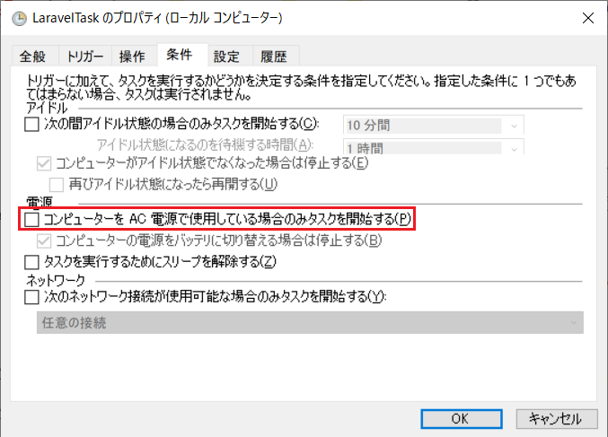

# 작업 스케줄
정해진 시각에 Exment의 처리를 자동으로 움직이기 위한 설정입니다(작업 스케줄).  
서버 쪽에서 추가 설정이 필요합니다. Linux와 Windows는 절차가 다릅니다.

작업 스케줄은 다음과 같은 일에 쓰입니다.

- 데이터베이스나 파일을 매일 정해진 시간에 백업한다.  
- 알림 설정에 맞춰, 조건에 맞는 데이터의 관계자에게 정해진 시각에 메일을 보낸다.
- 지진 정보를 매분 확인하고, 조건에 맞는 지진이 있으면 [안부 확인](/ko/safety_check)을 자동으로 보낸다("exment:safetywatch" 명령).
- 전문 검색 엔진(Meilisearch)을 쓰고 있을 때, 데이터베이스와 인덱스의 차이를 하루에 한 번 자동으로 복구한다("exment:meili-reconcile" 명령).  
※"MEILISEARCH_REPAIR_ENABLED"가 true일 때만 "MEILISEARCH_REPAIR_AT"의 시각에 실행됩니다. 자세한 내용은 [전문 검색 엔진(Meilisearch) 페이지](/ko/additional_meilisearch)를 보십시오.

### 설정 절차(Linux)
**(1) 다음 명령을 실행합니다.**

~~~
crontab -e
~~~

**(2) Cron 설정 화면이 나오므로 다음 내용을 씁니다.**

이것으로 artisan schedule 명령이 매분 실행됩니다. 그 뒤에는 Exment가 정해진 시간에 작업을 실행합니다.  
※아래는 한 예입니다. OS나 서비스에 따라 쓰는 방법이나 설정이 다를 수 있습니다.

~~~
# 일반적인 Linux
* * * * * cd /(Exment의 루트 디렉터리) && php artisan schedule:run >> /dev/null 2>&1

# Xserver(관리 화면에서 고른 PHP와 같은 버전을 전체 경로로. 아래는 PHP 8.3의 경우)
* * * * * cd /(Exment의 루트 디렉터리) && nice -n 15 /usr/bin/php8.3 artisan schedule:run >> /dev/null 2>&1

# 사쿠라 인터넷
* * * * * cd /(Exment의 루트 디렉터리); php artisan schedule:run >> /dev/null 2>&1
~~~

> **임대 서버(Xserver 등)에서는**: cron의 `php`는 관리 화면에서 고른 PHP와 다른, 서버의 표준 PHP가 될 수 있습니다. 관리 화면과 같은 버전의 PHP를 전체 경로로 쓰십시오([임대 서버](/ko/install_rental)).

### 설정 절차(Windows)
- 다음 명령을 실행하고 php.exe 파일이 있는 위치(경로)를 복사합니다.  

~~~
where php
// C:\xampp\php\php.exe
~~~

- Windows 메뉴에서 "task"라고 입력하고 작업 스케줄러를 시작합니다.  


- 작업 스케줄러에서 "작업 만들기"를 클릭합니다.


- "일반" 탭에서 다음과 같이 설정합니다. ("이름"은 원하는 이름으로 해도 됩니다)


- "트리거" 탭을 클릭합니다. 트리거를 2개 만듭니다.  
    (1) "새로 만들기" 버튼을 클릭합니다.  
    그런 다음 다음과 같이 입력합니다.  
    - 작업 시작: 시작할 때
    - 작업 반복 간격: 1분
    - 기간: 무기한
    - "사용"에 체크  
    끝나면 "확인"을 클릭합니다.  


    (2) 다시 한 번 "새로 만들기" 버튼을 클릭합니다.  
    그런 다음 다음과 같이 입력합니다.  
    - 작업 시작: 작업을 만들거나 수정할 때
    - 작업 반복 간격: 1분
    - 기간: 무기한
    - "사용"에 체크  
    끝나면 "확인"을 클릭합니다.  


- "동작" 탭에서 "새로 만들기" 버튼을 클릭합니다.  
그런 다음 다음과 같이 입력합니다.
    - 동작: 프로그램 시작
    - 프로그램/스크립트: 앞에서 복사한 php까지의 경로
    - 인수 추가: (Exment의 루트 디렉터리)/artisan schedule:run


- "설정" 탭에서 "예약된 시작 시간을 놓친 경우 가능한 대로 빨리 작업 시작"에 체크합니다.


- 노트북 PC일 때는 "조건" 탭에서 "컴퓨터의 AC 전원이 켜져 있는 경우에만 작업 시작"의 체크를 해제합니다. 


- 여기까지의 설정이 끝나면 확인을 클릭합니다.  
사용자의 자격 증명을 입력하는 화면이 나오므로 비밀번호를 입력하십시오.  


- 마지막으로 "작업 스케줄러 라이브러리"에서 만든 작업을 고르고 "실행"을 클릭하십시오. 


이것으로 설정은 끝입니다.


## 잘 동작하지 않을 때의 검증(v4.0.6 이후)
잘 움직이지 않을 때는 다음 2가지 방법으로 어디에 원인이 있는지 확인하십시오.

| 방법 | 알 수 있는 것 |
| ---- | ---- |
| 로그 출력 | cron이나 작업 스케줄러에서 스케줄이 호출되고 있는지 |
| 직접 명령을 실행 | 알림이나 백업의 설정 자체가 올바른지 |

### 로그 출력
로그를 내보내면서 확인하기를 권장합니다.  
v4.0.6에서 스케줄 실행을 위한 디버그 로그를 추가했습니다. 다음 절차로 확인하십시오.

#### 설정 절차 
- .env 파일에 다음 내용을 추가하고 저장합니다.

~~~
EXMENT_DEBUG_MODE_SCHEDULE=true
~~~

- 이것으로 스케줄을 정의했을 때·실행했을 때 /storage/logs/laravel.log에 로그가 나오게 됩니다.  
작업 스케줄의 설정이 올바르면 1분마다 로그가 나옵니다.


#### 출력되는 로그의 내용

- Exment schedule debug defined.  
→아래 로그의 출력과 스케줄의 설정이 끝났을 때 나오는 로그입니다.  
→이 로그가 나오지 않을 때는 스케줄의 정의나 호출이 올바르게 끝나지 않았을 수 있습니다. cron의 설정이나 작업 스케줄러의 설정을 다시 살펴보십시오.

- Exment schedule debug everyMinute called.  
→매분 나오는 로그입니다. 스케줄의 정의가 올바르게 끝났으면 매분 나옵니다.  
→이 로그가 나오지 않을 때는 스케줄의 정의나 호출이 올바르게 끝나지 않았을 수 있습니다. cron의 설정이나 작업 스케줄러의 설정을 다시 살펴보십시오.

- Exment schedule debug hourly called.  
→매시 0분에 나오는 로그입니다. 스케줄의 정의가 올바르게 끝났으면 매시 나옵니다.  
Exment의 본래 스케줄 명령과 같은 정의입니다. 먼저 이 로그가 나오는지 확인하십시오.

- Exment schedule command called.  
→Exment의 스케줄 명령이 실행을 시작했을 때 나오는 로그입니다. 이 로그가 나오면 적어도 스케줄 명령은 올바르게 실행되고 있습니다.  
이 로그가 나오는데도 알림이나 백업이 생각한 대로 실행되지 않을 때는 설정값을 다시 살펴보십시오.


#### 주의점
이 로그는 "스케줄에서 실행한 것인지, 보통의 명령 실행인지"를 구별할 수 없습니다. 보통의 명령을 실행했을 때에도 로그가 나옵니다.  
스케줄을 확인할 때 외에는 설정값 EXMENT_DEBUG_MODE_SCHEDULE을 삭제하십시오.


### 직접 명령을 실행
알림이나 백업이 올바르게 움직이지 않을 때는 Exment의 스케줄 명령을 직접 실행해서 확인하는 방법도 있습니다.  
다음 명령을 실행하십시오.

```
php artisan exment:schedule
```

이 명령은 다음 일을 합니다. 둘 다 본래는 00분이 아니면 움직이지 않지만, 명령을 직접 실행하면 바로 실행됩니다.

- 알림(시간 경과)에서 "알림 시간"이 맞는 알림의 실행.
- 자동 백업에서 "자동 백업 시작 시간(시)"이 맞는 백업의 실행.

이 명령으로 생각한 대로 움직였을 때는 어떤 이유로 스케줄(cron이나 작업 스케줄러) 쪽이 올바르게 움직이지 않고 있을 가능성이 있습니다.  
원인을 찾을 때 참고하십시오.


[←추가 설정 목록으로 돌아가기](/ko/quickstart_more)
