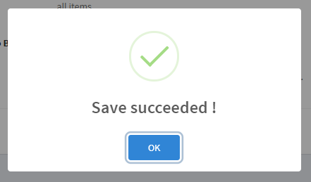
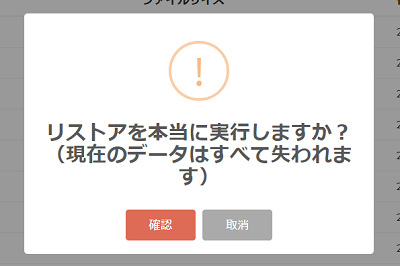

# 백업·복원
Exment의 데이터를 저장해 두는 "백업"과, 저장한 데이터로 원래대로 되돌리는 "복원"의 방법입니다.

| 하고 싶은 일 | 볼 곳 |
|---|---|
| 지금 바로 백업한다 | 수동 백업 실행 |
| 매일 등, 정해진 시각에 자동으로 백업한다 | 자동 백업 실행 |
| 백업에서 원래대로 되돌린다 | 복원 |
| 명령으로 한다 | (상급자용)명령에 의한 백업·(상급자용)명령에 의한 복원 |

## 개요
백업과 복원은 예를 들어 다음과 같은 때에 씁니다.

- 큰 데이터 업데이트 전에 백업해 두고, 잘되지 않았을 때 원래대로 되돌린다.
- 매일 백업해 두고, 예기치 못한 장애에 대비한다.
- 지금 있는 환경에서 다른 환경으로 모든 데이터를 옮긴다. (실시하기 전에 반드시 동작을 확인하십시오.)

백업 대상은 다음과 같습니다.
- 데이터베이스
- 플러그인 파일
- 첨부 파일
- 로그 파일
- 설정 파일

## 주의
- 다른 환경으로 옮길 때는 환경에 따라 정상적으로 완료되지 않는 일이 있습니다.  
특히 다른 OS(Windows나 Linux), 다른 종류의 데이터베이스(MySQL이나 MariaDB), 다른 버전의 데이터베이스로 옮길 때는 여러 가지 요인으로 정상적으로 완료되지 않는 일이 있습니다.  
반드시 미리 확인하십시오.

- 미리 하는 확인으로, 주로 다음 일을 권장합니다.
    - 옮길 곳을 개발 환경 등으로 하여 실시한다.
    - 테이블 정의만 만든 단계에서 옮기기를 시험한다.
    - 데이터베이스의 종류, 데이터베이스의 버전을 맞춘다.

- 현재 SQLServer에서는 자동 백업·복원을 지원하지 않습니다.  
[백업·복원(SQL Server)](/ko/backup_sqlserver)의 순서로, 수동으로 백업·복원하십시오.

## 화면
- 왼쪽 메뉴에서 "관리자 설정 > 백업"을 선택합니다.  
또는 아래의 URL에 접속하십시오.  
http(s)://(Exment의 URL)/backup  
그러면 백업 화면이 표시됩니다.

> ※URL은 "/admin"이 붙지 않는 표준 설정(v7.2.1 이후에 새로 설치한 사이트)의 경우입니다. `.env`의 `ADMIN_ROUTE_PREFIX`에 값이 있는 경우(이전 버전에서 설치한 사이트는 "admin")에는 사이트의 URL 뒤에 그 값을 붙이십시오(예: `http(s)://(Exment의 URL)/admin/backup`). 자세한 내용은 [URL에 포함된 "admin"의 변경·삭제](/ko/additional_prefix)를 보십시오.

## 백업
백업의 방법은 "수동"과 "자동"의 2가지입니다.

### 수동 백업 실행
원할 때 수동으로 백업하는 순서입니다.

- 페이지 오른쪽 위의 [백업] 버튼을 클릭합니다.  
  

- 확인 대화 상자가 표시되므로, [확인]을 클릭하고 그대로 기다리십시오.  
**※백업은 시간이 매우 오래 걸립니다. 조작하지 말고 그대로 기다리십시오.**
  

- 완료하면 메시지가 표시됩니다.  
백업 목록에, 작성 일시가 실행한 일시인 파일이 생깁니다.
  
  

- 만든 백업 파일은 다운로드할 수 있습니다.  
백업 행의 [다운로드] 링크를 클릭하십시오.  
  

- 만든 백업의 파일 이름은 변경할 수 있습니다.  
백업 행의 [파일 이름 편집] 링크를 클릭하십시오.  
※반각 가나, 기호를 포함한 이름은 설정할 수 없습니다.
  
- 파일 이름을 입력한 뒤 [전송] 버튼을 클릭하십시오.
  

- 완료하면 메시지가 표시되고, 백업 목록의 파일 이름이 바뀝니다.
  

  

### 자동 백업 실행
정해진 시각에 자동으로 백업할 수 있습니다.  
정기적으로 백업해 두면, 데이터를 크게 잘못 업데이트해 버렸을 때 등에도 복원할 수 있습니다.  
**※미리 [작업 스케줄](/ko/additional_task_schedule) 설정을 해야 합니다.**

예로, "야간 3시"에 "1일 간격"으로 "7세대분의 백업"을 하는 설정 방법입니다.  

- "백업 설정"에서 "자동 백업"의 선택을 "YES"로 합니다.
  

- 옵션의 설정을 변경합니다.
  

- 그 뒤, 페이지 아래쪽의 [저장] 버튼을 클릭합니다.  

<h3 id="backup_command"><a href="#/ko/backup?id=backup_command" data-id="backup_command" class="anchor">(상급자용)명령에 의한 백업</a></h3>

명령으로도 백업할 수 있습니다. 프로젝트의 루트 디렉터리에서 아래의 명령을 실행하십시오.

~~~
php artisan exment:backup
~~~

- "--target="을 지정하지 않는 경우에는 모든 대상(데이터베이스, 플러그인 파일, 첨부 파일, 로그 파일, 설정 파일)을 백업합니다.
- 대상을 좁히는 경우에는 "--target="에 아래의 키를 쉼표로 구분하여 지정합니다.
    - database : 데이터베이스
    - plugin : 플러그인 파일
    - attachment : 첨부 파일
    - log : 로그 파일
    - config : 설정 파일

~~~
# 예: 데이터베이스와 첨부 파일만 백업하는 경우
php artisan exment:backup --target=database,attachment
~~~

## 복원
데이터를 복원하는 방법은 "백업 목록에서 선택"과 "업로드"의 2가지입니다.  

### 복원할 때의 주의
- 백업했을 때의 Exment 버전과 현재 설치되어 있는 Exment 버전이 다를 때는, 복원한 뒤 데이터베이스의 최신화가 필요합니다.  
예: 
    - 백업 시점의 버전: v1.1.6 
    - 현재의 버전: v1.2.0  
    →데이터베이스의 최신화가 필요  
    
그 경우, 복원한 뒤 아래의 명령을 실행하십시오.  

~~~
php artisan exment:update
~~~

- 복원한 뒤에는 자동으로 로그아웃됩니다. 백업되어 있던 사용자의 ID와 비밀번호로 로그인하십시오.  

- v4.1.0부터, 복원을 실시하는 동안은 유지보수 모드가 됩니다.  
복원이 끝나면 유지보수 모드는 자동으로 해제됩니다. 만일 어떤 이유로 유지보수 모드가 해제되지 않게 된 경우, [유지보수 모드 해제](/ko/troubleshooting)의 순서로 유지보수 모드를 해제하십시오.

### 백업 목록에서 선택
과거에 실시한 백업 목록에서 복원할 파일을 선택하여 데이터를 복원하는 방법입니다.  

- 백업 목록에서 [복원] 링크를 클릭합니다.  
  

- 확인 대화 상자가 표시되므로, [확인]을 클릭하고 그대로 기다리십시오.  
**※복원은 시간이 매우 오래 걸립니다. 조작하지 말고 그대로 기다리십시오.**
  

- 완료 메시지가 표시되면, 백업한 시점의 환경으로 돌아가 있습니다.  
자동으로 로그인 페이지로 이동합니다.  
  

### 업로드
가까이(로컬)에 저장해 둔 백업을 Exment에 업로드하여 데이터를 복원하는 방법입니다.  
**※업로드 파일의 용량이 너무 크면 정상적으로 완료되지 않는 경우가 있습니다.** 그 경우, 아래의 [파일 크기가 커서 업로드할 수 없는 경우](/ko/backup?id=파일-크기가-커서-업로드할-수-없는-경우)를 보십시오.  

- 페이지 오른쪽 위의 [복원] 버튼을 클릭합니다.  
  

- 파일 업로드의 대화 상자가 표시되므로, 로컬에 다운로드한 백업 파일을 선택하고 "전송"을 클릭합니다.  
  

- "전송" 버튼을 클릭했으면 그대로 기다리십시오.  
**※복원은 시간이 매우 오래 걸립니다. 조작하지 말고 그대로 기다리십시오.**

- 완료 메시지가 표시되면, 백업한 시점의 환경으로 돌아가 있습니다.
  

### 파일 크기가 커서 업로드할 수 없는 경우
"업로드"로 복원할 때, 백업 파일의 용량이 너무 크면 복원에 실패하는 일이 있습니다.  
그때는 다음 중 어느 한 순서로 복원하십시오.  

#### (1)업로드 상한을 변경한다

- [PHP 설정값 변경](/ko/additional_php_ini)의 순서로 업로드 상한 크기를 변경하십시오.

#### (2)서버에 직접 백업 파일을 둔다

- 다운로드한 백업 파일을 서버의 아래 경로에 둡니다.  

~~~
(프로젝트의 루트 디렉터리)/storage/app/backup/list
~~~

- 백업 화면을 다시 읽어 들입니다.  

- 백업 목록에, 둔 백업 파일이 추가되어 있습니다. 위의 "백업 목록에서 선택"의 순서로 복원하십시오.

### 백업 화면이나 명령에서 오류가 표시되는 경우
백업 화면이나 명령에서 아래와 같은 메시지가 표시되는 경우가 있습니다.

  

이 오류가 나올 때는 백업·복원에 필요한 설정이 서버에 되어 있지 않을 수 있습니다.  
[문제 해결](/ko/troubleshooting)을 확인하고, 서버 설정을 변경하십시오.

### 복원한 뒤 사용자 정의 데이터 등을 초기화하는 경우
복원한 뒤, 저장되어 있던 Exment의 사용자 정의 데이터 등을 리프레시하여 데이터를 처음부터 만들 수 있습니다.  
자세한 내용은 [사용자 정의 데이터의 리프레시](/ko/refresh_data)를 참조하십시오.

### SQL Server를 쓰는 경우
SQLServer를 쓰는 경우, 현재 Exment에서는 화면에서의 백업／복원을 지원하지 않습니다. 수동으로 작업해야 합니다.  
자세한 내용은 [백업·복원(SQL Server)](/ko/backup_sqlserver)을 참조하십시오.

<h3 id="restore_command"><a href="#/ko/backup?id=restore_command" data-id="restore_command" class="anchor">(상급자용)명령에 의한 복원</a></h3>

명령으로도 복원할 수 있습니다.

- 다운로드한 백업 파일을 서버의 아래 경로에 둡니다.  

~~~
(프로젝트의 루트 디렉터리)/storage/app/backup/list
~~~

- 프로젝트의 루트 디렉터리에서 아래의 명령을 실행하십시오.

~~~
php artisan exment:restore (zip 파일 이름)
~~~

- zip 파일 이름을 생략한 경우에는 백업 목록이 표시되므로, 복원할 파일을 선택하십시오.
- 실행하기 전에 확인 메시지가 표시됩니다. 확인 메시지를 표시하지 않고 실행하는 경우에는 "--yes"를 지정하십시오.

~~~
# 예: 확인 메시지를 표시하지 않고 복원하는 경우
php artisan exment:restore (zip 파일 이름) --yes
~~~

<h3 id="change_backup_target"><a href="#/ko/backup?id=change_backup_target" data-id="change_backup_target" class="anchor">(상급자용)백업 저장 위치의 변경</a></h3>

보통, 백업 파일은 웹 서버 안에 놓입니다.  
백업 파일을 다른 곳에 둘 수도 있습니다. 다른 곳에 두면, 웹 서버가 고장 나서 시작할 수 없게 되어도 그곳에서 백업 파일을 다운로드하여 Exment를 복원할 수 있습니다.

※설정 방법의 순서는 [파일 저장 위치 변경](/ko/additional_file_saveplace)으로 옮겼습니다.

### 주의 사항
- 서버에 따라서는 백업 저장 위치를 변경할 수 없는 일이 있습니다.  
특히 임대 서버의 경우, **제공 회사의 설정에 따라 FTP 등을 제한하는 경우가 있습니다**. 미리 양해해 주십시오.
