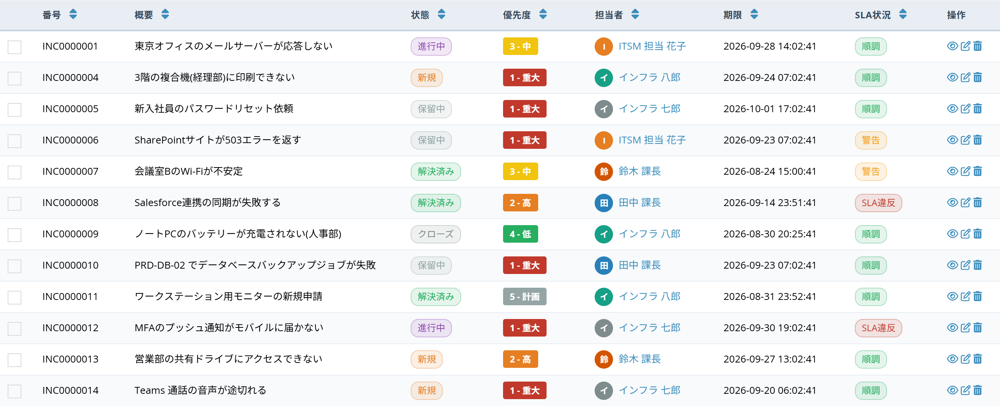
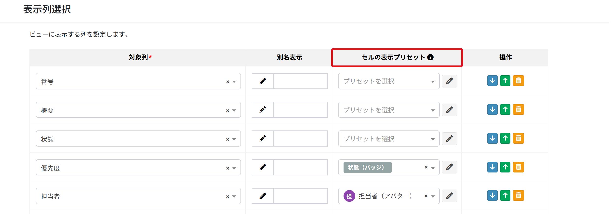

# 표시 프리셋

셀의 모양(색·형태·아이콘 등)에 이름을 붙여 저장하고, 여러 열이나 뷰에서 돌려쓰기 위한 기능입니다. 데이터 목록뿐 아니라 칸반 뷰의 카드에도 같은 모양이 적용됩니다.

## 표시 프리셋이란

지금까지는 셀의 모양을 **열마다 하나씩** 설정했습니다.  
그래서 "상태를 필(둥근 모서리)로 표시한다" 같은 똑같은 설정을, 테이블이 바뀔 때마다, 열이 바뀔 때마다 다시 만들어야 했습니다.

표시 프리셋은 그 설정에 이름을 붙여 하나만 저장해 두는 방식입니다.  
열이나 뷰에는 "어느 프리셋을 쓸지"만 기록하므로 다음과 같이 됩니다.

- 같은 모양을 다른 열·다른 테이블에서도 목록에서 고르기만 하면 쓸 수 있습니다
- 프리셋 하나를 고치면, 그 프리셋을 고른 모든 열의 표시가 한꺼번에 바뀝니다

## 프리셋을 쓰는 곳

표시 프리셋은 다음 4개 화면에서 사용합니다.

| 화면 | 역할 | 필요한 권한 |
| --- | --- | --- |
| 표시 프리셋(라이브러리 화면) | 프리셋의 목록·새로 만들기·편집·삭제 | 시스템 관리자 |
| 사용자 정의 열 설정 > 셀 표시 | 그 열의 기본 모양으로 프리셋을 고릅니다 | 대상 테이블의 테이블 설정 권한 |
| 사용자 정의 뷰 설정 > 표시 열 선택 | 그 뷰만의 모양으로 프리셋을 고릅니다 | 대상 테이블의 테이블 설정 권한 |
| 칸반 뷰 설정 > 카드에 표시할 열 > 표시 스타일 | 카드 위의 모양으로 프리셋을 고릅니다 | 대상 테이블의 테이블 설정 권한 |

※ 프리셋은 테이블에 속하지 않습니다. 하나 만들면 어느 테이블의 열에서나 고를 수 있습니다.  
※ 뷰에서 지정한 프리셋은 열의 설정보다 우선합니다.

## 라이브러리 화면(표시 프리셋 목록)

### 페이지 표시

브라우저에서 `(Exment 주소)/cell_style_preset`을 엽니다.

> ※ URL은 "/admin"이 붙지 않는 표준 설정(v7.2.1 이후에 새로 설치한 사이트)인 경우입니다. `.env`의 `ADMIN_ROUTE_PREFIX`에 값이 있는 경우(이전 버전에서 설치한 사이트는 "admin")에는 사이트 URL 뒤에 그 값을 붙이십시오(예: `http(s)://(Exment의 URL)/admin/cell_style_preset`). 자세한 내용은 [URL에 포함된 "admin"의 변경·삭제](/ko/additional_prefix)를 참고하십시오.

언제든지 열 수 있게 하려면 [메뉴](/ko/menu) 설정에서 메뉴에 추가합니다.

1. "관리자 설정" > "메뉴"를 엽니다.
2. 오른쪽 위의 ［새로 만들기］를 클릭합니다.
3. "메뉴 종류"에서 "시스템 메뉴", "메뉴 이름"에서 "표시 프리셋"을 선택합니다.
4. 표시할 상위 메뉴("관리자 설정" 등)를 고르고 저장합니다.

목록에는 다음 항목이 표시됩니다.

| 항목 | 내용 |
| --- | --- |
| 프리셋 이름 | 설정 화면의 선택지에 표시되는 이름 |
| 미리 보기 | 실제 데이터 목록에서의 표시 모습 |
| 대상 열 종류 | 이 프리셋을 선택지에 표시할 열의 종류 |
| 표시 순서 | 선택지에 늘어서는 순서(작을수록 위) |
| 업데이트 일시 | 최종 업데이트 일시 |

Exment를 설치한 시점에, 자주 쓰는 프리셋 15건이 처음부터 등록되어 있습니다.

| 프리셋 이름 | 주요 대상 열 종류 |
| --- | --- |
| 상태(필) | 선택 (고정 값) |
| 상태(배지) | 선택 (고정 값) |
| 라벨(태그) | 선택 (고정 값) |
| 선택지(점) | 선택 (고정 값) |
| 우선순위(사각 점) | 선택 (고정 값), 선택 (값과 표시명 저장) |
| 레벨(원형 점) | 선택 (고정 값), 선택 (값과 표시명 저장) |
| YES/NO(배지) | YES/NO, 2개 값 선택 |
| 담당자(아바타) | 사용자, 조직 |
| 진행률(막대) | 정수, 소수 |
| 숫자(굵게) | 정수, 소수, 통화 |
| 날짜(줄 바꿈 없음) | 날짜, 날짜 및 시각, 시각 |
| 코드(고정폭 글꼴) | 한 줄 텍스트, 자동 번호, URL, 이메일 |
| 텍스트만(항목 이름 없음) | 모든 열 종류 |
| 경고(빨강, 굵게) | 모든 열 종류 |
| 셀 전체 채우기 | 모든 열 종류 |

프리셋을 편집·삭제할 수 있는 사람은 다음과 같습니다.

- 라이브러리 화면을 열 수 있는 것은 시스템 관리자뿐입니다(역할 그룹에서 시스템 권한을 부여받은 사용자는 열 수 없습니다). 라이브러리 화면에서는 만든 사람과 관계없이, 처음부터 등록되어 있는 프리셋을 포함하여 모든 프리셋을 편집·삭제할 수 있습니다.
- "그 자리에서 프리셋 만들기·편집하기(연필 버튼)" 화면에서는 시스템 관리자가 모든 프리셋을 편집·삭제할 수 있습니다. 그 밖의 사용자는 자신이 만든 프리셋만 편집·삭제할 수 있습니다. 다른 프리셋은 읽기 전용이며, ［삭제］는 표시되지 않고 ［이 프리셋 업데이트］는 누를 수 없습니다. 편집 화면에는 "이 프리셋은 편집할 수 없습니다. 내용을 바꿔 사용하려면 새 프리셋으로 저장하십시오."라고 표시됩니다. 내용을 바꿔 쓰려면 ［새 프리셋으로 저장］을 사용합니다.

※ 시스템 설정의 "권한 관리 사용"이 NO인 경우에는 모든 사용자가 라이브러리 화면을 사용할 수 있습니다.

### 프리셋 새로 만들기 및 편집

목록 오른쪽 위의 ［새로 만들기］ 버튼, 또는 각 행의 편집 아이콘을 클릭합니다.

#### 프리셋 이름
설정 화면의 선택지에 표시되는 이름입니다. 필수 항목입니다.

#### 셀 표시 형식
값을 어떤 형태로 표시할지 선택합니다.

| 선택지 | 표시 내용 |
| --- | --- |
| 표준 | 지금까지와 같은 표시(장식 없음) |
| 글자 색만 | 글자에 색만 입힙니다 |
| 태그(작은 둥근 모서리) | 모서리를 조금 둥글린 테두리 있는 태그 |
| 필(큰 둥근 모서리) | 모서리를 크게 둥글린 태그 |
| 배지(채우기) | 배경을 채운 짙은 색의 배지 |
| 사각 점 + 글자 | 값 앞에 네모난 색 표시를 붙입니다 |
| 둥근 점 + 글자 | 값 앞에 둥근 색 표시를 붙입니다 |
| 고정폭 글꼴 | 글자 폭을 맞추어 표시(코드·ID 등) |
| 아바타(머리글자 원) | 머리글자를 둥근 아이콘으로 만들어 표시(담당자 등) |
| 진행률 막대(0-100) | 값을 가로 막대 그래프로 표시 |
| 셀 전체 채우기 | 셀의 배경 전체에 색을 입힙니다 |

#### 글자 색
값의 글자 색입니다.  
※ 선택지 열에서 "값별 색상"도 지정하지 않은 경우에는, 선택지의 순서에 따른 색이 자동으로 할당됩니다.

#### 배경색
태그·필·셀 전체의 배경색입니다. 지정하지 않으면 글자 색에서 자동으로 만듭니다.

#### 테두리 색
태그·필·셀 전체의 테두리 색입니다. 지정하지 않으면 글자 색에서 자동으로 만듭니다.

#### 글자 굵기
"보통", "약간 굵게", "굵게" 중에서 선택합니다.

#### 아이콘
값 앞에 표시할 아이콘입니다. 버튼으로 선택할 수 있습니다.  
※ "아바타", "진행률 막대", "셀 전체 채우기"에서는 표시되지 않습니다.

#### 줄 바꿈 안 함
YES로 하면 목록의 셀 안에서 글자를 줄 바꿈하지 않게 됩니다. 날짜나 번호처럼 중간에 줄이 바뀌면 읽기 어려운 열에 사용합니다.

#### 대상 열 종류
체크한 종류의 열에서 이 프리셋이 선택지에 표시됩니다.  
※ 하나도 체크하지 않으면 모든 종류에서 표시합니다.

#### 표시 순서
설정 화면의 선택지에 표시되는 순서입니다. 작을수록 위에 표시됩니다.

## 사용자 정의 열에 프리셋 할당하기

1. 메뉴에서 대상 테이블을 고르고, ［테이블 상세 설정］ > ［사용자 정의 열 설정］을 엽니다.
2. 설정하고 싶은 열의 편집 화면을 열고, "셀 표시" 칸까지 스크롤합니다.

3. "표시 프리셋"의 선택지에서 쓰고 싶은 프리셋을 고릅니다.  
선택지는 실제 모양 그대로 표시됩니다.

4. 선택하면 아래의 "미리 보기"가 바로 바뀝니다. 저장하지 않아도 확인할 수 있습니다.

5. 화면 아래쪽의 ［전송］ 버튼으로 저장합니다.

### 값별 색상

선택지 열에서는 "값별 색상"에서 선택지 하나하나에 색을 지정할 수 있습니다.  
색을 지정하지 않은 값에는 선택지의 순서에 따른 색이 자동으로 할당됩니다.

※ 진행률 막대에서는 "임계값"으로 다루며, 값이 임계값 이상일 때 그 색이 됩니다.

## 그 자리에서 프리셋 만들기·편집하기(연필 버튼)

"표시 프리셋"의 오른쪽에 있는 연필 버튼을 클릭하면, 설정 화면을 떠나지 않고 프리셋을 편집할 수 있습니다.

왼쪽에서 설정을 바꾸면 오른쪽의 "미리 보기"가 바로 갱신됩니다.

대화 상자의 아래쪽에는 다음 버튼이 있습니다.

| 버튼 | 동작 |
| --- | --- |
| 새 프리셋으로 저장 | 지금의 내용을 **다른 프리셋** 으로 추가합니다. 원래 프리셋은 바뀌지 않습니다. |
| 이 프리셋 업데이트 | 지금 열려 있는 프리셋을 덮어씁니다. **이 프리셋을 고른 다른 열의 표시도 바뀝니다.** |
| 삭제 | 프리셋을 삭제합니다. 잘못된 조작을 막기 위해, 한 번 더 누르면 삭제됩니다. |
| 닫기 | 저장하지 않고 닫습니다. |

> 기존 프리셋을 조금만 바꿔 쓰고 싶은 경우에는 "이 프리셋 업데이트"가 아니라 **"새 프리셋으로 저장"** 을 사용하십시오.  
> 업데이트하면 같은 프리셋을 쓰고 있는 다른 열의 모양도 바뀝니다.

## 뷰의 열에 프리셋 할당하기

같은 테이블이라도 뷰에 따라 보여 주는 방식을 바꾸고 싶을 때가 있습니다.  
그 경우에는 사용자 정의 뷰 설정의 "표시 열 선택"에서 프리셋을 지정합니다.

"셀 표시 프리셋" 열에서 열마다 프리셋을 선택합니다.  
오른쪽의 연필 버튼으로는 열 설정과 같은 대화 상자를 열 수 있습니다.

※ 여기에서 지정한 프리셋은 **사용자 정의 열 설정의 내용보다 우선합니다.**  
※ 아무것도 고르지 않으면 사용자 정의 열 설정의 내용이 쓰입니다.

## 자주 묻는 질문·주의할 점

#### 프리셋을 삭제하면, 쓰고 있던 열은 어떻게 됩니까
그 프리셋을 고른 열은 장식이 없는 "표준" 표시로 돌아갑니다. 데이터는 바뀌지 않습니다.

#### 프리셋이 선택지에 나오지 않습니다
프리셋의 "대상 열 종류"에 그 열의 종류가 들어 있지 않을 수 있습니다.  
라이브러리 화면에서 프리셋을 열고 "대상 열 종류"를 확인하십시오. 모든 종류에서 표시하고 싶으면 체크를 하나도 하지 마십시오.

#### 모양을 바꿨더니 다른 테이블의 표시도 바뀌어 버렸습니다
프리셋은 테이블에 속하지 않고 Exment 전체에서 공유됩니다.  
한 테이블만 모양을 바꾸고 싶은 경우에는 "새 프리셋으로 저장"으로 다른 프리셋을 만드십시오.

## 관련 항목

- [사용자 정의 열](/ko/column)
- [사용자 정의 뷰](/ko/view)
- [데이터 목록](/ko/data_grid)
- [칸반 뷰](/ko/view_kanban)
