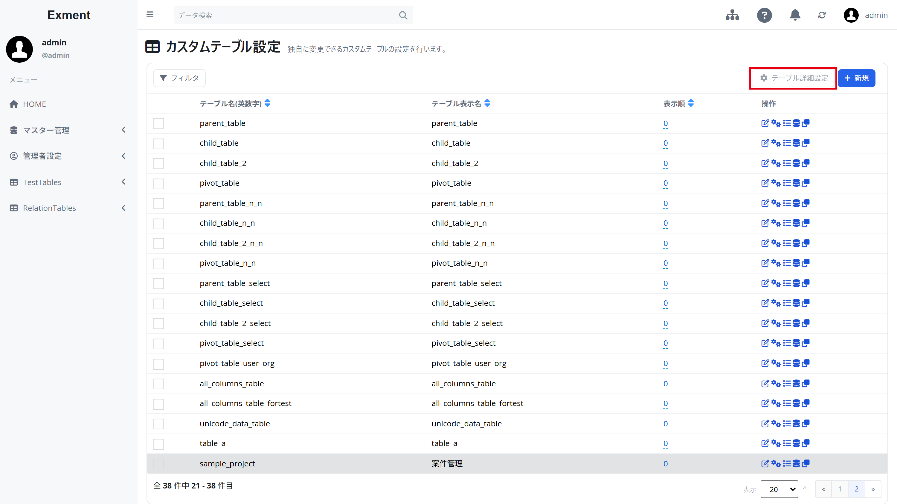
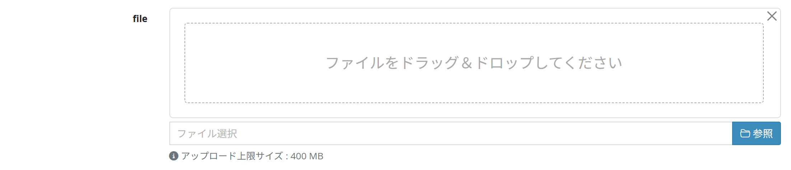
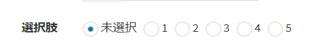
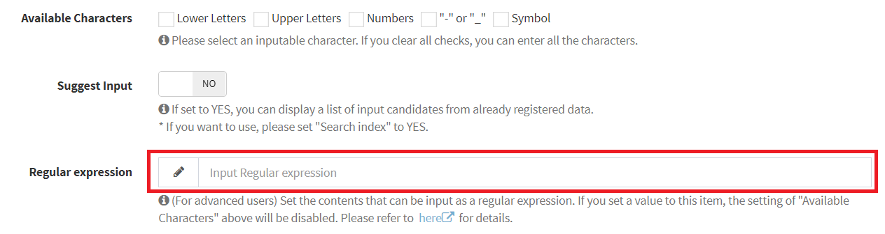

# 사용자 정의 열 관리
사용자 정의 테이블의 열("사용자 정의 열")을 만들고·고치고·지우는 페이지입니다. 열은 "고객 이름", "우편번호", "주소"와 같은 데이터의 항목 하나하나입니다.  

- 열을 만드는 방법: 아래의 "설정 화면" → "열 새로 추가" → "저장"의 순서로 보십시오.
- 어떤 종류의 열이 있는지: 아래의 "열 종류"를 보십시오.
- 항목별 설명: 아래의 "기입 항목의 상세(공통)", "기입 항목의 상세 설명(열 종류별)"을 보십시오.  

## 설정 화면
- 사용자 정의 테이블 목록에서 설정하고 싶은 테이블에 체크를 하나 넣고 오른쪽 위의 "테이블 상세 설정"을 누릅니다.  

- 또는 메뉴에서 설정하고 싶은 테이블을 고른 뒤, 마찬가지로 오른쪽 위의 "테이블 상세 설정"을 누릅니다.  
※ 그 테이블을 메뉴에 내보내는 설정이 먼저 필요합니다.  

- 나온 테이블 상세 설정 화면에서 사용자 정의 열의 아이콘을 누릅니다.

- 이것으로 그 사용자 정의 테이블의 열 목록이 나옵니다.  

## 열 새로 추가
- "사용자 정의 열 설정" 화면에서 페이지 오른쪽 위의 [만들기] 버튼을 누릅니다.

- 사용자 정의 열을 새로 추가하는 화면이 나오니 필요한 항목을 입력합니다.

## 저장
설정을 입력했으면 [전송]을 누르십시오.

## 편집
열을 고치고 싶을 때는 그 행의 [편집] 링크를 누르십시오.  

## 삭제
열을 지우고 싶을 때는 그 행의 [삭제] 링크를 누르십시오.  

**※ 다만 시스템에서 설치한 열은 삭제할 수 없습니다.**

## 기입 항목의 상세(공통)
- 열 이름(영숫자): 시스템에서 쓰는 열의 이름입니다. 영숫자 또는 "-", "\_"로 기입합니다. 설정할 수 있는 것은 한 번뿐이고 바꿀 수 없습니다.  
**※ 다음 이름은 쓸 수 없습니다.**  
id,suuid,parent_id,parent_type,created_at,updated_at,deleted_at,created_user,updated_user,deleted_user

### 열 표시 이름
화면에 표시하는 열의 이름입니다.

## 열 종류
열의 종류입니다. 여기에서 고른 종류에 따라 데이터를 등록할 때의 입력 칸의 모양이 정해집니다.

> 사용자 정의 열별 시스템 사양의 상세는 [사용자 정의 열 레퍼런스](/ko/column_reference)를 확인하십시오.

#### 한 줄 텍스트
한 줄 텍스트(텍스트 상자)입니다.  

#### 여러 줄 텍스트
여러 줄 텍스트(텍스트 영역)입니다.  

#### 텍스트 편집기
텍스트 편집기를 쓴 데이터 입력을 할 수 있습니다.

#### URL
URL을 입력할 수 있는 폼이 됩니다.  

#### 이메일
메일 주소를 입력할 수 있는 폼이 됩니다.  

#### 정수
정수만 입력할 수 있는 폼이 됩니다. 또 데이터를 등록할 때 항목의 좌우에 [+] [-] 버튼을 표시하여, 클릭으로 값을 올리고 내릴 수 있습니다.  

#### 소수
소수만 입력할 수 있는 폼이 됩니다. 백분율 표시를 YES로 하면 데이터를 표시할 때 %로 표시됩니다.  

#### 통화
통화를 입력할 수 있는 폼이 됩니다. 표시 형식은 4종류(￥·円(엔)·＄·€)에서 고를 수 있습니다.

#### 날짜
날짜의 폼이 됩니다. 데이터를 등록할 때 캘린더에서 날짜를 바꿀 수 있습니다.  

#### 시각
시간의 폼이 됩니다. 데이터를 등록할 때 시계에서 시각을 바꿀 수 있습니다.  

#### 날짜 및 시각
일시의 폼이 됩니다. 데이터를 등록할 때 캘린더와 시계에서 일시를 바꿀 수 있습니다.  

#### 선택 (고정 값)
선택지의 폼이 됩니다. 값과 제목이 같은 선택지 목록이 됩니다.  

#### 선택 (값과 표시명 저장)
선택지의 폼이 됩니다. 값과 제목이 다른 선택지 목록이 됩니다.  

#### 선택 (테이블에서)
선택지의 폼이 됩니다. 선택지가 다른 테이블의 항목이 되는 선택지를 만듭니다.  

#### YES/NO
"YES"와 "NO"를 전환하는 스위치를 만듭니다. 데이터를 등록할 때 YES이면 1, NO이면 0으로 등록됩니다.  

#### 2개 값 선택
두 값을 전환하는 스위치를 만듭니다. 데이터를 등록할 때의 값도 바꿀 수 있습니다.  

#### 자동 번호
UUID나 랜덤 문자열 등의 값을 데이터를 만들 때 만듭니다.  

#### 이미지
이미지를 업로드하는 폼이 됩니다.  
※ 데이터 목록 화면이나 데이터 상세 화면에서는 이미지가 링크와 함께 표시됩니다. 링크(a 태그)에는 class "image-link"가 붙어 있으므로, [플러그인(스크립트)](/ko/plugin_quickstart_script)나 [플러그인(스타일)](/ko/plugin_quickstart_style)로 이미지의 링크만을 대상으로 처리나 겉모습을 바꿀 수 있습니다.

#### 파일
파일을 업로드하는 폼이 됩니다.  

#### 사용자
시스템의 사용자를 선택하는 선택지가 됩니다.  

#### 조직
시스템의 조직을 선택하는 선택지가 됩니다.  

## 기입 항목의 상세(공통)
- ##### 열 이름(영숫자)
시스템에서 쓰는 열의 이름입니다. 영숫자 또는 "-", "_"로 기입합니다. 설정할 수 있는 것은 한 번뿐이고 바꿀 수 없습니다.  
**※ 다음 이름은 쓸 수 없습니다.**  
id,suuid,parent_id,parent_type,created_at,updated_at,deleted_at,created_user,updated_user,deleted_user

- ##### 열 표시 이름
화면에 표시하는 열의 이름입니다.

- ##### 열 종류
[열 종류의 목록](/ko/column?id=열-종류)에서 데이터 등록에 쓰는 열을 선택합니다.

- ##### 필수
이 열을 필수로 할지 말지를 고릅니다. YES로 하면 데이터의 입력 화면에서 필수 항목이 되고, 입력하지 않으면 오류가 나옵니다.  

- ##### 검색 인덱스
아래의 "[검색 인덱스](/ko/column?id=검색-인덱스-1)"를 참조하십시오.  

- ##### 자유어 검색 대상
검색 인덱스가 YES인 경우에 표시됩니다.  
아래의 "[자유어 검색 대상](/ko/column?id=フリーワード検索対象詳細)"을 참조하십시오.  

- ##### 고유
YES로 하면 데이터를 등록할 때 다른 데이터와 같은 값을 등록할 수 없게 됩니다. 여러 열의 조합으로 중복을 막고 싶을 때는 [사용자 정의 테이블 설정](/ko/table)의 "복합 고유 키 설정"을 참조하십시오.  

- ##### 한 번만 입력
YES로 하면 새로 등록할 때만 입력할 수 있는 열이 됩니다. 데이터를 편집할 때는 표시만 됩니다.

- ##### 초기값
입력 칸에 처음부터 넣어 두는 값입니다.  

- ##### 플레이스홀더
입력 칸이 비어 있을 때 옅은 글자로 내보내 두는 문자열(플레이스홀더)입니다.  

- ##### 도움말
입력 칸의 아래에 설명으로 내보내는 내용입니다.

- ##### 표시 순서
사용자 정의 열의 목록 화면에서의 표시 순위를 지정합니다.

- ##### 기본 폼·뷰에 추가
YES로 하면 열을 새로 만들 때 기본 폼·뷰에도 그 열을 추가합니다. 열을 새로 만들 때만 설정할 수 있습니다. 나중에 바꿀 때는 각각 [폼 화면](/ko/form)·[뷰 화면](/ko/view)에서 변경하십시오.

- ##### 제목 열에 추가
만드는 사용자 정의 열을 제목 열에 추가할 수 있습니다.  
※ 사용자 정의 열을 새로 만들 때만 나오는 설정입니다. 나중에 바꿀 때는 [사용자 정의 테이블 설정](/ko/table)의 "제목 표시 열 설정"에서 바꾸십시오.

- ##### 셀의 표시
데이터 목록에서 이 열의 값을 어떤 겉모습(색·태그·배지 등)으로 표시할지를 설정합니다.  
"표시 프리셋"에서 선택합니다. 자세한 내용은 [표시 프리셋](/ko/cell_style_preset)을 참조하십시오.

## 기입 항목의 상세 설명(열 종류별)
- ##### 최대 글자 수(한 줄 텍스트, 여러 줄 텍스트)
입력할 수 있는 글자 수의 상한입니다. 넘으면 오류가 됩니다.  

- ##### 사용 가능 문자(한 줄 텍스트)
체크를 넣은 종류의 문자만 입력할 수 있게 됩니다.
어느 것에도 체크를 넣지 않았을 때는 모든 종류의 문자를 입력할 수 있습니다.

- ##### 추천 입력(한 줄 텍스트)
같은 사용자 정의 열에 이미 등록된 값 중에서 입력한 내용에 맞는 것을 입력 후보로 내보냅니다.

- ##### 정규 표현식(한 줄 텍스트)
입력한 내용을 정규 표현식(문자의 나열 규칙을 적는 방법)으로 검사할 수 있습니다. 자세한 내용은 [정규 표현식](/ko/column?id=정규-표현식)을 보십시오.

- ##### 최솟값(정수, 소수)
입력할 수 있는 값의 최솟값입니다. 이보다 작은 값을 전송하면 오류가 됩니다. 비워 두면 최솟값의 검사를 하지 않습니다.  

- ##### 최댓값(정수, 소수)
입력할 수 있는 값의 최댓값입니다. 이보다 큰 값을 전송하면 오류가 됩니다. 비워 두면 최댓값의 검사를 하지 않습니다.  

- ##### 계산식(정수, 소수, 통화)
자세한 내용은 아래의 [계산식](/ko/column?id=계산식)을 보십시오.

- ##### 선택지(선택 (고정 값), 선택 (값과 표시명 저장))
입력 칸에 후보로 내보내는 선택지를 등록합니다. 한 줄에 하나씩, 줄 바꿈으로 구분하여 등록합니다.  
열 종류가 "선택 (값과 표시명 저장)"일 때는 쉼표로 구분하여 1열째에 값, 2열째에 제목을 씁니다.  

↓  
  
폼에서 데이터를 저장하면 1열째의 값이 데이터베이스에 저장됩니다.  

- #####  라디오 버튼·체크박스 형식으로 표시(YES/NO, 선택 (고정 값), 선택 (값과 표시명 저장))
선택 (고정 값), 선택 (값과 표시명 저장)의 열에서 다중 선택이 NO인 경우에는 라디오 버튼 형식으로 폼에 표시할 수 있습니다.
 

YES/NO의 열, 또는 선택 (고정 값), 선택 (값과 표시명 저장)의 열에서 다중 선택이 YES인 경우에는 체크박스 형식으로 폼에 표시할 수 있습니다.

- ##### 자유 입력 허용(선택 (고정 값))
YES로 하면 열 설정에 등록하지 않은 선택지도 자유롭게 입력하여 등록할 수 있게 됩니다.  

>[라디오 버튼·체크박스 형식으로 표시](/ko/column?id=radio_buttom)를 YES로 한 경우에는 이 설정은 할 수 없습니다.

- ##### 초기값 종류(날짜, 시각, 날짜 및 시각, 사용자)
데이터를 새로 등록할 때의 초기값의 종류를 정할 수 있습니다.  
· 날짜, 시각, 날짜 및 시각의 열에서는 [지정한 일시] 또는 [데이터 입력을 한 일시]를 초기값으로 설정할 수 있습니다.  
· 사용자 열에서는 [지정한 사용자] 또는 [로그인 사용자]를 초기값으로 설정할 수 있습니다.

- ##### 대상 테이블(선택 (테이블에서))
선택지의 후보로 내보내는 테이블을 정합니다.  

>선택지로 목록에 표시되는 문구는 [사용자 정의 테이블 설정](/ko/table)의 "제목 표시 열 설정"에서 바꿀 수 있습니다.

- ##### 선택지를 매번 검색(선택 (테이블에서), 사용자, 조직)
보통 데이터 편집 화면의 선택지는 화면을 읽어 들일 때 모든 후보를 목록으로 표시합니다.  

이 설정을 YES로 하면 처음에는 선택지를 읽어 들이지 않고, 사용자의 입력값으로 데이터를 검색하여 후보를 좁힙니다.  

입력 폼에 문자열을 입력하면 서버에서 데이터 검색을 하고 결과를 후보로 표시합니다.

> 이 설정에 관계없이, 데이터의 총건수가 100건 이상인 경우는 성능 향상을 위해 좁히기를 하는 설정이 됩니다.  
또한 이 상한값은 [설정값](/ko/config)으로 바꿀 수 있습니다.  

- ##### 채번 종류(자동 번호)
데이터를 등록할 때 채번을 하는 종류를 선택합니다.
- 형식  
사용자가 지정한 형식으로 채번을 등록합니다.
- 랜덤(라이선스 코드)    
5자×5로 25자의 랜덤 문자열을 등록합니다.
- 랜덤(UUID)  
합계 32자리의 랜덤 문자열을 등록합니다.

- ##### 자릿수(자동 번호)
자동 채번을 할 때 데이터로 등록하는 자릿수가 됩니다. 모자라는 만큼은 0으로 채워 등록합니다.  

- ##### 권한이 없는 사용자·조직도 표시(사용자·조직)
테이블에 대한 접근 권한이 있는 사용자·조직만 내보낼지, 모든 사용자·조직을 내보낼지를 정합니다.

- ##### "내가 담당" 버튼 표시(사용자)
YES로 하면 데이터의 등록·편집 화면에서 이 열 옆에 [내가 담당] 버튼이 표시됩니다. 버튼을 클릭하면 로그인 중인 사용자가 선택됩니다.  
※ "다중 선택 허용"이 YES인 경우는 이미 선택된 사용자에 로그인 중인 사용자가 추가됩니다.

- ##### 클립보드에서 붙여넣은 이미지 허용(이미지, 파일)
YES로 하면 데이터의 등록·편집 화면에서 Ctrl+V로 붙여 넣은 이미지(스크린샷 등)가 이 열의 파일로 추가됩니다. 파일 이름은 "paste-(연월일)-(시분초)-(일련번호)"가 됩니다.  
※ "다중 선택 허용"이 YES인 경우는 이미 선택된 파일에 추가됩니다. NO인 경우는 붙여 넣은 이미지로 바뀝니다.  
※ 텍스트 편집기 안에서 붙여 넣은 경우는 지금까지와 같이 본문에 들어갑니다. 또 텍스트 상자에 텍스트를 붙여 넣은 경우는 파일로 추가되지 않습니다.  
※ 화면에 이 설정이 YES인 열이 여러 개 있는 경우는 맨 앞의 열에 추가됩니다.

- ##### 다중 선택 허용
이미지·파일이나 선택지 종류의 항목에서 여러 개를 고를 수 있게 할 때 YES로 하십시오.  

## 자동 채번 형식 규칙
열 종류를 "자동 번호", 채번 종류(자동 번호)를 "형식"으로 하면 스스로 정한 규칙으로 번호를 자동으로 붙일 수 있습니다.  

설정할 수 있는 매개변수 변수는 다음 페이지를 확인하십시오.  
[매개변수 변수](/ko/params)

## 검색 인덱스
"검색 인덱스"는 데이터의 검색을 빠르게 하기 위해 미리 데이터베이스에 설정해 두는 것입니다. "인덱스"는 "색인"이라고도 합니다.  
Exment에서는 검색 인덱스를 YES로 한 열에서만 일부 기능을 쓸 수 있습니다.
    

YES로 한 경우 다음 기능이 유효해집니다.  
- [사용자 정의 뷰](/ko/view)의 "데이터 표시 조건" 설정에서 "대상 열"에 표시된다  
    

- [사용자 정의 뷰](/ko/view)의 "데이터 정렬" 설정에서 "대상 열"에 표시된다  
    

- [데이터 목록](/ko/data_grid)의 "필터" 설정의 항목에 표시된다  
    

- [데이터 목록](/ko/data_grid)의 "정렬"을 하는 아이콘이 표시된다
    

- 페이지 위쪽의 검색 바에서 사용자가 단어를 입력했을 때 데이터 검색의 검색 대상이 된다. 각종 코드나 각종 이름 등 검색 화면에서 검색하게 하고 싶은 열의 경우 YES로 하십시오.  

- **자유어 검색 대상**을 설정할 수 있습니다.  
YES로 하면 검색 바에 문자열을 넣어 검색을 할 때 검색 대상이 됩니다.

※ 하나의 테이블에 "검색 인덱스"를 매우 많이 설정하면 데이터를 새로 만들거나 업데이트하는 일이 느려질 수 있습니다.  
하나의 테이블에 설정할 수 있는 "검색 인덱스"는 권장 10건까지, 최대 20건까지입니다.  
※ 또한 검색 인덱스의 상한값은 [설정값](/ko/config)으로 바꿀 수 있습니다.

## 라벨에서 사용
> 이 설정 방법은 v1.3.0에서 [사용자 정의 테이블의 확장 설정](/ko/table)으로 바뀌었습니다.

## 정규 표현식
> 이 설정은 [전문가 모드](/ko/additional_expert)를 활성으로 한 경우에만 표시됩니다.

사용자 정의 열 종류가 "한 줄 텍스트"일 때는 정규 표현식으로 입력 내용을 검사할 수 있습니다.  

  

#### 정규 표현식의 예
~~~
# 전화번호  
^0\d{2,3}-\d{1,4}-\d{4}$

# 우편번호  
^\d{3}-\d{4}$

# 히라가나만
^[ぁ-ん]+$

# 가타카나만
^[ァ-ヴ]+$
~~~

#### 기타
- 정규 표현식을 설정한 경우 "사용 가능 문자"는 무효가 됩니다.  
- 정규 표현식의 판정에는 PHP의 함수를 쓰고 있습니다. 정규 표현식의 예를 찾을 때는 PHP의 정규 표현식으로 찾으십시오.  
- 문장 처음과 끝에 붙이는 "/"나 끝의 "u"는 필요 없습니다.  
- 정규 표현식의 내용은 문의 대상에서 제외됩니다. 양해해 주십시오.

## 계산식
사용자 정의 열 종류가 "정수", "소수", "통화"일 때는 계산식을 설정할 수 있습니다.  
데이터 입력 화면에서 항목을 입력하면 설정한 계산식으로 자동으로 계산됩니다.  

### 설정 방법
- 사용자 정의 열 종류가 "정수", "소수", "통화"인 경우 "계산식" 항목이 표시되므로 클릭합니다.  
    

- 계산식용 대화 상자가 표시됩니다.  
  

- 계산식을 입력하십시오. 식은 오른쪽 열의 버튼을 눌러 입력하거나 손으로 입력합니다.
※ 입력할 수 있는 변수는 뒤에서 설명합니다.
  

- 입력이 끝나면 "식 검증" 버튼을 눌러 입력을 확정하십시오.
  

- ※ 입력한 식에 잘못이 있으면 오류가 나와 설정할 수 없습니다.
  

- 올바른 식을 입력한 뒤 "설정" 버튼을 누르면 대화 상자가 닫히고 식이 설정됩니다.
  

- 설정한 뒤 데이터 입력 화면에서 계산식이 실행됩니다. (다음 예는 열 3에 열 1 × 열 2를 설정)
  

### 쓸 수 있는 식·변수

#### 보통의 연산자
- +, -, *, /  
※ 반각으로 입력하십시오. 곱셈이 "×", 나눗셈이 "÷"가 아닌 점에 주의하십시오.

- 괄호()

#### 변수
※ 변수는 "계산식" 대화 상자의 오른쪽 열에 있는 버튼에서 넣는 것을 권장합니다.

- 다른 열의 값
- 참조하는 테이블의 열 값
- 부모 테이블의 열 값
- 자식 테이블의 열의 합계값
- 자식 테이블의 건수

| 항목 | 예 | 설명 |
| ---- | ---- | ---- |
| ${value:(열 이름)} | ${value:mitsumori_zeigaku} | 같은 테이블 안의 다른 값이 설정됩니다. (예: 견적 명세 테이블에 대해 견적액 ${value:mitsumori_zeigaku}라고 기입한 경우, 항목 "견적액"에 입력된 값이 설정된다)  |
| ${select_table:(열 이름).(참조하는 테이블의 열 이름)} | ${select_table:client.client_shikiri} | 같은 테이블 안의 열 종류 "선택 (테이블에서)", "사용자", "조직"의 경우, 참조하는 열의 값이 설정됩니다. (예: "계약 정보(contract)" 테이블에 "고객(client)" 열이 있고 "고객 정보(client)" 테이블을 참조하는 경우, ${select_table:client.client_shikiri}라고 설정하면 "고객 정보(client)" 테이블의 고객 도매가(client_shikiri)에 입력된 값이 설정된다)  |
| ${parent:(열 이름)} | ${parent:mitsumori_value} | 부모 테이블의 다른 값이 설정됩니다. (예: 견적 테이블과 견적 명세 테이블이 1:n 관계이고, 견적 명세 테이블의 열에 대해 부모 테이블 열의 견적액 ${parent:mitsumori_value}라고 기입한 경우, 상위 데이터 "견적액"에 입력된 열 "견적액"의 값이 설정된다)  |
| ${sum:(자식 테이블 이름).(자식 테이블의 열 이름)} | ${sum:mitsumori_detail.mitsumori_zeigaku} | 1:n 관계가 설정되어 있고 부모와 자식 데이터를 동시에 입력하는 폼의 경우, 자식 테이블의 지정한 열 값의 합계값이 설정됩니다. (예: 견적 테이블과 견적 명세 테이블이 1:n 관계이고, 견적 테이블의 열에 대해 자식 테이블 열의 견적 명세액 ${sum:mitsumori_detail:mitsumori_zeigaku}라고 기입한 경우, 자식 데이터 "견적액"의 모든 데이터의 합계로 입력된 값이 설정된다)  |
| ${count:(자식 테이블 이름)} | ${count:mitsumori_detail} | 1:n 관계가 설정되어 있고 부모와 자식 데이터를 동시에 입력하는 폼의 경우, 자식 테이블의 건수가 설정됩니다. (예: 견적 테이블과 견적 명세 테이블이 1:n 관계인 경우, 자식 테이블의 건수가 설정된다)  |

### 순환식이 된 경우
다음과 같이 설정하면 계산이 언제까지나 끝나지 않게 됩니다.    

- 열 calc1: 계산식 "${value:calc2} + 2"
- 열 calc2: 계산식 "${value:calc1} + 2"

"열 calc1의 값을 넣는다" → "열 calc2의 값에 calc1의 값 + 2를 넣는다" → "열 calc1의 값에 calc2의 값 + 2를 넣는다" → "열 calc2의 값에 calc1의 값 + 2를 넣는다"...가 되어 계산이 끝나지 않습니다.  

이런 계산식을 설정했을 때 데이터 입력 화면에서 값을 입력하면 다음과 같은 경고가 나옵니다.  
그때는 계산식의 설정을 다시 살펴보십시오.
  

### 0으로 나누기가 발생한 경우
계산식에 따라서는 0으로 나누기(0으로 나누는 것)가 일어날 수 있습니다.  
그때는 결과의 항목이 비게 됩니다.

### 기타
계산식 로직은 화면에서 데이터를 입력할 때에 대응합니다.  
현재 API나 플러그인 같은 기능에서의 데이터 등록에는 대응하지 않습니다. 양해해 주십시오.
