# 대시보드
대시보드는 Exment에 로그인했을 때나, "HOME" "왼쪽 위에 표시된 사이트 이름"을 클릭했을 때 표시되는 화면입니다.  
데이터의 목록·그래프·캘린더 등을 자유롭게 늘어놓아, Exment에서 관리하는 정보를 한눈에 볼 수 있게 할 수 있습니다.

이 페이지의 내용은 다음과 같습니다.

| 하고 싶은 일 | 볼 곳 |
|---|---|
| 대시보드를 만든다 | 대시보드 새로 만들기·대시보드의 설정 항목 |
| 대시보드에 목록·그래프 등을 둔다 | 표시할 항목 선택 |
| 그래프의 가로축·세로축에 무엇을 낼지 정한다 | 차트 설정 내용 |
| 다른 사용자·조직에게 보여 준다 | 대시보드의 공유 |
| 화면 위에서 필터링·그래프 전환·정렬을 한다 | 대시보드의 조작 |
  
### 대시보드의 표시 예
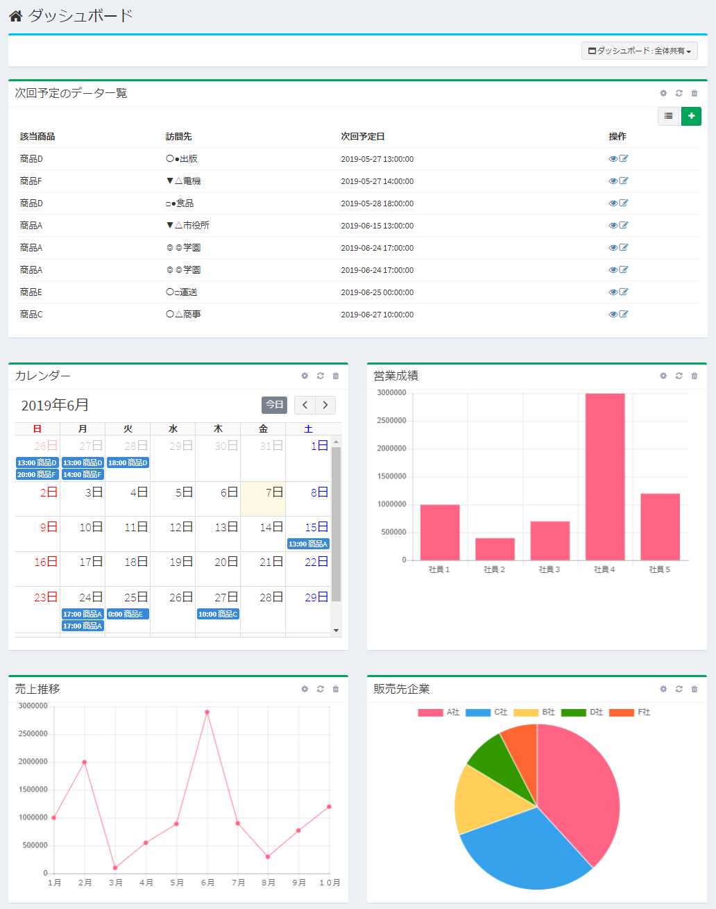

## 대시보드 새로 만들기
1. 대시보드 화면 오른쪽 위에 있는 "대시보드 새로 만들기"를 클릭합니다.
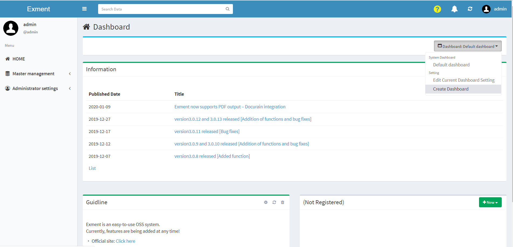

2. 필요한 사항을 설정합니다. 항목의 의미는 아래의 "대시보드의 설정 항목"을 보십시오.  
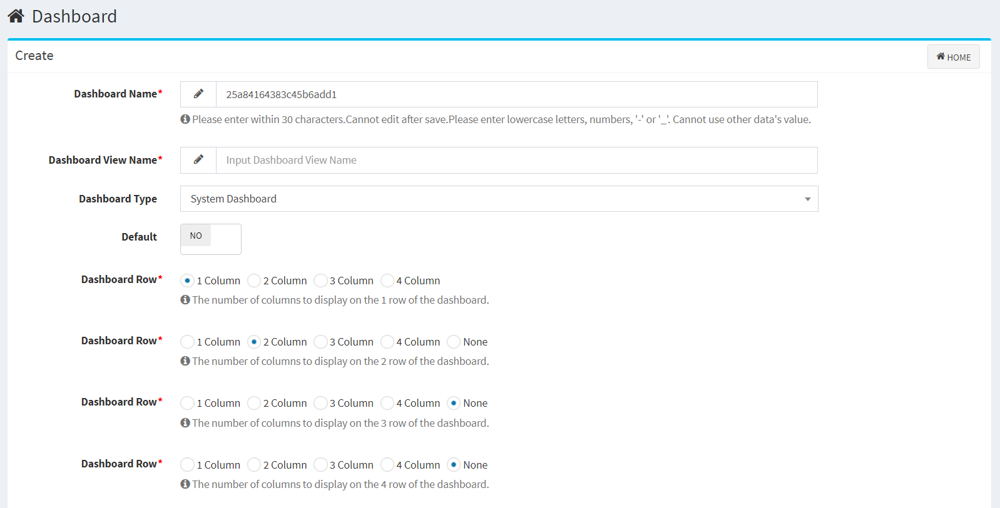

## 대시보드의 설정 항목
#### 대시보드 이름(영숫자)
대시보드의 이름입니다.  
저장한 뒤에는 변경할 수 없습니다.

#### 대시보드 표시 이름
대시보드를 고를 때 화면에 표시하는 이름입니다.  
한글 등도 쓸 수 있습니다. 저장한 뒤에도 변경할 수 있습니다.

#### 대시보드 유형
"시스템 대시보드" "사용자 대시보드" 중 하나를 선택합니다.  

- "시스템 대시보드"  
시스템 관리자만 설정할 수 있습니다. 모든 사용자가 쓸 수 있는 대시보드입니다.  

- "사용자 대시보드"  
시스템 관리자가 아니어도 설정할 수 있습니다. 만든 사용자만 쓸 수 있는 대시보드입니다.    

※"시스템 대시보드"를 나중에 "사용자 대시보드"로 변경할 수는 없습니다.  
**시스템 관리자가 만든 사용자 대시보드**는 나중에 "시스템 대시보드"로 변경할 수 있습니다.  
※[사용자 대시보드 무효](/ko/config)를 설정하면, 일반 사용자는 대시보드를 만들 수 없게 됩니다.

#### 기본값
"YES" "NO" 중 하나를 선택합니다.  
대시보드가 여러 개 있을 때, 대시보드를 열어 처음에 표시되는 것은 "YES"로 한 대시보드입니다.  
※"NO"인 대시보드도 목록에서 선택하면 표시할 수 있습니다.  
※"기본값"을 "YES"로 할 수 있는 것은 대시보드 1개뿐입니다.  
2개 이상의 대시보드에서 "YES"로 하면, 마지막에 "YES"로 한 대시보드 외에는 "NO"로 바뀝니다.

#### 열 수의 선택
대시보드의 각 행에 표시할 열 수를 선택합니다.  
1행에 최대 4열까지 표시할 수 있습니다.  
※열 수를 늘리면, 하나당 표시 면적은 작아집니다.  

#### 대시보드 (n)행 최대 높이(px)
그 행에 표시하는 항목의 최대 높이를 픽셀로 지정합니다. 행마다 설정할 수 있습니다.  
항목의 내용이 이 높이를 넘는 경우에는 항목 안에서 스크롤합니다.  
150~3000의 정수로 입력하십시오. 입력하지 않은 경우에는 400px입니다.

### 1행에 4열을 표시한 예
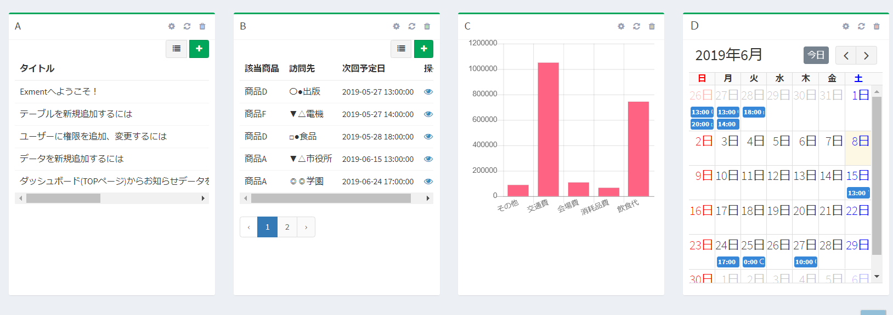  

## 대시보드 필터 설정
대시보드 위쪽에, 모든 차트를 한꺼번에 필터링할 수 있는 "필터 바"를 표시할 수 있습니다.  
지역·상품·담당자 등의 조건마다 뷰를 만들지 않아도, 하나의 대시보드에서 조건을 바꾸어 가며 집계 결과를 확인할 수 있습니다.  
※필터 바의 사용 방법은 [필터 바로 필터링하기](/ko/dashboard?id=필터-바로-필터링하기)를 확인하십시오.

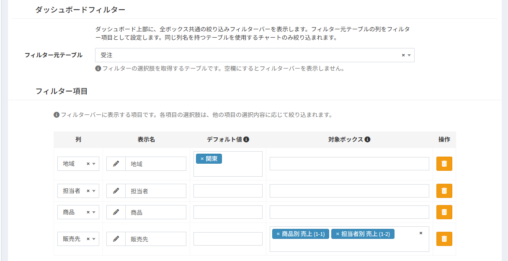

#### 필터 원본 테이블
필터의 선택지를 가져올 테이블을 선택합니다.  
비워 두면 필터 바는 표시되지 않습니다.

#### 필터 항목
필터 바에 표시할 항목을 1행에 1개씩 설정합니다. "만들기"로 행을 늘릴 수 있습니다.

| 설정 | 내용 |
|---|---|
| 열 | 필터 원본 테이블의 열 중에서, 필터링에 쓸 열을 선택합니다. |
| 표시 이름 | 필터 바에 표시할 이름입니다. 비어 있는 경우에는 열 이름을 표시합니다. |
| 기본값 | 대시보드를 열었을 때 처음부터 선택되는 값입니다. 목록에서 고르는 항목은 저장 값을 쉼표로 구분하여, "부터" "까지"의 범위로 지정하는 항목은 "최소~최대" 형식으로 지정합니다(한쪽만 지정할 수도 있습니다). 비어 있는 경우에는 선택하지 않은 상태로 표시합니다. |
| 대상 박스 | 이 필터로 필터링할 차트를 선택합니다. 비어 있는 경우에는 같은 열 이름을 가진 모든 차트가 필터링됩니다. 선택지에는 저장된 차트만 표시되므로, 차트를 추가한 뒤에 설정 화면에서 선택하십시오. |

> 필터로 필터링되는 것은 **필터 항목과 같은 열 이름의 열을 가진 테이블**을 쓰는 차트뿐입니다.  
> 해당하지 않는 차트에는 "필터 적용 대상 아님"이라고 표시됩니다.

> 건수가 많은 테이블에서도 쾌적하게 조작할 수 있도록, 필터 항목에 쓰는 열은 [사용자 정의 열 설정](/ko/column)에서 "검색 인덱스"를 유효하게 하기를 권장합니다.

> [템플릿](/ko/template)으로 대시보드를 내보내기·가져오기 하면, 필터 바의 설정(대상 박스 포함)도 그대로 이어집니다.

# 표시할 항목 선택
만든 대시보드의 각 열 오른쪽 위에 있는 [만들기]에서, 표시하고 싶은 항목을 고릅니다. 항목은 "데이터 목록" "시스템" "차트" "캘린더"의 4가지입니다.  
※[플러그인(대시보드)](/ko/plugin_quickstart_dashboard)을 설치한 경우에는 "플러그인"도 선택할 수 있습니다.

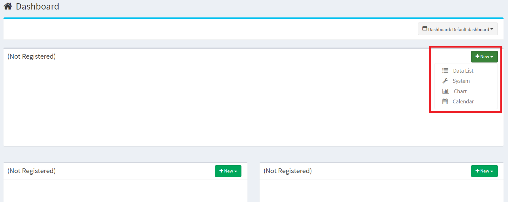  

이 다음, 항목마다 표시할 내용을 설정합니다.

## 데이터 목록
테이블과 뷰를 골라, 그 데이터의 목록을 대시보드에 표시합니다.

### 데이터 목록의 표시 예
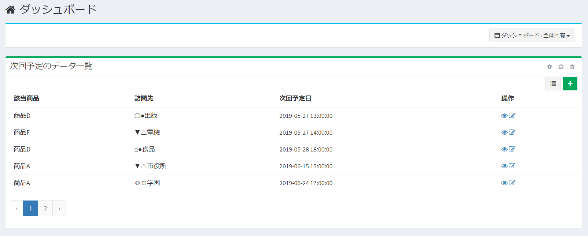

### 데이터 목록의 설정 항목
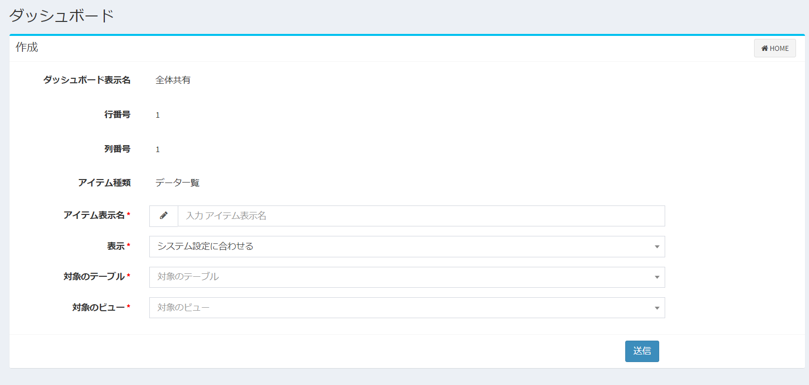
#### 항목 표시 이름
화면에 표시할 항목의 이름을 입력합니다.

#### 표시
한 번에 몇 건의 데이터를 표시할지 선택합니다.

#### 대상 테이블
[사용자 정의 테이블 설정](/ko/table)에서 만들어 둔 테이블 중에서 표시할 대상을 고릅니다.

#### 대상 뷰
선택한 대상 테이블 안에 있는 [뷰](/ko/view) 중에서 표시할 대상을 고릅니다.  
※캘린더 뷰·칸반 뷰·간트 차트 뷰·조건 뷰는 선택할 수 없습니다. 시스템 대시보드의 경우에는 시스템 뷰만 선택할 수 있습니다.  

## 시스템
대시보드에 시스템에 관한 표시를 냅니다.  
※현재는 "가이드라인" "Exment 새 소식 목록" "편집기" "HTML" "알림 목록" "2차원/JAN 바코드"를 표시할 수 있습니다.

### 시스템의 설정 항목
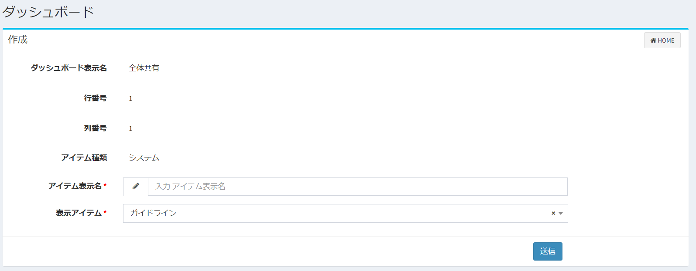

#### 항목 표시 이름
화면에 표시할 항목의 이름을 입력합니다.

#### 표시 항목
표시할 항목을 선택합니다.

- ##### 가이드라인
시스템에 관한 안내를 표시할 수 있습니다.  
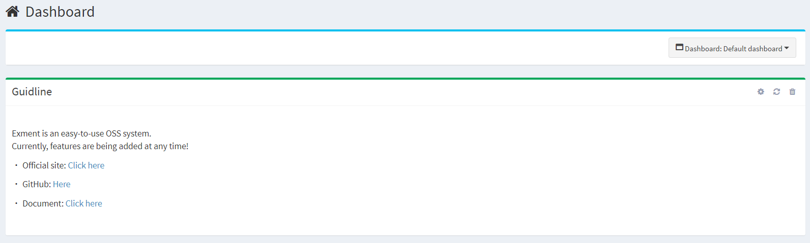

- ##### Exment 새 소식 목록
Exment 공식 사이트에서 새 소식을 가져와 표시합니다.
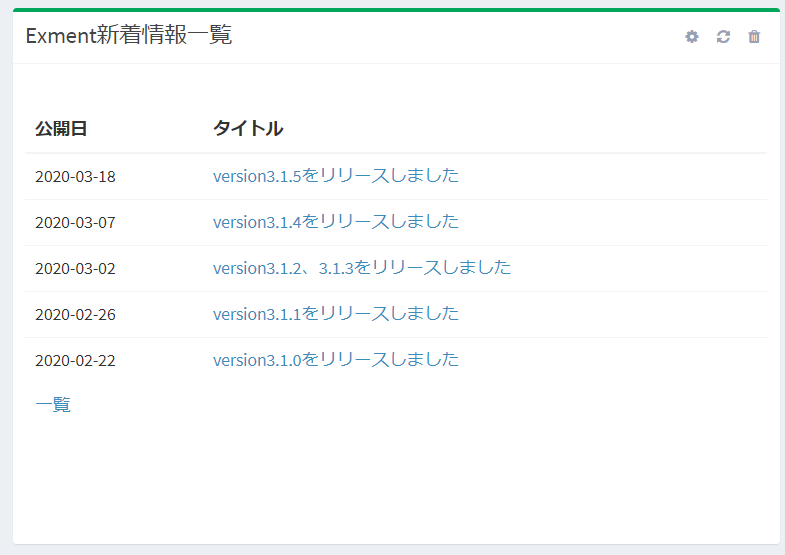

- ##### 편집기
자유롭게 본문을 입력하여 화면에 표시합니다.
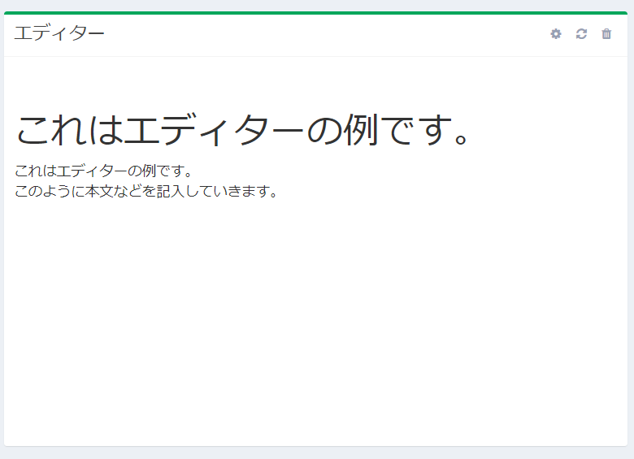

- ##### HTML
HTML 형식으로 내용을 입력하여 화면에 표시합니다. ※스크립트도 실행됩니다.
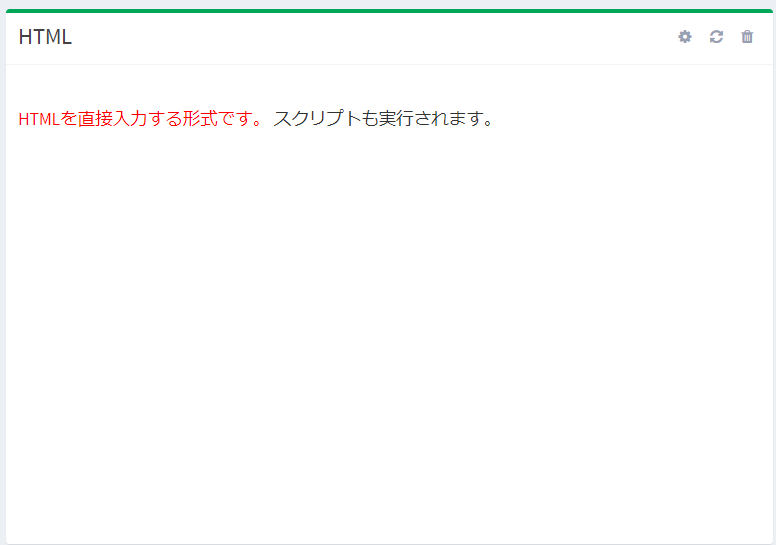

- ##### 2차원/JAN 바코드
2차원/JAN 바코드 읽기 버튼을 표시합니다.  
"2차원/JAN 바코드 읽기" 버튼의 "2차원/JAN 바코드"라는 표시 이름을 .env 파일의 "EXMENT_TEXT_SCAN_BUTTON_JA/EN"으로 변경할 수 있습니다.  

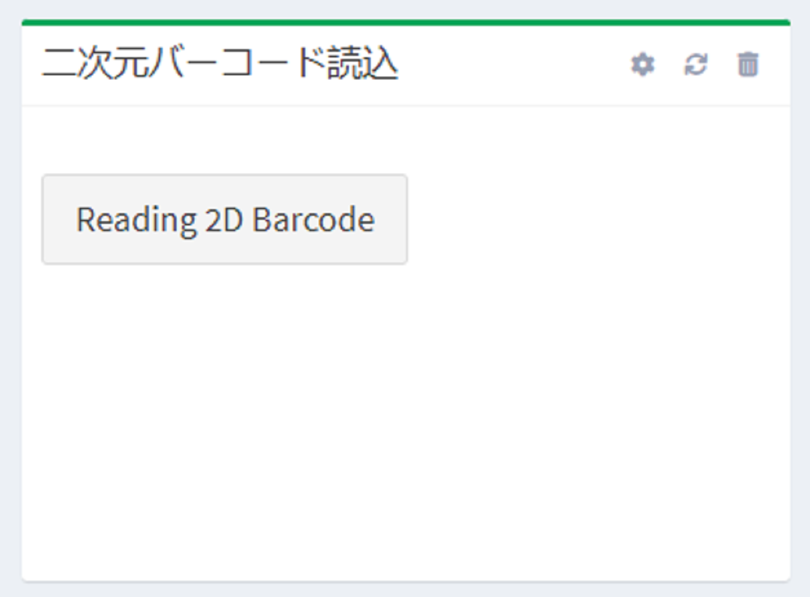

## 차트
Exment의 뷰(뷰·전체 데이터 뷰·집계 뷰 등)의 데이터를 그래프로 만들어 대시보드에 표시합니다. 그래프는 막대 차트·꺾은선 차트·원형 차트를 비롯하여 18가지가 있습니다.  
표시 중인 그래프는 화면 위에서 종류의 전환·필터링·정렬 등을 할 수 있습니다([대시보드의 조작](/ko/dashboard?id=대시보드의-조작)).  
※자세한 내용은 [차트 설정 내용](/ko/dashboard?id=차트-설정-내용)을 확인하십시오.

### 막대 차트의 표시 예

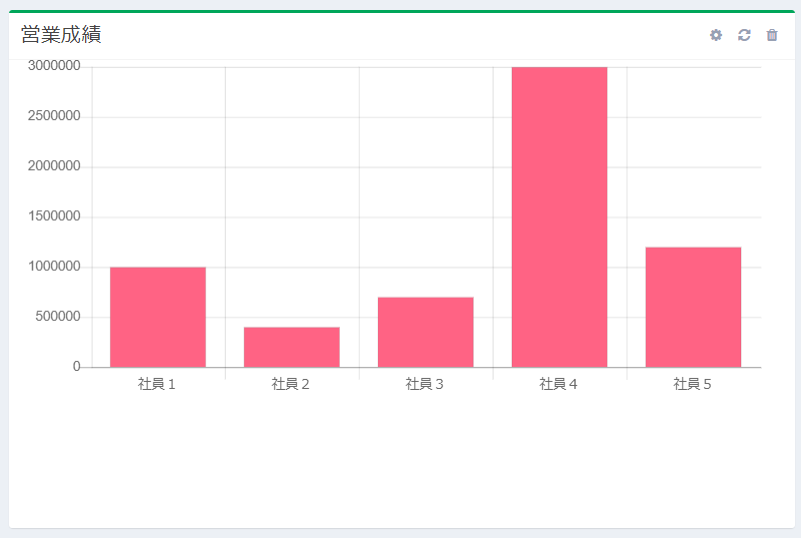

### 꺾은선 차트의 표시 예  
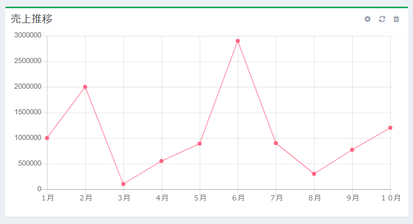

### 원형 차트의 표시 예
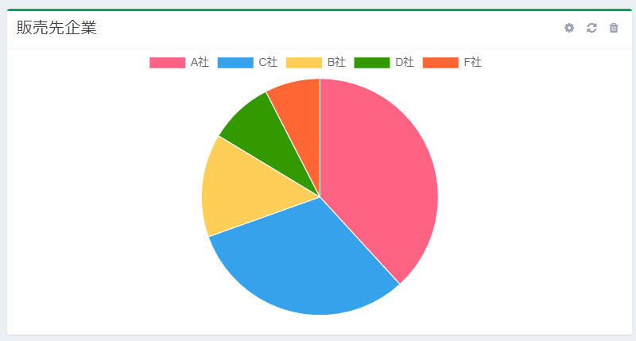

### 차트의 설정 항목
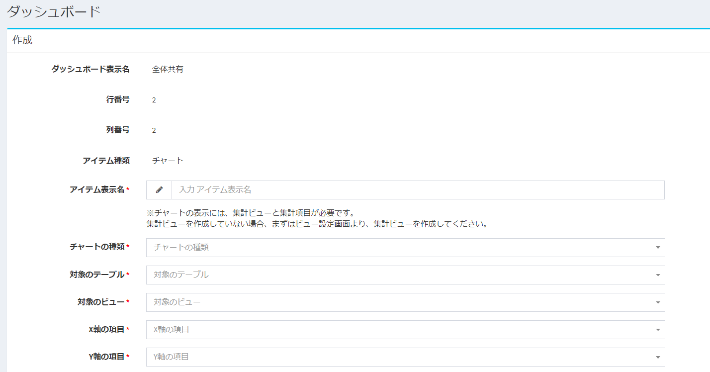

#### 항목 표시 이름
화면에 표시할 항목의 이름을 입력합니다.

#### 차트 유형
아래의 18가지 중에서 그래프의 종류를 1개 선택합니다.

| 분류 | 그래프의 종류 |
|---|---|
| 기본 | 막대 차트, 꺾은선 차트, 원형 차트 |
| 단일 계열 | 가로 막대 차트, 영역 차트, 도넛 차트, 레이더 차트, 깔때기 차트, 게이지, 산점도 |
| 다중 계열 | 그룹 막대 차트, 누적 막대 차트, 다중 꺾은선 차트, 히트맵, 누적 영역 차트, 트리맵, 선버스트, 상자 수염 그림 |

"다중 계열"의 그래프는 가로축의 항목마다 여러 계열을 표시합니다(예: 월별 매출을 상품별로 표시).

다중 계열의 그래프를 쓰려면, 집계 뷰를 2열 이상으로 그룹화해야 합니다. 그룹 열 중 [계열 항목](/ko/dashboard?id=계열-항목（다중-계열）)에서 선택한 열(기본은 2번째 열)이 계열, 그 밖의 첫 열이 가로축이 됩니다.

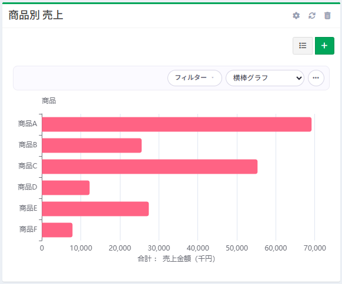

가로 막대 차트

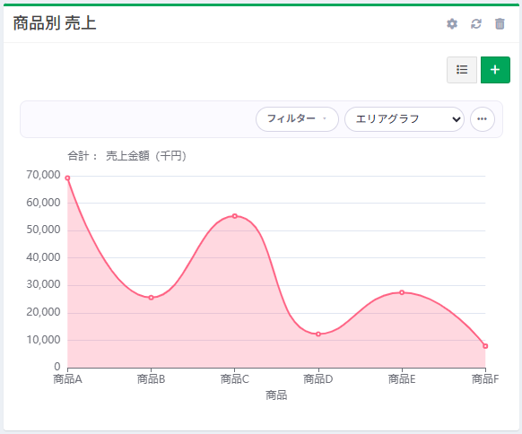

영역 차트

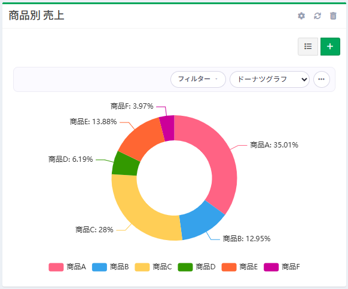

도넛 차트

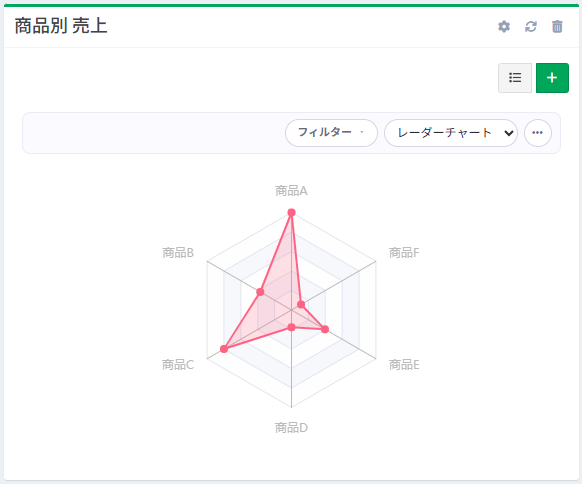

레이더 차트

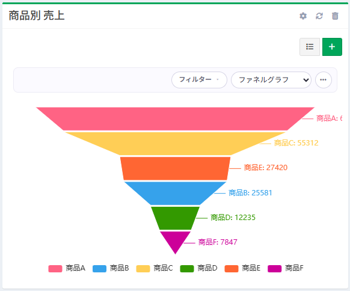

깔때기 차트

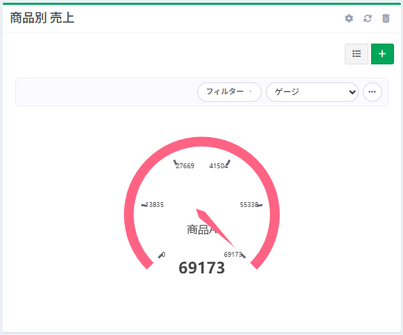

게이지

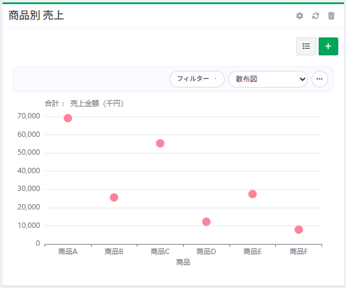

산점도

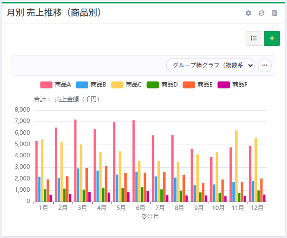

그룹 막대 차트

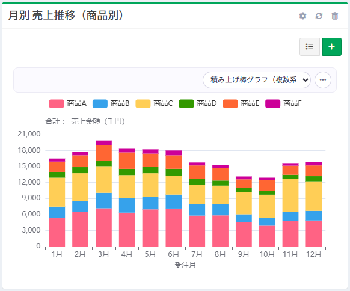

누적 막대 차트

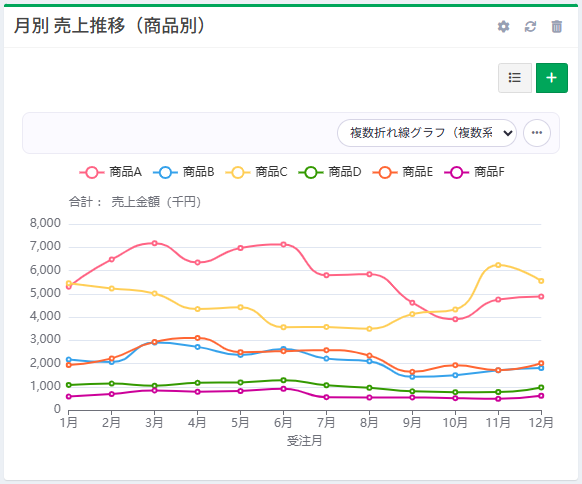

다중 꺾은선 차트

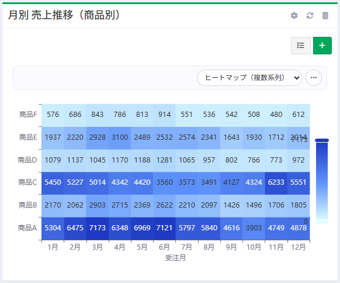

히트맵

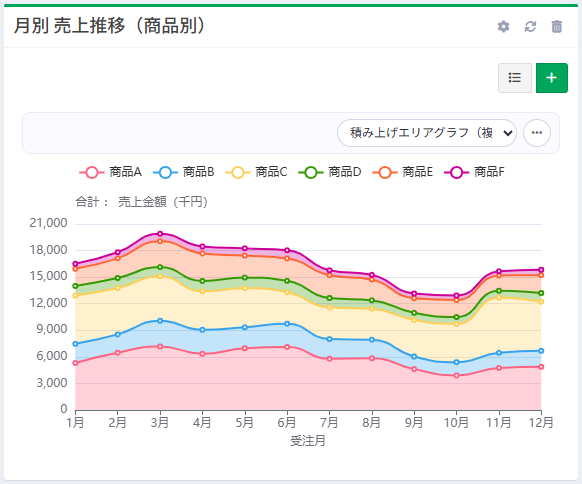

누적 영역 차트

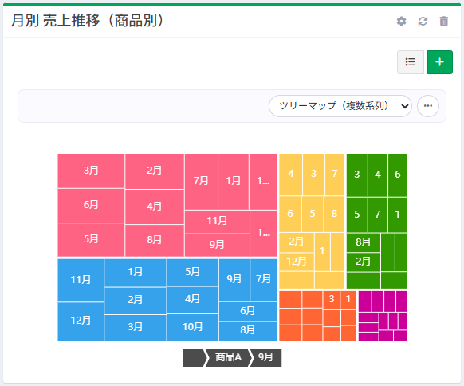

트리맵

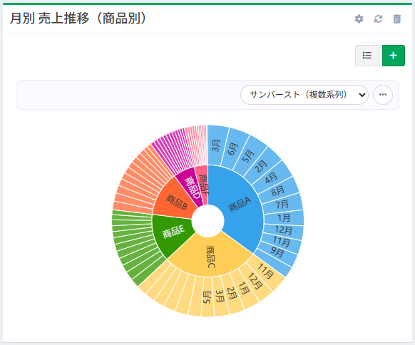

선버스트

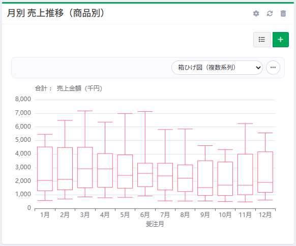

상자 수염 그림

#### 대상 테이블
[사용자 정의 테이블 설정](/ko/table)에서 만들어 둔 테이블 중에서 표시할 대상을 고릅니다.  
※열람 권한이 있는 테이블이 선택지로 표시됩니다.

#### 대상 뷰
선택한 대상 테이블 안에 있는 뷰(뷰·전체 데이터 뷰·집계 뷰 등) 중에서 표시할 대상을 고릅니다.  
※캘린더 뷰·칸반 뷰·간트 차트 뷰·조건 뷰는 선택할 수 없습니다. 시스템 대시보드의 경우에는 시스템 뷰만 선택할 수 있습니다.  
※다중 계열의 그래프를 쓰는 경우에는 집계 뷰를 선택하십시오.  

#### X축 항목
그래프로 표시할 X축(가로축)을 선택합니다.  
※자세한 내용은 [차트 설정 내용](/ko/dashboard?id=차트-설정-내용)을 확인하십시오.  

#### Y축 항목
그래프로 표시할 Y축(세로축)을 선택합니다.  
※자세한 내용은 [차트 설정 내용](/ko/dashboard?id=차트-설정-내용)을 확인하십시오.  

#### 계열 항목（다중 계열）

다중 계열의 그래프를 선택한 경우에만 표시되는 설정입니다.

집계 뷰의 그룹 열 중에서 계열로 쓸 열을 선택합니다. 선택하지 않은 경우에는 2번째 그룹 열이 계열이 됩니다.

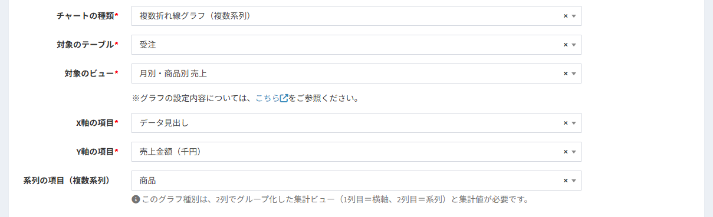

#### 차트 필터 항목

이 차트만 필터링하기 위한 열을 선택합니다. 여러 개 선택할 수 있습니다.

선택한 열은 차트의 **필터** 버튼에서 필터링에 쓸 수 있습니다([차트 필터로 필터링하기](/ko/dashboard?id=차트-필터로-필터링하기)).

열을 선택하지 않는 경우, **필터** 버튼은 표시되지 않습니다.

#### 그래프 종류에 따른 그 밖의 옵션

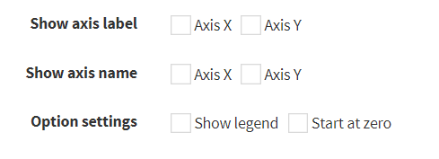

선택한 옵션이 그래프에 반영됩니다.

※**축 레이블 표시**, **축 이름 표시**, **0부터 시작**은 막대 차트·꺾은선 차트에서만 쓸 수 있습니다.

## 캘린더
Exment의 캘린더 뷰의 데이터를 대시보드에 표시합니다. 표시 형식은 "월별" "목록"의 2가지 중에서 고를 수 있습니다.
>표시되는 문구는 [제목 표시 열 설정](/ko/table)에서 변경할 수 있습니다.

### 월별의 표시 예
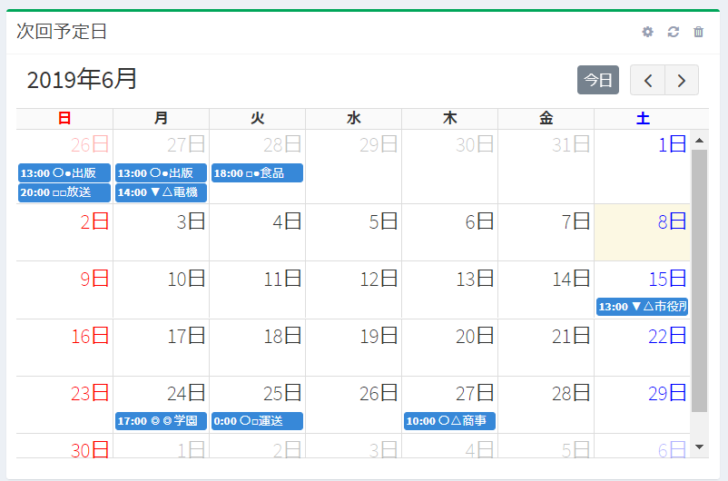  

### 목록의 표시 예
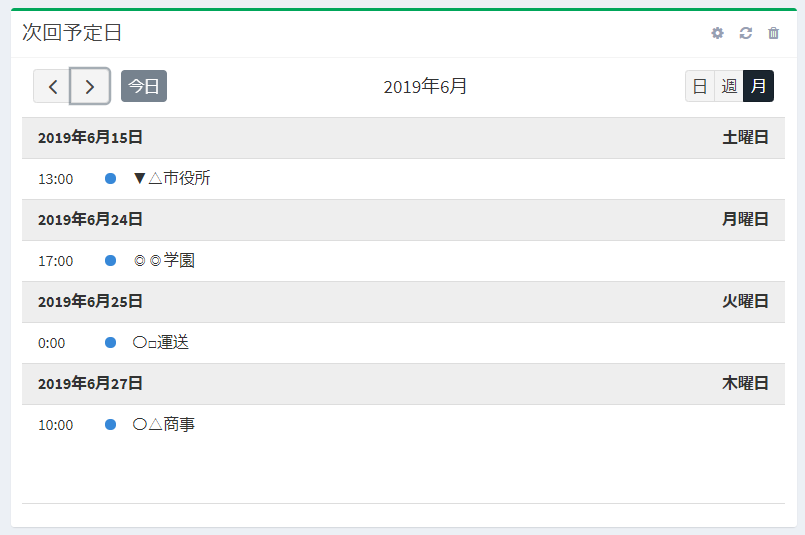  

### 캘린더의 설정 항목

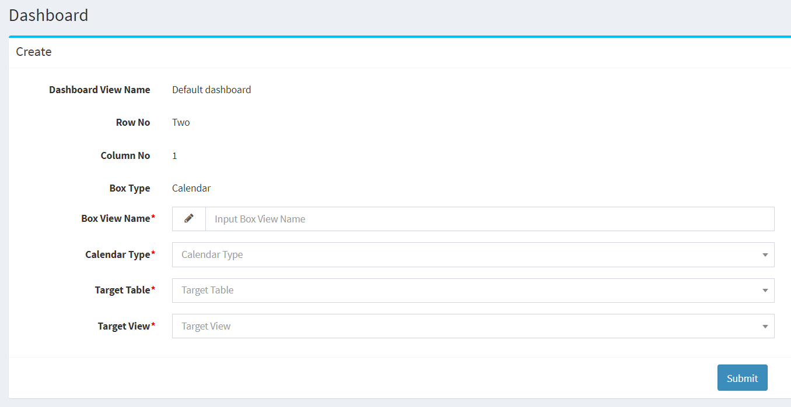  

#### 항목 표시 이름
화면에 표시할 항목의 이름을 입력합니다.

#### 캘린더 유형
"월별" "목록"의 2가지 중에서 표시하고 싶은 캘린더를 고릅니다.

#### 대상 테이블
[사용자 정의 테이블 설정](/ko/table)에서 만들어 둔 테이블 중에서 표시할 대상을 고릅니다.  
※캘린더 뷰를 설정한 테이블만 선택지로 표시됩니다.

#### 대상 뷰
선택한 대상 테이블 안에 있는 캘린더 뷰 중에서 표시할 대상을 고릅니다.  

## 차트 설정 내용
차트(그래프)의 X축, Y축에서 고를 수 있는 항목은 대상 뷰의 종류에 따라 달라집니다.  

### 대상 뷰가 전체 데이터 뷰, 표준 뷰인 경우

#### X축 항목
X축의 선택지에는 아래의 2가지가 표시됩니다. 어느 하나를 선택하십시오.

- "차트 레이블" 항목.  
  

선택하면, [사용자 정의 테이블 설정의 제목 표시 열 설정](/ko/table)이 X축에 표시됩니다.  

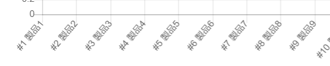  

- [사용자 정의 뷰 설정의 "표시 열 선택"](/ko/view)에 표시되어 있는 항목. 선택하면, 선택한 열의 값이 X축에 표시됩니다.  
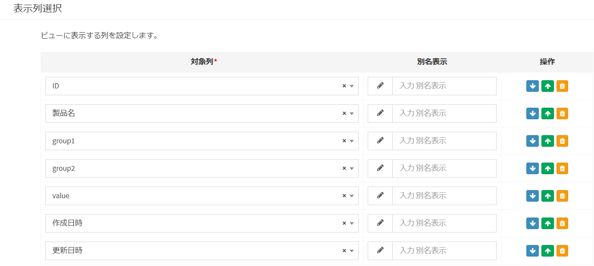  

#### Y축 항목
Y축의 선택지에는 아래의 1가지가 표시됩니다. 어느 하나를 선택하십시오.

- [사용자 정의 뷰 설정의 "표시 열 선택"](/ko/view)에 표시되어 있는 항목 중 아래의 열 종류. 선택하면, 선택한 열의 값이 Y축에 표시됩니다.
    - 정수
    - 소수
    - 통화

### 대상 뷰가 집계 뷰인 경우

#### X축 항목
X축의 선택지에는 아래의 1가지가 표시됩니다.

- "차트 레이블" 항목.  
  

선택하면, [사용자 정의 뷰 설정의 "그룹 열 선택"](/ko/view)에서 설정한 값이 X축에 표시됩니다.  
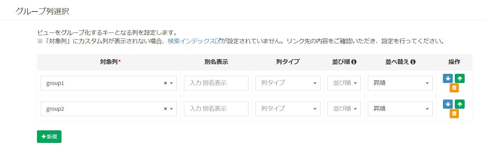  
  

#### Y축 항목
Y축의 선택지에는 아래의 2가지가 표시됩니다. 어느 하나를 선택하십시오.

- [사용자 정의 뷰 설정의 "그룹 열 선택"](/ko/view)에 표시되어 있는 항목 중 아래의 열 종류. 선택하면, 선택한 열의 값이 Y축에 표시됩니다.
    - 정수
    - 소수
    - 통화

  

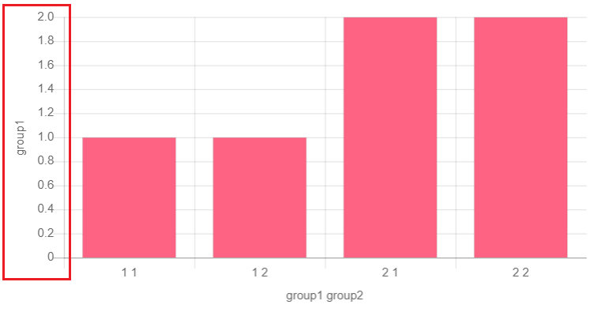  

- [사용자 정의 뷰 설정의 "집계 열 선택"](/ko/view)에 표시되어 있는 항목. 선택하면, 선택한 열의 값이 Y축에 표시됩니다.

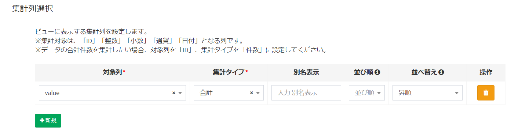  

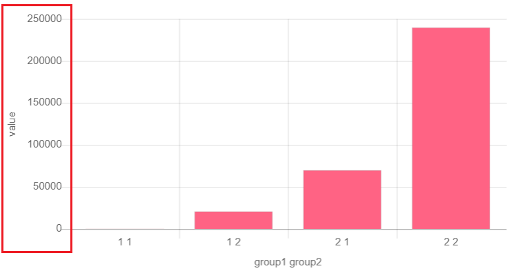  

## 대시보드의 공유
만든 대시보드를 다른 사용자·조직에 공유합니다.  
※공유할 수 있는 것은 "사용자 대시보드"뿐입니다. ("시스템 대시보드"는 처음부터 모든 사용자에게 공개되어 있습니다.)  

#### 공유 방법
1. 대시보드의 설정 변경 화면의 "공유" 버튼을 클릭합니다.  
※새로 만들 때는 이 버튼이 표시되지 않습니다.
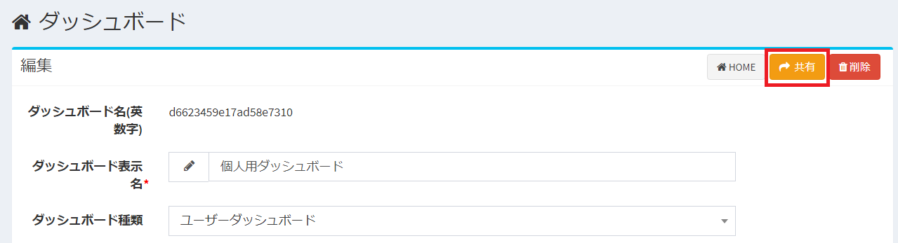

2. 대시보드의 공유 대화 상자가 표시됩니다.
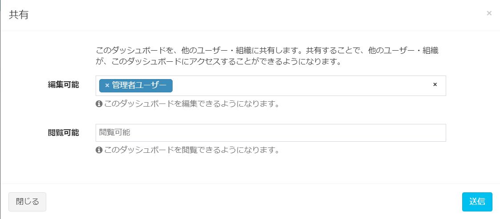

3. 공유하고 싶은 사용자 또는 조직을 추가하고, "전송"을 클릭합니다. 이것으로 공유할 수 있습니다.  
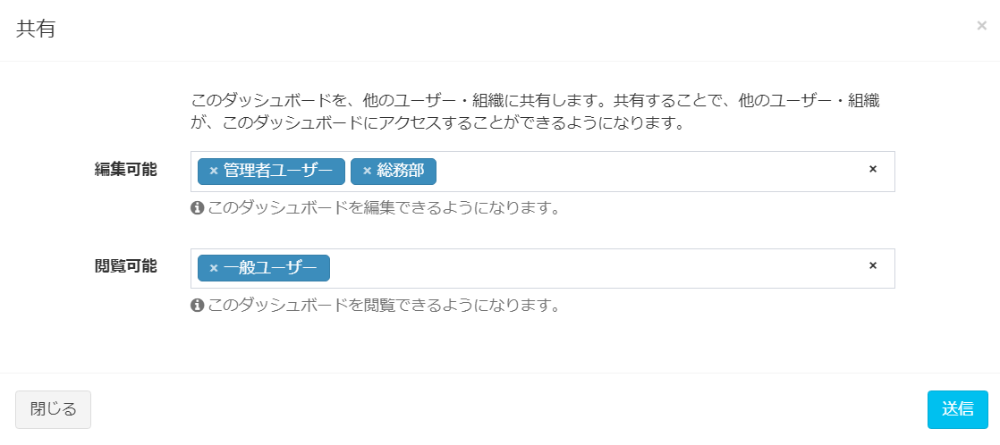  

# 대시보드의 조작

대시보드 위에서 차트의 필터링, 그래프 종류의 전환, 데이터의 정렬을 할 수 있습니다. 색의 변경을 빼고, 이 조작들로 대시보드의 설정, 차트의 설정, 데이터는 변경되지 않습니다.

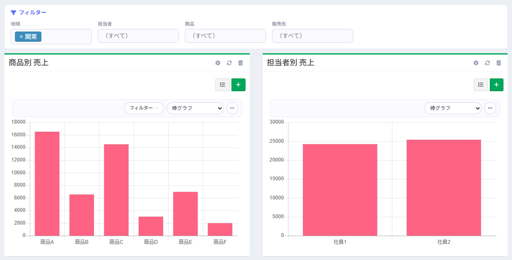

| 조작 | 할 수 있는 일 | 대상 |
|---|---|---|
| [필터 바](/ko/dashboard?id=필터-바로-필터링하기) | 대시보드 위의 차트를 한꺼번에 필터링합니다 | 대시보드 전체 |
| [그래프의 클릭](/ko/dashboard?id=그래프를-클릭하여-필터링하기) | 클릭한 값을 필터 바에서 선택합니다 | 대시보드 전체 |
| [차트 필터](/ko/dashboard?id=차트-필터로-필터링하기) | 차트 1개만 필터링합니다 | 차트 단위 |
| [그래프 종류의 전환](/ko/dashboard?id=그래프의-종류-전환하기) | 같은 데이터를 다른 종류의 그래프로 표시합니다 | 차트 단위 |
| ["⋯" 메뉴](/ko/dashboard?id=⋯-메뉴) | 정렬, 데이터 레이블의 표시, 데이터 내보내기를 합니다 | 차트 단위 |
| [색의 변경](/ko/dashboard?id=그래프의-색-변경하기) | 막대·부채꼴 등의 색을 변경합니다 | 차트 단위 |

## 필터 바로 필터링하기

[대시보드 필터 설정](/ko/dashboard?id=대시보드-필터-설정)을 하면, 대시보드 위쪽에 필터 바가 표시됩니다.

필터 바에서 값을 선택하면, 그 필터의 대상인 모든 차트에 같은 조건이 적용됩니다.

※필터 원본 테이블의 열람 권한이 없는 사용자에게는 필터 바가 표시되지 않습니다.

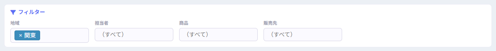

#### 값 선택하기

필터 항목을 클릭하고, 목록에서 값을 선택합니다. 여러 값을 선택할 수 있습니다.

다른 필터에서 값을 선택하면, 목록에는 그 조건에 해당하는 데이터가 있는 값만 표시됩니다. 예를 들어 "지역"에서 "간토"를 선택하면, "담당자"에는 간토의 담당자만 표시됩니다.

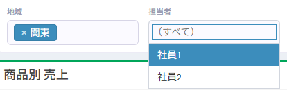

날짜·일시 열은 목록이 아니라 "부터" "까지"의 범위로 지정합니다. 숫자 열도 선택지가 너무 많은 경우에는 범위로 지정하게 됩니다.

> 선택지가 너무 많아 표시할 수 없는 경우에는, 먼저 다른 필터에서 값을 선택하여 좁히십시오.

#### 필터링 해제하기

"초기화"를 클릭하면 [기본값](/ko/dashboard?id=필터-항목)의 상태로 돌아갑니다.

기본값을 설정하지 않은 경우에는 모든 필터링이 해제됩니다.

#### 필터 적용 대상이 아닌 차트

필터 바의 영향을 받지 않는 차트에는 "필터 적용 대상 아님", 일부 필터 항목이 적용되지 않는 차트에는 "적용되지 않는 필터"라고 표시됩니다.

선택한 필터가 표시 중인 데이터에 어떻게 반영되어 있는지를 확인할 수 있습니다.

> 필터링의 조건은 URL에 유지됩니다. 브라우저의 "뒤로" "앞으로"로 이전의 조건으로 되돌릴 수 있습니다. 또한 URL을 공유하면, 같은 조건의 대시보드를 다른 사용자에게 보여 줄 수 있습니다.

> 마지막으로 선택한 조건은 사용자마다 기억되어, 다음에 대시보드를 열었을 때도 같은 조건으로 표시됩니다.

## 그래프를 클릭하여 필터링하기

그래프의 막대·부채꼴 등을 클릭하면, 그 값이 필터 바에서 선택되어 다른 차트가 필터링됩니다.

클릭한 차트는 모든 값을 표시한 채로, 선택한 값을 진하게, 그 밖의 값을 연하게 표시합니다.

| 조작 | 결과 |
|---|---|
| 값을 클릭 | 그 값만 선택합니다. |
| 선택 중인 값(그 값만 선택하고 있는 경우)을 다시 한 번 클릭 | 선택을 해제합니다. |
| Ctrl(Mac은 ⌘)을 누른 채로 클릭 | 값을 추가로 선택합니다. 이미 선택한 값을 클릭한 경우에는 그 값만 선택에서 뺍니다. |

※그래프의 가로축 열이 필터 바의 항목에 포함되어 있는 경우에 쓸 수 있습니다.  
※집계 뷰의 차트에서 쓸 수 있습니다. 가로축의 열이 "부터" "까지"의 범위로 지정하는 항목(날짜 열 등)이나 여러 개 선택하는 열인 경우에는 쓸 수 없습니다.  
※레이더 차트·게이지·트리맵·선버스트·상자 수염 그림에서는 쓸 수 없습니다.  
※필터 바에서 값을 선택한 경우, 가로축이 그 필터 항목에 대응하는 차트는 필터링되지 않고, 선택한 값이 강조 표시됩니다.

## 차트 필터로 필터링하기

차트 필터는 그 차트에만 적용됩니다. 다른 차트에는 영향을 주지 않습니다.

차트에 [차트 필터 항목](/ko/dashboard?id=차트-필터-항목)을 설정하면, 차트 오른쪽 위에 "필터" 버튼이 표시됩니다.

"필터"를 클릭하고, 표시하고 싶은 값을 선택합니다.

버튼에는 필터링 중인 항목 수가 표시됩니다. "초기화"를 클릭하면 차트 필터의 조건이 해제됩니다.

선택지가 8건을 넘는 경우에는 목록 위에 검색란이 표시되어, 원하는 값을 찾을 수 있습니다.

날짜·일시 열은 목록이 아니라 "부터" "까지"의 범위로 지정합니다. 숫자 열도 선택지가 너무 많은 경우에는 범위로 지정하게 됩니다.

※차트 필터는 필터 바와 함께 쓸 수 있습니다. 그 경우에는 양쪽의 조건으로 필터링됩니다.  
※차트 필터의 선택은 페이지를 다시 읽어 들이면(F5) 해제됩니다.

## 그래프의 종류 전환하기

차트 오른쪽 위의 그래프 종류 선택란에서, 같은 데이터를 다른 종류의 그래프로 표시할 수 있습니다.

선택한 그래프의 종류는 사용자마다 기억되어, 다음에 대시보드를 열었을 때도 같은 종류로 표시됩니다.

원래 그래프의 종류를 다시 고르면, 전환이 해제되어 원래의 종류로 돌아갑니다.

※단일 계열의 그래프는 단일 계열의 그래프끼리, 다중 계열의 그래프는 다중 계열의 그래프끼리만 전환할 수 있습니다. 예를 들어, 막대 차트는 도넛 차트나 산점도로 전환할 수 있지만, 누적 막대 차트(다중 계열)로는 전환할 수 없습니다.

## ⋯ 메뉴

차트 오른쪽 위의 "⋯"를 클릭하면 메뉴가 표시됩니다.

| 메뉴 | 내용 |
|---|---|
| 정렬 기준 | 가로축의 항목 또는 값으로, 오름차순·내림차순으로 정렬합니다. |
| 데이터 레이블 | 막대나 점 등의 위에 값을 표시합니다. 막대 차트·꺾은선 차트·원형 차트·가로 막대 차트·영역 차트·산점도·그룹 막대 차트·누적 막대 차트·다중 꺾은선 차트·누적 영역 차트에서만 표시됩니다. |
| 데이터 내보내기 | 표시 중인 데이터를 CSV 파일로 다운로드합니다. |
| 색 초기화 | 변경한 색을 원래대로 되돌립니다. 색을 변경할 수 있는 사용자에게, 색을 변경한 경우에만 표시됩니다. |
| 초기화 | 정렬과 데이터 레이블을 원래의 설정으로 되돌립니다. |

※정렬과 데이터 레이블의 설정은 사용자마다 기억됩니다.  
※표시할 수 있는 메뉴 항목이 없는 차트에는 "⋯"가 표시되지 않습니다.

## 그래프의 색 변경하기

대시보드의 편집 권한이 있는 사용자는 그래프의 막대·부채꼴 등을 오른쪽 클릭하여 색을 변경할 수 있습니다.

"테마 색" "표준 색" 중에서 고르거나, "다른 색..."으로 임의의 색을 지정합니다. "자동"을 고르면 원래의 색으로 돌아갑니다.

막대 차트·원형 차트 등은 막대·부채꼴마다 색을 변경할 수 있습니다. 꺾은선 차트·영역 차트 등 1가지 색으로 그리는 그래프나 다중 계열의 그래프는 계열마다 색을 변경할 수 있습니다.

"다른 색..."을 고르면, 임의의 색을 지정할 수 있는 팔레트가 열립니다.

팔레트를 클릭하거나, RGB의 값을 입력합니다. ↕로 HSL·HEX의 입력으로 전환할 수 있습니다. "확인"을 클릭하면 색이 반영됩니다.

※변경한 색은 차트의 설정에 저장되어, 모든 사용자에게 같은 색으로 표시됩니다.  
※열람만 하는 사용자는 색을 변경할 수 없습니다.  
※히트맵·상자 수염 그림은 색의 변경을 지원하지 않습니다.
